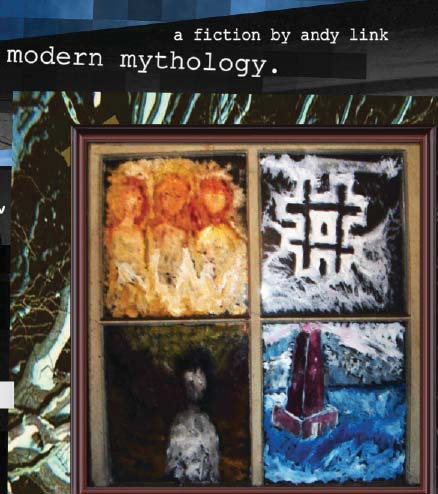
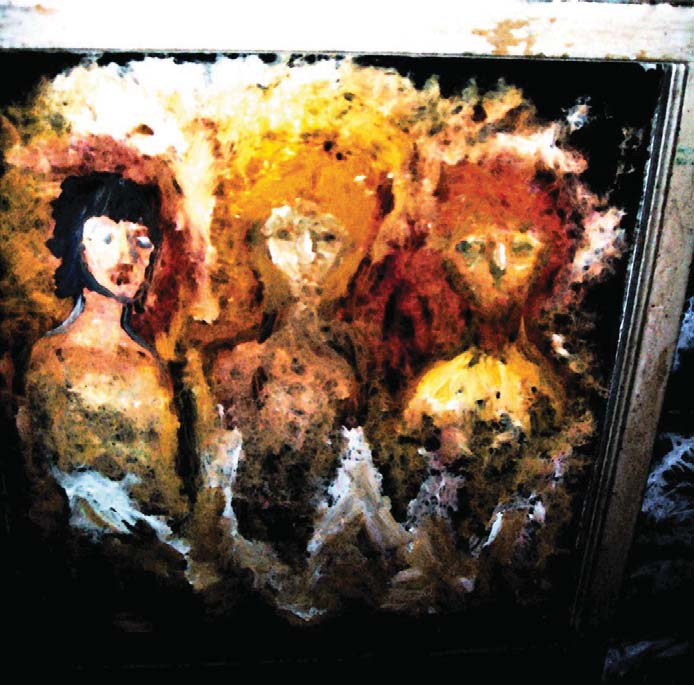
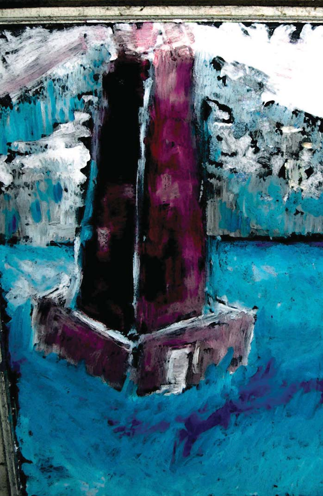

# Volume I — Faust 3

*Modern Mythology* (2010) — restored text for the visual novel. Register: **night-city Americana**. Source pages 1–87 (PDF page index; printed folio = index + 1).

> Already adapted in the Godot build: pp 3–52 (marked ✓ below). Everything after is new material for the game.

Conventions: `<!-- p.N -->` page anchors · **CUE** speaker lines · `####` sluglines · `> [[RECOVERED …]]` text transcribed from the page image · fenced `:::expansion` blocks are new connective material (not in the 2010 book) — keep, cut or rewrite.

---

<!-- p.1 -->

*Plate: Cover — four-panel painting, "modern mythology. a fiction by andy link"*

<!-- p.2 -->

*Plate: Title plate — three figures (painting)*

<!-- p.3 ✓ -->
modern mythology.  

a fiction by andy link  

copyright 2010. andy link all rights reserved. any part of this publication may be reproduced, or transmitted by voice, light, thought and matter across time and space through any medium physical, temporal and/or philosophical dimension by express permission of the copyright holder.  

names and places of real people are used with the express intent of entertaining an audience in a fictional capacity. any confusion with reality is your own damn fault. any characters, real or otherwise, harmed in the act of creation are the sole responsibility of andy link. any emotions you feel as a result of this fiction are wholly yours to own and contemplate. any works inspired by modern mythology are going to be loved by modern mythology as the works that inspired modern mythology are loved. any bastard fictional children or offspring are entirely in the care of their individual creators. andy link accepts only the creations herein as his own, or as determined by a paternity test.  

this digital first edition is special to the few who find and cherish it. share it how you will, as it may change because change is coming and there's nothing you can do to stop it.  

fly not fall.  

a chainlinkspiral production of a oneironautics endeavor.

<!-- p.4 ✓ -->
Introduction:  

THE WRITER (nervously)  
A moment ago I was debating whether or not to begin and here I am starting something I should never finish.  

THE ARTIST (comfortable)  
There comes a time in life when pieces click in place good and bad chambers of existence line up just so showing both the way and every single misstep ever taken specifically on purpose pressed in prehistoric mud so long gone yet still to come for ancestor gawkers to stumble cross centuries later and find mute satisfaction  

THE HUMAN BEING (sitting with a book)  
The days gone by dry up crackle and flake.  

THE ARTIST (obsessive)  
I scrub my kitchen learning textures of surface

<!-- p.5 ✓ -->
peel back what used to be A late-life thirst for me; finally recognized mine own contribution to grime and soil accumulates just under sight.  

THE HUMAN BEING (drunk sick and hugging the toilet)  
I was put here for reasons perhaps to leave prints etch an owned existence into this second-hand tapestry.  

**THE WRITER**  
Maybe I have a reason to-  

**THE ARTIST**  
To?  

**THE HUMAN BEING**  
-To be.  

THE ARTIST (playing video games)  
Sin accounted for washed up from having borrowed so much against a name that means little much last living male branch - should fashion a wand from that.  

THE HUMAN BEING (dressing in a waiter's uniform) I hold Link in highest esteem worn with certain pride, to pay back

<!-- p.6 ✓ -->
and then some (father's) handsomely.  

THE WRITER (in a cafe with friends drinking chai)  
But what I know about myself is an utter fiction fabricated by myself and others to make this new reality come to pass.  

Cut to: The Players celebrating, wrapping up their success.  

THE ARTIST (toasting them)  
A conspiracy of beautiful dreamers yet a conspiracy no less.  

**A PLAYER**  
At least we're upfront.  

THE HUMAN BEING (making tamales, with flashes to:)  
I work towards the good if such a term gives any meaning -true- to you certainly me but my good a construct of culture a childhood of cartoons video games movies comic books sports nature library books travel friendships rivalries all with fierce science- fiction

<!-- p.7 ✓ -->
clarity.  

Images of various cultural stepping-stones and highlights. George Lucas, Jim Henson, et all.  

THE WRITER (waiting in line for a movie)  
A beautiful mythology built just for me hired hands and artisans giving up on dreams to birth collective dreams within dreams.  

DD (standing in line)  
All so very meta.  

THE HUMAN BEING (writing a letter)  
To all: Sorry for my protracted childhood and adolescence still doing my best to make up for it.  

**THE WRITER**  
Teachers taught me well enough. I loved them most like second parents.  

**THE DIRECTOR**  
I always hurt my tutors by never being good enough for failing when they had so much invested in me at just that crucial moment.  

**THE HUMAN BEING**  
I saw our futures I choked to them I apologize

<!-- p.8 ✓ -->
all that on me.  

**THE DIRECTOR**  
They gave so much and hoped I could give back so little.  

**THE HUMAN BEING**  
Things taught to me by them left-handed unusual very tall big feet bright and kind.  

**THE DIRECTOR**  
This is unusual.  

**THE WRITER**  
Everything about me looking back seemed unusual.  

**THE HUMAN BEING**  
In both the majority and minority of who I was and who I was.  

**THE DIRECTOR**  
I don't know what I've become- just know that I am.  

**THE HUMAN BEING**  
I am a nerd that needs looking after. I have lovely friends and family. I try to repay their love.  

**THE ARTIST**  
But I slip in small ways I gaze off into far corners of things lose myself at the world inside my head

<!-- p.9 ✓ -->
**THE HUMAN BEING**  
I fear how I function when left like this.  

**THE DIRECTOR**  
My father just like me in such different ways.  

**THE HUMAN BEING**  
The hardest thing about losing him was becoming him.  

**THE ARTIST**  
Self-doubt would have crippled me instead ordered chaos electric static sandstorm booted this operating system this great battle whirclicking inside me accelerates something crushing something so damned high I lose myself in art find beauty in friendship family found eternal connection in everyday existence.  

**THE DIRECTOR**  
Can't unsee what's seen not to bemoan I try to step up and carry that weight.  

TEXT: (Every day you gift yourself so please thank the stars and the moon and the sun -I- thank you sun and moon and stars.)  

**THE WRITER**  
My thanks trickles down rests here on books examined eye straining existential dread untold delights library books by the armful

<!-- p.10 ✓ -->
transparent clear skinned  
shrink-wrapped from future tense  
tomes of forgotten lore  
history repeating itself  
within fictional allegory  
arts and crafts; horrors and hobbies  
all books look the same  
(though good design, hardly lost on me)  
judging by the cover  
fresh new bleached through  
razor blade pages slick enough-  
slit and scar an impressionable age.  

#### INSERT:

(The good kind of hurt:  
A synesthetic compound of bacon cinnamon buns  
sedated cavity- filling smell and taste of drilled tooth  
little-league grand slam compounded by  
Super Mario Bros. 3 tanooki suit  
four in the am escapades.)  

**THE DIRECTOR**  
When we create  
starting from scratch  
the mind pauses  
as if to contemplate  
its own worthwhile capacity  
and determine whether or not  
it is eager for the task.  

**THE HUMAN BEING**  
As it has been with everything  
come before it will hold true  
for everything to come.  

**THE WRITER**  
Writing  
like any and all creation  
is of the present  
yet my mind tends to reside not with myself  
but with my audience

<!-- p.11 ✓ -->
in many a hypothetical future tense  
or deep in the past  
communing with ancient and long dead  
voice of genius I see fit to cozy up to  
a child auditioning for parental approval  
content I am to put words to paper  
or whatever medium exists to transmit  
naked thoughts into naked flesh  
suppose I stand before you  
bereft of all but the barest sense of self  
and purpose.  

**THE ARTIST**  
We start from scratch  
clothe ourselves in the fabric of history  
dyed intrinsic with familial blood  
stain and sweat of both  
dignity and shame.  
interlude 1 - target demographic  

#### MONTAGE OF IMAGES, INTERNET MEME-ISH:

I am the target they want to reach  
their demographic if you will  
Disconnected age  
so easy it would be to unionize  
our like-minded culturally significant  
dopplegangers.  
In others we trust.  
Our individual hopes and fears  
rest with the many  
who  
just like us  
nothing like us  
divide ourselves  
along so many lines  
where does  
one allegiance  
begin another

<!-- p.12 ✓ -->
entwined frayed  
end.  
How strong our convictions  
we pardon bare comfort passion  
forfeit in due processed  
manufactured winter  
closed for.  
Church bells rage on the hour  
glorious to earhold  
several blocks away.  

#### INFOGRAPHIC:

Taste in music  
defined as follows:  
a mix of genres  
an arrow through  
personal experience  
running parallel  
but never intersecting  
the dissemination of  
good times along  
an all right quotidian  

**OR**  
Today is Sunday  
I worship the Sun  
or at least pause in place  
to firmly address with a hand and a squint  
the Sun I give a smile and word to  
as it is a good Sun.  

**AS**  
I worship many a thing  
the state of mind I've occupied  
since earliest memory is of worship  
abject  
live in praise  
of it

<!-- p.13 ✓ -->
all.  

#### PICTURE AND TEXT:

my first memory:  
two dimensional car driving  
up a storybook hill  
with sun shining bright  
behind.  

#### CRUDE ANIMATION AND VOICE OF CHILD:

An old woman asked a young me  
what is it  
when I held a ladybug  
up to the sky  
I replied everything  
she tried to correct me.  

**ART AND ARTIST**  
I smile on the world  
always hope that  
is enough  
to get me to the next.  

**WORDS AND WRITER**  
I write to begin something  
The act itself  
brings about dimension  
every line carries  
certain candid  
suspense.  
DIRECTOR AND PREVIEW OF COMING ATTRACTION  

I want to tell you all  

about the fictional world  

to come  

if I'm too eager to begin  

forgive me  

I'm just excited  

is all.

<!-- p.14 ✓ -->
#### DISCLAIMER:

within this filmed text you'll experience  
a pseudo-documented  
journey deemed  
worthy of your attention.  
Pick and choose  
to believe what you will.  
You are both the audience  
and not.  

#### VOICE OVER

(weak)  
I try to be heard  
so please hear me  
Ba  
my voice is getting through.  

**THE HUMAN BEING**  
There were many paths before  
I selfishly wanted to be  
-do everything.  

**THE DIRECTOR**  
Parents indulged the dreamer  
and here I am  
enacting great schemes.  

**THE WRITER**  
I always wanted to  
write never wanted to be a  
writer.  

#### A TRAILER FOR A COMING ATTRACTION:

**THE HUMAN BEING**  
Reading Goethes Faust in the tub  
smoking judiciously the last of my reefer  
peeling back foiled squares of holiday fudge  
I realize I must concoct mine own  
interpretation.

<!-- p.15 ✓ -->
**THE WRITER**  
I will write a post-modern screenplay  
full of playful update  
cultural significance  
it will do what all good sequel reboots do.  

**THE DIRECTOR**  
Here be the Internet as player  
the spy cam as eye of fate  
the indie emo wiccan soothsayer  
post-industrialized world we live in.  

**THE WRITER**  
I will rename Mephistopholes  
Dickens Dean and Satan  
Antagonist.  

**THE DIRECTOR**  
Cast myself and friends as  
in player parts and  
summon post-production  
magic.  
CUE TITLE TEXT: FAUST 3  

**THE HUMAN BEING**  
Keep the name  
it is universal  
timeless.  

**THE DIRECTOR**  
Shoot the intimate  
on iphone and digital cameras  
and as the world expands  
make significant beauty in HD.  

**THE HUMAN BEING**  
It hurts to think  
this play has already started  
and I just now realize  
it must be completed.

<!-- p.16 ✓ -->
**THE WRITER**  

I could never be Goethe  

can just be me and let he himself  

shine through.  

**THE FOOL**  

Faust I could play myself  

as did he.  

**PRELUDEIN THE EDITING SUITE**  

**THE DIRECTOR**  

You two  

who have been here  

since the beginning  

why even start if all  

we'dare dream to do  

is break-even in  

this marginal marketplace?  

**THE HUMAN BEING**  

What do you mean start?  

Where in time are you looking?  

**THE DIRECTOR**  

From you  

the writer  

they expect something  

they have always known  

but never witnessed  

brought forth from  

your inner eye  

and rendered by  

myself and others  

to tickle their wicked fantasy  

**THE WRITER**  

We know our audience  

cultured in good reads  

if not great literature  

tenured instead in

<!-- p.17 ✓ -->
arrested development  
buffy vamp slayer  
always sunny  
good eats  
the wire  
lost  
bsg  
a random sampling  
must see tv.  

**THE DIRECTOR**  
They expect the finest  
things rendered explicit  
and I count myself among them  

(geekgasm)  

District 9 Kill Bill  
parts one and two  
the Trilogies  
my nerdcore speaks  
much truth so  
heed my words most well  
for but the latest  
descend from the greatest  
a pantheon of classics  
writ into collected skin  
bound together illustrated  
man.  

**THE HUMAN BEING**  
You may bang at those doors  
to get but a glimpse otherside  
all swell and good  
but know there are other worlds than these.  

**THE WRITER**  
To find an audience  
for this  
Frankenstein thing  
beyond mad.  

**THE HUMAN BEING**  
When we started

<!-- p.18 ✓ -->
was it not fear  
of fame that kept us  
running towards failure.  

**THE DIRECTOR**  
The crowds we might  
attract might utterly destroy us  
if not compromise  
everything we're working towards.  
The three sigh.  

**THE WRITER**  
Can't we just sit here  
and think a minute.  

**THE DIRECTOR**  
It is in silence mind races  
and eye truly sees.  

**THE HUMAN BEING**  
And all I feel is love  
for friends and  
family.  
Enter the FOOL, a disheveled and insane merry  
prankster.  

**FOOL**  
All the questions you've asked  
yourself you've answered  
yourself  
so to answer your question  
(pointing at each)  
no  
you're just afraid  
you're just a pussy  
within you is power  
make something awesome  
understandable  
and good  
simply good

<!-- p.19 ✓ -->
that transcends  
all expectation  
so permission to go nuts  
absolutely batshit crazy  
as long as you're having a good time  
we're having a good time.  

**THE DIRECTOR**  
Give this thing a shot in the arm  
can't feel the pulse here  
amp up the soundtrack  
swell their emotions  
dim the lights just so  
cue flashy credit sequence  
lull em in for the ride to come.  

**THE WRITER**  
Keep things simple  
don't think for a minute  
half-way smart p atr ons  
won't notice how much  
of a hack you truly are.  

**THE DIRECTOR**  
Hey now  
I just use the tools that are given  
sometimes it works  
sometimes it's absolute shite  
at least I'm delivering that beautiful dream  
so don't forget what you write  
is only seen and heard because of my scheme.  

**THE WRITER**  
You cheapen and whore our premature baby  
to any who'd press up gainst glass to see.  

**THE DIRECTOR**  
A fitting if crude analogy  
but unlike you I am proud to call my child  
perfectly imperfect  
all we need really.  

**THE HUMAN BEING**

<!-- p.20 ✓ -->
Don't forget  
this is collaboration  
plain and simple  
sum of the whole  
not of the part  
you three but a small fraction  
wrapped up in your own  
short-sighted drama.  

**THE WRITER**  
Agreed  
so now we begin?  

**THE DIRECTOR**  
hear hear.  

**THE HUMAN BEING**  
finally.  
The director shrugs and starts the film.  

#### INT. FAUSTS BEDROOM - NIGHT

CUE TEXT: Act One, John Faust.  
Faust wakes up at four am with the sound of an  
alarm.  

**FAUST**  
If it is 4am  
then I am awake.  
He pulls a tug of water to drink and gets up out  
of bed.  

**FAUST**  
Before this waking I had lucid dreamt  
a dream in which I'd had riches  
as a captain of industry  
movie star debonair how peculiar.  
Faust looks in the mirror at his early morning

<!-- p.21 ✓ -->
haggard.  

**FAUST**  
At least it wasn'tone in which  
my teeth all fall out  
and death is imminent  
maybe tomorrow.  
He opens the mirror to get his vitamins. He takes  
one with a tug of water.  
CUT TO IMAGES: Faust clubbing with two young  
girls, The Robocop montage of Detroit thumping in  
the background.  

**FAUST**  
These modern draughts my learned trade  
you down with OCPand OTC  
yeah you know me  
your legal and commercial medicinal liason.  
Faust puts on his medical blue uniform and white  
jacket and heads to work.  

**FAUST**  
Not so heavily medicated just yet  
still feeling the affects of last night  
though an education away from  
exactly who I need to be.  
FAUST bicycles to work.  

**FAUST**  
Regret not loving enough  
not living enough  
outside  
my head.  
FAUST heads to his office, sits down at the computer.  

**FAUST**

<!-- p.22 ✓ -->
Hate seeing the world  
not as it should be  
everyday tedium sets in everyday  
feel I can't break free.  
Faust grabs a handful of pills.  

**FAUST**  
The latest model  
think I/1l try three  
going down a stringent chalky burn  
can't sell what isn't personal.  
Alternate:  

**FAUST**  
The latest model think I 1ll try three  
warning objects in mirror  
aren't closer than they appear  
can't sell what isn't personal.  
He swallows them with coffee, glances about his  
office.  

**FAUST**  
Immortal animal spirit dancing on cave wall  
I can not grasp but merely perceive  
some primal truth into this quest  
inserted Dis honestly.  
FAUST stands up and inspects himself in the mirror.  

**FAUST**  
My world of possibility  
expands with each new breath  
they give this drug to shut ins  
agoraphfolk struggling with writers block.  
Faust looks at his iphone.  

**FAUST**

<!-- p.23 ✓ -->
Time to make some work  
dime Dis corporate skrill  
all the tech pharm nerds  
holla at me please.  
Faust exits the office, emerges into the drugstore  
proper, looks out at the slow medicated trickle of  
society.  

**FAUST**  
From my white walled fortress of solitude  
I emerge and bask upon my kingdom  
of cheap fluorescents and impulse buys  
for I rule it well.  
Deborah is helping a customer at the front table.  
Faust saunters up.  

**FAUST**  
Everything going great today  

**DEBORAH**  
bit early to tell  

**FAUST**  
some days I feel like an IV drip  

**DEBORAH**  
pretty much sums up my view of purgatory.  
A customer interrupts, a happy old woman.  

**OLD WOMAN**  
When most the ones my age learn  
how to be happy they've already  
lost so much time so enjoy it  
be young and happy forever.  
Faust checks the bottle and hands it over to her.  

**FAUST**  
another happy customer served

<!-- p.24 ✓ -->
**DEBORAH**  
another one who sees the light oncoming  

**FAUST**  
I feel like Charon ferrying.  

**DEBORAH**  
aptly put.  
Fausts other assistant, Eric, enters.  

**ERIC**  
Yo yo ma in the hizzouse  

**DEBORAH**  
what he got in that grill  

**ERIC**  
just a bridge and two f holes  

**FAUST**  
MC R-I-B is back!  
Faust and Eric palm shake. Eric puts down lunch.  

**FAUST**  
I smell me some Vietnamese  
Deborah is already digging into hers.  

**DEBORAH**  
so good give it over  

**ERIC**  
six eggrolls between the three of us  

**FAUST**  
hint, lunch is on me becase I want three.  

#### EXT. THE PARK - DAY

<!-- p.25 ✓ -->
Faust is jogging with his friend, Jacob.  

**FAUST**  
What have you been reading my friend  

**JACOB**  
Oh let's see ratifying nations  
of the comprehensive nuclear  
test ban treaty.  

**FAUST**  
I just started reading  
funnily enough the book  
whose title character I was  
named after.  

**JACOB**  
So how is it  
as a translation  
hear us yanks can't quite  
get it right.  

**FAUST**  
Not too shabby  
taking my time with it  
have this funny feeling  
life is getting weirder.  

**JACOB**  
Lay off the recreational  
man you're wigging me  
out a bit  
here.  

**FAUST**  
No big deal  
well it is a big deal  
found some fun stuff out  
about my grandparents.

<!-- p.26 ✓ -->
**JACOB**  
People are always finding  
out cool stuff about grandparents  
grandparents are awesome  
for all the shit they lived through.  

**FAUST**  
Well said but my relations  
while awesome ran to the  
kooky occult side of things  
dabbled in sex magick and the like.  

**JACOB**  
Go on  

**FAUST**  
I'm not sure if my  
grand-dad was Jack Parsons  
or L. Ron Hubbard.  

**JACOB**  
I know of Monseiur Xenu  
but not of this Parsons dude  

**FAUST**  
Long story short but awesome  
let me sum it up quick:  

#### FAUSTS NARRATION OF THE EVENTS FOLLOWS WITH KEN

BURNS ESQUE MONTAGE.  

**FAUST**  
Lafayette as I/11 call LRon  
always wanted to be a sailor boy  
dreamed big dreams  
and boy how he schemed.  
Loved his genre books  
his science fictions  
cowboys jungles  
outer space creatures.

<!-- p.27 ✓ -->
Lived a wonderful life  
if only in his own head  
submarine commander and  
deep cover (yet decorated) secret agent.  
Medical discharge drifting  
about Los Angeles in with New Age  
better living better looking people  
drawn to his larger than life escapades  
They were not all entirely stupid  
Jack Parsons was perhaps brilliant  
a non-academic rocket scientist  
founding father wicked eccentric.  
His tastes ran to the occult and  
his lofty Pasadena mansion  
home to many like minded explorers  
also traversing the edge of existence.  
Lafayette and Parsons were best friends  
worst enemies each seeking  
the same thing from their own extreme  
gazing into the abyss of their reflection.  
They shared a woman  
her name was Betty  
she was my grandmother  
and here I am five decades later.  
Cut back to the jogging.  

**JACOB**  
I'll have to read upon that  

**FAUST**  
me too there's more cool shit to it  

**JACOB**  
funky family skeletons do that chicken dance  

**FAUST**

<!-- p.28 ✓ -->
tell me about it.  

#### INT. JACOBS APARTMENT - DAY

Jacob and Faust playing video games.  

**FAUST**  
So what's been new with you  

**JACOB**  
working on cool video games smoking weed  
getting laid regularly playing some bass  
top gear torrented for later this evening.  

#### EXT. FAUSTS APARTMENT - DAY

Faust has an easel set up.  

**FAUST**  
Everyone must have a hobby  
said Aunt Grace who set me up  
who sorta got famous  
in the wild and crazy seventies  
Faust paints.  

**FAUST**  
It's like reading to me  
summoning that which exists  
outside and bringing it in  
painting burns an image from memory.  
I've started getting better  
don't know what that means  
only that I am starting to see  
things which should not be.  
When nightmares keep me up  
at odd hours I can relax  
with my demons and desires  
made firm in the slowing of paint.

<!-- p.29 ✓ -->
Look what I've trapped  
I think three elementals  
water on the left fire on the right  
air in the middle.  
Faust takes a hit off the joint he has and leans  
back.  

**FAUST**  
While I painted  
I talked to them  
as they were modelling  
and were sitting still indeed.  
Faust looks over at his models, the three elements, while he paints.  

**FIRE**  
It's cool how  
we can see ourselves  
as he paints us  
even if it is all just tits and ass.  

**WATER**  
Quiet while he works on me  
I think he really gets it  
this is so exciting  
can't you see.  

**AIR**  
You're just trying to win his favor  
make him an offer of power  
to get on his good side  
you're his astrological element  

**WATER**  
No I think this one isn't a dick  
which is exactly why shit  
went down so bad previously  
old white men done stupid shit

<!-- p.30 ✓ -->
**FIRE**  
Reminder he's just a kid  
and look at how he's looking at me  
I don't think it's the flames  
that are fanning his attention.  

**AIR**  
At least he reads  
the last few have been rather dimwitted  
though I think we should try and warn him  

**FIRE**  
not to play with fire?  

**FAUST**  
Zing. You guys converse  
like I'm not even here  
I can hear you just fine  
which is cool you dig.  

**AIR**  
See I told you he knew we were here  

**WATER**  
it's all good he gets it  

**AIR**  
if he gets it why isn't wood here  

**FAUST**  
She's the frame numbnuts.  

**WATER**  
called it dude is awesome  

**AIR**  
it could go either way yet  

**FIRE**  
kid knows his shit  

**AIR**

<!-- p.31 ✓ -->
however casually.  

**FAUST**  
I just want to paint you  
not hash out some magical deal  
so apologies if I get the details wrong  
next time I'll take a reference photo.  

**FIRE**  
such a dork relax and enjoy the moment  
take a deep breath and breathe because  
you Sir summoned frickin elementals  
without a monstrous manual no less.  

**FAUST**  
You have to admit that is worth some mad  
real life XP right there  
this tinnitus in my ear is like a ding  
methinks I've leveled up.  

**WATER**  
So just roll with it brother  
you're posting good stats keep an eye  
on the endgame move the balls down field  
and remember to use all the players  
(who are players who are players  

**FAUST**  
It's cool I get it but you have to realize  
certain things about me  
firstly my life is a work in progress  
second I've got much to do yet  

**FIRE**  
You are flesh you are decay  

**FAUST**  
everything is broken down made new  

**WATER**  
everything is born everything dies

<!-- p.32 ✓ -->
**FAUST**  
I welcome what's next.  

**AIR**  
Alas our sitting hour is up  
you must pee and break concentration  
Faust stands up and looks away from the painting.  

**FAUST**  
bladder is bursting  
(as he pees)  
oh what a wonderful tea party.  

#### EXT. THE SKATEPARK - DAY

Faust is with his friends Wagner and Jacob waiting  
to push off into the pool. Faust talks to each in  
turn.  

**FAUST**  
Fun just to imagine how the world could be  

**WAGNER**  
different future points the smallest thing  

**JACOB**  
could change the big picture completely  

**WAGNER**  
pebbles on the water's surface.  

**FAUST**  
I feel old just coming out here  

**WAGNER**  
not so bad giving me hope for the future  

**JACOB**  
plz watch me epic fail plz  

**WAGNER**

<!-- p.33 ✓ -->
you're getting better bro.  

**FAUST**  
I need to finally try this  

**WAGNER**  
start off easy Faust  

**FAUST**  
break tailbone later  

**WAGNER**  
earn mad skills through trial and error  

#### INT. WAGNERS HOME - DAY

Wagner puts up his skateboard, goes to the record  
player and starts some metal.  

**WAGNER**  
This here is the shit  

**FAUST**  
what is this I'm hearing  

**WAGNER**  
Burzum Norwegian Black Metal  

**FAUST**  
Euronymousand Varg Vikerines.  

**WAGNER**  
Metal sad those folk so  
wrapped up in the story  
can't see past  
what they are creating.  

**FAUST**  
We need to get a good crew  
take the longboat out tonight  
prowl uncertain waters

<!-- p.34 ✓ -->
**WAGNER**  
then let us away to Judgement Day.  
They make haste to their ride of choice, JD, a beat  
up piece of shit.  

#### EXT. DRIVING AROUND - NIGHT

Good music is playing, everyone is tuned in and excited.  

**WAGNER**  
All right  

**JACOB**  
The night is young let us find some bitches  

**WAGNER**  
if bitches ye seek bitches you'll find  

**FAUST**  
which is why I look for ladies.  

**JACOB**  
Whatever mood strikes me  
I do little to resist  
as we are complex animals  
fighting flawed up nature.  

**WAGNER**  
How can you both engage in  
and hope to supplant base instinct  

**JACOB**  
easy to just go with it  
recognize and learn from experience.  

**FAUST**  
Which is why the world needs new mythology  
we three shall be the Handsome Triumvirate  

**JACOB**

<!-- p.35 ✓ -->
But aren't we already I mean look at us  

**WAGNER**  
living in this land of milk honey.  

#### INT. A HIP BAR - NIGHT

The Handsome Triumvirate wander in, make their way  
to the chalk table.  

**WAGNER**  
(on the phone)  
be home later  
drinking with the boys  
to steer them out of trouble  
love you too.  

**JACOB**  
Shots all around  

**WAGNER**  
None for me ginger beer thanks  

**FAUST**  
I'll help carry chalk table open  

**WAGNER**  
going out for a smoke join you soon.  
Faust and Jacob sit at the table.  

**JACOB**  
Emily Helen and Margaret are on their way  

**FAUST**  
they're trying to set me up with Margaret  

**JACOB**  
yeah we boned  

**FAUST**  
figured.

:::expansion
**[expansion E5 — optional echo · source: "Land of Milk & Honey" by andy link (2018) · verbatim]**
*Wagner's line on this page — "living in this land of milk honey" — is the Triumvirate's original declaration. This 2018 prose poem is the same phrase seen from the other side of the counter, and the seed of the later gas-station purgatory. It sits in an already-adapted stretch of the game, so treat it as an optional flash-forward or a Vol IV scrap.*

Land of Milk & Honey
The convenience store was fluorescent lit from all angles, inside and out. Vehicles arrived at odd hours and lingered. It was eternal, methane torch burning, a twenty-four-seven eye sore attended and serviced by mis-matched pairs of fairly greasy individuals. The owner tried to keep eight young dudes in rotation, but settled for whoever’d show up for a scheduled shift or three. 
If you kept the joint stocked and shelved, you could linger with a read or minimal distraction. A radio show for company, a loose wrapped titty mag as curiosity, a forbidden forty cracked on the curb mixed with an energy drink in ubiquitous plastic branded jug.  You get a discount on the foodstuffs preserved better than Egyptian royalty, and a nickel a gallon off the gasoline. You could study, if you were to do something with your life.
You weren’t working hard, you were hardly working. 
You used up minimal energy and movement in small talk and exchanges of currency. Minutes stretched to hours stretched to the flash passage of time across retina. Haze of blacktop reflected heat in the day, haze of overbright overhead light at night. 
You empty buckets filled with foul window washing fluid. You pick condom wrappers off the pavement. Your asshole puckers when cars backfire, or someone decides to pop off a few stray shots into the night sky, or directly in the direction of someone peeling out in a hurry. You find bags of drugs in the bathroom. You find spare twenties stuck to your shoe with hot pink gum. 
You get people who refuse to leave, so you just let them linger. Some of them become co-workers, some of them become friends, some of them will be here long after you are gone. 
One of your regulars wears a tee shirt he made himself. The print is of his high school crush, taken when she was perhaps sixteen. He is in his forties. His shirt is grease stained and thinned to the point of falling apart on him. It could also be said he is falling apart underneath, if his teeth are indication of the rest of him. He is not unique, he would be furniture, if this place contained furniture. 
Modern drunkards, nicotine stained, chemically fed, distracted to spend. 
Most of the words people use here are transactional, or horrifyingly descriptive. Insults are frequently directed at you and your co-workers. If there’s a racial hot button, folk have tried to push it. Religious invective, you’re goddamn right they went there. Sexual slight? That tends to be a dead giveaway of their own hang-up or insecurity lit up like the War on Christmas.
Lazy bum? That’s a given. That’s the badge you wear with pride. 
Lazy bum is why you’re here, and why you’re the best there is at what you do. Which is nothing, honey. 
They had a name for your kind before there were names for most things. 
The fool, the dullard, the dociled, the dummy. 
You lingerer, you layabout, you local color.
Still, someone’s got to wipe your stain from the toilet, empty out the trash you kick from your mighty vehicle, cover for when the authorities got a whiff of your stench and you go a running with your tail between your legs. 
You come back because you have to. You need a fix of what we’re selling, and fuel for the road ahead. 
You live here, with us, in this purgatory, and you like it, because what else is there for you out there? 
You live here with us, here, in this land of milk and honey.
:::

<!-- p.36 ✓ -->
**JACOB**  
Already drawing up some wacky shit  
still hot for teacher or star pupil  
move but quick else someone will  
there's timing and then there's timing.  

**FAUST**  
Time and place  
for everything you know this  

**JACOB**  
from where I look seems missed opportunity  

**FAUST**  
you are right but don't count me out.  
The girls join them, Helen pushes Margaret into  
the seat next to Faust and sits next to Jacob. Emily puts her purse next to Faust and joins Wagner  
for a smoke outside.  

**HELEN**  
Hello boys how goes the noche  

**JACOB**  
agreeably laid back productive  

**FAUST**  
cool drinks swell friends cozy corner  

**MARGARET**  
sounds most affirming I got yelled at.  

**JACOB**  
By your useless boss for what small trifle  

**MARGARET**  
my fault this time  
he's constantly stressing me out  

**FAUST**

<!-- p.37 ✓ -->
that's no good  

**HELEN**  
girlie shots coming up.  
They all hold to toast and drink.  

**HELEN**  
To finding gainful not painful employment  

**JACOB**  
may stupid jerkfaces in workforce  
get rightful comeuppance  

**MARGARET**  
thanks for helping me forget my troubles  
if but for a moment  

**FAUST**  
cheers to the simple magic in this.  
Wagner and Emily return to the table.  

**WAGNER**  
(to Emily)  
A deft maneuver please to rejoin the group  

**EMILY**  
I didn't know they had pinball here  

**JACOB**  
Yes and Missile Command too  

**EMILY**  
Sth Element pinball is my favorite  
Corbin Dallas multi-pass multi-ball.  

**JACOB**  
Forswoon for she is as beautiful  
as she is nerdy  

**EMILY**

<!-- p.38 ✓ -->
I dressed as Leeloo Minai  
Lekarariba-Laminai-Tchai Ekbat  
De Sebat for Halloween  

**MARGARET**  
Stop showing off Emily  
else we'll leave you home next time  

**HELEN**  
Hey we've all got our nerd triggers  
be it star trek wrestling pin-up photography  

**WAGNER**  
It's times like these I could thank  
the suffragettes in person  

**HELEN**  
Okay what does that mean  

**WAGNER**  
Without them I would not be having  
this fine evening under these circumstances  

**EMILY**  
Continue.  

**WAGNER**  
Sad fact is left to their own devices white  
men would have ruled this world completely  

**EMILY**  
there has always been opposition and in this  
connected age their grip has slipped  

**WAGNER**  
it is a glorious thing to see  
my own primal archetype subverted  

**HELEN**  
if we're saying down with white men  
hear hear.

<!-- p.39 ✓ -->
The men all say:  
We suck!  
And cheer.  
EXT, THE BAR - NIGHT  
Jacob and Emily are talking outside. Faust in inside talking to Wagner. The two other girls are  
getting more drinks.  

**WAGNER**  
What sort of superpower would you have?  

**FAUST**  
to be myself only better.  

**WAGNER**  
flight telek ines is there's a long list.  

**FAUST**  
cool and all how about you?  

**WAGNER**  
I skate.  

**FAUST**  
see that being like flying.  

**WAGNER**  
Jacob also flies but in planes though.  

**FAUST**  
I'm the earthbound one push come to shove.  

**WAGNER**  
Never say never my friend.  

**FAUST**  
I had a thought.

<!-- p.40 ✓ -->
**WAGNER**  
just now about what?  

**FAUST**  
a strange one about a black lodge  
people coming and going.  

**WAGNER**  
Getting any idears or you just ruminating  

**FAUST**  
only expressing myself in words  
when perhaps it should be painted on canvas  
or worked into something useful  

**WAGNER**  
Ah yes I remember those days well  
and want to return to projects old  

**FAUST**  
we need to work on something again  
create other worlds to run to.  
They are rejoined.  

**WAGNER**  
It is a good idea my friend  

**FAUST**  
yours are always the best  

**JACOB**  
Next to mine you mean.  

**FAUST**  
I'd say they sit fairly center on all things  

**WAGNER**  
good ideas just drift amongst us

<!-- p.41 ✓ -->
**EMILY**  
enough of this boy's club who wants to dance  
Intercut with scenes of the group dancing at the  
club:  

**HELEN**  
aye-  

**MARGARET**  
and seconded any of the males  
want to ratify this amendment?  

**FAUST**  
I think we're being bullied  
into moving in place quickly to loud music  

**WAGNER**  
overpriced drinks cover charges  
restrooms crusted wiv sex and excess  

**JACOB**  
well that I can abide but see no reason to  
invite back ghosts of dramas past  

**FAUST**  
a most suitable entrance into the underworld  
for all its modern limitations  

#### INT. FAUSTS BEDROOM - NIGHT

Faust wakes up from a bad dream. Sitting at the  
foot of his bed is a woman.  

**WOMAN**  
I did not want to alarm you.  

**FAUST**  
not alarmed just not awake fully.  

**WOMAN**  
you lose control of dreams you

<!-- p.42 ✓ -->
lose control of reality.  

**FAUST**  
reality is a new day which I live  
as if it were my last.  

**WOMAN**  
And what of yesterday did it amount to much?  

**FAUST**  
just trying to build something tangible  
with my friendships  

**WOMAN**  
and yet you resist making new friends  
why is that?  

**FAUST**  
I have dif culty satisfying good connections  
I have already.  
She moves into bed with Faust.  

**WOMAN**  
want me to leave you be or hold you close?  

**FAUST**  
if you're already in my head  
hold me close please.  
She hugs Faust tight.  

**FAUST**  
I have to warn you I generate a lot of heat.  

**WOMAN**  
just close your eyes and talk in your sleep.  
Faust sleeps.  

**IN HIS SLEEP**

<!-- p.43 ✓ -->
**FAUST**  
I remember what it was to be infant  
further back even than that maybe I remember  
how beautiful childhood looked sounded  
how it all came rushing back to me.  
Words sounded like music literally the most beautiful thing that beauty through infancy the reason for my golden stares the music of speech flowed  
into me much of that beauty transferred.  
Objects became the best thing ever  
naming them gave meaning and power  
to summon to our wills  
else the power of cry rendered them shrill.  
The more I could do the more excited I became  
because I realized I was few and rare  
among other little ones perfect angels  
figuring shit out asking questions.  
Faust is in dream.  

#### INT. DREAM BED - NIGHT

Faust sits up checking his watch. It glows purple  
with gibberish. Next to him in bed is the woman.  
Both of them are naked under covers. Windows glow  
with a yellow sort of barrier. paintings on walls  
and floors pulse with life.  

**FAUST**  
I'm afraid I'm going to have to kick you out  

**WOMAN**  
do you do this to all your dreamgirls?  

**FAUST**  
trying to be a gentleman but let me have  
this corner pocket of unfettered thought  
and slumber.

<!-- p.44 ✓ -->
The woman gets out of bed, her body glowing colder as  
it leaves the heat of the bed.  

**WOMAN**  
Fine Faust your thoughts are your own  
Faust leans in close, kissing her as she pulls away.  

**FAUST**  
thanks for respecting my secret scheming baby.  

**WOMAN**  
I just hope you keep me reasonably near.  

**FAUST**  
you may be more real than all else.  

**WOMAN**  
No wonder you keep secrets from me Faust.  

**FAUST**  
I may not be able to answer all your questions  
but I'll strive for honesty in all things.  

**WOMAN**  
honesty screws up the world Faust  
there are degrees.  
Faust lets go of the woman, she fades away. Faust  
lands in a bar, it materializes around him as he goes  
through the motions of entering and sitting down and  
drawing. He quickly draws a portrait. It comes to  
life with a sudden urgency. Faust is sitting across  
the table from this young person, tall and attractive. He is watching Faust draw.  

**MAN**  
It seems you have summoned me.  

**FAUST**  
what I just did right there is draw a picture

<!-- p.45 ✓ -->
plain and simple.  

**MAN**  
no you clearly summoned me  
dreams have dream rules  

**FAUST**  
You assume too much of any one thing.  
it is you instigating this whole encounter.  

**MAN**  
well we're skipping along quick  
sort of hoped this played out the old way.  

**FAUST**  
Exactly the jazz I'm working on this table  
right here. See, I'm ahead of your game, Antago-nist. I know why you're here. And I'm going to  
lay it out early, I'm going to win you to me. Not  
as an enemy but as a friend who knows how to make  
this world so frigging awesome. I'm not sure why  
you've come to my world but since we now find ourselves aligned, I welcome your intrusion upon my  
life and any attacks against my own happiness will  
be taken as a threat, implied because one of us is  
the intruder, though I'm still not sure which of  
us it is.  

**MAN**  
not too shabby but still awful sloppy speed  
up not slow down.  
Faust is drawing the man. He looks at his picture  
with strange recognition.  

**FAUST**  
Not that I trust you or want anything to do  
with you but if you aren't leaving the name is  
John Faust. I've got this fantastic destiny ahead  
of me, and I want to know who you are and what  
you're hoping to do with it.

<!-- p.46 ✓ -->
**MAN**  
Good to meet you John, a name I go by is  
Dickens Dean. And you have in fact guessed it, I  
am a traveller from another realm, a world much  
like this one. More of a time-traveller, really.  
Been so many places, done so many things. And I'm  
sorry of my presence here is an intrusion. Usually, my presence generates excitement and intrigue.  
I mostly just observe, watch and enjoy. Sometimes I get involved with awesome amazing people.  
You Sir, and your friends, may be awesome amazing  
people.  
Faust extends a hand, staring across from his Nem-esis. The two shake comfortably familiar.  

**FAUST**  
I feel we've met somewhere.  

**DICKENS DEAN**  
in a dream perhaps I have a friend you need  
to meet.  
Dickens beckons Joan over. She looks down at the  
table and realizes Faust has drawn her, too.  

**DICKENS DEAN**  
Joan meet John Faust artist in this dream-  
space we find ourselves.  
Joan sits next to Faust and close looking in on  
the drawings.  

**JOAN**  
so you're the one people ve been talking  
about.  

**FAUST**  
I find it strange people are coming up to me  
in dreams now.  
Joan looks at Faust funny. Suddenly reality snaps

<!-- p.47 ✓ -->
into focus.  

**JOAN**  
this isn't a dream honey.  
Faust gets up out of his chair, drunk and staggering.  

**FAUST**  
How many have I had I seem to have lost  
count.  

**JOAN**  
some first impression you are.  

**FAUST**  
where are my friends I came with my friends.  

**DICKENS DEAN**  
relax good sir, I think the effects of Joan  
have just kicked in, sit back down I have a story  
to tell.  
Faust sits, Dickens Dean signals the bar wench for  
more booze.  

**FAUST**  
Make it quick feels I may wake any minute.  

**DICKENS DEAN**  
this is our world we've got you a spell  

**JOAN**  
no spoilers.  

**DICKENS DEAN**  
cutting to the quick of it we're both protagonists, you've made several intuitive leaps  
already, but know that I am not opposed to you,  
and ourselves can all compliment each other quite  
nicely. We can co-exist and rule this realm of  
collective consciousness with ease.

<!-- p.48 -->
**FAUST**  
Both the main characters in our own life  
stories.  

**DICKENS DEAN**  
correct and this beautiful lady beside me is  
one as well.  

**JOAN**  
Joan and hi again, drunk boy.  

**DICKENS DEAN**  
We come from different fictional worlds  
of which you yourself are also a part. You feel  
that your life is special, because it is. You are  
an exciting creation at an exciting point in time.  
You should be enjoying this moment.  

**JOAN**  
and he doesn't mean that just you are  
fictional. You are still an awesome, wholly  
rewarding creation in your own right. But you are  
a product of so much, the lineage of blood that  
brought you here, the shapes and constructs of  
society, both exalted and on its knees. You are  
alive and you are special and you have to leave  
this place and come with us.  

**FAUST**  
I follow along so far but understand  
my narrative arc entirely in my own hands.  

**JOAN**  
how far off path have you strayed in  
dreamtime wanderings? How deep have you gone  
down the well of self-discovery? What strange  
draughts have you concocted on your own to tear  
down the walls of your perception, the safety of  
your own mind and body. You percieve on a different frequency, you see the unreality of things.  
You're becoming a superhero.  

**DICKENS DEAN**

<!-- p.49 ✓ -->
gatsby and company has nothing on us  
you share your sleep with kindred souls  

**FAUST**  
I'm here and in the mood to be a tourist so  
show me the way, but I don't have long need to get  
back to friends.  
Joan takes Faust by the hand and leads him to a  
beautiful car waiting outside. They get in and  
go tearing around town, winding up at a club in  
the heart of nowhere beating with life and people  
overflowing from its seams.  

#### EXT. CLUB SHARP - NIGHT

Club Sharp has a for a logo. Dickens Dean seems  
to have the run of the place. There is a gigantic  
arcade downstairs, several dance floors and a bowling alley. Music and movement seem to flow from one  
area to the next.  

**DICKENS DEAN**  
We fled worlds of ruin and decay making something new because as ideas Joan and I were strongest.  

**JOAN**  
we were each made in some way perfect  
reflecting a singular point of view.  

**DICKENS DEAN**  
Have you met this creator yet and do I get  
my chance?  

**JOAN**  
gosh no we seem to exist to please him much  
as he exists to please his own creator.  

**DICKENS DEAN**

<!-- p.50 ✓ -->
and so on and so forth until we finite loop  
back in on ourselves, but lets not get ahead of  
ourselves.  

**JOAN**  
but understand this knowledge hides a terrible price.  

**FAUST**  
Doesn't it always?  

**DICKENS DEAN**  
just by coming here and meeting with us  
you've begun to split your reality into many pieces.You have to be careful with this wonderful life  
you've been given. Respect others in your journeys, watch for signs and patterns, and reflect inwardly as often as you can.  

**JOAN**  
insanity will try to breach your firewall  
corrupt your data so fortify your defense.  

**DICKENS DEAN**  
no joke mania creeps inside so you either  
have to want it in you or not.  

**FAUST**  
What if insanity was a large part of me to  
begin with?  

**JOAN**  
you shouldn't joke that's no joke.  

**FAUST**  
coming from my feminine ideal hello there  
are you trying to seduce me.  

**JOAN**  
you've had too much to drink stop skipping  
script.

<!-- p.51 ✓ -->
**FAUST**  
I play my part well enough lovely miss but  
clearly I presume  

**JOAN**  
clearly you need a shot of absinthe to clear  
away cobwebs.  

**DICKENS DEAN**  
you are a mean one when you're beguiled.  

**JOAN**  
I've got my own heros journey to complete  
so stop making eyes at me the both of you.  
Dickens Dean shrugs. Faust looks at her trying to  
get at her. He leans in close to her.  

**FAUST**  
I can see every last eye lash and blemish of  
skin you are far too real in my minds eye to be a  
dream.  

**JOAN**  
to me you aren't real enough yet you're so  
much smoke and ash  
I don't know whether to breathe you in  
or spit you out.  
Faust straightens up.  

**FAUST**  
Can I see you again tomorrow?  

**DICKENS DEAN**  
her no me yes.  

**FAUST**  
as far as drunken dreams go this one is ridiculous.  

**JOAN**

<!-- p.52 ✓ -->
John Faust you need to wake up see it's all  
the same silly.  

**DICKENS DEAN**  
worlds will speak to you in signs  
show you the way to the center of it all.  
John Faust wakes up in his bed, his alarm ringing.  
It is 4:00 am. He turns the alarm off and goes  
back to bed.  

**FAUST**  
I clearly have no grip  
and feel my world spin fast and loose.  
John gets up to the bathroom and pukes in the toilet. An abrupt and ugly scene end.  
Cue Text: Act Two, The Plot Thickens  

#### INT. WAGNERS HOME - DAY

Wagner begins the day by getting out of bed, walking over to his turn-table and putting on an album.  

**WAGNER**  
All right.  

#### INT. JACOBS HOME - DAY

Jacob watches his son waking up to start the day.  

#### INT. FAUSTS HOME - DAY

Faust is gagging, he stumbles about disoriented.  

#### INT. WAGNERS HOME - DAY

Wagner is sitting on the porch, reading and smoking.

<!-- p.53 -->
#### INT. JACOB'S HOME - DAY

Jacob is cooking up schnitzel.

#### INT. FAUST'S HOME - DAY

Faust looks at himself through a crusty mirror. There is a knocking at his door and he goes to get it. It is Dickens Dean.

**FAUST**  
Forgive my mess, but I find it conducive to  
creativity. I can look at things in sedimentary  
layers and remember where in it something should  
be. Fossil finds in my own apartment. The air you  
bring about you really changes the place, Dickens.  

**DICKENS**  
Yeah, I've been told that. I'd suspect you'd  
carry your specific voice and indentity with you as  
well. Assuming those were your goals.  

**FAUST**  
At this time in my life, I really just want  
to see to the happiness of my friends and family  
first. My ambitions while fierce, do not supersede  
their own closeness or proximity to me. I've been  
neglectful or selfish enough to them in this existence alone, without bringing any other dimensions  
into the equation.  

**DICKENS**  
You know why I sought you out. You have a  
great potential to craft something I really want  
to see made. Well, lots of things I want to see  
made. I wouldn't say you alone, but you few, you  
special few.  

**FAUST**  
Who are you exactly, I'm intrigued.

<!-- p.54 -->
**DICKENS**  
In my world, I was the fastest kid in town.  
I ran everywhere, I was always thinking on my  
feet. I was Forrest Gump but not retarded. When I  
wasn't running, I was in a book, waiting tables,  
I ran to the edges of town and I got lost. I knew  
there was a bigger world out there just waiting.  
But I never left. I just kept running those same  
streets. Looking up at the powerlines, seeing the  
strange connections running just under the surface. I was the youngest person let into the Elk'S  
Lodge, because I did so much work for them. I got  
them hooked up to the Internet, is all, but that's  
a big thing to old people. Even better if you explain to them how awesome it all is. They see the  
spark in the eyes and just want to follow your  
gaze.  

**FAUST**  
You were what, a broadband prophet.  

**DICKENS**  
In my world, I achieved way more pushing  
techology forward. Your trickle would not be felt  
for but a moment in the churning ocean of what I  
helped bring about. A flood of information, pouring  
out across the world. Knowledge for all.  

**FAUST**  
Sounds intense. Why do you want to hang with  
me?  

**DICKENS**  
You have a vision, from those of us who've  
learned to wander, they've spoken of you.  

**FAUST**  
I hardly think I'm worthy to cross time and  
space. And besides, it sounds like my reality is  
awfully grungy to you, like you're slumming dude.  

**DICKENS**

<!-- p.55 -->
Sorry, no, that's not the impression I want  
to leave. I'm very much enjoying my travels. Think  
of me like a tourist. Eyes always wide open and  
happy, staring out with mute fascination and wonder upon the fresh new world. It's my first time  
outside Small Wood, though I have watched from  
afar.  

Faust's Phone vibrates. He checks his text message.

From Habes. Hey, in town, wanted to catch  
up. Thinking of you.  

**DICKENS DEAN**  
Who is that from?  

**FAUST**  
Someone I hadn't thought about in a very  
long time.  

**DICKENS DEAN**  
In a good way or bad.  

**FAUST**  
It's never just one now is it?  

**DICKENS DEAN**  
Love lifes are complicated.  

**FAUST**  
I imagine hopping between dimensions only  
complicates the deal.  

**DICKENS DEAN**  
You think girls are weird on this plane of  
existence, just you wait.  

**FAUST**  
Ha, no spoilers.  

**DICKENS DEAN**

<!-- p.56 -->
Mind if I hang out with you and your friends  
today?  

**FAUST**  
Why would I? You seem like you can hold your  
own.  

**DICKENS DEAN**  
Thanks, I appreciate it.  

Faust and Dickens Dean are walking over to Jacob's house. Jacob is waiting for them outside, smoking.

**FAUST**  
Jacob, Dickens Dean. Dickens Dean, Jacob.  

They shake and meet.

**DICKENS DEAN**  
Pleasure.  

**JACOB**  
Likewise.  

**DICKENS DEAN**  
Are you a fellow dreamer with a mad quest of  
your own?  

**JACOB**  
You might say that.  

**DICKENS DEAN**  
Excellent. I am a tourist in this fine city,  
and am friends with your friend John Faust.  

**JACOB**  
Funny, he never said anything about you.  

**DICKENS DEAN**  
We are new friends.  

**JACOB**

<!-- p.57 -->
I've known this kid for fifteen years, and he  
ain't once mentioned you, all I'm saying.  

**FAUST**  
Give my friends their due, Dickens Dean.  
They are as cool as me, if not moreso.  

**DICKENS DEAN**  
We are but the company we keep.  

**JACOB**  
Damn straight. So what are you in town for, business?  

**DICKENS DEAN**  
Several reasons, some personal, some business. I came to your friend John Faust because I  
have access to resources that will elevate you and  
your friends to superhero status.  

**JACOB**  
Jesus, sounds like the premise of a bad  
live-action Japanese television show.  

**DICKENS DEAN**  
Or rock star, if you prefer. The gal I'm  
looking for is drawn to larger than life figures.  
She seems to be preying on them. But she's only  
after a certain sort of person.  

**JACOB**  
Most guys don't mind being the prey sometimes.  

**DICKENS DEAN**  
Then you will be perfect for our little  
trap. I've opened up a club in this town, later on  
you'll need to get there and make a scene and see  
if you can draw her out.  

**JACOB**

<!-- p.58 -->
John Faust, you weren't kidding when you  
mentioned life taking a turn towards the surreal.  

**JOHN FAUST**  
Just you wait.  

**JACOB**  
No spoilers?  

**JOHN FAUST**  
No spoilers.  

#### EXT. WAGNER'S HOUSE - DAY

Music lingers on the afternoon air. The three approach the steps.

**WAGNER**  
Howdy gentlemen. What brings you here this  
fine afternoon?  

**DICKENS DEAN**  
My name is Dickens Dean and I have a proposition for the three of you.  

**WAGNER**  
And what would that be?  

**DICKENS DEAN**  
Dreamstuff. Power. Magick. Resources. You  
name it, it's yours. Just know that whatever  
you're working towards brings me closer to my  
goal.  

**WAGNER**  
Sounds positively Faustian, no offense John.  

**JOHN FAUST**  
None taken.  

**JACOB**

<!-- p.59 -->
Of course, we'll want to know what we're  
working for.  

**DICKENS DEAN**  
Good. Progress. Art and beauty. Education.  
Entertainment.  

**JACOB**  
So you're giving us all the cards, all the  
chips, hell, the whole game just to do with what  
we want.  

**DICKENS DEAN**  
Too good to be true. Of course it is, and  
it's not without a certain fine print. But I assure  
you, our goals and ambitions are lined up just  
right.  

**JOHN FAUST**  
But we have to make the choice to help you.  

**DICKENS DEAN**  
I've got a good feeling about you guys. I  
can go elsewhere but this feels like the right  
time and place.  

**JACOB**  
Great. Now you got me curious. So this girl  
you're after.  

**DICKENS DEAN**  
She's just a girl.  

**JACOB**  
Aren't they all.  

**WAGNER**  
So all you want us to do is help you find  
her.  

**DICKENS DEAN**

<!-- p.60 -->
Finding her will be easy, keeping her will  
be hard. She always loses interest so quickly.  
Keep her eye and force her to settle here for a  
spell, keep her fascinated.  

**WAGNER**  
What's her name?  

**DICKENS DEAN**  
Aria.  

**JACOB**  
Aria, huh, I'll put the word out.  

**DICKENS DEAN**  
Thank you. This is an awful lot of exposition to take in in such a short amount of time.  

**JACOB**  
Even the best of narratives are guilty of  
it.  

**WAGNER**  
Give us you're number and we'll get back to  
you.  

**DICKENS DEAN**  
Faust will be my go-between. He and I are going to your new office. From there, I'll get you the equipment you need to start on your journey.  

**JACOB**  
Our journey? I was under the impression  
we'll be looking for her here.  

**DICKENS DEAN**  
Well, yes. You'll see. Actually, do you all  
want to come along? Might save me time if I just  
explain as we tour your new digs.  

#### INT. THE OFFICE - DAY

<!-- p.61 -->
A modest modern looking building tucked into the quiet part of a neighborhood. Dickens Dean unlocks the door and goes in.

**DICKENS DEAN**  
This is your new office. The cover you'll use  
is game design. Instead, we'll have you exploring  
dream worlds and other parallel dimensions just  
off the main drag. Aria is interested in music,  
video games, consumerism, nature, history, and  
novels, and search engines. The equipment here  
will help you tune into those planes of existence  
and embark upon your journey. Think of it as the  
space program for the soul. Astral projection  
mixed with high technology.  

Jacob looks at the business card on his desk. Oneironautics.

**JACOB**  
Funny, I had a dream about this.  

**DICKENS DEAN**  
Dreams are what brought me here, so think of  
that what you will.  

**WAGNER**  
So we're supposed to find Aria, and once that  
is done?  

**DICKENS DEAN**  
You go about your lives, stronger for the  
experience.  

Faust sits at a desk, puts on the strange goggles.

**DICKENS DEAN**  
This is all proprietry technology from another dimension, so please act like adults.  

Faust browses the channels of perception.

<!-- p.62 -->
**DICKENS DEAN**  
There are a great many presets, but you'll  
have to get creative when hunting down Aria. Because she is not from here, she can become anyone or anything, depending on how she is viewed by  
that individual. These overlaps in reality produce  
strange effects, social ripples of unease and disorientation.  

**WAGNER**  
Who exactly is Aria? To you, I mean.  

**DICKENS DEAN**  
She's my daughter.  

**JACOB**  
You look younger than me, daddy-o.  

**DICKENS DEAN**  
In my reality, I'm not very old at all. But  
to Aria, I'm much older. I showed her my true self  
and the results did not go so well.  

**WAGNER**  
To those people who think they know everything, truth is perhaps the most dangerous thing  
there is.  

**DICKENS DEAN**  
I was only trying to show her the way.  

**WAGNER**  
Your way. The only true way would be the  
path she chooses for herself. You forced her to  
accept truths she was not yet ready to face.  
You're a bad dad.  

**DICKENS DEAN**  
I'm a bad dad and that's why I'm here,  
that's why you're here. I don't know how to be a

<!-- p.63 -->
good dad. All I've ever done is lie to the ones  
I've loved.  

**FAUST**  
We'll see if we can find her.  

**DICKENS DEAN**  
I've included a tutorial. I suggest you complete it before venturing out on your own. These  
new tools should give you a significant advantage.  

**JACOB**  
In what?  

**DICKENS DEAN**  
Existence.  

#### INT. THE TUTORIAL - HAZY

John Faust is already lingering in the lobby. Jacob and Wagner pop into view. A cute secretary is typing at her console.

**SECRETARY**  
Greetings gentlemen. My name is Olivia and I  
am here to help you adjust to your new equipment.  

**JACOB**  
What are you, AI, avatar?  

**OLIVIA**  
I am a very real person. The equipment goggles we gave you include projection windows into  
other dimensions. These office spaces were carved  
out of imagination, but occupy a very real volume in space-time. There are quite a few software  
level functions to allow you to adjust these realities, but keep in mind you will only affect the

<!-- p.64 -->
rules of the world itself and not its inhabitants. There are ways to do just that, but not within the legal confines of our hardware, so you'll have to get crafty all on your lonesome.  

**JACOB**  
Impressive.  

**OLIVIA**  
Try adjusting your viewpoint to Empathetic.  

The boys do.

As Olivia speaks, her words break up and become a bit scrambled. Her speech is subtitled.

**OLIVIA**  
Notice how you hear one thing, but what I'm  
saying is actually quite different from how you  
percieve it.  

**OLIVIA (alternate)**  
As much as I love my job, today is not a  
good day for me to be here. My pet cat is sick  
and I'm worrying about her a great deal. My mom's  
phone call last night gave me nightmares.  

Jacob looks at his brother and smiles.

**JACOB**  
I can say just how much I love you man, and  
you will truly know I mean it.  

**WAGNER**  
That goes without saying. Empathetic mode is  
only going to give us super powers.  

**FAUST**  
Yeah, I feel the world heating up. Got to be  
careful with that button.  

**OLIVIA**

<!-- p.65 -->
Now switch the channel to Target Demographic.  

They do.

**OLIVIA**  
Here you will see the world as a product being designed and sold by invisible hands. People  
will reek of corporate identification and speak  
their affiliation.  

They watch a television program.

A sitcom family relates its day in the products it consumed and the interests it has in coming products. It's horrifying.

**OLIVIA**  
There are millions of other possible filters  
or windows into these realities. Be careful which  
doors you open, because if you're not strong or  
careful, you might not return.  

**JACOB**  
Jesus. I think staring into the multiverse  
may be blinding.  

**FAUST**  
Oh, that is for certain. But think of the  
sights we'll see.  

**WAGNER**  
My head was starting to hurt, but now I  
think in a good way.  

The boys stand up, take off their goggles.

**JACOB**  
I think I'm going to need a drink.  

Dickens Dean is sipping on coffee.

<!-- p.66 -->
**DICKENS DEAN**  
Feels pretty cool, don't it?  

**JACOB**  
How long have you possessed this technology?  

**DICKENS DEAN**  
I was one of the first to know about it. It  
became available to the masses three of my years  
ago.  

**WAGNER**  
You let shit like this out in public?  

**DICKENS DEAN**  
Of course. I can't deny my fellow man the  
glory of the multiverse.  

**FAUST**  
Good call. Democratize the imagination, seed  
it across the possibly maybes.  

**DICKENS DEAN**  
It's about getting your message out there.  
I'm just here to let you know things are getting  
better. Across the multiverse, things are getting  
better. Free thinking nerds must spreading the  
word.  

**JACOB**  
Yeah, but I can imagine there are some serious repercussions to all this.  

**DICKENS DEAN**  
We're fast forwarding to some very cool  
stuff, so realize that whatever cool obstacle  
you're facing, it's all about making the right  
choices. Are you true to yourself, the moments  
that have led you to this in life? Are you honoring your legacy or ever compromising and giving up  
strides when degradation and authoritarian principle

<!-- p.67 -->
 challenge your own assertion to your own existence?  

**JACOB**  
You're talking about our universe, aren't  
you? Just the general principle of human history  
thus far.  

**DICKENS DEAN**  
What do you know of human history? Really  
truly.  

**JACOB**  
A history major, that means little to you,  
doesn't it?  

**DICKENS DEAN**  
When I was growing up, I was one of the first  
weaned off book learning, introduced to hyper-sublininal implementation and higher education memory  
implants. I was just born aware of so much of what  
you learned in your lifetime's education.  

**FAUST**  
It would certainly give you a leg up.  

**WAGNER**  
Where are you from really?  

**DICKENS DEAN**  
To give name to the place is hard to describe, the closest would be: A future in which I  
am always peering much of my life into the past.  

**JACOB**  
This is getting creepy.  

**DICKENS DEAN**  
Hmm. From what I've gathered of my own lifetime, I seem to be a consciousness, the closest I  
can describe it as would be a space fetus growing

<!-- p.68 -->
out nurtured by the stars and the nature of the  
cosmos. My world is a kaleidoscope of times, places, and peoples. I've found a footing in various  
identities, settled in for awhile. My mind is at  
once, isolated and connected with all the rest. I  
feel like an island, but also an archipelago. I've  
been many people, but I've always lived my life as  
if it were my own. I struggle to find myself and  
return to the center of my being.  

**WAGNER**  
Are you immortal?  

**DICKENS DEAN**  
I have lived as many characters, I have died  
as many characters. Do I maintain a reality separate from those fictional threads. Not really. When  
this narrative is done will I continue on. Most  
probably.  

**FAUST**  
What about us?  

**DICKENS DEAN**  
I honestly don't know yet. We'll just have  
to wait and see how this little drama plays out,  
now won't we?  

**JACOB**  
Yeah, thanks a lot Mister Ominous Sounding  
in a Movie Moment.  

**WAGNER**  
Zing.  

They all laugh. Uncomfortably. Playfully. Considering.

**DICKENS DEAN**  
Well, I'll leave you three to your fun and  
games. I have to go back to my club to see about  
some long due business.

<!-- p.69 -->
**FAUST**  
So that club from my dream was real?  

**DICKENS DEAN**  
It wasn't yet, but it will be tonight.  

**WAGNER**  
Rock on.  

**DICKENS DEAN**  
I always imagined Rome could be built in a  
day, why not, I believed in Santa Claus.  

**FAUST**  
Damn, well, guess that's our cue to exit  
stage left.  

**JACOB**  
Let us away to Judgement Day.  

**FAUST**  
Our ride awaits.  

They all exit and salute Dickens Dean.

**WAGNER**  
Smell you later.  

#### INT. JUDGEMENT DAY - DAY

The boys sit in near silence for a moment.

**JACOB**  
I must say, of all the weird moments I've  
had in life, that's pretty high up there.  

**FAUST**  
Top three?  

**WAGNER**

<!-- p.70 -->
Yeah, I'd say that makes the top three.  

**JACOB**  
Meh, top five.  

They all nod and shrug and mentally re-adjust. Judgement Day speeds off.

#### INT. FAUST'S HOME - DAY

Faust comes homes and flops down on the couch, grabbing a book to read. Joan is in the corner, looking over a painting.

**JOAN**  
I like this one.  

**FAUST**  
I thought you were supposed to be busy.  

**JOAN**  
With proper motivation, I can do even the  
most horrible things quite efficiently.  

**FAUST**  
So tell me about your day then.  

**JOAN**  
Your world is strange, I don't know what to  
think of it.  

**FAUST**  
How is it any different from your own?  

**JOAN**  
Everything. It's overwhelming, really. You'd  
think my world primitive in most aspects. This  
world is more advanced than the ones we've come  
from yet backwards in so many ways.  

**FAUST**  
I don't doubt it. We've got to find some measure

<!-- p.71 -->
 of balance, I'm sure our history is no different when it comes to difficult compromise. Have  
to make sacrifices somewhere.  

**JOAN**  
So are you a champion of your people?  

**FAUST**  
Hah. Hardly. I try to be a good friend  
and family member, and only made good grades in  
school, pretty low requirements for championhood.  

**JOAN**  
You say you are average, but you do not seem  
it.  

**FAUST**  
I don't know what I am. Just when I think  
I'm something, life throws another labor at me to  
complete, and I'm something brand new.  

**JOAN**  
So you are a champion.  

**FAUST**  
The only trophies I have are my books, my  
friends, and my stories.  

Joan sits next to him on the couch. She pulls out a dagger.

**JOAN**  
You eyes may not be able to see the energies  
that reside within this blade, but you should be  
able to feel them.  

Faust touches her blade.

**FAUST**  
It feels like warm skin.  

**JOAN**

<!-- p.72 -->
That is because it is tied to my body and  
soul. When you touch my blade, you touch me.  

Faust keeps his hand on the blade, looking Joan in the eyes. She leans in to kiss him.

**FAUST**  
We probably shouldn't.  

**JOAN**  
How often are you given the gift of a woman  
from another dimension, blind champion?  

**FAUST**  
Well, if I'm blind, perhaps you should guide  
the way.  

**JOAN**  
What do you think I was trying to do, John  
Faust?  

They kiss.

**FAUST**  
This can only mean trouble.  

**JOAN**  
For you or for me?  

**FAUST**  
For everything.  

They kiss again.

Afterwards, Joan is dressing, her naked back visible to John.

**JOAN**  
Tonight I go to battle. I'd like you to  
paint me with thoughts that are warm, strong, and

<!-- p.73 -->
fierce.  

John brushes her back. He traces a faint line with his fingernail, etching in basic lines.

**FAUST**  
I can do that.  

**JOAN**  
I don't ask that you do it. I ask that you  
do it well. All that you do not yet see is apparent to me. You have a gift, you are an artist.  

**FAUST**  
I was never very good at it.  

**JOAN**  
You speak of the past as if it is ancient  
history. As long as you live and breathe, your  
will is a vital part of existence. Do not be  
afraid to exercise your will.  

Faust gets up to get his paint. He returns and prepares behind her.

**FAUST**  
I'm a little afraid but mostly of myself.  

**JOAN**  
That is the best fear. Be your own worst enemy and all others will seem trivial.  

**FAUST**  
How did you get so strong.  

**JOAN**  
I got hurt time after time, my body grew  
tired of hurting so it became strong.  

John strokes her back with his brush.

**JOAN**

<!-- p.74 -->
Your brush is coarse and scratches.  

**FAUST**  
Would you like me to use one softer?  

**JOAN**  
Paint me how you see me, John Faust and power will come from that.  

John kisses her neck, she looks up. The brush comes down her spine.

**JOAN**  
You will be in my thoughts while I do what I  
must.  

**FAUST**  
We've only just met. But come back to me in  
one piece, okay?  

**JOAN**  
What if this is all we get, John Faust?  

**FAUST**  
I'm selfish and don't accept that.  

**JOAN**  
And I repeat, what if this is it?  

**FAUST**  
Wear my ink for as long as you can.  

Joan kisses Faust and gets dressed. He touches her dagger until she takes it from him.

**JOAN**  
Goodbye John Faust.  

She is gone. John looks at his brushes. Then gets up to paint.

<!-- p.75 -->
He paints Joan charging off into battle. Her clashes, her triumphs, her victory over many strange foe. A phone ringing interrrupts him. Faust answers it.

**FAUST**  
Yellow?  

**DICKENS DEAN**  
You and your friends headed by the club tonight?  

**FAUST**  
At some point.  

**DICKENS DEAN**  
Stop worrying about her and come out and  
play.  

**FAUST**  
I'm sure she'll be okay.  

**DICKENS DEAN**  
You don't fool me.  

**FAUST**  
I've only known her a day.  

**DICKENS DEAN**  
You've known her a lot longer than that.  

**FAUST**  
This is all some test, isn't it?  

**DICKENS DEAN**  
A worthy quest for a worthy hero.  

**FAUST**  
I'm not, though.

<!-- p.76 -->
**DICKENS DEAN**  
You will be, soon enough.  

**FAUST**  
How bad will things get, if you don't mind  
me asking?  

**DICKENS DEAN**  
It's all coming down.  

**FAUST**  
Just as we're building it all up?  

**DICKENS DEAN**  
Doesn't seem fair, does it?  

**FAUST**  
I'm an optimist. Eternal optimist.  

**DICKENS DEAN**  
Good. The world needs your kind, too.  

**FAUST**  
Why I'm here.  

#### INT. CLUB # - NIGHT

Dickens Dean surveys the club before him, curiously empty.

**DICKENS DEAN**  
Not yet, but you will be.  

He hangs up the call. Sitting caged in the center of the club, beaten and raw is Joan.

The three friends arrive a the club and investigate. It is opened, but there seems to be no activity.

<!-- p.77 -->
**JACOB**  
Guess it hasn't found its niche yet.  

**WAGNER**  
I don't remember this ever being here. I  
walk by this lot all the time.  

**FAUST**  
Yeah, funny about that. I dreamt about this  
place two nights ago, and now here it is.  

The other two look at him funny.

The trio enter the building. There is low lighting, lit like a stage in the middle of a bar.

Faust sees Joan and rushes over to her. She is unmoving inside the cage.

**FAUST**  
Joan, please girl turn over, let me see you,  
if you can respond to the sound of my voice say  
something, there are people here, we're here with  
you.  

Jacob is already on his phone. It won't turn on. Wagner tries the same. Faust fumbles for his connection.

**FAUST**  
Come on, why isn't this working?  

His hands on the cage.

**FAUST**  
Somebody help me.  

Faust starts trying to push the cage. They both come to help and manage to up-end it.

Faust turns Joan over. She has been shot through

<!-- p.78 -->
the head.

Faust struggles to find his breath.

**FAUST**  
No, this can't be happening.  

Dickens Dean appears. Faust sees him, bellows furiously.

**FAUST**  
You! You did this!  

**DICKENS DEAN**  
Would it even matter to you if I did?  

Jacob and Wagner back up Faust.

**DICKENS DEAN**  
You are so blinded by rage right now I couldn't  
reaaon with you if I tried.  

**FAUST**  
She was my ideal. She was my perfect woman.  

**DICKENS DEAN**  
I know, that's why I brought her to you.  

**FAUST**  
To kill her.  

**DICKENS DEAN**  
The story isn't over.  

**FAUST**  
She's dead.  

**DICKENS DEAN**  
She is. But you can journey to whereever she  
is to find her.

<!-- p.79 -->
**FAUST**  
I know your game. I'm not going for Aria.  
I'm going for Joan.  

**DICKENS DEAN**  
This is a two for one deal and I'll be going  
with you.  

**FAUST**  
You did all this to recruit me to follow her  
into the afterlife?  

**DICKENS DEAN**  
Close to death but not quite crossing over  
into it. That's what this technology does. But being so close to death, we'll be literally so very-close to death. And not just you, Faust, but all  
of you.  

**JACOB**  
Nuh uh. Homeboy may be willing to pursue his  
own end for some girl, but I'm not.  

**WAGNER**  
But we wouldn't be going for some girl, we'd  
be going to keep Faust safe.  

**JACOB**  
Fuck.  

**FAUST**  
No, this is my battle.  

**DICKENS DEAN**  
The closer we travel to death, the further  
we lose of ourselves. Having people who matter  
share in this experience gives a much firmer grip  
of reality to fall back on. If anyone has the most  
to lose, it's myself, and as none of you know or

<!-- p.80 -->
like me all that much right now, my chances of  
coming back are marginal. But I need to make sure  
Aria gets back safe and sound, her life is not yet  
over with.  

**FAUST**  
How did she die?  

**DICEKNS DEAN**  
She was working as a D.J. when shots were  
fired in the air. She was up in her booth and one  
caught her by random chance. It wasn't fair. She  
was too perfect to lose to random chance. It  
wasn't fair to track her across so many worlds and  
lose her here. But I've discovered back doors into  
the reality of death. There are many ways into it.  
I just had to find three strong dreamers to sneak  
us in.  

**JACOB**  
Jesus, this shit is ridiclous. Fuck. If  
we're doing this, we're doing this.  

**WAGNER**  
All right. Yeah, damn.  

**FAUST**  
Thanks guys.  

**JACOB**  
You'll owe us one.  

**WAGNER**  
A very big one.  

**JACOB**  
Each.  

Faust shakes their hands.

**FAUST**

<!-- p.81 -->
Let's get on with it.  

Dickens Dean leads them on to his office. Each of them has a t-shirt laid out. There are four portably listening devices.

**DICKENS DEAN**  
I based these designs the closest I could on  
your artwork for each of the heroes. These will be  
strong visual reminders to the outside world that  
we belong and have a place to come home to.  

He goes over the music devices.

**DICKENS DEAN**  
These audio communicators have imbedded imagery cues which will affect your perception, emotional reaction and keep you tethered to reality  
through familiar audio clues and personal samples  
from your music library. We can also converse with  
each other however great a distance. We may get  
lost but these are our lifelines to each other.  

Dickens Dean gives them each a small medical looking needle device.

**DICKENS DEAN**  
Your last line of defense, wont work in every situation, but will in most, a shock to the  
neural system that will hopefully reset you back  
to this reality. A very powerful drug. Be very  
careful with it.  

**WAGNER**  
And how exactly were you hoping to bring  
back two young ladies whose bodies are dead and  
rotting?  

**JACOB**  
We ain't going to hell and back for a lost  
cause. And sorry but zombies freak me out.

<!-- p.82 -->
**DICKENS DEAN**  
You'll have to trust me.  

**JACOB**  
Forgive us if we don't.  

**DICKENS DEAN**  
We don't come back unchanged.  

**FAUST**  
What do you mean?  

**DICKENS DEAN**  
We save their consciousness. We carry them  
home with us. I could probably bear Aria's. But  
you three would probably have to share Joan.  

**FAUST**  
What?  

**DICKENS DEAN**  
She is far too big for you, Faust.  

Faust sighs.

**FAUST**  
None of this makes any sense.  

**DICKENS DEAN**  
She is worth saving. As is my Aria. That is  
all that matters.  

**JACOB**  
They're dead and I happen to be a little  
selfish and think all of us here are pretty damn  
awesome.  

**WAGNER**  
This is sounding more and more a fool's errand.

<!-- p.83 -->
**DICKENS DEAN**  
I may be a madman but I am no fool.  

**FAUST**  
If we choose to do this, we're all foolish  
madmen.  

Jacob picks up the equpment.

**JACOB**  
How do we do this?  

**DICKENS DEAN**  
We explore realities close to death, but not  
quite. We start off simple, ease our way into it.  

**WAGNER**  
Easing ourselves close to death isn't simple.  

**DICKENS DEAN**  
Actually, it is. Life is a state of mind.  
Our bodies have a series of biological safeguards  
and back-up systems in place. We can percieve of  
ways past these barriers with only the power of  
our mind.  

**JACOB**  
Well and good, but with little to no warning  
we're thrust into this situation and have to proceed? Life or death?  

**DICKENS DEAN**  
This day is the same as any other day.  

**JACOB**  
But at this point, I might die?  

**DICKENS DEAN**  
Precisely. Who is to know when their time

<!-- p.84 -->
is even up. There are other safeguards automatically  
built into the system to bolster your feelings of  
importance and invulnerability. By merely percieving  
a world in which you are a superhero, one starts to  
grow comofortable there. Very quickly you will become whatever it is you need to become. Each world  
has different requirements of you, which you must  
work alone or together to overcome. I'll be with  
you, but my connection to these are more personal,  
and I can not inform that reality with my presence.  
I warn you, the worlds from here will diverge and  
how you take this next step determines how -  

Dickens Dean slowly fades away, a static hiss interrupting his signal.

The Handsome Triumvirate are left alone with the body of young Aria.

**WAGNER**  
All right. We need to think.  

**JACOB**  
Jesus, he just ditched us, didn't he.  

**FAUST**  
No he's still here  
this is just a moment  
we need to share together  
without his voice in our heads.  

**JACOB**  
the air is different  
a certain dramatic gloom hangs about it  
the music in my head is dredg  
nordic runes etched into my back.  

**WAGNER**  
Still we carry with us primal tools  
he gave to which we possess these gifts  
of elseworld make

<!-- p.85 -->
perhaps Disingenuous design.  

**FAUST**  
Quiet I hear him in your voice  
wait no he's in all our voices  
I can feel his presence in this world  
he's always been here always looking.  

**JACOB**  
Have you gone mad Faust  
you were the one who introduced him to us  
how can he be in us when you  
yourself were the source.  

**FAUST**  
did not dream this  
this is no dream or is it  
don't know what to make of any  
don't like how words feel coming out my mouth.  

Wagner puts his hand on his friend's shoulder.

**WAGNER**  
We're here for you dude  
don't get all knocked askew  
life is all about shattering  
these doors of perception wide open.  

Jacob grimaces and does the same.

**JACOB**  
You got us into this mess  
you'll get us out  
and you'll become a cliche  
and get the girl in the end.  

Faust stands up, wiping tears from his eyes.

<!-- p.86 -->
**FAUST**  
Some part of me is always a stupid child  
learning so much from every moment  
how can adults turn this off and  
forget the joy of discovery?  

Faust stands a beat.

**FAUST**  
Yeah, he's in us. Rock on.  

They proceed to leave the club. Outside, the world is a wash of color and activity. They see everything in strange new ways, so bright shiny new and overwhelming.

**WAGNER**  
Whoa.  

**FAUST**  
Now we're playing with power.  

**JACOB**  
If this is what being close to death  
is like then sign me up because I'm sold  
I feel like a full blown rockstar  
every step I take trembles ridiculous.  

**WAGNER**  
There is a guitar riff buried deep  
echoing out a lonesome wail into the  
stardust aether of 'all and right' and  
we Sirs are most definetely all and right.  

Cue Text: Act Three, The Handsome Triumvirate.

<!-- p.87 -->

*Plate: Small Wood Volumes — By D.N. Dean (painting: violet tower / ship over blue water)*
