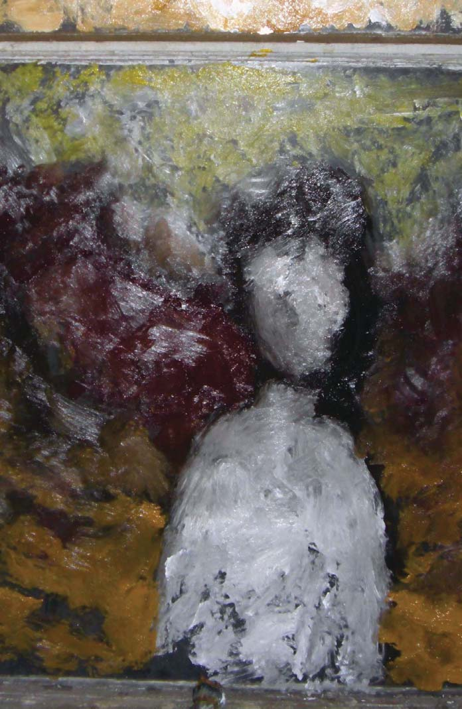

# Volume III — The Earthman Chronicles

*Modern Mythology* (2010) — restored text for the visual novel. Register: **retro-future signal**. Source pages 177–291 (PDF page index; printed folio = index + 1).

Conventions: `<!-- p.N -->` page anchors · **CUE** speaker lines · `####` sluglines · `> [[RECOVERED …]]` text transcribed from the page image · fenced `:::expansion` blocks are new connective material (not in the 2010 book) — keep, cut or rewrite.

---

<!-- p.177 -->

*Plate: The Earthman Chronicles — by Lafayette Hubbard (painting: pale figure)*

<!-- p.178 -->
*Spine strip of the Earthman plate (no text)*

<!-- p.179 -->
i. the boy from pasadena

The sky was falling and it came down in pieces. Jack Perkins wanted to be strong but he was only just a child. The world at war with itself was one he was stranger to and all he dreamt of was home. He feared that if this the true future of the planet earth there wouldn't be much left to build on after all the smoke had settled. He hoped there had been some mistake, some miscalculation in all his years of research, experimentation and thorough planning.

He crouched under a fallen street sign, thick cables held at odd angles, close to terrified it would fall on him and crush him like a bug.

The building behind him existed as stubbled foundation, brick and steel charred black and white with smoke and ash. Children sat round small fires, warmed themselves and kept a considerable distance from the odd man. He realized he was a complete stranger with his nice clothes, his kempt haircut, his general cleanliness. Jack Perkins stuck out like a shiny quarter in a penny jar.

He had seen few other people since his arrival in the time pod besides packs of pathetic children, ugly asexual feral monsters.

His first moments in this place were primal, sliding from nightmare to nightmare. He didn't know what he expected to emerge into. He never dared hope his experiment a success but it was and that changed everything. He concieved the idea hundreds of years ago, built his egg with a team of other young, passionate like-minded scientists, volunteered himself, sealed himself inside one quiet night, dared himself to push a button, gestated in the time between times and was born thusly into this strange new blighted lanscape of humankind and fallen civilization.

<!-- p.180 -->
Jack first noticed the quality of the air, thick and heavy like the aftermath of a rocket experiment in a desert arroyo, the lingering charnel residue of a science lab caught in chemical fire, the blinding chaos of a wildfire magnesium accident, the after-image of intensity burning the retinas, the blindspots of white and surrounding pools of darkness, the sound and presence of great machines passing above, directly overhead, the gusts of turbulence and electricity in the air standing his hair on end.

He saw shapes moving, the children. They remained very still keeping to shadows yet remained casually indifferent amd distracted, knowing the machines had no real interest in them. Their eyes were afraid, more focused on future horrors that awaited them not these present discomforts.

The machines drifted above covered in tiny lights like little eyes, oscillating and surveying the ground, kicking up dirvishes and fogging the night with dust and light. Jack did as the children did, and kept absolutely still. A voice came booming from a machine among machines, it spoke a language not quite English, almost understandable. It was angry, desperate, pleading. After a few moments of petrified fright, Jack began to imagine began to hear his father's voice come out of it. He wanted so much to be home right now, to have his father close by saying words of encouragement, gentle and firm. He felt so alone, so rotten that he was only just a boy, that he did not belong, that his whole life had led to this one terrifying terminus.

He didn't want to think about how he had no friends, in this or any other present. He was different as a child, could never be one of them. These children of the ruins would not accept him like his own youthful peers had never accepted him. His world was limited to science and precision logic. At an early age his mother read to him classics, works of literature, but his father weaned him off the frivolous and pushed him into science and mathematics, drilling equation, proof, socratic discourse and scientific method into his eager, he

<!-- p.181 -->
remembers how impressionable young mind. He was nothing if not willing, stupid and willing.

The lights stop above where he cowers a siren sounds, light changes color to a dirty hue of pink, encircles him. He feels a gentle tug about his very being, his ears stop working or perhaps all that ambient, awful sound ceases to be. He thinks to scream but can not hear it. He is alone again, completely alone in the pink light. His stomach flip-flops, his arms drift up and away, he kicks out his feet and begins to spin, can't find his footing, vertigo seizes him, debris floats around him, bounces off him, the world spins and holds him and he is swimming.

He goes to the source of all the light, shadow darkness ebbs at the periphery, the end of the world just outside, perhaps going on business as usual. He almost feels comfort for a minute before it all goes away. All sensation, all thought, all connection to the world.

ii. dreams in the key of godhead

He opens his eyes and can't close them back up again.

Lafayette Ronald Hubbard felt entirely alone up there in his room. He had just moved to Pasadena from another city, another whole coast. He looked out on his empty street, always empty at this hour. He was waiting for something to happen, a new day to echo out like all before.

His day and the day it slowly ended up transmogrifying into was now come and gone and sat upstairs gasping in great breaths of significance, sucking the air out of the room, out of the black magic mansion commune palace he called home, lived in, sucking so hard he felt his own breath like it was deep kissed from sleeping roommates, recalled directly the memory of friends in slow places, forgotten and swilled by lovers in other states, other states of mind, spat out of sworn

<!-- p.182 -->
enemies always lurking in suggestive shadows, tasting of their blackened lungs, their stretch-marked souls shoved deep down inside, coming at last to the taste particle taint of the universe that bore everything, the simple stardust stuff which brought him to this very moment.

He tasted silence, mistrust and preconceived notions. There were very few kindred souls in the world. Most souls being rotten things, dirty laundry in need of better cleaning, pressing and pressure washing. This unkind world, this rottenness in man existed because things never got better, only ready-steady progressively worse. He knew childhood a beautiful thing the world ruins a day at a time. He knew because he was a beautiful child with dreams of adventure and discovery and endless delight. Sure Lafayette was spoiled by dreams but not spoiled rotten, instead dreams preserved him. He liked to imagine himself an egg, not left out in the sun but kept in a bottle, preserved forever, waiting for his day to be born again. To be devoured. He was not quite there yet, but he would be, of this he was certain, and remained firm believing. He asked himself every day, is this why I'm here, now, in this place?

The new kid who showed up, who Jack introduced into the fold, who told everyone he was a time-traveler from the future, he was big, as big as Ron but fatter. He had a silly lumberjack half-beard which cut his head from the neck. He wore a suit with no tie and his shoes were huge and falling apart on his feet.

The big kid, quiet almost like an affected simpleton, looked into things with big blue green gray eyes and asked the oddest question upon being introduced acting very much like a tourist without a map. He said to Ron, aren't you going to start some crazy religion or something?

Seeing him made Ron recall New York and how

<!-- p.183 -->
everything changed at once and he was no longer significant in that place and how his stories, his words, no longer carried necessary weight and the incredulity which brought him into that awesome and focused and vital literary circle warped into something much more like disdain. They met him with silence. No one looked forward to his presence. He had done something, said something to someone, word had spread like an influenza to infect everyone he cared about. Perhaps word got out about his wife and kid. Or perhaps they simply stopped believing the words coming out of his mouth. His words, great in volume, great in furious output he produced from fingers without rest, words which poured, goddamn poured like pulp novel blood, clean and crimson, those sad messy human words could, would, never be equal to the primal stories inarticulate, spoken from drunk and delirious queasy lips, half-finished abstracted near-greatness protruding from his mind.

Ron woke that day to cars honking, people leaning on loud horns, merry melody intonations, squawks and sirens, cacophony, car tunes. Downstairs was a ruckus unholy. That morning, not quite awake, Ron had been thinking he had no one in Pasadena to truly confide in, to give himself over to, to tell all his secrets and impress with the fantastic and utterly untrue life story he had come to very much half-believe despite knowing better, telling himself, it's all true, every last word. He was a storyteller because he's always been, but he did not yet realize he was a liar. A great big deceptive awful glorious bastard intent on untruth. He never would realize this deception, this Ron told only himself in confidence. Instead he made to believe that life was one great big adventure and this he would tell them all when he had become who he was always meant to become.

Jack was holding a meeting or something in the hallway thick with bohemian peoples pressed up intimate: Physicists, journalists, the bent and broken, also writers, poets,

<!-- p.184 -->
artists, actors, charlatans, addicts, and those who loved them or got suckered into thinking so, all gathered close to Jack, beautiful Jack, their tent pole Renaissance Man, their rocket scientist cult leader cult of personality genius who was each these things, more even and none all at once.

Jack had with him the tall man, the time-traveler he'd found in the bowels of Caltech.

He told the story, of going to look for his new basement office and science lab, of opening up the door to an empty room and finding the time-traveling vagrant asleep on the cement floor.

Jack woke him gently, roused him from his sleep.

The boy was disoriented, confused. Of course he was, making the journey he made. He'd traveled back in time over fifty years, from the far off future, the year 2003. Imagine that.

Jack asked him his name.

Andy, he said.

Jack walked with him around campus, trying to find a place for him, Jack asked him which hall he lived in and Andy mentioned Dabney, but said he didn't live there, that his sister did, which was an obvious lie because women weren't allowed in as students, so maybe she was somebody's something on the side, but that didn't make any sense the way he told it.

Regardless, Andy remembered peculiar details about the campus but the specific details were all wrong. Andy walked around in a tired daze refusing to accept the world as it was, grumpy and belligerent.

Jack talked about his rocket experiments about hiking those arroyos just out yonder, talked about maybe one day traveling into space in his lifetime, talked about changing the world with his work.

Andy nodded encouragingly, said, you will, I'm sure.

They got to Dabney and Jack said, here you are. Andy looked the place up and down and said, this isn't right.

Jack said, how do you mean?

<!-- p.185 -->
First off, there's no basketball hoop right here. And there are no speakers up in those windows and there is no umbrella table here and the paintings, the writing on the walls, it's all different.

Jack said, I'm not understanding. I'm not familiar with Dabney much, I'm not a student, I just work here and eat dinner over there sometimes.

Andy sat down and Jack decided to leave him, deposit him to this spot and be done with him.

He looked at him for a moment and had his answer and changed his mind.

He asked Andy if he'd like to help him set-up his office, told him he'd throw him a few dollars for his troubles. The kid was big and looked like he could lug around a couple boxes.

And as simple as he seemed, Jack knew that wasn't quite the truth.

Ron had started on a new book titled "The Earthman Chronicles". It would be his first serious foray into speculative fiction, what the Los Angeles congregation of writing aficionados, hard mathematics and laboratory minded types, as well the silly movie horror and genre buffs had collectively dubbed "Science Fiction".

Ron was having trouble getting started. He knew the shape of the story but details for this speculative fiction were hard to come by. He was good at making things up, so it should have been no problem but Ron wanted his words to ring with truth, he wanted his warning, his message to the masses to sound out loud and clear and not fall on confused ears.

So far the effect was not working. He got his start writing westerns and knew he wanted the speculative bit, the outer space hokum to feel like a high stakes card game out on the range, only much further out, tumbleweeds on alien terra firma.

<!-- p.186 -->
 He wanted the Indians to be spider monsters, killer robots and advanced alien cultures with beautiful women creatures. He knew his hero would be a bit like Jack, a boy genius who grows up and builds a time machine, flings himself fifty years into the future and finds the earth under attack by what exactly.

He wanted that wild eyed innocence, genius, shattered and dashed upon the wreckage of so much progress, the folly of man. And there was to be a big twist at the end, this he'd already figured out.

Ron heard Betty talking in the hall. She was Jack's girl but she belonged to everybody. Jack had rules for the house and his rules were pretty much long as nobody gets hurt. Ron had Betty the first night he got here and was trying not to think too much into it but that was hard when Betty was thinking too much about it too. She waited outside his door until he got up and let her in.

How'd you know it was me, she said.

Beauty changes the mood of the room even when it stands just outside it.

You know what to say, don't you Ron?

You want to come in and help me with my novel? I need a second set of eyes.

You really should ask Jack for a bigger room, you've already filled this one up, all these books on the floor, it really is not fit for a body to stand around in, dust everywhere is all.

Take a seat on the bed and look over my shoulder while I write.

What's this one about?

All manner of incredible out of this world intrigue, really. You and Jack have already inspired me so much, I'm just aching get it out. Jesus woman, I didn't realize how sore I was.

You shouldn't hunch over, you look just like a brute when you do.

Read this here, where my finger is, how does that sound?

<!-- p.187 -->
She took her time reading out loud, "Jack first noticed the quality of the air, thick and heavy like the aftermath of a rocket experiment in the desert arroyo, the lingering charnel residue of a science lab caught in chemical fire, the blinding chaos of a wildfire magnesium accident, the after-image of intensity burning the retinas, the blindspots of white and surrounding pools of darkness, the sound and presence of great machines passing above, directly overhead, the gusts of turbulence and electricity in the air standing his hair on end."

And then she stopped. Jeez, it sounds horrible, is Jack going to be alright?

It's just a character, Betty.

But you're writing about our Jack, right? Jack Parsons?

Mostly, but Jack builds rockets, not time machines. And I don't think you have to worry about him landing on an alien world any time soon, unless he blows himself sky high.

It's scary Ron.

It's supposed to be, Betty.

She stopped rubbing his shoulders and lay with her back to the bed, her arms crossed behind her head as if a pillow. He turned and put his hand on her stomach, a tiny bit exposed from where the blouse and skirt went their separate ways.

You're practically married to him Betty.

He's done with marriage and that's all he'll say about that.

Well, some of us aren't meant for it, that's just the way the world works.

You two should just marry each other, queer as that'd be. Not that I'm saying.

Know what you mean, no fence taken. Besides, I've got my hand some place awful peculiar right about now.

Jack don't mind none, if you keep at me, he thinks the world of you, really.

<!-- p.188 -->
What do you think Betty.

Don't stop, is what I think.

They both thought of Jack, handsome Jack with his thick eyebrows and devilish mustache, dark hair combed wet to his skull. He had this energy, see. Meeting him was like being in the presence of something sincere, something bigger than big. He was a trembling thought of the id, a slight and implausible superman to grasp at with focused certainty, but very much real in the ego sense of the word. Ron and Betty believed that Jack believed he could change the world, would in fact, change the world.

One part because Jack caught the attentions of the most evil man in the world, one Aliester Crowley, Black Magic Monster of Fair Brittania. He was their reason for being here, this was his temple, his cult, his borrowed belief. Another because Jack was a founding father of this strange new thing called rocketry. It was science and technology and it was the way things were going, the way of the future. And another because Jack was state expert witness making all the headlines in the attempted murder trial of the Los Angeles district attorney. Because the world was a bad place and Jack was determined to do some good. Because Jack was one of those who somehow fell into the very center of things, charming all around him with his confidence, good looks and open mind. He changed, charged the fabric of reality just by rubbing up against it.

Betty felt in Jack a good soul, perhaps too good. And Ron was everything that Jack was not which is why he encouraged her and she him. Despite the shallow depravity and moral greyness of all that occurred at the mansion, Jack remained sunny, smiling and offered up encouragement to all the lost ones who wandered in looking for answers. He believed in layers of reality, believed in the potential of the human being, the anchor of the human soul, the purpose of the shadow stuff, the sheltering sky of the sublime. His disposition was what

<!-- p.189 -->
drew the curious to him and his gentleness kept them close.

Jack was their father figure but he was also their little boy with big ideas, too big for his head. When they were together, Betty and Ron, when they weren't playing at flesh and fluid and when they mostly talked about Jack and got to wondering where he was off to, what he was up to, who he'd rub up against out there in the city streets and bring back tonight to the table, what new strange human being he'd show off and impress them with, that was the Jack who mattered substantially.

iii. safari

Jackie Onassis played a major role in the slide shows and it took an audience that many years to finally see it.

He'd pull out the projector with its dim bulb, it's strange disembodied yet tethered outlet control wand, its central sliding forward/rewind mechanism, the one button to advance counter/clockwise. He would clear away wall space or venture up to the attic to pull out the pull down screen, assemble it hours before pinning it in place. At the bar his wife would have bottles of wine ready to pour. He loved old ports, saving them for the end of a long evening and those all but last to leave. Dozens of cases acquired in travels, the good stuff, dwindled and appreciated more each year, savored murky antiquity. His children would drink from half-full glasses if left unobserved, the Saturday or Sunday morning afters showing telltale broken blood vessels in nostrils.

Trickled in coworkers and a strange collective of friends. The men mostly oil, close but not quite big wigs, though sometimes one or two would sneak in and loyalties and resentment would ripple across the quasi visible surface tension. The women medical professionals, higher education and expatriate ambition their shared commonalities. Couples mostly all childless, adrift and moving in packs across the globe. Ended

<!-- p.190 -->
up in Tulsa, a sort of mid-eighties purgatory for the best and brightest of them. They'd built massive dream homes atop the rolling hills but for the most part didn't know what to do with themselves.

They spent. And swapped. And drank more than they damn well should have. They spoke about crazy mad religion and Oral Roberts just down the road and that designer drug mad scientist compound right around the corner. And it all came a crashing down around as profiled in Rolling Stone Magazine. Tulsa, OK, off the map, yet somehow the center of this now non-existent universe. If for just an instant, a fast fading blip on the extra-cultural radar.

Marty's young children were allowed to mingle and run around until exhausted and this confused the guests so they regarded the kids as everything children were actually not, depending on their level of intoxication and familiarity: to young adults a delightful entertainment, an oftentimes nuisance, focused on them they were, free range youth as gangly pets without cages, pets without leashes.

When it got to be time, there'd be a hush and the hum of the projector alive, its empty contents illuminating in the air minute threads and particulate without rest, like a Chinese silk artisan juggling her threads in the air while stitching. Marty would stand beside the screen in full on professor mode, right hand casting shadow, resting and pressing upon points of interest.

Niles thought it like a comic strip almost not quite something else entire.

The still images, one after another, slip sliding into the next.

Marty had his cameras with him. Slung around his neck and shoulder, three of them, Minolta. In his army green burlap back sack were several telephoto and macro lenses, some as big as his forearm running all the way down to the tips of his fingers. He screwed on attached filters red and black, the

<!-- p.191 -->
difference how they tricked the eye, did things to light and shadow.

Marty built like the center lineman he once was wore khaki, Dodgers baseball cap. Facial stubble, ruggedly stooped, mostly muscle, intimidation in silhouette, eagerly approachable in profile.

Jackie Onassis and her kids were with him all in that same open air school bus safari vehicle, top shaved off, bars in place of window- like they were being driven around in their own special cage, like they were the ones caught, rounded up by animal controllers and not the ones observing from afar.

He only ever took slide photos. Black and white mostly, sold what he could on the side to glossy magazine or advertising outfits looking for stock photography. His best slides of Jackie O, wherever did those go.

He had a special license, had to these days. He was carrying microfiche with him everywhere he went. He'd often spend days in some office waiting, getting clearance to move on, hotspots entrenched until word came from on high to mosey on, move along. Marty living with, learning to love the big guy sweat coming off him like rings, concentric rings, to measure his age in the yellow brown of his white tees, the pits and shoulder blade and where it all pooled belly button.

His name on special lists, keep an eye on this one, all said in protocol politeness. Twenty-eight and about to start work on his PhD at USC under some stubborn old son of a bitch who could and would use and abuse him, outlive him most likely. Marty was something else entire and wherever he was, whatever he was doing, they could not hold him, keep him, contain him. He drank with pretend spooks who offered part time work which Marty sometimes accepted no ifs ands or buts. The contracts, liasons, short-lived, hardly worth a mention, except for the hmm, curiosity of the thing.

This photo-safari gig, what this was, a one-time thing preserved and on display now and here was Jackie O and

<!-- p.192 -->
JFK Jr and the girl, and the can't miss it secret service presence. Marty and all took pictures of bull elephants by watering holes, gazelles spooked by large cat and of baby giraffe newborns reaching up to almost not quite grasp out of reach Savannah frond.

Slide after slide revealed fuzziness and clarity both. Background foreground, something compelling just out of focus, that lone woman in her sun hat, her light drapery blouse, the children clutching car bars like nickelodeon convicts, the incredible hulk about to break free. Lou Ferigno, he'd pantomime to the audience. They'd laugh with a fresh familiarity.

The guys who would normally be wearing matching suits asked what Marty would wear normally and they all dressed accordingly, because they were all on the same team, so they looked like fraternity brothers or well-physiqued gonzo journalists, dark sunglasses all.

Because things were happening in the world, which is why they arrived with such short notice and snatched up whoever was around, background checks over and done with in half-a-day. This isn't some cover story, they said. It just is what it is, a family out for a good time. This was seventy-five. Nothing going on in the world, nothing ever.

Marty read spy novels all through college, Ian Fleming's early stuff, the movies he looked forward to and was disappointed, further and further by.

The runt border collie who is their new pet, who nips at heels during slide show, who children hug onto and the youngest, the girl, rides around, her own pony, named Tracey after James Bond's wife who didn't last very long. The dog is named Tracey, not the daughter, though that was under consideration at one point.

Marty disappeared for a few years after becoming a geologist, traveling the world and the United States under the grant and auspice of the USGS, mapping, writing geological field guides, taking reference photos, always something in the shot

<!-- p.193 -->
to show scale, a pick-ax, a human body, geological outcropping in relief. Strata revealed, naked, the human reference usually an attractive female in short shorts, Kathy doesn't smile so much at all the in-joking.

Seven of them before settling down, what he tells people, though the number is probably twice that, judging on slide data alone.

And they exist in slide, especially the one that gave him a Hawaiian Punch red boutique print shirt that he wore to his wedding.

Casual that way, in her mother's backyard, already pregnant. Kathy knows when they're coming and looks away, engages somebody in small talk.

Slide go by. Sometimes one is upside down. Or reversed, you only can tell by certain ones. The insignia or logo or lettering in a vehicle, a print tee, a newspaper left lying about. Ambulance is backwards on purpose, but not here, not on safari.

The children hiding behind the structural bar marvel at father, hair still black, chest still firm, belly flat to hip. He seems to stride across frame, some superhero pose impossible to imagine, blurred slightly distorted, unreal. About to strike an oxen with branch, shooing off juvenile cheetah with scary claw fingers and a static hiss captured. They wonder who took the photos. Him posing with Jackie O, the progeny, the drivers, and the black guys with white teeth thumbs up saluting.

It makes no sense and there is no connection between this and that, here and there. A vague uncertainty in that kodak color projection, the later sameness of color corrective processing. The children still ahide behind the bar. Everyone knows they are there and not yet asleep but those that remain who haven't yet said goodbyes are those caught up by the story, his lack of story, this slide-show meandering, matter of fact, interactive and interpretive.

Someone finally pipes up, it's Niles, the geologist cartoonist.

<!-- p.194 -->
 Marty is a frequent character in his corporate sketches that make the rounds on xerox macintosh telefax throughout the Cities Service.

So Marty, I think the question we all want to ask, you do anything with that.

Marty swaggers back, tall deep glass in hand, fielding a fly ball.

The wife on sidelines unaware, drifting buzzing, her secretary glasses and Velma haircut catching enough attention on their own. People often see her in scrubs, teal green things, tonight it's just a tan slip dress thing with black stocking that disappears into shadow.

What do you want me to say, I'm not saying anything.

I'm just noticing certain things is all, the way this is going.

These slides have been in that spindle for years. I could be playing it backwards for all it matters.

It matters, you know what I'm saying. Anybody else sides me seeing this.

A smattering of ayes, drunken yays.

The myth of Marty ever deepens. You my friend, are a work of art.

Pour him another and make sure he drinks.

Marty points out Kilimanjaro, shows the road they take, stops on a slide of a hippopotamus and for a moment his recollection sounds verbatim Jungle Cruise Disneyland.

Much later on, Marty would go out to the patio with a select few. Mosquitoes dying off in the fall, the breeze turned crisp, but still after his high cholesterol blood just sweet enough. Finishing off the booze, gulping now instead of tasting savoring swishing sniffing. It is a game, their easy embraces and familiarity. They speak highly of friends who could not make it out tonight, who were with them in spirit, oftentimes very far away, sharing stories of, remembering like this.

Kathy and the kids also far away, but safe right here tucked away right here.

<!-- p.195 -->
It is a boys club he is part of. The shared stories, made up shit, waxing on forever seeming at this uncertain hour. They wanted details spilled, laid bare. Drink more they said and did.

Marty and Niles boxing, ducking and weaving with their fists raised up using the children's sawdust playground as a proving ground. The moon is there between tall skinny trees. Two guys remain sideline, young proteges of Marty and Niles both. Marty doesn't know what he's doing. Niles is fucking Norwegian, so who the fuck knows. They're drunk and stumbling and laughing and hugging between hits. No blood showing despite some copper taste on their lips and gums. Mostly ribs hurt, mostly they fall to their knees giggling upon landing a solid hit to the others shoulder or stomach.

They hold whole bottles now, the final remnants a black ink poured down with a final shout out to the heavens. They relax against the wooden fort Marty built for the children one long weekend Kathy took off without telling him. Inside is a play kitchen for his daughter, the faux sink thick with red dirt and twig.

This is good, he thinks. Not quite sure, but he thinks.

iv. names in neon

Justin looks to me expecting an answer. I look Ginger in the eyes, the girl shivering in the stranger's bathtub. The bubbles there to cover her have mostly dispersed into a thin film she works with hands to pull in close to chest. I can't tell you a damn thing about this look she gives me. I don't know if she's excited or afraid or both. I just know that whatever I say back to Justin will be wrong, that this moment is too fucked up, too far gone and the three of us have let it get out of control.

"We can do it either way," I say, not really saying anything at all.

<!-- p.196 -->
He tells her to stand up out of the tub and she does. She's eighteen and beautiful and naked and dripping. The cameras love her which is why we love her. That will be our pathetic excuse when we got caught up in the fantasy of the moment. I only try and look at her through the viewfinder. I feel ashamed, I'm burning frightened and I hate that my dick is hard. I'm twenty-two. I have a girlfriend who doesn't know what I'm doing far from home back home on the coast of Small Wood.

Living vicariously through my best friend. I don't have a life until he brings me into his. He's twenty, bleached his hair blond dates a twenty-nine year old actress. He knows she cheats on him with her costars but until she leaves him for the sensible obvious reasons he flies blind, loving it. He doesn't sleep. He taught me how to do this without resorting to speed or caffeine or supplemental stimulant. When we are together, quietly discussing something away from raucous, we begin by breathing deep and repeating a coda, a familiar chord. "Inhale light, exhale exhaustion." Themes and variations thereof, a cliche for every occasion. We do it by the force of sheer will alone. Shooting, editing, writing and planning three days a week straight. Friday, Saturday and Sunday, switching off and resting eyes for maybe an hour two max. The other four days we both have jobs and I, school to return to, to blink, emerge back into, mental patients released to the outside world.

He has many nicknames. Jlowe, JKL said "Jekyll" signifying the three letters used to advance frames in the AVID software editing suite we chore master. He works at Maximillian, arguably the best west coast ad agency. They are Nike. He charmed his way in, a high school graduate nobody translated into no practical experience. He cut a tape together with some personal highlights of his short life in front of the camera. The video opens with a custom-made eighteenth birthday present neon sign being born out of darkness, his name flickering and

<!-- p.197 -->
glowing, "Justin J. Lowe", cursive blue.

That whole advertising mentality I can't fathom, the seemling too hipsters, the comfortable distance they create for themselves away from the rest of reality. The see themselves as those who sell dreams to primates. They don't associate with the common man, they move in packs of carbon copies of themselves wearing black always considerate of how they feel.

Justin is not like them but he is their mascot. The young kinetic human being they all wish they might have been. He bleeds electric. At their weekly meetings he's the DJ at the mike working their reptile blood into a lather. He gets them to hoot and holler and dance and go to strip clubs and celebrate existence. He tapes inspirational messages that play on closed circuit monitors in that beautiful steel and wood and glass edifice, non-cubicles seemingly hovering in space. He lives too hard and burns far too fast, and he tells me I bring him back down to reality, as if that's a good thing.

I look like a logger. I missed growing up of that grunge era and must reference this iconic Pacific-Northwest. Torn jeans, corduroy, flannel wear, long greasy hair and full beard. I am the emotional anchor, the overstimulated octopus brain behind his rabbit beating heart.

We are So So Cool, the name we give ourselves to stand out from all the rest. We say it like Japanese tourists, thumbs up excited, so very self-aware. We have a mission statement and it is said in defiance. We are two young people, two old souls. He hits the streets, I craft websites, he prints t-shirts and stickers that I design.

We network and schmooze. We hit the clubs and bars looking for fresh faces and eager minds to join us for a fleeting moment. We capture impressions with Polaroid cameras, leave behind hyper real post-it notes, tattoo sharpie marker bare flesh for a week or two. We talk emerging musical acts out of their art so that we might 'collaborate', incorporate

<!-- p.198 -->
them and further this collision into being with our incredible persistence, they become the soundtrack of our lives. We want to share our vision, our vision that we can't agree on, that changes from moment to moment. But we feel it with all of our being, we know it. We dream the dream together and somehow find the time to parent our love child of the mind.

This is where we are before the horrible truth of reality hits and we dreamers come crashing down.

We're working on a film called House of Glass. I brag now about how we accomplish so much with so little. Our massive set, sound stage and backdrop is a brand new up-scale condominium in Vancouver, Washington. We somehow talked the owners into letting us shoot our movie in several of the empty demo units, fully furnished and glossy like a magazine spread. It is trendy and urban hip. There is a Starbucks in the lobby, across from it an art gallery. It is too perfect a locale and we consider ourselves blessed karmic fortunates.

This is all so amazing because the fictional House of Glass is a post-modern art commune, a hive where all the rooms are wired for sound and video and all the tenants can see what exactly their neighbors are doing at a moment's notice by turning on the television or computer. I wrote the script because I recognized the crazy voyeur exhibitionist in my young self and I got a very real thrill writing it. Justin responded as much if not more so. He is obsessed with making this a reality. He encouraged me to write into a mirror, digging ever deeper, discovering so much more than the surface sensational we were selling it as.

I was mainly interested in the peculiar sorts of people who would gather in such an environment. The jump off point of historical reference, this was written and is constantly rewritten at the dawning of reality television. We started shooting days after 9/11 with the jets in the skies, their sonic booms etched audibly into our tape. This is about that, we delude ourselves.

<!-- p.199 -->
 This is fresh and topical and deranged. Also mean and ugly and too much, yes. But we go forward because people respond to the concept on some basic level. They want to see what we will do with this, where we could possibly go.

Where it falls apart because it was bound to from the beginning. I blame my bloated script. At one time it was upwards of 300 pages. Six hours of material. We thought about doing as a mini-series, like The Kingdom, the Lars Von Triers DV show. Release it to DVD, that exciting new format. Or sell it off the Internet, there's gold in them thar hills. There is too much to it to keep straight. Too many characters, too many archetypes clashing and coming alive, representing conflicting aspects of Boheme being. The two main foils, Haydon and bass, order and chaos. The logical documentary filmmaker locked in a battle of wills against the passionate entropic musician. House of Glass, their playground, a place too small for boys to share willingly.

All the players are young and beautiful and talented.

And they are. The webpage for the House of Glass is already up, the interlinked web pages of all the fictional characters an on-going meta-exercise that takes weeks out of my life. I write as all the characters in the House of Glass forum. We've been casting cool people off the streets, as themselves, as extras, filling in the negative space that sucks at me. They photograph themselves, improv their existence. House of Glass is entirely beyond our control now.

It certainly doesn't help that as of this very moment, the (spoiler) written finale is a musical number filled with such choice moments as our fresh out of high school sexual suicide diva masturbating with a pen camera while all the characters watch and come together as one uber-art-organism thanks to the magical black man powers of bass. I mean goddamn. We're going for broke here, we're letting it all hang out and fall where it may.

<!-- p.200 -->
> [[RECOVERED from page image]]

Somehow all the people associated look at us and think we know what we're doing.

There are moments you never forget. When the book we walk through comes to a new chapter and the words that begin this great transition hover vibrato in the air.

Everything changed when we saw the film. I hesitate to even call it that. I lead you gently into that night.

I was in town, the start of the movie making weekend that would last a hollow eternity. It was a Friday afternoon and there was nothing for Justin and I to do except socialize and reacquaint. We wandered streets in the early evening, window drop shopping independent record stores, trailblazing Powells book store, being observed out in the open laughing and celebrating early that rush of impending weekend freedom rubbing it in eager curious noses that looked up from lack of passion duties.

She found me, the young woman with dreadlocked hair all the colors of fruity pebbles. Practically assaulted me in the street, thought she knew me from somewhere, called me by a stranger's name which I remember to be Bran. She was certain I was him and grew all the more empirical the longer we spoke between concrete limbo. She thought I was fucking with her and went back and forth between upset and excited. I showed her my driver's license to which she said, I'll be damned and changed her tune, suddenly now wanting to hang with us, asked if we had a problem with that. She kept looking at me, eying me, squinting effectively unnervingly. Justin, to stop the honking, embraced the girl completely, her name April. She lurched over and included me in the hugging tight. I was big and awkward, consciously scouting for my implied doppleganger to appear out of nowhere. The three of us in the road, just like that.

She took us by hand and led us through alleys we'd never considered but understand she was not an alley person.

<!-- p.201 -->
I don't want to give the impression that she was from the street that she knew the lingo because she was entirely like us and we were all tourists. She used four dollar words because she was a student and they felt good on her tongue. Pierced not once but twice. We shared this new world together for a day the way strangers do when they familiarize themselves with comfortable otherness. She wanted to know all about us, all about our movie, because she loved movies. In fact, she explains in bold, she got an invite to an invitation only movie screening that very evening and this she kept repeating.

Important, this invite only invite. She pulled it out of her purse at some point, written in fancy cursive across one side, invitation only. On the other side was an address, a gallery space she told us her friend once used, but had since reverted vacant. She tried and failed to explain the significance, it was all a web of people, names we couldn't place.

We continued our wandering. Unimportant save for details, fleeting. We had pizza dinner and bought disposable cameras which we emptied, pow pow pow, in a pigeon occupied park plaza. The winged squatters refusing to budge, unafraid of us, we'd run at them and they'd stare us down, the whole flock would just flutter and bustle in place, watching as we were the ones who trembled.

We showed up early, there was already a line at the door. These people were individuals. I empathize because they were fascinating to look at and to overhear speaking to one another. I wanted to know their stories. They were cool and different and they all hummed at that same special frequency. It has taken this long to realize that Justin and I and April, we all hummed at that same frequency as well. We belonged there, with them, at that moment. But even then, I knew This Was Important in that Richard Dreyfuss mashed potatoes mountain kind of way.

People nervously fondled their invite only invites. A colic youth moved to the front and unlocked the glass doors,

<!-- p.202 -->
kick stopped them open and disappeared into dark leaving us to watch as lights appeared non-sequentially in relative distance. We saw a waiting area which we slowly filed into brushing against one another. April holding our arms tight wedged tiny down there. The floor was unswept meaning dust was kicked up and footprints emerged, diverged leading every which way.  

There was a table with refreshments set up along one wall, a trashcan filled with ice and cans of beer. This became the uncomfortable transition period, forced to wait together. This energy is vital. The uncomfortable dread, the questions we asked of one another, ourselves, why are we here exactly. The line of thought continues like this and continues to build, the answers must be coming. I remember a strange young woman in the corner, dressed in a ratty dress. Ratty like a doll dress, used up by too much play, too treasured to discard. She had that raggedy ann look, languid limp from so much existence. She was telling a story when I wandered up to her. Justin and April at different corners with different circles, our shapes formed an imaginary triangle, circles within circles. She spoke of a boy she gave a ride to in her car.  

He was a normal looking kid, about nine or ten. Then he started talking. He sounded funny. Like he should be medicated. (she speaks very slow, affects some truly queer accents and enunciations) He talks about twigs. Sticks. For minutes, that's all he talks about. About having sticks inside. Having scarecrow stick limbs. That's when he pulls out a pistol. Only it's missing a barrel. It's just a handle and chamber. He assures me it can still shoot. He's already shot somebody with it. He shows it to me. I'm driving. I'm terrified. I keep driving and he keeps talking. He talks for maybe an hour. Then he puts the gun in my lap, leaves it there, his hand still on it. Tells me to let him out at the gas station. He leaves the gun on my lap and walks out into the night.

<!-- p.203 -->
This was when she produced the gun without a barrel and showed it to us. Said she knows it still shoots because she's shot somebody with it. Some people laughed at this. You know the kind of laugh.

There was that frenzied moment where the crowd out of sight reacts and moves and you are suddenly aware that the time has come. A physical change comes over the assembly, and we are blood cells now. We slow and flow. There is a back room, dimly lit, larger than expected. We move into it.

Oh wow. I saw an island of leather executive swivel chairs, maybe eighty in total. Pilot chairs that swallow up a man like me. April squeed and pulled us into the middle somewhere. People unsure what to make of this. She was more open to the possibility, the play of it all.

So we're sitting in these chairs, rocking and spinning like tops. They were securely bolted down but we managed to bounce all over the place, locked in place. This was rad. You had to be there. There was some original music playing, beautiful noise. The sounds you make by accident hitting objects together. Arranged just so.

The house lights flicker. We approach the curtain call. The doors close. Tremendous excitement. We are locked in a large room, each wall taller than normal. White. People realize something is about to happen. Perhaps a light show, a slide show. What happens is darkness. People are quiet and loud at the same time.

There are four projectors that must be on the other side of the walls. I don't know how they do it. Each wall has a moving image on it. Sound comes from each of the four walls. It is cinema on four screens, all at once. I can see one whole image in my periphery at any one time. The edges of the flanking two screens bleed over. The sound is everywhere. It starts like this.

A helicopter shot through graphic desert landscape. A van is always at the edge of the screen, moving closer as the

<!-- p.204 -->
shot spins and orients itself. The van is dust-covered, a relic from the sixties, seventies, hard to place. It is a patchwork of all vans.

We are giddy, we notice that the images are all different, complimentary. Each of the four screens has a different, beautiful angle. I am a cinephile, I don't know how they did this. It seems to all be happening at the same time. There is light music, like bouncing around an eight-track, tinny, wheezy.

I have to relate this as it is relative to me. I could only see so much of this. This is what I saw.

It overwhelms us. The shot(s) seamlessly transition inside the van, each shot settles on a particular character inhabiting this van fully. The shots linger, letting us spin and consider each of them. Driving is a deranged looking character played by John Goodman. Yes. There are big name actors in this thing we are seeing. It is shocking to us. In the passenger seat is an unknown young actor, male, somewhat Hispanic looking, beautiful at fourteen-fifteen. In the middle seat is John Cusack. Yes. He looks like I've never seen him. At the end of his rope. A gaunt creepy drifter, copious patchy facial hair. Behind him is a young woman, another unknown. She is an enigma. Neither beautiful nor ugly. Maybe about twenty-three, twenty-four. She is looking intently at the back of John Cusack's head, like she just wants to reach up and touch it.

The cameras slowly begin to pull back out again. I catch a road sign outside the car that announces "Ticonderoga". Apparently on other screens, people saw different signs. The one I was watching was the main one (?), the John Goodman one. I say this because he was the driver. The John Cusack one said "Promontory Point". These are our jumping off points for later discussion afterwards. I can't remember the others, I think one may have been "Durango". I am dizzy by this point. It may have just been a few minutes, and I'm just

<!-- p.205 -->
spinning all over the place.

There are no credits. As the camera pulls back out of the van, each film transitions to how each character began their respective day. I can't begin to describe the artistry, the craft of the thing. There were four narrative films playing in concert. The setting was indeterminate. Late seventies, early eighties. A small town in the middle of godforsake. I spun, watched as John Goodman went through a Samuel Beckett inspired existence, suffering the torments of a hateful and indifferent family, absurd, cruel and cutting but shockingly funny. It was played as carefully observant, the tackiness of this man's suffering, the lengths he went through to get through a day, until he could take no more and began his ascent-descent.

I want to reveal so much. But I can't. I shouldn't say anything at all. I just have to talk about this.

The girl's story was full of graphic sex, which made for some interesting viewing scenarios. There was a whole portion of the audience who'd take casual peeks over at her screen and titter. And those like April who'd get caught up and not look away. I was somewhere in between. I reflect that my viewing experience was completely natural and right for me. My eyes fell where only they could have. Did I want to see more, of course. But that is life.

Digression, her story was this. She was in the middle of preparations to leave town to be with her dying mother. She just gets word when it opens that her mom is in the hospital, and she probably wouldn't come out. The girl, never called by name (none of the characters are) is living with her boyfriend in complete and total squalor. A dingy one-room pit of human decay. No ammenities. Just a nightmarish mattress where they fed off each other like sexual emotional vampires. For the first twenty minutes or so, while she packs and gets ready, he is insecure and forceful, afraid and knowing she'll never come back. He gets her undressed and sits on the floor and makes her masturbate for him because he's never seen her do

<!-- p.206 -->
it before and wants to see it before she goes and most probably never comes back. And she does, for him, maybe for herself. Closure.

I'll say nothing of the John Cusack character. I can't.

The young teenager though. He's nuts. He has no home, he moves from house to house, living with other kids his age, for a day, two at most. He's a sort of ghost, a Peter Pan, playful and arrogant and youthful wise. An older sibling of a friend gives him some acid, presumably to attempt to molest him, and the kid goes off on this amazing trip. We see it from his point of view. It's like a beautiful painting. Time stops and slows and there are moments of forced interest. The only reason it works and doesn't fall flat on its face is because of the content. The kid imagines himself and the beautiful young seventies-eighties Michael Jackson as best friends, getting into all sorts of magical mischief. I can't give enough credit to how well this sequence worked. It could have been an utter farce, given the dubious stature of the pop idol. But this was a time capsule, a character piece of the young man, the potential. Michael Jackson was beauty and wonderment and the strong guiding hand. He was what was right in the world, the glamour of the age. This played straight, played perfect.

You're probably thinking, how could this have worked. Well know that, by all accounts, it worked. Somehow, they edited the four films tight. Each was a stand-alone film. But they played in tandem. Imagine that. There were moments of cacophony and crossover and revelation. The soundtrack was pure creation. The music was timeless unidentifiable rock and twang. The sound effects and dialogue and pacing were done just so as to subtly lead the viewer from moment to moment. Each audience member responded to different cues and charted their own course through the narrative.

When it was over and it kept going on, god bless it, we filed out, stunned, afraid to leave our seats, our cockpits. The film was over and we were changed. There was applause. For

<!-- p.207 -->
minutes. They kept both the theater and lobby open after for few hours. People grabbed drinks. Some people got drunk and found their way back into the seats. Spinning aimlessly. I was tempted to join them. Justin and April and I had far off looks in our eyes. We'd be playing scenes over in our heads, sharing moments, realizing each of us had different pieces of the puzzle, we could only only just grasp at. Talk like this continued. After they shut us out, we found ourselves and others wandering the streets, finding places to gather and discuss. We had little information to go on. What the hell just happened to us. It was wondrous, it was phenomenal. Was it film or art or bigger than both, certainly bigger than us. Realize there was tremendous craftsmanship. When you talk about great films this was four great films and it came out of nowhere. Who made it. Why. And more questions emerged as that night gave way. It affected us. Parts of it felt like certain filmmakers had their hands on it. One person mentioned Matthew Barney. Could one mind have been behind that? It felt like both a yes and a no. It was big, too big. As a lover of life, it was far too much. It was madness, the potential to drift and lose oneself in recursive thought.

There is no way for me to conclude my telling of my experience with the film. If it was a film. It changed us. It humbled us. Tempered our passion somewhat. Inspired us, but tore us apart. April drifted off around dusk. We were on the edge of the Columbia River. She wanted to crash at a nearby friend's house, she invited us to join her. But we were in our own heads by then. We would remain there for weeks.

So Justin gives me a call up out of the blue. We'd drifted back into our respective lives away from the movie. We'd agreed by not agreeing to shutter the film, re-evaluate what we were doing in hopes of making it better. I was going through another round of re-writes. Justin fired a bunch of the actors and was trying to recast. He was not willing to compromise his vision and it was a set-back but I admired the

<!-- p.208 -->
decision. In particular, he wanted to cast a girl he knew from back home in Small Wood. A non-actor, achingly beautiful. He adored her, but she was always with someone. So he used her in music videos and advertisements and couldn't let go. She was perfect for the part of Penny. I had to agree. Even with her lack of experience, she was our Penny. She liked the script, was uncomfortable with aspects, but recognized there was no way around them and agreed to be our Penny.

Justin shot scenes with Amber, bringing her up on days I couldn't be there to shoot with her. It was obvious what he was doing but I didn't say anything. I sorted of wanted the distance from the project at that point. I saw all of the flaws and none of the beauty. We had become polarized. Him, in love with life. Me, withdrawn from it. I wanted to switch places, I wanted to equalize. But it was necessary, it was life correcting the imbalance, bringing us back down.

And then he called. He was in Small Wood and needed me on the coast to shoot a scene with Ginger. The big scene with her and he couldn't do it by himself, was afraid to do it by himself. So I drove the many miles to the coast. It was beautiful that time of year. The roads ever twisting revealing deep forest and valley. Sunlight dotting through the thickness of it all. I drove with the window down and the radio blaring, it crackling in an out of reception.

I met them both at Justin's parent's house. We drove from there to a clothing store where we picked out lingerie for Amber to wear in scene. The middle-aged woman garment attendant gave serious pause to two young men helping this young woman pick out and model barely theres. She didn't say anything with her mouth.

From there we went to a photographer friend's home-studio overlooking the coast. He was on a shoot in Washington state and gave us access to his place. We set-up in the bathroom. Lighting kits were unfurled and cameras set-up on tripods. It was Justin and me and her. This was to be done

<!-- p.209 -->
minimal, for her comfort.

The problem came after the scene was shot. After the sweat was wiped from our brows and we just stood there and shook nervously. It all felt wrong. Justin and I couldn't talk about this until Ginger took leave of our company. There was too much silence in that car before we dropped her off.

By that evening, I was back home quiet and moody. Justin called me up and told me that Amber was furious, that Ginger's boyfriend was furious. She wanted the tapes in her hand and she wanted to destroy them. The boyfriend wanted to beat the fucking shit out of Justin. He was afraid to leave his parent's house.

I did not know how this happened. Justin was hysterical. I drove back to the coast and took him for a ride. We did damage control. We were hopeful about the state of the film, we could recast once again. But by now Ginger was on all our posters and what a great image that was, her nakedness just covered holding that giant shard of broken mirror. We had to fix what was right with her. She was hurt and vulnerable right now. And whether we could admit it or not, we did it to her. We could have done things differently. Maybe if she saw the tapes, she'd come to a different conclusion. I kept driving and Justin kept talking. We talked it to death. We replayed the moment over and over, each time it was different. Sometimes we were right, sometimes she was. We loved ourselves, hated ourselves. We drove and did not stop.

v. non-stop flights

Brother sister in different places trying to schedule similar flights to the same place to be with the male specific one half of their reason for being before he leaves on a plane to god knows where henceforthever.

Janessa waits at LAX for the flight to up up and away. She

<!-- p.210 -->
packed light, barely anything. She buys books and gifts in the airport convenience store.

Andy tries to work out the logistics in Oregon. He is stuck in panic mode, and nothing is going right, the stars are not aligned,and he flails about in his mad dash attempt to get home to see Dad before-

They both need to be in Houston right this minute because every minute counts.

Tick tock tick.

Janessa dropped a thousand bucks on a last minute ticket. Andy has a ticket already on hand but it is dated for a couple weeks future tense. He had been planning the hypothetical trip the last few months, emailing back and forth to Dad in his medical isolation room. But shit happens. He has no money to buy another ticket at last minute prices so sobbing mom on the phone forwards her credit card details and Andy argues with airline people pleading his case to work down the price and give him a break but they'll have none of that hassle and harangue him being under the impression they have a policy to be nice to people suffering from extreme wits-end emotional duress dealing with non-negotiable deadlines emphatic dead.

Andy has no ride so he calls up Justin who drives several hours down from Portland to pick him up and deliver him, big baby that he is, to PAX. While the friend works his way down south, Andy walks into work, them surprised to see him as they expect him much later to work that evening all night sleep deprived student in flux making what he must and sucking up the debt remainder.

He tells them the good news. They hug him, he breaks down and cries on the store floor but smiles on the inside because he is sick to death of his job, his coworkers, his dependence. And this will be a vacation of sorts, he's leaving this state with no return ticket to ferry him back, one way for all he knows. Big change is on the horizon he can feel it. So much has gone wrong in his life details forthcoming.

<!-- p.211 -->
Janessa stresses about all the summer trips she was supposed to take and will still take regardless. She itemizes her packing list, works on a checklist for all the international travel preparations she will need to make and how this next awful week will complicate her plans, all her imminent destinations. She's only half prepared for her trips to Taiwan and Brazil. There is so much she needs to prepare for both academically and responsibly. Passport visas, inoculations, last minute shopping and communication. Her whole summer planned out to the nth degree and here in the middle Dad goes and does his dying thing. No matter that he's been fighting the sickness for over a year now, he's bigstrong, he's supposed to live forever. Dad is her heart and her heart is breaking and she can't deal, so this is how she deals, she plans her escape.

Andy has to tell the live-in girlfriend he's going away. She knows he's going away but she expected to go along with him. She doesn't question his distance only knows their last few minutes together will be important. Christine undresses him and comes onto him wants to lift him up and make that last impression memorable. For a few hours she is alive and tender and sweet.

For the last year Andy has known that the type of cancer killing his dad was designated AML. Acute myelogenous leukemia. Coincidentally enough, Andy's initials are AML, the M standing for Martin, his father's first name.

Justin shows up driving his SAAB, he has an early model IPOD which plays healing music, music Justin picked out last minute to give Andy strength and keep him cool and positive. The first song is Elevation by U2 and the trend continues until Andy is numb to Justin's upbeat bopping along in the driver's seat. Justin's girlfriend has just left him and he wants to talk about that, so they do and they both feel much better. Andy tells Justin it will be okay, Justin tells Andy it will be okay, and they both know it will be okay just not right this very instant.

<!-- p.212 -->
Justin drops Andy off at the airport, the small man gives the bigger man a humongous hug that lasts too long and not nearly long enough. Andy is crying saying goodbye because it may be a long goodbye and he doesn't have the heart to tell Justin that just yet.

Andy only realizes he is seated on the plane when the Captain's voice comes on to announce the immediate departure. When the Captain is done, a stewardess comes on to tell everyone this will be the last commercial flight of this pilot as he will be retiring upon landing. Andy always tries to get the aisle seat because his legs are long and he likes room to stretch out, instead he's seated at the window, which is good because he mostly turns to cry, looking out at nothing or at his reflection when the satellite lamp overhead is on. He does have the fan positioned to hit him hard in the face and it blows consistently, drying him sucking the moisture clean off him.

A woman sits next to Andy. She is unmistakably Texan, day old red business suit, large hoop earrings supported by fine cartilage curly dark hair that refuses to budge in airline stillness, glimmers in stiff concentration. Andy remembers a friend once saying that a woman who spends that much time on her hair can not be good for a man.

When they are in the air the businesswoman keeps leaning over to talk to Andy. It is a late flight and she orders drink after drink. "This will put me to sleep," she says. A moment later she says, "But I'm really not all that tired."

She asks Andy if she can put the arm rest up, scoots in close and asks, "You ever see the movie 9 and ½ Weeks."

Andy is aware of the movie, the sex and nudity and all that good stuff but an actual plot summary escapes him. Perhaps all that good stuff is the plot. He nods and she pulls out her portable CD player, puts the earphones on over his ears.

"I love the music to it," she says, "I work out to it all the time. Makes me feel so special and sexy. And alive. It's my favorite."

<!-- p.213 -->
She is probably a few years older than Andy and he can they live a much different lifestyle and that the only clicking they do is because of the booze she drinks which doesn't do much to mask her insecurity and sad clingy desperation. Andy feels like a magnet to these people. He doesn't want to say much to encourage her but at the same time he wants to sort of see what she's all about. So he humors her in the caring sort of way that shows interest and genuine sympathy perhaps.

She looks at him with big sad make-up eyes far too dark and wet like raccoon eyes and asks if he wants to hear any more of this music perhaps something else of whatever else she has. He shakes his head no and she hails a stewardess to get her another.

She keeps right on drinking. Amaretto sours. Out of the blue asks Andy, "Do you think I'm sexy," doesn't wait for him to answer keeps right on talking, "I feel sexy because work is going real good and I think they like me. I sell advertising space so everybody's got to like me. My bosses, my coworkers, the people on the phone, the clients, everybody. They like me because I do my job and we make money and that is fantastic."

Andy tells her he knows a fair amount about what she does, that he knows how hard it can be.

"I miss my boyfriend," she says when she puts her hand hand on his leg. She shows absolutely no knowledge having done so.

Andy drinks orange juice and then a sprite. He pushes the call button later on for a glass of water. The air is loud and leeches the energy right out. That centralized crisp dried out quality infects sinus, chills the body deep down inside. The business lady falling asleep next to Andy.

While she lightly snores leaned up against him he watches a Cuba Gooding Jr. comedy on the in-flight embedded headrest monitor sans sound.

The businesswoman rubs his chest scoots closer in to hug onto him. He sits up straight further sipping on various liquids,

<!-- p.214 -->
trying out some of her remainder beverages and the many ice cubes in clear plastic cups which are later crunched, the half-melted remains audible to only Andy and perhaps the sleeping listener with an ear to his chest. The whining drone of 40,000 feet continues all around.

Andy drifts off and wakes up suddenly. A sickening vertigo hits him, kicks him, his mouth tastes like lingering sickness, groggy numbness, foggy vision, congested ear sinus nostril inside yuck. He pops at his jaw, clarity, try to clear ears, equalize, decongest. The woman next to him stirs.

She slurs her words, as drunk if not more so than when she first fell asleep. Maybe forty five minutes have passed on their way down.

The voice that announces this is speaking too closely to the microphone, his disaffected enthusiasm pops in and out.

In the tunnel leading up and away from the plane the business lady tries to take Andy by the hand. She ends up putting her business card in his palm. When she reaches the exit her demeanor changes. Her arms are in the air, she sees her boy.

"I'm so drunk," are the last words Andy hears her say she finding arms giving Andy a look as he walks by, over the shoulder she holds that look until he is out of sight.

Terry meets Andy at the airport. She looks tired, professionally tired. A business lady, Mom's best friend, a long-time friend of the family. Aunt Terry. She has on a gray suit, her blond hair is cropped short and curly cute. She is formal with her caring this is me coping mode.

Terry asks Andy if he's hungry as they drive into the night.

Andy ask how far it is to the hospital.

<!-- p.215 -->
"About a half an hour," she says, "your sister was hungry when she got in."

"What'd she have," he says.

Ten minutes of quiet neither of them can stand it.

"Janessa wasn't ready to see Marty. I tried to explain to her what was happening. How he looks with all the tubes," Terry says.

"Does he look bad," he says.

She thinks about how to say it, her hands on the wheel, looking over at him, "He's dying," she says.

"I know he's dying."

"What I mean is he's dying. He's going quickly. He's been fighting like a trooper. Janessa wasn't ready to see him in that way."

He says, "He didn't look so good at Christmas."

"Just be ready," she says.

MD Anderson is an elegant hospital in a reasonably elegant building. The lobby is empty except for a receptionist who looks like a security guard. A pleasant and attractive black woman intimidating if not so big as to deserve it. The downstairs is all dark hardwood and glass, stained dark and shining through.

Andy and Terry encounter no one as they wind through the halls, board and disembark elevators. Terry leads him through it all. Sounds if they exist don't register, an odd thing for a hospital, eerily empty, padded to prevent mental and physical injury visiting hours used up except in cases such as theirs.

They arrive in Dad's room. It is large for what it is, looks real nice and new and clean. A television dangling from an odd angle plays video of ducks on a lake or a pond somewhere. It keeps going so it is apparently a duck channel. Different duck scenes play out, but mostly all takes place in the fall. Colorful, orange brown red serene. Dad loves ducks. He collects painted wooden decoys and statuettes.

Andy sees him and Andy smiles. Know that his first reaction

<!-- p.216 -->
 is to cry instead. Dad is connected to his bed, connected to the wall, his mouth is slack and open, his eyes roll around in sockets too big and hollow, he overlooks can't trace or focus and corrects his line of sight. He is doped up and still agonizing every breath. He manages a big smile for Andy. It is a variation on his tired smile. Like if he were staying up late and watching a movie. He'd fall asleep sitting up, his head would fall back and a snore would half make it out before he snapped himself back upright. Then he'd look around and the face he'd make when he recovered that smile was brother to the smile that greeted Andy. Only his gums are bleeding so very goddamn much his skin is so yellow it looks like urine his chest is gauzed up from where they went in and cauterized his lungs in places.

Janessa is sitting in the corner with Mom. They are close to him but not around him. Their energy seems too far removed from his seeming isolation.

Dad speaks to Andy, his words to Andy.

They are pleasantries and he looks at Andy long and hard while saying them taking his time because he can only speak slowly and it hurts a great big deal just to do so.

They keep holding water up for him to sip on. He makes pained, truly pained noises, weak and strong at the same time. He'd been fighting. All used up. Except for those eyes, those bloodshot all the way through and then some eyes. Hungry, and livid, they were desperate and sad. Andy hopes to god he didn't know what's happening. Hoped he didn't recognize these hours as his last few hours on this earth. This one loved the earth itself it was his living heaven, geologist scientist teacher father. Andy talks and touches him puts a wet cloth on his head. Father looks at son with so much love when he does that. They do that taking turns. So protective. Not wanting to leave his side. Andy is a flood. Tears. He can't help. He wants to be strong much stronger than this. The words out of his mouth are a croak. He can't hold it back he can't be that

<!-- p.217 -->
strong.

Like his sister, Andy's initial reaction is collapse. He can't handle any of it. The sight of him, the smell of him, the certainty of death that surrounds him. He is shattered and shrunken, stubbles scratches against his touch. His skin is a mess of bruises, sores, odd discolorations he don't know what to make of.

He is an old man but he is not this used up.

He smiles and when he smiles he coughs. His throat is bleeding out and in. He vomits up blood and Andy is there with a rag to wash it up. The clean rags and the dirty rags. He dab him more runs an ice cube over his lips. He want to be a good son. He's not a good son. He weeps trying to be silent while doing so, stoic or whatever.

The bucket of blood at Andy's feet. It is quite clear and sloshes syrupy.

Dad turns away, watches the ducks.

Andy eventually falls asleep on the floor next to the air conditioning unit. This is something he did as a child. He finds the sound, the hum, the constant mechanical breeze soothing.

Someone rocks him gently awake.

Dad isn't doing good. Specialists and doctors are in the room consulting with Mom. She tells them to up the morphine. They ask if she's aware of the consequences, she tells them she's a respiratory therapist, she knows what will happen next.

Janessa is verbally worrying out loud about her immunizations. Janessa says she has two appointments she has to make. Both are required for her to go to Brazil for a month long geology trip. Curiously enough, Dad was scheduled to lead a similar field trip before his bloodwork came back bad.

Janessa needs a visa and several vaccinations to ward against Yellow Fever and Yellow Fever's friends. She had

<!-- p.218 -->
them scheduled in LA but has to do them here and now right this minute. A doctor takes her shoulder and says she will take her to go and get that taken care of. My sister says goodbye to Dad who is less than half aware. He doesn't say bye but he does appear to look at her.

As Janessa is walking out the door Dad tries to get up out of the bed, he's confused, his medication is confusing him. Orderlies rush in the room to hold him down, strap him down, sedate him more. They all keep saying he shouldn't be fighting like this. Janessa flees in almost terror, shocked sober afraid dutiful. She has to get an okay from Mom before she goes, she wants to leave on good terms, she waits for the calm to settle back over the room. There is too much passion, too much energy lingering the air for this to be a death room. It is too much for her.

Janessa is walked by a staff aide to a hospital down the road. Terry had drawn directions on a napkin and made arrangements behind the scenes. Janessa hears all the hospital lingo being thrown about back and forth, sounding almost sinister, health care underworld, professional care mafioso, everything has been taken care of, it's all been arranged.

Her path was nearly a mile, almost completely indoors, multiple hospitals connected by catwalks all heavily air-conditioned. Her eyes had been fuzzy since her arrival and she hadn't brought any spare contacts and slept in this pair once already. Her vision is fuzzy at the edges, the tunnels she walks through only adding to the sensation.

The waiting room of the inoculation center has several magazines, most documenting or remembering September 11th dark times. A nurse quickly gets her because news travels fast and administers the shots and stamps a yellow card to keep in the passport. Janessa asks her why only certain clinics administer yellow fever.

"It's a live virus, just weakened. They need to keep a greater amount of control and regulation over the clinics that carry it."

<!-- p.219 -->
Janessa thinks and says, "So would it be okay if I return to MD Anderson's top floor with the leukemia patients? Would it get to them with their weakened immune systems, would it hurt them?"

The nurse thinks for a moment and says, "So long as you're not going into any of their rooms you should be alright."

"I'm only going to visit my dad and he doesn't matter at this point."

The nurse gives Janessa a look so Janessa knows what she's thinking.

"I didn't mean my dad doesn't matter, I just mean my live virus can't do him any farther harm. He's too far gone."

The nurse doesn't say anything more.

Janessa is aware of the emotional trap she sprung on herself, slightly proud to have thought of asking such a question, such a considerate scientist, just like Dad she's become but the shame of saying such simple honest obvious words sting her, ashamed to admit that Dad can't hurt any further and that this stranger is judging her capacity as a loving daughter.

So they give her a bill which she will forward on to the geology department at CalTech and retraces her steps back to MD Anderson.

When Mom and Andy are alone with him, Mom goes and sits by the window.

Mom does not get up from where she sits.

Dad is going now, the doctors have essentially put him to sleep. Andy sits and hold his hand up to his father's. He's looking at it, holding it, loving him these last few minutes. He looks at the wrinkles in his flesh, his fingernails. His hand is the only thing he finds familiar about his father. He want his hand to grasp back but it is slack.

He put his face into this hand and Andy cries and Dad goes. He watches his eyes go from living human being to plastic

<!-- p.220 -->
hollow corpse. The eyes, the connection, the weight of his life and love, it's all gone.

He sits there and cries, doesn't want to look at his dead father any longer.

Quickly people come and make Andy and Mom leave the room.

Janessa arrives back where Mom and Andy are sitting on benches just outside the top floor elevator. Mom says they'd cleaned Dad up and asked Janessa if she wanted to see him. She'd made this decision before she'd punched the elevator's number. No. Her last memory of dad isn't going to be of a dead man. None of that needing closure nonsense, there's already plenty of doors that get slammed suddenly. Mom and Andy hugged Janessa and they all went downstairs completely gone and disconnected. Janessa sees a sign on the way out to donate blood and resolves to but realizes the malarial in her blood will prevent her from doing just that for many a year to come. The ethereal statue in the lobby seemed even more alien. Janessa thinks about the anniversary card and gift in her bag that she'd bought at the airport. She hadn't found a moment to mention it or bring it up because it would almost be in bad taste. Yesterday was their twenty-fourth.

vi. stacks

Literature is exhaustion, the literature of exhaustion.

Andy Link strains over notes in hardcover notebook. He double-checks reading list he forced on himself over a too long summer still not yet over with. He has read two books total that matter for something, the remainder of so many other words light summertime fun reading, crap mostly that rots in him and makes him feel inferior.

He is anxious on flight number one, struggles to read something serious intelligent, pop his awareness and intellect front

<!-- p.221 -->
and center because he needs to be attuned. Modernism. An expression of crisis. Specifically the crisis of the word.

He borrows far too liberally for stories of his own that he has not yet written, steals outright from those he idolizes, wordspiral to the center of his universe, black hole nebula. Language from the center of the universe proper, bang big. He traces patterns of illegibly written words with his finger, trying to absorb trace ink through skin, blind reading indented braille. This is the start of something.

Andy Link can't comprehend the big picture of what he sees. Words make no sense because the world gets in the way and he can't make that all go away. Words are small, the world is big, much too big.

The plan is: He is going to surround himself with the freaks, the mad genius children of the future, the CalTech kindred souls he shares by association with his sister who are so alike and unlike himself he knows he'll want to flee their midst when the week is up and then never look back.

He has never met these people and assumes they will be just like him in some distorted mirrored fun house way. And here he is, hours away from priming and pumping them for story ideas, steal their lives and birth them on a later page.

Step one, he will give them a tiny faint impression of Andy Link, the brokenhearted drifter and then leave them hanging for more. He fully expects to dominate their lives to write the story that unfolds that he helped to create and make their existence his own during the flicker of time they share together.

He thinks his sister doesn't know this about him, this schemer dreamer, not the shy boy she sees at holidays, the boy she looked up to from infancy, older brother, swell and seldom cruel, always generous with his small circle of friends and borrowed intellectual pleasures.

They growed up geeks, wordnerds, their common shared language, half-formed shorthand, star wars final fantasy x-men

<!-- p.222 -->
transformer ninja turtle free nerd association six am before school cartoons three pm after school electric teat babysitter among friends all sitting on the floor front and center, evening readings passed back and forth worn beyond crumbling copies of sci-fi fantasy novels (and good fictional readings of the non-genre variety as well) handmedowns from fatherfigure.

Something happened to Andy. He must not let himself forget this.

He forgets this and it's like waking up from a dream.

He shakes his head to knock away disorientation.

How he orients himself now. Wake up and say, repeat after me. Deal.

Let's start with Andy losing his soul and his conscience, the voice in his head that tells him how to be a quality human being. He wants to hate something big. He wants to cry but he's sick of that. The rage has simmered down to a general loathing of self. He blames himself for all the lost transmissions all the words he never entrusted to father and now the chance is gone and he's left with so many possibly maybes. That's what life is now, fractured parallel universe existence in which he imagines all the ways Dad might have survived to see another day, to share his words once more.

The loss of the transcendent universe, another note he makes skimming close to the page distracted.

Andy has resolved to be a right bastard, a real prick, but only when the time comes to maximize his inner asshole efficiently. He'll be a nice guy up until a point then he'll turn on them. He'll be selfish, take what he wants when he wants, goddamn the consequences, make a break for the dark side, because Luke has no father. He thinks this is possible now, yes, that he is capable of such treachery. Caltech will be the testing ground for the new improved Andy, the Andy who will set the world on fire. He always so nice, though.

<!-- p.223 -->
He made a list of the places he's been and the people he's known. Texas full of new friends, a few old ones thrown in to ease the transition. Oregon basically dead to him. Caltech is California, it's the west coast, the place he sprung from life, so full of life, full of crazy ember dying horizon light bathing the world in orange and red and pink as the sun permanently and repeatedly inches underwater for the night. It is the place of his mother and father, his sister too, all of them, sprung forth.

The Death of God.

He thinks on this one, goes to the easy place and there is a sudden narrative skip ahead, two hours later, having landed at LAX, catching a shuttle to Caltech, Janessa brings Andy to sit under a mural at Dabney House entitled The Birth of God.

It depicts an old man in a striped shirt and overalls.

The first thing they do, sit here and talk catch-up. Cat soup. Janessa brings out lunch, a few steamed dumplings and hoisin sauce. They eat in relative silence.

The air is new and so fresh and Andy does not know quite what to make of any of this not so subtle change of scenery. Texas a toxic death cloud when he left. A greenhouse of suffocating summer heat and sweat in his eyes like tears. The crisp bright newness of California makes him sneeze in fits. The courtyard is quiet, few people pass in and under courtyard archways, look out the inner windows music playing from somewhere high up carried on tiny speakers and mp3 computer terminals that anyone at anytime can access and change the general ambiance of the much bigger central place with whatever selection they want whenever they want. It's a commune he realizes and he sees why his sister likes this place so damn much. Why he sees so little of her because she's so in love with this.

Palm trees and dead fronds fallen at the base ebb in the strong mid-afternoon breeze. Old adolescent scraggly kittens play a bit too mean and aggressive, Janessa reminds Andy she gets paid by the school to volunteer at the SPCA and says

<!-- p.224 -->
she'll have to take the kittens away soon as soon as they've stopped being so darn cute.

Janessa tells Andy a story about her freshman year, about the games they played when she first got there, not so much a game as a series of games, extreme challenges thought out rendered executed with fine honed Caltech nerd precision.

The stacks.

Janessa says, "Know where the term comes from?"

Andy thinks, "Programming, I think. I remember that from my computer science days. A stack. A series of 8 or something. A series of storage things. God, this is the reason I'm not a computer scientist."

"Sorta," she says and goes into a bit more detail about the stacks themselves.

Janessa was frosh, she was initiate. Early on in the year every older student gangs up to challenge frosh, to bring them into the Caltech fold proper. One year, Janessa says, they threw frosh into the back of the van, made them drink electric Kool-Aid and the little bastards Fear and Loathed all the way to Vegas.

Andy laughs. She continues. When they got there, there was a whole series of tests and games they had to pass. Math problems, logic problems, strange shit thrown into just confound the poor babies.

"So," Andy asks, "what crazy shit did you have to participate in your freshman year?"

Janessa smiles, "I haven't told you about this?"

Andy shakes his head, smiles.

She recounts, "Video games, that was our theme."

It began with several freshmen being concreted into their rooms overnight unaware. It was up to all the rest to free their imprisoned comrades first off. Upperclassmen made it clear the kids on the inside had half a clue and the kids outside the missing piece. There were many different solutions to the primary cask of amontillado scenario. One involved a jackhammer,

<!-- p.225 -->
 another a fireman air cushion to jump into for the bravest soul among froshkind.

The next discovery was a set of clues entombed in the bathrooms of Dabney Hall. They were told not to try and budge the front doors. Instead they were told to go to higher ground. Frosh found new holes in the floor where no holes were before. Peering into the holes they saw dark water. The older students had sealed and flooded the bathrooms overnight, and now the frosh had to swim down into the bathrooms and look for uneasy answers.

"There were chains and locks and heavy things at the bottom. They had to find keys in the dark before they could get at the objects themselves."

"What were they?"

Metal puzzle pieces the industrial art kids had welded, three dimensional abstract. They had to assemble them under water under eight feet of water.

"And then what?"

The sculpture spelled out a word, '8-bit'.

"Huh," Andy says, "Old-school video game, Nintendo was 8-bit for sure."

"We went down to the game room which is where you'll be sleeping and hooked up was an old nintendo. Somehow the older kids had made their own ROMS, their own video games, and we had to play through them. They had me play the Zelda knock-off since my last name was Link. It was a breeze, my clue was just one part of the greater whole. When everyone finished up their respective games we went on to the next stack challenge. It just got more insane as it went along."

Andy and Janessa both finish up their buns and throw the trash away. The stack story ends and Janessa uses the natural pause to show Andy around campus, they walk just about everywhere.

Janessa carries a bottle of water with her everywhere she goes because she's big on hydration.

<!-- p.226 -->
Andy asks Janessa, "Where are all your friends?"

"They only come out at night. They're all still asleep or they're at their summer jobs or internships. I'm treating you to dinner tonight. Rather, Jessie and Spencer are, since Spencer has a car."

Janessa gets an idea and drags Andy to the side of the building. Under a tarp is a couch only it has been lifted off the ground and underneath are two large sets of wheels, an engine and a make-shift handlebar steering wheel, all welded fitted into awkward looking monstrosity.

"Behold the couchmobile. A bunch of us are still working on it but it should be up and running before you leave. It's the only way to get around campus."

"You guys made this," Andy says. He sits on the machine and looks out at the overgrown ivy wall that separates the campus from the greater city of Pasadena.

"Comfy son of a bitch."

Words to fill in the blank where story matters little, settling in still, establishing shots in a motion picture, panaorama ex machina before we get to the very end of the beginning. Cruising on an unmade couchmobile, getting a feel for the place. General impressions of a boy out of whack with time and place, wanting to be someone he's not, trying so hard to figure out what any of this means. The campus is clean like most are. Central beating heart of a thriving sleepy town called Pasadena on the edge of that great big city of angels. Other schools less prestigious soak up the wash-outs and locals, community tech schools, a culinary arts school that costs an arm and a leg. Young people and old are the visible population majority. There is a history to the place despite the relative newness of southern California in the grand cultural scheme of things. People have grown old and died here. There is art and artifice and artificial mash-up cultural identity everywhere like strata

<!-- p.227 -->
of pasted poster sized advertisement image peeking past the decades of old accumulation

There is a scream that says look how pretty this all is don't you just love it. The air is perfect is it not. It is sunny and it always will be except when it's not though never mind that.

Andy wants to fall in love, he wants to be swept off his feet but that is so far away from now.

Andy leaves his bag in the Dabney hall video game basement room. The womb it feels like. Black leather couches form a U that smile wickedly up at a wall of large screen televisions and computer monitors, tethered to miles of black rubber twine cord connection. Controllers strewn about, a comprehensive history of videogame technophile standards and obsolescence. Betamax, DV deck, DVD, VHS, SVHS. The pantheon of gods among them Sony, Nintendo, Microsoft. Sounds of din and tin assault the ear, kids who stink of in-between and ozone in old t-shirt and blue jean short stained cheetoh orange and mountain dew green. Refrigerators line one wall, all big and industrial and filled with snack drinks, their collective hum a calm companion. Andy could sleep here and never wake up.

They go up to Spencer's room. He's writing code on his laptop sitting on the floor wrapped up in a blanket. He doesn't make eye contact with Andy because Andy intimidates him, he feels small and inconsequential next to Andy. Andy is older, he is alpha geek, he is big in his skin and wears it comfortably.

Spencer is slight, wire frame, sunken defeated because this term has wasted him away to nothing except his exceptional intellect. He's found his limit and must find a way past the peark or fail and end up nobody, a washed up somebody half-formed, good for everything but the bleeding edge, that place where only the best and brightest live and die and make the world in their image, that's where he wants to be.

The limit, his theoretical limit he must imagine his way past. Janessa's older brother never really registers.

<!-- p.228 -->
It's just a level, a stage he can transcend. But Janessa wants something wants him to meet someone. Her brother. One look dismissive. A dumb male Janessa he can see the resemblance and files this one into the siblings brought here that are seldom as impressive.

Andy looks around the room, pokes his nose into the dirty clothed over corners picks up at magazine and text book and thumbs through articles without care. He sees a picture of a pretty Asian girl posed with Janessa and both are wearing an uncomfortable very little, Jessie with hair not so pink as neon explicit plugged in exploded, both the girls covered or not so covered in strategic locations with black vinyl paint-on.

Janessa says, "Jessie. Sixteen and a sophomore next year."

Andy says, "Damn," and Spencer looks up and frowns. Prickles is the word.

Spencer pushes his long bangs away from his face and takes a good look at the big man. Andy is tall and heavy like a slumped over Liam Neeson, he has that popular chinstrap Abe Lincoln facial hair and looks like he's thinking too hard for his own good, constipated for thought, dim perhaps.

Andy smiles suddenly and everything changes, he is alive and Spencer can't stop looking at him. Andy turns to meet his gaze. Andy takes a frame off the wall. Inside is a piece of paper, a sketch of a 2D video game stage, long and detailed on blue grid paper with Japanese characters scrawled up and down and sideways. Andy wants to examine it further but has to ask and congratulate and share.

"Is this a level from Contra? Like, an original? How much did this cost?"

Spencer looks back down at the computer, "It was a birthday present from Jessie. Ask her."

Dinner that night is Korean Barbecue. The restaurant looks like something out of a movie. Perhaps it is. There is a very good likelihood of that. The production value is top notch the

<!-- p.229 -->
cast is gorgeous. Andy looks around the table at the nerdherd, pretty despite the grunge of vulgar educational excess and the resultant exhaustion. They order like pros and the table is full of good uncooked food and kimchees of variety. They cook their meal in the communal center over a hotpot. Spencer and Jessie devour, absolutely devour like this is their first meal in weeks. Andy wants to savor but must keep up because they inhale and the first round of dishes gone stuffed into gut and already undergoing physical transformation becoming liquid paste necessity for the hot young bodies. Jessie leans into Spencer spent, they exhaust and expand and collapse cozy sexual into the other in tiny booth in a matter of minutes no conversation they are too far gone groggy elastic rubber band neck and shoulder and spine.

When they get back, Janessa walks Andy into the strange tall building fully lit alive and never sleeping, tallest on campus. They enter from the underground instead of aboveground. Tunnels network all the other underground entranceways. People ride bikes along the long subterranean corridors, skateboard press off walls, find center handles to grind, feel them coming half a mile off, moto-scooter on through, graffiti that shit all up with whatever ink on hand.

That's one of the unwritten rules of Caltech. Write on everything, it's okay, feel free. If it's liked, your words and pictures will live in that spot for years. If it's crap, it'll be the canvas for something far more worthy, the masterpiece of tomorrow's miscreant dreamer defiler.

Andy and Janessa pass rooms with radiation warning signs on doors, security checkpoints, clean rooms visible behind reinforced glass, people in lab coats, kids wearing 3D glasses playing racquetball in an empty room lit with red and blue Chinese lanterns.

On the ride back, Janessa told Andy about the psychophysics

<!-- p.230 -->
 experiments she did. Says she knows some kids who are doing CAT scan sleeping experiments now and they're paying good money for every night they get you to participate. All the experiments are in the new building, Moore, in the Koch lab. The hallways leading to the lab are lined by long empty aquariums once housing intricate families of electric eels.

For these experiments they're recruiting video game players figuring it'd be so much easier to train stimulation junkies to quickly respond to the computer prompts and visual stimuli. Video game generation deadheads see what makes them go batshit insane. Caltech was where so much of the early LSD shit gave way exploded became. This is the same only different they say. The voices of intellect and reason and experimentation. Janessa doesn't want to give it all away.

The room is in the basement's basement and a deathly heavy black curtain is pulled around the computer, a spanky Sun or something networked with slick handwritten Linux so the researcher can watch real time from the next room. The chair is intentionally uncomfortable to discourage nodding off in the warm and darkened room.

The sleep study room is a small office with two beds. It has a homey feel, there are little touches that put Andy immediately at ease. A Kermit doll sits on top a computer monitor his eyes painted bloodshot red holding a real joint in his green felt hand.

A girl with black hair, bleached blue highlights says hello, immediately recognizing Janessa. They hug make excited to see you sounds catch-up quickly on the spot. Andy stands there unnoticed looking around.

There are movie posters on the walls. Altered States with William Hurt, the David Lynch film Lost Highway. There is a bookshelf between two beds, stacked full of good reads. Jacques Deridan. Martin Heidegger. Wittgenstein. The Corrections. Vollman. Richard Powers. A portable CD player occupies part of one shelf.

<!-- p.231 -->
Her name is Jane, she says when she finds Andy's hand and shakes enthusiastically, "Thanks for coming, volunteering. Can I ask you some questions real quick to see if you even qualify first things first?"

The test is done on the computer. A general application is breezed through to get to the qualifying questions. Age, sex, education. Then the fun ones:

Have you ever cried playing a video game. Never, once, several times, often.

Do you sexually fantasize about video game characters.

How emotional do you get playing video games on a scale of one to ten.

Do you use verbal profanity when you make mistakes when playing a game.

Have you ever resorted physical violence as a result of playing a video game.

Janessa hangs out for the first bit of the testing, then leaves Andy to Jane as minutes stretch into many more minutes further on, says she'll come back and get him in the morning, like he's a puppy at a boarding house, or a grandkid spending the night with grandma.

Jane runs several more tests, some of which are puzzles.

"What are you studying," he asks, "What are you looking for?"

"I can tell you after," she says.

"Is it just tonight I can do this, or can I do it the whole time I'm here?"

"We'll see how it goes. We can pay up to a week's compensation per subject."

"Perfect," Andy says, "there's this game I want to get and play with sis while I'm here. And I was thinking about treating her and her friends to a going away dinner my last night. How much do you pay a session?"

"Fifty bucks. For sleeping. I know."

She flirts with Andy a little, touches his hand, bites her lip,

<!-- p.232 -->
asks him about himself in ways he assumes have nothing to do with nothing except to satisfy her own curiosity.

Andy does like her, is attracted to her but gets a really weird vibe off her. She's pretty but hasn't really figured herself out yet, a jumble of nerves and strange tics. More than a small part of her screams insecure like she's had her confidence shaken or is in the middle of something very stressful distressing and maybe she tries a little too hard to hide whatever it is that eats at her. But she's cute and edgy and smart and not perfect and that's got to count for something. This Jane is not plain.

They play with blocks, she times his assembly skills then a series of blinds and identifications. On the computer there are odd mathematical, financial and economic questions.

She takes his blood pressure, asks more personal questions he answers a bit too honestly, truthfully, playfully. She blushes and shows him the machinery under the curtain, it looks simple but expensive tells him how this is all going to go sets down some ground rules. Says he shouldn't get up to go pee once he's laid down for the night. Says he can read, listen to music or go for a jog, and get cleaned up for bed before getting started. She shows Andy the bathroom, shower.

One-way vector of linear time. What comes next.

These are scribbles Andy sees on her note-pad. Gentle foreshadowing of who knows what but the words itch at Andy's front and center awareness, he wants to study her scribbles but they are upsidedown and he is distant and they are just pieces of a puzzle and he likes games and that's why he's here.

"When can we start," Andy says.

"Just get comfortable," Jane says, "let yourself go. We'll be here to catch you."

Andy does, thinking about Jane just out of sight monitoring vital statistic data pertaining to nothing and everything for a greater good that goes by the name science technology progress. It all feels like a dream and he's not even there yet. The story hasn't actually happened. He wonders why Dad had

<!-- p.233 -->
to die. Why the good die young. He is the last surviving male in his family. He has bad genes. Dad died of a genetic cancer. He fears the future. He wants to think about Jane undressing wants to picture her body's proportion a bit heavy but a good heavy her eye glasses emo heavy as well. She wore cute shoes, wore even cuter toe socks. Her shoes come off at some point and she wiggles her netherdigits for pleasure showing off.

Andy can tell she shops for the bottom half more so than the top. He especially liked the way she said the Rorschach test. Roar shark, roar.

v. emulsion

Kathy drove that baby blue Plymouth voyager minivan with fake wood strip down the side through blasted Utah desert red, summer heat ashimmer undulating black tarmac horizon above and dashboard stickiness below, smelted diet coke tootsie roll together into this pitch tar potpourri.

The black and white border collie sat up front sniffing at trying so hard AC, freon happy doggie grinning out polka-dot tinted childproof glass. Further back were four children between ages eight and eleven, two borrowed, two her own from one marriage still on-going after all these years. The kids tired of giving long haul truckers the middle-finger, that and alternately pumping their fists to summon the big-rig bellows, a noise that had ceased to startle her a thousand miles ago.

Kathy been driving without stopping for sleeping used to pulling all nighters picking up twelve hour doubles. She listened to books on tape on loan from the library in these cheap plastic containers that hold dozens, easy to lose track of, mysteries mostly, never so much yawning as the internal tape deck automatically righted itself and the story continued on. The tapes were weird, could go in one of four ways, upside-down, right-side down, front to back, any which way but loose.

Before the trip she gave the children each a roll of quarters

<!-- p.234 -->
to spend on arcade games and treats from roadside convenience stores along the way. Said, but if you ask when we gonna get there, you gotta give me back a quarter, each, which kept them on each other honest without fail.

She stopped in towns along the way, empty places just off the main drag. All the gas station people looked semi-familial bred-in amongst exhaust fume expanse and quiet nothingness where the roads did not seem to meet. They were the greasy and deep mistrusting, pock-measured and toothless grinning carnal friendlies, cash only as a courtesy.

In this one place, there was this one guy. Shirt off caked in mud shingled up and down his torso, the joints dry crackling crumbling away a fine pink powder. He stumbled into the gas station, his sculpted hair at angles, he was asking for smokes, lucky strike, precisely.

Kathy had this lecture running in the back of her mind. Formulated working as a respiratory therapist since getting licensed some fifteen odd years ago. But here in this part of America, where all smoked, all died choking coughing oxygen deficient death, where vultures circled grasping lighters to breasts, flicking alive nubile flame with claw talon spur, to drop from way up above on quarry, smoke em if you got em, the innerstate of mind motto.

Hell, even Kathy smoked when she was sigh so young. All the doctors and staff who trained her made her, all those hospital people sneaking out to be among their own for five or so. True colors fixing for a fix, but she got pregnant and stopped and it was somehow so easy to stand here and judge now.

She held her breath because the air was changing and there was nothing she could do to stop it. More than a minute out here in this mess, the heat taking over her breathing for her, animal gulping almost mouth wide open, hiding it with a folded triptych map with highlighted marker lines marking the way there.

Inside the one room store a desktop fan oscillated shreds of

<!-- p.235 -->
paper, the young woman at the counter getting ready to birth another. The sexless uncertainty inside her felt just as lovely that sweet shared nicotine fix, its hyperrabbit heart amniotic aflitter. Besides breathing for people, Kathy delivered babies, too. That counter top tending distended boggle-bubble belly always dreaming of discoveries some such other lights and sounds, the sweet warm taste of shared mother fluid all it does know with any real certainty.

The lecture, oh yes, the lecture. Starting and stopping as the mud man reaches into an outdoor ice cooler, grabs cube handfuls washing himself clean rivers of clear revealing almost beautiful skin. Rubbing the ice all over like soap wetting away his pits and back and round and around his belly button. He wrings out hands over head rubbing remaining sliver cubes into scalp letting them melt but quick in that sudden direct heat from up there that god's eye.

The highway off in the near-distance echoing with whirs and booms and the thudding of tires on uneven terrain, straight and certain for-almost-ever.

The kids in the car watched Kathy pump gas she knew it time to move on. Her legs and back protested further interment anticipating the journey more so its completion.

When she was just a kid she worked in Cedar-Sinai, taking care of Ronald Reagan still just Governor of California. She got this dread when word spread him taking a stab at the biggest thing of all because even back then he was already showing signs of senile dementia. Her best friend Becky told her the Richard Gere story firsthand near two in the morning because Becky was the first person to be lost in all that and Kathy knew she was telling truth. That and she heard the story months before anyone else. Also remembering Arnold Schwarzenegger a near crush from afar. Him the magnetic center of Venice Beach, her childhood stomp, her mother owning all that beach front property which put her in the mystic proximity of celebrity that defined her youth. The famous always

<!-- p.236 -->
getting sick or getting themselves sick. Their lungs the first to go. Cancer, emphysema, dark shadow splotches on uncertain x-rays, pneumonia, this in the late seventies early eighties, gay cancer spreading among the bright and beautiful you never would guess.

Kathy's husband in Nova Scotia for six weeks. So she decides to call up Mom, plans to deliver the lazy summer break children to her, drop them off and head up to that undiscovered part of Canada she has never been to herself. This opportunity to be alone by herself, wants it more than anything all of a sudden desperate. Wants the cold and if not cold, the cool. She can do that go to a whole nother place entire.

The road lays itself out, the creeping middle finger extending, expecting the unforgivable, nodding beckoning damning yes you.

The kids slam the sliding side door open rushing out to pee and pee-pee dance in waiting. They rummage through nondescript cheap candy in clear plastic bags sealed up top with a thin ribbon of yellow, they flip through magazines they've already seen too much already, they play a quick game of Galaga squirting out needle shots at tiny building-block primary-color-coded insect invader adversaries, outer space milieu smack dab firm in the wasted west, the layer of dust on everything a fine enough silt changing the way people cough their teeth becoming nubbins worn away to nothing by the grit in everything else eaten drunk, selling dead lizards horny toads with fake engorged enlarged horny parts. She keeps the children away from the curios as best she can.

As she drives it gets harder to see. She wipes at the inside of the glass with bare hand. A squirt of liquid assist onto windshield wipers and it all turns into this great red smear.

Kathy says shit and pulls off to the side of the road, the undercar bumping against upturned root clumps and nothing much else.

All around her the dust comes taking away everything.

<!-- p.237 -->
Kathy tells the kids quiet stay quiet and drives slowly along the edge like this creeping into the redness.

Cars still on the road thunder past in excess of sixty miles appearing and disappearing like camera lens median focus objects on a murky lake underbottom. The kids quiet excited faces pressed up to the windows all on one side.

Not so far off booms heard.

Sick thuds and squeals.

Black smoke mixes with red fog, the dust storm reveals in movie film wipes a long burning mass of wreckage, tight thick with metal fire tiny voices calling out amid conflagration. A man in a baseball cap and yellow tee-shirt steps into road and tries to direct traffic if only for an instant. A family station wagon clips him full speed and both disappear into so much else.

Kathy can see now how it started. Two semis meet and collide, how, across parallel lines distinctly delineated, their hinged cargo whiteouts both lanes and car after car disappear inside them a drain sucking down and around, a black hole swallow it all.

Kathy and the children hear the man scream a splitsecond before the car cuts him off. His disappearance leaves a fine grease of blood drops and oil smears on left side windows sheening in this occluded glowing prenatal half-light.

Kathy turns the AC up all the way even though she turns it right back down before turning it right back up again. She says her thoughts out loud because there are children present, because they need the comfort, because she needs the comfortable comfort sound of her own voice.

She says I should stop and help, it's what I'm trained to do, it's what I should do as a good person but I can't stop, we just have to keep driving just like this, it looks fine up ahead we should keep going.

The kids nod, terrified scared excited.

Because I've got four children in this car and two of you

<!-- p.238 -->
aren't even mine, your mother trusted me to you, to take care of you, so I can't stop.

And they nod.

And she felt a momentary relief but her breath not quite returned to all right normal. The vision of the end is already gone from sight when she thinks to worry about the guilt of having to look in the rear-view mirror and seeing it all fade away to nothing left behind. All gone lost in the red haze, aswirl and doomed and all that's left its howl alive.

She pulled into a motel some twenty miles down. The kids grabbed their stuff, followed her lead, from tallest on down, tiny people clutch marching their stuff tight. Inside an elderly woman watching the television.

Kathy said, back on the road there was a

Yes dear, I know.

Was handed over a set of keys.

The kids all found the pool and watched the sky change, the dust pass over, they swam and played, despite, because it all, the only ones in that pool in that hotel for all the world. And when they ran along the concrete shorelines they became tinted wet blood colored, ran screaming and hollering marco wait polo, jumping into the pool where the bottom never quite settled until they returned to beds floors pillows blanket comforter sheets each to curl up with eyes stinging red salty chlorinated shock treated hair sticky stiff faces tight showered conditioned concentrated clean fingernails all.

Kathy had sat on the single bed in the empty room, the television on while they played outside. She watched the first thing that came on, a strange cartoon HBO played in the middle of the afternoon. A little girl was being pushed out onto an acidic flood plain trying to stop a pillbug monster from drowning destroying itself. The tiny girl's feet burned blistered bled as she was pushed deeper and deeper. Kathy cried. It startled like a hollow laugh, empty, small talk of unnameable

<!-- p.239 -->
sorrow. She went into the bathroom and locked the door. She started coughing and could not stop until she saw herself there suddenly her red eyes clear with red.  

vi. passengers  

This is the story of two boys, one named Steven Chau, one named Aaron Cauther and the stranger they took home one night after much fun was had.  

Around one am, industrial downtown, the fading of a Friday night into the weekend's heavier remainder.  

The music beat with the life of the almighty goddamned. Green and pink light cut across body mist, artificial smoke, thick fog of exhausted sigh and exhalation. Young people flinging all up against each other, salmon dancing up the biological waterfall, casting off that lower energy where old exhausted succumbed to die. Into the air it went, into those four walls, even more into the floor, penetrating permeating. They reached out to seize that connection they could not simply grasp with outstretched hands. The hunger for sensation better than the drug they were currently on. The moment rushing upcoming just around the corner cutting into the next beat already here dancing harder faster now because this moment should - will - last forever. Yes. Chants in their heads. Inner ears numb and stimulated almost sexually spent.  

Steven not quite asleep in the backseat, drifting in and out on his back, one forearm half covering his eyes, the gentle rhythmic pulse of the tall sentinel street lamps, the haze of the mid-between hour a blur on top the blur. Moaning softly to himself, scratching his head, the long scars under thick bristle hair where they cut him open to relieve hemorrhaging. He was

<!-- p.240 -->
near to the moment, the moment he could not ever remember except perhaps in near sleep standing on precipice footing.

Getting hit by the car when he was nine and then again when he was thirteen. What they said about lightning, random vehicles did to Steven. Hit and run in empty stretches of suburbia. He was found broken, run over, smooshed, swollen bloody oozing by kind and panicked strangers who would come to visit in recovery. When he woke in hospitals, drugged and unaware, stupid like a baby, it was like a party. All his friends would visit, his younger brother would hug him and familial relatives flown in chattering from Taiwan and there would be no animosity, no petty grudges, all wiped clean, like him. He had been a violin prodigy, taken from him. He said finally, I'm done, broke his parents' hearts. He'd worked so hard to recover after that first time. Months of rehabilitation, he'd gotten as good if not better by the time of the second accident. His fingerprints still thick with vibrato callus. After that, he was moody, teenagerish, said fuck it, let his body fall apart, untrained himself, let his brain remain half-crushed steam-fried from so much swelling and healing, the blunt trauma of life. This was change, this was how he grew.

His disappointed mother, who had escaped from him, invested herself in younger son Chris, both of them away at a state competition, piano. The father never coming home, importing exporting in Vietnam. The new empty beautiful house to return to, to fall into like a couch and not get up from. He was the ambitionless lost cause bah bah black sheep age sixteen. He didn't want to think, didn't want to feel, wanted to shed his old friends and start over new. Be young and pretty and horrible. Join the tribe of the tattooed pierced scarred forgotten nobodies ageless in their youth.

He recognized the sound of his garage door opening, closing behind them. He was home.

Saturday, between three and four am, pulling into the six

<!-- p.241 -->
month old eight hundred thousand dollar home of Steven Chau.

Aaron Cauther helping his friend up out of the back seat. Steven cursing at him, at the smell of what, he is not sure, saying softly, whathufuckishat smell.

Aaron has an aura, taint, of vomit on him, Steven's own vomit from earlier left mostly on gas station asphalt. Their one stop between here and there. The limbo stretch of suburban convenience and molded colored letter lighting, signs from large department stores the only thing emitting, radiating in the murk. Aaron remembers because it was almost like now, Steven in the front seat pitching back and forth stopped by the seat belt, that olive look, the slight pouching of his cheeks. Aaron stopped the car, went around to the passenger side, helped Steven get unbuckled, asked if he was okay.

Steven said, I'm fine, swaying in place.

Then he put his hand over his mouth and tried to cup his throw up instead sprayed it like a fan all over Aaron. The rest he puked between his knees coughing crying sputtering it out, still sitting in the car, at least facing outside. Aaron went to the bathroom to clean himself off, get towels. He tried the door but it was locked tight, seemingly one piece with the wall, metal frame firm shut.

Aaron went inside the small market, bleached white light, smelling of burnt popcorn and windex. The kid behind the counter raised his eyebrows at Aaron as if that was word or warning enough.

I need the key to the bathroom, said Aaron.

The kid regarded this, took tiny headphone nubs out of his ears, asked You gonna buy something.

Aaron slapped change down on the counter, two crumpled dollar bills.

Just gimme some gas on eight.

The key was pushed across the counter chained to a

<!-- p.242 -->
plank of wood.

Aaron washed in the sink, looked himself in the mirror. His t-shirt wet but not uncomfortable. He smelled but at least it wasn't thick on him. He dispensed pink soap and lathered the shirt once more. Wrung it out, flicked off flecks of chunk on his jeans, scraped lines and dots that had crusted like sores. Thinking about his best friend, not quite concerned, almost parental, a frown. Their lives moving away from common childhood afternoons spent walking home, reading comic books, watching cartoons. Now they shared pornography, music, video games. They communicated through artificial lines, about artificial constructs of culture, common threads these. Their shared history was one of wish fulfillment and young outsider nostalgia holding onto childish things.

See the new Joyner record is out.

Yeah. Wanting to go to that show. When they coming to town?

March, no April. Sometime for sure. Dahlia, I think they're with. She's so goddamn fine.

Despite allying himself with the husk of Steven Chau, Aaron was still smart, still very much interested in school. His parents were cautious but not yet concerned about the friendship. He'd started playing in a soccer club, started marathon long distance running, been taking up leadership roles in the ROTC program. He still wore glasses, still pretty much a geek, but had a squinting attractiveness, strength, resolve, a budding presence of body and mind. He wasn't sure what he was doing here, why he'd have to go back out there and clean his best friend like a baby.

The gas station attendant yelling. Aaron thought because wasted Steven might be doing something stupid. Instead the attendant was focused on a homeless man squeegeeing the car windshield. Cause for alarm dissipating, Aaron approached,

<!-- p.243 -->
 noticed Steven had moved to the backseat, unaware, asleep.

The dickhead attendant pointing at the homeless man said, I told him he's not supposed to be doing that, I can call the cops if you want.

Aaron threw the driftwood key rather hard at the attendant, walked over to the homeless fellow, took the squeegee from his hands and continued wiping. The homeless guy stumbled back, leaning against a pillar. The attendant just stood there while Aaron finished wiping. When he was done, he looked for a five dollar bill to give the homeless guy, but realized he had given the last of his change to the attendant.

Aaron said, I don't have any money. You need a ride somewhere or something?

I could bum a smoke.

Aaron shook his head, we can drop you off someplace.

I just need to crash, getting late, cold, got nowhere to go.

Aaron considered, the attendant standing there with his arms crossed.

The hour noonish, later that Saturday. Aaron never really falling asleep, spent all night on Steven's computer, flaming a videogame maker for their substandard product.

Steven waking up, the sound of the television on in a distant room, loud, the bass from the surround a rattle, an action film playing perhaps, something blowing up, the blowing up sound continuing, not seeming to end, the din without sound continuing on even past that, shaking small objects in place on top counters. Steven's head hurts but not because of the sound. Nevertheless his aggravation attributes this to that.

Still lying down, his mouth muffled by pillow, he yells out, Aaron, Aaron.

He is unanswered.

<!-- p.244 -->
Steven sits up, eyes closed, feeling himself, scratching and rubbing at places. Light comes in through window blinds, the sound of an industrial lawn mower far off. He is wearing his boxers, he does not remember how he got here, the condition of his dormant condition. He hears water running, a shower or sink in another room, the walls make the sound ears make when they fill up with water, gone swimming, empty peaceful.

Steven stumbles through the house, yawning, tugging at boxers. He grabs candy from a candy dish, throws it in the back of his mouth. Seasonal candy, this looks like Valentine's Day, old and left out, forgotten about, unloved, he eats without thinking, grazing.

He is in front of the bathroom door, it is closed.

It is locked when he tries to open it. He calls out, Aaron, Aaron. Nothing. Then, Aaron answers from down the hall. Steven wanders over to where the voice of Aaron should be, and there is Aaron hunched by the computer, typing, not looking up.

Are you still feeling anything, says Steven, recalling some of his last sober thoughts.

Aaron shakes his head, I'm gonna crash soon if that's cool. Did you want to do anything later tonight?

Steven mumbles something.

Aaron nods and returns his gaze to the computer screen, transfixed with levels of murky Internet correspondence deception unfolding.

Re: Smart Clarification

From aldusm@hotmail.com  
Organization The Leader in Internet Discussion  
Date Mon, 13 Apr 20:16:04 -0600  
Newsgroups comp.sys.ibm.pc.games.strategic,alt.games

<!-- p.245 -->
Message-ID <6gudcj$1ps$1@nnrp1>  
References 1 2

Hello again,

I respect Dr Smart's personal decision to withhold information about where he obtained his PhD. Our school was well known to be affiliated with several government and military organizations. These connections were always a concern for the students as they might be somewhat detrimental for career advancements. Dr Smart's work was always held in high regard at the school and he was considered by all to be the 'authority' on Artificial Intelligence research. It's sad to see his work so maligned at present. His game represents the pinnacle of 'machine intelligence.' Regardless of its outer shell or other superficial problems, $50 is small price to pay for such a magnificent scientific work. I'm not certain of the source validity of this next statement, but I heard from another fellow student that Dr. Smart was approached by NASA to incorporate some of the Neural Network code into future planetary probe missions (perhaps the dual probe Pluto Fast Flyby?).

Regards again,

Aldus Mayhune

The stranger finishing up his shower shaved several times consecutively with disposable razors found behind the mirror. Looking alert, feeling fine, sober, somewhat, sort of. Soaps and moisturizers good on the skin, clean towels rubbed hard against himself discarded in a pile. His hair unused to shampoo, conditioner. His fingers, nails, altogether virgin from soaking, scrubbing. He chewed at the rough ends of himself, spat them into the drain. It felt trespass to return clean body to filthy clothes, his only choice.

Soaking his skin and first layer of clothing in aftershave,

<!-- p.246 -->
 spray-on deodorant, musk and ozone, fake and sensual, tickling his nostrils bruning him like a beautiful dream.

Looking, seeing an old man, where did the boy go, wanting to hurt the stupid child, if he could still see him he would.

Too much. He can't deal.

Around ten Saturday night, the two boys at a friend's house, her name Amanda, and with Amanda, her friend Summer. The scene in which our young heroes find themselves naked in water coughed up by air jets passing around a bottle of jack daniels.

So there's this kid who came up to me the other day, Robert was his name and he was like all into me and I was just like no way.

Lots of Roberts.

This one you'd know if you saw him. Real freaky, long hair, denim jacket, headband.

What's up with that?

(it continues like this, oblivious and wasteful, words and skin brush up against one another, hardly interesting except for the surface sensation, the lingering sensuality of buzz and boredom, kids who look across see opposite sex mysterious, hardly knowing, not really very attracted, more curious, withholding depth for someone else special, another unspoken about at another table across town in a place just like this with someone else not unlike them, for if they kiss it is not because they want but because they can and it may not feel spectacular because good may be enough to get them through this moment, what is this really but filler, artificial sweetener adding to the overall package, caloric contents printed on side panels for public consumption, poisons tucked down there at the very bottom almost German in their polysyllabic never-ending.)

They end up passed out in towels and blankets on

<!-- p.247 -->
pushed together couches, curled up tight like children asleep or near to it, music videos playing behind them on a large television. A large floor fan drones and kicks a sheet into the air, tented in place by a tall floor lamp. A billowing fort, they are enclosed and safe and comfortable.

There is a shared dream that happens between them that occurs something like this:

Steven working at a gas station, thinking of a girl he'd immortalized. Her image printed on a t-shirt he wears daily now thick with grease stains. He feels his gums receding, his teeth becoming loose, he is an artist, he has taken up the pencil. Drawing to earn respect and catch her eye. He is nobody, he is trembling, afraid to continue any further in this reality. People he used to know pull up to pump gas and don't recognize him under his long hair, facial stubble. He listens to the mass of traffic pounding on the overhead expressway, drinking cheap liquor stolen from broken bottles.

Amanda is a summertime fungirl, living in the backs of cars, getting picked up by boys by the side of the road, all their faces imaginary, people she's never seen before, perhaps existing just within this moment. Making out with a girl who looks like her sister, attracted to her neck, her long slender clavicle. They hold hands and talk about summer camp experience and share cigarettes. She realizes she is not done with school but it is done with her. Complicated thoughts are made simple, drifting pleasure to pleasure. She stares out a window, this is a train ride through farm country, warm and fertile.

Aaron, a Marine, only he's not with the Marines right now. He's at his family home, estranged and distant, visiting old friends, tracking down old girlfriends. He knows someone close to him will die soon. He sleeps sixteen hours a day in his childhood bed surrounded by the familiar, half-forgotten. What he has aren't suicidal thoughts, he does not know the

<!-- p.248 -->
word ennui, he returns to abstract images that convey purpose, direction, inertia. He visits his father in jail for selling cocaine of all things. He drives around around the neighborhood nighttimes at speeds in excess of 100 miles an hour.

Summer almost a mother having lost a little girl once already and trying again so soon. Someone special her body could not hold onto, too good for this world, a large part of her that must be toxic. She can't stop reading about sudden infant death syndrome, downs syndrome, thermonuclear war. Reasons not to bring new life into this old world. She crochets spiderweb shaped configurations, dreamcatchers finished, filled up. Her husband uses the rainbow octagons as beer coasters. She does not know why she can't stop making them.

Sunday morning, the Chau residence.

The homeless man passes out on the floor of the game room.

He discovered the liquor cabinet earlier that evening and began his drinking in earnest. He smoked the fancy found cigars going through them like cigarettes. Playing billiards, throwing darts, flipping channels. He jerked off to pay-per-view pornography. It was in those high numbered channels he discovered a jazz music channel which he left it at, the soundtrack of his diminished drinking returns. He'd gotten to the point where he just wanted to flush himself away and feel the hurt of oblivion some other morning.

Instead of stopping and falling asleep he forced himself to consume.

Fuck you point of no return.

At one point he awoke, retching in a corner, pulling himself up to a potted fern like plant, clear liquid from inside him gelling up in thick mossy dirt. He laughed to himself after he was all done feeling so much better, his whole world swimming away in a warm current.

<!-- p.249 -->
Mrs. Chau returns home early, calls out for her son at the entryway. Her nickname for him literally translated means dog fart. Younger son Chris had been treated to a McDonald's chocolate milkshake, he carries it around close to his chest, sipping at it with his whole face. Mrs. Chau puts her purse on a counter and hangs up her jacket, calling out for Steven.

Chris surveys the disarray of the house. The mess left in the kitchen, the main living room television on, the looping intro to a movie playing static, not quite. He goes into his room, finds the computer on, sits down and looks at the history of the browser, retraces the steps backwards in time, reading carefully.

Mrs. Chau goes into her room and deposits her suitcase, pulls at her bangs in the mirror. Her tiny dog runs up to her begging for food barking sharply. Her mother-in-law, come to visit from Taiwan tried to abandon the dog blamed the dog for running away. She hoped the old woman would die before the dog and suffer in limbo long before the price on her soul was paid in full.

Mrs. Chau picks her up in her arms and holds her to her chin.

They walk together through the house.

A few hours later, Aaron and Steven return.

The thing that gets their attention are the flashing lights then the sounds, whooping.

An ambulance pulled up out front, they see the homeless man strapped to a gurney, young EMTs pushing, pulling, hoisting and bored looking, their thoughts lateral elsewhere. Two police cars are off to the side, empty inside. Steven is driving, looking over at Aaron.

Jesus Christ, the sound they make, not quite in tandem, one of them starts it.

Aaron hopping out in a hurry while Steven figures out

<!-- p.250 -->
what to do with the car. Aaron rushes over to the EMTs, asks what's going on.

Steven leaves the car on the curb, walks inside the opened up garage door, forgetting all about his friend. He sees his mother's car, implications hitting him now.

Aaron gets caught up in the moment, goes along for the ride in the back desperately lying about who he is confusing the EMT even further but whatever no time to think about anything really.

And he's off, the sirens sounding so much different from the inside.

Mrs. Chau on the couch, holding her one son so close. The four men look down on her even if they're seated.

They don't notice for a minute but when they do all the attention shifts and settles on him.

And then there is noise, unbelievable noise, so much he can't hear any longer, meaning he can not discern, he just stands there, waiting for impact, sustained collision, the tossing of himself far off away, never landing, tumbling, dizzy, falling wherever.

Forget slow motion, this is ballet, his fingers instinctively push at invisible strings.

vii. backward jaunt

Andy Link wakes up on the floor, cement and cold. The room is bare and dark, light creeps in under the door, florescent ugly. The sounds of footsteps echo outside, drawing nearer. He doesn't seem to know why he is like this, where he is. He remembers his dad is dead, he is in California, he is visiting his sister.

Perhaps she and her friends played some trick on him. He remembers the sleep study. Yes, it must be a prank. He is feeling a little hurt because it doesn't make any sense. Voices outside the door now.

<!-- p.251 -->
Two young men open up the door, turn on the lights, find Andy Link sitting on the ground, looking groggy, holding his hand up to shield himself from the light.

Hello. What are you doing here?

Andy Link says he doesn't know.

Must have been some party, says the red haired one.

They can get a bit crazy, says the dark haired one.

They prop open the door, the redhead whistles.

Not very big at all.

It'll do, says the other. He offers a hand up to Andy, pulls him to his feet.

Whew you're a big one. What do you weigh?

Two forty, he says.

The redhead whistles again.

Is this your office, Andy asks.

Yes, or it will be. Just got the clearance from upstairs.

Real hassle, from the sound of it.

Were you sleeping here?

Yeah. I'm a little confused.

Hmm.

There was a whole office here. When I went to sleep.

And now there's not. Most curious.

Must be one of those famous Caltech pranks, a real corker.

Hope you're a good sport. What's your name slugger?

Andy. Andy Link.

I'm Ron and this is Jack.

Pleasure.

Likewise.

You are an odd one, come to think of it. Look at the kid, Jack, doesn't something seem not quite right about this one.

Not quite right, that would be putting it.

So, you want to be a rocket scientist like Jack here, or are you looking into the shape of the universe, or perhaps the

<!-- p.252 -->
earth itself full of such wonder and beauty.

My dad's a geologist, Andy says. I don't know what I want to do yet, make games probably.

Make games, well boy, all the good games are already made. Can't beat pool or darts in the simplicity and staring across the way at your opponent.

I take you can't played Super Mario 64 yet.

Is that some logic or algebra game you kids are playing these days?

No, it's where you're a plumber and you journey to all these crazy worlds.

Come on kid, we'll show you to the clinic.

That's the other thing about the kids these days, they're into experimenting with all this crazy stuff, exploring strange new frontiers, real experimental.

Sounds terrific, we'll have to get some of that back at the house to pass around to a select few, hey kid, perhaps you can introduce us to the chemist who is making this fine stuff when you're all straightened up now.

Gosh, I feel like I'm in some other time or place. Nothing looks right and I don't know quite what to make of it.

Yes indeed, this kid is having himself a fine time indeed. I want to ask him some questions, doesn't that sound like a fine idea, Ron?

Where you from kid, the places a man grew up tell their own story.

I was born in California but I moved all over.

Whereabouts.

Tulsa, London, Texas, Venezuela, Oregon, Louisiana, and now I'm here visiting my sister.

That is a lot of travelling for one so young. Tell me, what were these places like.

Tulsa I was just a little person but it was cool. Lots of trees, strange religious folk and malls.

You get along with strange religious folk?

<!-- p.253 -->
Sure, met many a Wiccan, have no problem with any other cultures really. They're all cool, as far as I can tell. Some prophets cooler than others, but then, they can't all be Shakespeare.

Most curious, I never knew Tulsa was such an interesting place. Figured it left for dead after the draught and all.

How was Venezuela?

Caracas was a huge city, about an hour from the coast up in the mountains. Perfect weather, mostly year round. Not too hot, not too damp. An ideal place to have a metropolis. The vertical burrows of hillside slum homes lit up like a beautiful quilt of light across the sky.

Fascinating. I think we need to get our hands on this pharmaceutical, most quick, Jack.

He seems to be undergoing the most incredible physical projection, his whole body seems to glow with a sort of truth and certainty.

Peculiar. Here's the clinic son, the nice woman is handing you a glass of water which you'll probably want to drink.

Thanks, I'm okay, really.

We think the boy might have injested something he shouldn't. Usually kids look after their own so perhaps he wandered off and got lost. He seems harmless and most happy.

So where you from kid?

Andy, my name's Andy. And I know this is going to sound ridiculous but think I'm from the future.

From how far in the future, 30 or so seconds? That's a common enough feeling, but can be any number of natural phenomena.

Gosh no, I'm from 2003.

Each man whistles, the nurse puts a blood pressure cuff on Andy's arm.

<!-- p.254 -->
viii. notes from the underground

1945 is a walk in the park. Everything feels new despite being past tense. Normal people can be seen reading books in public noses deep in newspapers using journals and magazines to rest their coffee on.

The same movie plays all over town, the same few songs drift from the radio. The women are striking. Gorgeous even. I try not to think of them being the same age as my grandmother if not older. Lots of people of color, black, Chinese, mexican, indeterminate. I expect less for some reason. They are normal but keep more to themselves.

The cars are so slow. Public transporation moves near the same clip. Life as a result feels more dragged out, casual. I walk everywhere I can. I feel out of place but nobody notices. The sky is clear, it tastes so damn good to just stand there and breathe. Heavy citrus aromas in the air, the salt on the breeze.

I wear my button up shirt and pull over sweater vest, dark slacks and black work boots. I carry around a notebook which I've been given to keep phone numbers and addresses in. I scribble into it when I get the chance. I always seem to have a couple dollars in my pockets. My hands are always greasy, I can't seem to wash away the slick feeling, I rub my hair back with my palms.

I eat Chinese today, it tastes predominately of ketchup, sort of how dad used to make it.

The diners are okay. The people are fun to look at, listen to, engage at random.

I try to keep a tight leash on myself, stick close to what I know of Pasadena. The buses are fantastic. I read the books Ron has given me. They're all bad but there is a spark of personality that makes reading them infectious.

<!-- p.255 -->
The men here are all so friendly.

There is a nice park to explore every few blocks. I stop and linger. I play chess and lose. Everyone is so much better at everything. I toss around a football with a few college kids. I'm out of breath and they lose interest in me. People are actually flying kites.

There is still a lot of fear out there. Japs and Germans and all that what comes next nonsense. There has been an enemy. The otherness of world war. There is the beginnings of the communist hysteria. It is out there, socialism prominent, beckoning from behind closed shop doors and office fronts, people with pamphlets on street corners ready to jaw your ear off.

The clothing stores and department stores are like glorified resale shops. This is the height of commerce. It makes me sick to think how out of control this will all get. Consumerism is still a terrible infant, teething.

No one has a problem with corporations. Incorporate is a good word, a swell word. America is in the upswing. Corporations are keen. The logos and brands I recognize I want to tear to pieces. I wouldn't have expected this reaction. I want to wake them up. But then they'd just call me a commie or worse.

Because there is nothing wrong with the American dream. Which doesn't explain all the new age cults I see. This place is demented. There is something in the air that makes you aware of so much possibility. There is prosperity, but you still have to struggle. There is intellectualism, but also great ignorance. The same can be said of any age, from one generation's

<!-- p.256 -->
 perspective far removed.

I expect to see masked crime fighters, visitors from another planet, foreign menaces that threaten to unravel the straightlace of decency and morality.

I come here to hide from reality. I can halt the grief, stop the clock on my education, delay the final schism with Christine. I have no family to need me, no friends who know me and have watched me make mistake after mistake.

I want to join everyone and buy into this sunny California dream, reimagining themselves as they see fit. When it gets down to it, this is anathema to the American Dream. This is where those with nightmares go.

I forget how much has happened. Rather, every time I look down a street I can't help but remember so much history that has yet to be.

Technology is trying so hard and works despite being so damn clumsy. Television and particularly radio are so enthusiastic, so immodest. At least the radio has grown into its own skin. Television is too new, selling itself as much as its commercial sponsors. The sounds of far off places, actors so eloquent, pitchmen so persuasive. Products long forgotten jingle, their slogans stick in the head like wonderbread.

God, these grandmothers of ours are hot. It must be the fashion. It's showing plenty and suggesting a promise of so much more. They dress smart, confident. I can see why these people made so many goddamn babies. The confidence and arrogance of them.

I go to libraries and borrow off the shelves. I write

<!-- p.257 -->
letters to myself, my unborn family. I want to tease the time stream, I want to fuck things up.

Perhaps there are ways of changing things for the better. The hubris comes in the open window. Could I save my father from death. Is there a way to let him know about the cancer before it is too late. Is this my reason for coming here, making this trip back in time.

I need to experiment. I need to find a way to connect through to the present. If this is just a recurring night time dream state, fine. But it feels like it was meant to be, this perception of reality.

Paradox thought makes me queasy, uneasy. There is a specific limit on my temporal confinement. There is a reason for me being here, there has to be.

I feel important, I feel gifted, I feel honored. I swell up because I am the ultimate tourist.

I just watch and listen and think. I'm afraid to move and play and touch these lives with my strong father's fingers.

None of these people have the slightest clue. I hold this knowledge above them, that I could possibly know their destiny, the remains of their glorious rotten future. I am from the place where the answers are already written.

Because I've come from the future. And I wonder how often this has happened before. People have written books about it, after all. Mark Twain sent his Connecticut Yankee to King Arthur's Court.

I have to wonder what role the accidental time-traveller

<!-- p.258 -->
plays in the unfolding of this quiet drama.

Who have the others been? Is there a reason why fiction is the only avenue to express this? Reality only works one way and to say otherwise would bring the whole thing down.

How easy would it be to rewrite history. Can I change the slightest thing, not for selfish reasons. If I can, should I. If I can, given the choice, it should be assumed that I would operate on this just by the very fact that I am here.

The experiment. With the boys in the desert. We drive out one afternoon. There is a box empty of explosives they've gone through. I bury a newspaper, a novel, and a toy soldier by a fence. I think I can find my way back.

I quiz myself on what I know of the 1940s. Surprisingly little, I find out.

I'm in Los Angeles. Home to the faces that survived to live on forever, the achingly beautiful icons and household names. I want to seek them out, see them in the flesh. This is an opportunity I have been given.

I stroll down to Hollywood. It is a hub of activity. The studios are busy crafting dreams lived in at 24 frames per second. They shoot on the streets, the closed sets are easy to gain access to.

ix. acceptable losses

A strip mall on a hot wet summer night, a pizza parlor tucked in the corner, a father and son outside arguing, screaming, a party room reserved for a baseball team in the back, a projection screen showing Major League, the sound of a

<!-- p.259 -->
crowd scene lost in the din of reality, sixteen teenage boys with their families celebrating loudly humidity steaming windows air thick with sweat and perfume smelling of pepperoni, hot pepper powder and small children that smell like shit and baby poweder.

I push my empty plate to the pile and sit back full and tired. My ear goes to the window and I close my eyes. The chill of the rain on the pane of glass feels great, a tingle goes down my spine and then my back. In one ear I hear them outside fighting.

"Get back in there," says coach to star player.

In return, all-star shows defiance.

"I said, back in there, goddamnit," father to son.

Teenage boy is crying, the anger in father's voice at a place near hysteria. Without looking I see a man trying hard to not lose control. Grown boy cries harder. No one says anything for a moment. I hear the tinkle of small metal.

"Alright," he says. "Get in the car," he says.

Son's cries muffled by hand and forearm. The father coughs in the dampness, "You're sobbing like a girl and I'm sure your friends don't want to see that."

Footsteps splash in the film of water over asphalt. The glass is quiet except for the sounds of rain and the city.

My dad puts his ear to the bathroom door. I hear him breathing outside. I look down at my shoes, my untied laces, "Dad, go away," I say. He takes a deep breath and taps the door. "Dad?"

He coughs and says, "You okay in there?"

"Dad, don't worry, I won't make us late." After a moment, I hear him walk away. I put my head down, prop it up on my thighs, cradle it in my palms. The pressure in my gut is unbearable. I press my hands against the side of my head. Harder until it hurts.

From five feet down the hall, "Son, what's wrong?"

<!-- p.260 -->
I keep pressing in on my skull. The bathroom looks like wet watercolor. Pastel, everything in tint. It's too bright. The pressure on my inside, building up and still not releasing. That moan should count for something.

"Son?"

I can feel it.

"Son?"

There it is. Release. Oh there it is.

"Son?"

"Dad?"

"What is it?"

I start laughing. I holler. "It felt like I was pissing out of my ass that time."

Tears in my eyes, running down my cheek, the summer flu, the fucking bastard. I hear my dad laughing behind the door. My mom slaps him on the back, "Don't encourage him. In a couple of years, he'll be as bad as you."

The car ride to the country, to a large man-made lake in the middle of nowhere. I play games with the streams of rain running down the windshield. I sit in the front seat with Dad. Mom now designated to the back with sis because I turned thirteen, my long legs to blame. She insists.

My idea of a good time anything but this. I'm missing a summer weekend for whatever that's worth, one of the last before I go back to school. Pool parties, movies, couches and extreme comfort. Pobrecito, Don't bitch and whine, mom says, it's a cultural experience, she says. Culture defined by the frown on my face. She smiles when I grimace that's the kind of mom she is. Loving but sadistic. I smile, fake and plastic to show I love her.

My head bangs back against the headrest, it sits too low on my neck even at its highest adjustment. Dad has the same problem, he drives hunched over the wheel of the little Peugeot. Road kill litters the highway's horizon. Don't Mess

<!-- p.261 -->
with Texas says a Willie Nelson billboard.

Dad points to a sign a little ways off. I nod and he slows the car to a crawl in the margin. We turn hard right onto a small wooded road.

The dugout was full because we were up to bat. I was sitting next to Dad and a kid named Cody. Dad gripped the bench beneath him hunched over watching with focused attention. The crowd bleachers held parents and younger siblings on metal steps, fathers in short shorts and mothers in Lycra. Dirty children played at their feet with the sand and trash on pavement. Pink gum stuck to everything, sunflower seed shells lay spat back out wherever. The heat of an August in Texas, well past 110 degrees. Kids and their parents suffering heat strokes ambulances could be heard pulling into the parking lot every so often. At least I wasn't practicing for the upcoming football season under a mass of pads, running wind sprints, choking on my own sweat, passing out in a tackle. A kid who went to my school died the week prior from shock and exhaustion, a real sad thing. I stood and wiped the layer of sweat from my forehead. My hands were stiff from salt, my eyes wet with tears.

Chris was warming up but he wasn't to bat until after me. He looked at the grass as he pivoted the bat against his neck from behind. Coach Terry came up and pulled my hat on straight.

Alright, look here. You're gonna get a base hit. Got that? Just hit the ball and get to first on time. I want to see some spring in your step.

I nodded and he handed me a plastic bottle, the kind used for cleaning windows. I sprayed a mist of cool water on my face and neck and handed it back over. Terry was still looking at me. I could feel sunburn all over my arms and face. My nose and cheeks were tight. I'll do my best, I said.

<!-- p.262 -->
The car pulls in. A barbecue is set up, something is smoking underneath the lid. Before the car can stop, my sis is out the door stretching and pulling her backpack from the wedge under her seat. The place is better than I imagined, a big home on the lake, a boathouse out back.

Terry comes to greet us. His shirt is off and he's wearing bright red swim trunks that look a little large on his small frame. He comes up and shakes my dad's hand as he exits the car and grabs a bag away from my mother at the same time. "Glad to see you all made it, the kids are out skiing, Leslie is pulling them around in the boat. Here let me take that," he says, grabbing another bag from my sister. He pushes the screen door open with his back and escorts us in.

The game is all about tension. Not much action, just anticipation. The sense of dread and disappointment figure heavily. I saw it on Chris's face. He had nothing to worry about. He was the best of us. He made things happen. I sat on third breathing hard and fast because I got lucky and the ball went flying over the third baseman's head and he and the left fielder had to run for it. I knocked Tony on second in for a run and he got to celebrate with coach at the dusty home plate. All Chris had to do at bat was make something happen and we'd be in the lead. Sixth inning and in our league there were only seven to a game, so yeah, something had to happen soon. So I sat and waited, breathing hard and often completely soaked in sweat.

"You'll be sharing this room with Chris," Terry says. There's a cot set up for me by the window. I nod and smile. I set my shit down in the corner and look at the place. Hard to believe this is the kid's second bedroom. He's got autographed Texas Ranger posters all over, Pudge and Nolan Ryan's 5000th strikeout stand out. A television is in the corner with a pile of tapes that look like they were sent courtesy of Sports Illustrated.

<!-- p.263 -->
 I flip through a stack of magazines. Not the sort of shit I read in my spare time. The room is clean and sterile. Unused. All in all, it looks like a dentist's office with a jock-strap fetish.

That weird feeling passes over me. You know the one. You're in a new place, it's like nothing you've ever experienced, you're scared shitless and even though you're all grown up, it feels like you're in first grade looking up at a teacher who's a whole lot creepier than mommy. Sort of like that, plus the whole I'm a teenage boy and I'm staying in another teenage boy's room and I don't know what kind of shit he's into when the lights are off kind of vibe. My palms are sweating and shaking at the same time, perhaps it has something to do with my flu.

I hustled back to the dugout to grab my glove from my dad. So much for superstar saving the day at the plate. Terry was tearing into Chris in a very public show of affection. His chest was heaving as if he was sobbing and stopping himself from actually shedding tears. Terry hit him in the chest with his clipboard and pointed down viciously with his dry-erase marker.

Dad was standing, ready to receive me. Great hit, he said.

Yeah, I said.

He held out my giant, way-too expensive left-handed first baseman's glove. It looks like a leather scythe, black and orange. I managed to turn my grimace into a half smile. He sprayed me with water and tapped my shoulder affectionately. Chris came over and handed me a ball. His face was red and puffy. Go warm up the basemen, I gotta get some practice pitches in, he said.

I smiled and nodded and ran for my place between first and second base, tossing the ball in an underhand lob to skip it over to third.

<!-- p.264 -->
I go out to back to the dock by the lake to watch my father try to fit the water ski boots on his feet. "Don't think they're gonna fit," I say.

He looks up at me and frowns, "No kidding, but it's the largest they've got. What size are you wearing?" Dad goes back to sitting with his legs over the water, struggling with the booties. I walk behind and get a better look at the shoes.

"Now? Sixteens. No way those things are gonna fit," I say.

"If you keep growing, nothing will. Wonder if Nike makes clown shoes. Those might work," he says. I kick him in the back, he laughs.

I pull my T-shirt off and kick my sandals across polished wood. The lake is beautiful. Better than I thought it could be. My sunglasses are tucked into my shirt which I put in a bundle by the dock's edge. God, this is gorgeous. Sailboats and speedboats create wakes which splash up on the dock, hot air balloons take off on some distant shore. I smile. For the first time this stupid trip, I smile.

The catcher's hand did a quick motion. Chris nodded and started his stance. He stepped back on the bar and raised his shoulders up, pulling his glove and throwing arm to his chest. He looked back and forth watching for the runners to try and steal. There was none of that so Chris stepped forward and down the mound in one quick graceful motion, his throwing arm down at his shoe and the ball already in the catcher's mitt. Strike three. I clapped my fist into my mitt and hollered, half the people in attendance did the same. One more to go, I said to myself. One more to go, I shout to the sky.

I swim by the dock's edge, enjoying the feel of the hard water on my body. It's cold lake water, so I shiver and I smile. It tastes like scum and the visibility when I open my

<!-- p.265 -->
eyes underwater is claustrophobic. I could catch some awful microscopic bug in this shit and die but that's the price you pay for twenty minutes of utter bliss.

I hear the boat coming back, I see Dad waving because he's ready for his turn. The kids jump into the water once they get close enough to me. Chris has a smile on his face. This is the happiest I've ever seen him. He screams as he lands in the water and I lose him under the surface. I feel cold hands grab my ankles and pull me down. For fuck's sake I think as my open mouth is filled with water and my head goes underneath. I struggle vainly with my arms and try to kick him off my legs. I gulp thick brown water in my panic and I start to choke. This is now a very bad thing. Chris lets go and I see his white form race by as he goes back for air. I kick and punch my way back up, gasping and choking out water, wheezing in pain. I hear the two of them laughing, brother and sister.

"Bastard," I spit out. Chris giggles and splashes water in my face. His little sister does the same.

There was a team meeting in the dugout. Terry sat back and let his son take charge of the team. Chris had his hand out and made contact with each of us. He looked serious and said, this is a big deal. Right now, what's happening. This is the last game we play together this year. We win this, we win it all. The league is ours. I honestly don't think we're as good as those guys, but they've won three years in a row and they're a bunch of assholes. I want this to be over and I know we have it in us to win. They're ahead by one point and that pisses me off. We've made too many stupid mistakes. We can win this, we just have to hit the ball and hit it hard.

Chris spoke with strength and determination. Things that make people sit up straight and pay attention. The kid is good. A leader. He can say shit like that and not make me laugh. He's got talent and that makes people uneasy. To recognize a quality in someone else that is greater than your own.

<!-- p.266 -->
That shit usually upsets me, but not with Chris, Chris is different.

Chris and I are sitting across from each other in his bedroom, playing cards. Chris is the dealer. Five-card Stud being a game, Chris is better at it. I haven't won a single hand though I've often had better cards. I frown. This is embarrassing. Chris plays with a big, goofy grin which is scary on a face like his. Lean and mean. I fold. I had shit. We're playing for candy and I've already lost my share ten times over. Chris keeps pulling more out of the bag to give to me, not letting the game end. I put my thumb to the bridge of my nose and tap hard, my frustration obvious. He celebrates by tossing candy at me, giving it away. He cracks up. He delights in annoying the shit out of me. He does this to nobody else. Pisses me off.

I can't stand it. "Chris man, stop it."

He pulls his smile straight up into a sneer, "Pretty soon we'll be all out of candy."

"Yeah, thank God."

I put my pot in prematurely. He hands me a new set of cards and grabs his hand as soon as he's finished dealing. The look on his face says it all. I look at my cards again to find some hope. I feel a stinging slap on my thigh. He just hit me with a licorice stick on the thigh. Fuck, I scream in my head. Bastard, I look up at him. My hands fist up and my back gets that itchy feeling. He plays it straight like nothing happened. I throw my cards down and he gets an upset pissy look on his face like I just ruined his evening, "Come on, what'd I do?" he says.

I just look at him, "Fuck this, I'm going to bed. No more games, I'm feeling like shit." He looks sad and upset with himself like he just realized what a prick he's been all evening, "Jeez, look I forgot. No more bullshit." He is animate, in motion, cleaning up the mess of cards and trying to stop me from leaving the corner.

<!-- p.267 -->
Fine. "Fine," I say completely uninterested, trying to get the cot ready for bed. He comes over and tries to set the pillow in place and I push him away, "I got it man, I'm going to bed."

"A game or two more, we gotta play a game or two more."

I look at him. He's near tears. This kid I don't hang out with. This kid I play ball with and that's it. He's a teammate. An associate. He grabs my hand as I pull the zipper on my sleeping bag down. I look at him, look him in his eyes. He's sad and angry.

He pulls my hand to his face and starts kissing it. I jerk it away. My gut takes over, like a wasp is crawling all over. I don't think for a second or two. I can't. I see tears in his eyes. He's crying and can't stop. No sobs, no noises, just tears pouring down his face. Then his chest heaves, just once, like a hiccup. I don't know what to say. I know I say something like, "I'm sorry, I'm sorry," like it was my fault he was crying. I don't know what the fuck is going on. I just know I feel sorry for him, I offer him my hand back, hoping to stop him from crying. Because all I can think about is him waking his parents up and them coming in and asking what's wrong and me having to tell them. I offer him my hand and he slaps it away. It hurts and I look at him more confused than shit and I just say, "You okay?"

He shakes his head and turns away from me. I reach out with my hand again and just leave it there, shaking. I watch it, I watch him crawl into bed. The lights are on and he's going to bed. He sobs in his pillow and I just stand there. After a couple of minutes of me just thinking shit over, I go and crawl into the cot, the light still on. He sobs for hours and he's still crying when I fall asleep hours later.

Chris was warming up as pitcher. Dad waved from the convenience stand to get me to come over. Nothing was happening

<!-- p.268 -->
 so I went and joined him. Little kids were picking out ice cream bars by the pictures taped to the counter.

Fun game, Dad said.

Yeah. Close one.

Want me to get you anything?

Sunscreen, I said. He laughed.

We were next to order. Dad got the biggest soda they sold. A 64-ounce monster.

What do you think of Dale? That kid can cover second.

Yeah, I said. I took a sip from the straw as soon as it is passed over the counter. Dad asked for onion rings with lots of ketchup. The greasy guy nodded and removed the frozen rings from the large metal fridge. Dad asked the guy if they sold sunscreen. He pulled out Kid's Coppertone. Bright pink. For little girls. Dad laughed and handed it to me. I chuckled and squirt a handful on my palm and rubbed it into my nose and cheeks. Dad paid the guy and looked at me, cleaning up the mess on my face with a finger.

What about Aaron? Can bring him in from center. Think he's got it in him?

He wants to play shortstop. He's clumsy as hell.

Best natural athlete we've got.

Chris is pretty good.

You think so?

He's better than me.

Terry shouldn't keep pitching him. His arm is going to hell.

He hates it, Dad. Say something to Terry. He hates the goddamn pressure.

Chris wouldn't do it if he didn't love it.

All eyes are on him Dad. He hates it. Every mistake he makes. Everyone sees it.

You want me to say something to Terry.

Yeah, Dad.

Chris would be a good short stop.

<!-- p.269 -->
I'm in the bathroom. It's the middle of the night or early in the morning. Goddamn shits. Wakes me up, makes me run to the goddamn bathroom because I have no control. I don't like this. I sit and wait to shit again. I don't like this one bit.

I was guarding first base and some bastard last named Larry was keeping me company. He had a crew cut and he tried to spit on my shoe. I just smiled and held out my glove arm, waiting for Chris to throw the ball my way. Larry crept his way forward a few feet in a crab-squat, sideways. I tapped my glove to get Chris's attention. He didn't even look at me. Larry grinned and tested his luck by extending himself ever more towards second base.

Ain't getting nowhere, I said real quiet, so he could hear me and ump couldn't.

Eat shit, he said.

I'd love to, I said. Long as you keep it real warm and juicy for me.

Fuck you, he said.

I just smiled and jerked my hand out real fast. Sucker. Last name Larry looked back at Chris and then jumped back to the plate expecting the worst. Chris looked over at me and smiled. Larry coughed down from his cloud of dust and stood, his uniform a whole lot dirtier.

That's gotta be embarrassing, I said. Bet your family saw that.

Shut up, he said, shaking the dirt out of his jersey.

Morning comes quick enough. I wake up at sunrise and wander into the kitchen, Chris still asleep in the bedroom. I go to the cupboard and grab cereal and eat it dry. I sit at a table with my box of granola watching the sun crawl over the horizon. Terry is outside the window fishing off the dock in

<!-- p.270 -->
his shorts. I take the cereal under my arm and open the sliding glass door. Terry hears me and turns around raising his free hand in the air in a half-salute.

"Good morning," I say. "You actually catch shit out here this early?"

He shakes his head and laughs. I see tiny insects buzzing above the water and I can still smell dew in the air. "You fish much?" he says.

I shake my head and say, "No," just in case he doesn't see me.

"You're dad's a real sportsman. I'm surprised he doesn't take you out more."

"He lets me do my own thing. Don't like to fish," I say.

"He does."

"Yeah, I go sometimes but he knows I don't enjoy it all that much," I say.

Terry finishes reeling the line in and pulls the hook onto a ring, bending the rod in a bow. He looks at me, "You playing in the soccer club this year?"

I give him a funny look, "Haven't thought about it. Soccer's not my thing."

"Yeah," he says, "You're not the fastest. But you're smart and quick on your feet, we could use someone like you."

I shake my head, "I don't like soccer," I say, "Thanks, though."

He frowns and the look on his face says he ain't done with me yet, "Chris isn't playing this year. We need someone good in our club."

Something sounds wrong, "Chris ain't playing? I thought soccer was his favorite."

"It is. Soccer is his favorite," he says.

Chris loves soccer. Everyone knows this. Chris not playing soccer is like Chris not existing. "He won't play for me anymore." His frown goes deeper. "It's too expensive to let him play in someone else's club. Especially when I can get

<!-- p.271 -->
him in ours for practically nothing."

"So you won't let him play soccer at all?"

"I won't let him play in anyone else's club," he says.

I shake my head, thinking how wrong this is. He must see this look on my face.

"It just doesn't look good. I try hard, I do," he says, "I've built this club up with Chris since he was in kindergarten and now he won't play for me anymore."

I keep shaking my head. "Why not?" I say, "Why won't he play for you?"

Terry just looks at me with a strange little smile like he's never really thought it over. His face looks like it's about ready to say something important then that look is gone and he smiles a big, friendly Coach Terry smile. "Kids will be kids," he says.

No. My gut begins to hurt real bad. No.

"We could really use you, we're still one hell of a team, even without Chris."

I shake my head. He looks upset. "I could teach you, in my spare time." I shake my head harder. "I can give you a deal. I'd throw in uniforms for free and we can carpool, that'll cut down the price." I look at him, the pain in my gut is coming back. "I was talking to your dad, he seemed to be cool with it, he said he'd even help coach if you really wanted to do it." I lower my head, rumbling deep down inside. "You'd be helping me out. And the team." I just want him to shut up, to stop talking. "Soccer is a great opportunity, it'll keep you fit in the off-season and there's a chance of scholarships." No. No. "It's a great team, with you on it, we'd be unstoppable." He stops talking. I look up.

"Soccer's not my thing," I say. He just nods and nods, not really hearing what I just said. "Sorry, it's just not my thing."

He looks pissed for a second then he looks perfectly cool. "Yeah, well. It's just a game, right?" I nod in agreement.

<!-- p.272 -->
I begin to walk away. "Wait," he says, hurrying over. "Wait just a minute."

I don't stop. I keep walking. He grabs my shoulder and spins me around, "You're dad wanted you to do it, he thought it'd be good," he says, "Your dad and I were talking, and we thought it'd be real good."

I look at his hand on my arm.

It burns he's holding it so tight. "Let go Coach," I say. He looks down and I can feel his hand easing up. "Let go," I say and he does.

I see him nod and scratch his chin. Standing there in his big red shorts with his sunburned shoulders, looking hurt and confused. I walk inside and lock myself in the bathroom.

Chris was up to bat. Tears in his eyes but he was finished crying. His body tensed to a coil, wound up ready to explode. I watched from second behind the pitcher. I had the best seat in the house. I smiled, urging him on my head, trying to mentally vibe over good thoughts. Go man. Hit the fucking ball man. Knock that shit over the fence. Do it man. I rocked back and forth on my knees. Waiting. Watching.

There was chanting in the stands from both teams. Louder and louder. Longer and longer. I rocked back in forth to the rhythm of the game. Electricity shot through my body. I could feel it happen. The ball leaving the pitcher's hand in a blur. Fucking fast. Chris swinging. Perhaps a little early. Beautiful swing. Bat and ball met somewhere in time and space. And then something rocketed over my head. A line-drive. Absolutely beautiful. It didn't reach the fences. Fuck. Fuck. I started kicking my feet forward in a sprint, pushing my arms down then pumping them up. Over and over. Faster and faster. I rounded third base and ran even harder. It's easy. Too easy. I could feel it. I was home free. I was safe. Somewhere between third and home the catcher saw me coming and began twirling his free arm in the air to draw all attention to the situation

<!-- p.273 -->
 at hand. I pushed him out of my way and stomped down on the plate.

I scored. My vision blurred over in joy. I felt him cover up the plate behind me. Dad grabbed me to stop me from hitting the fence. People rushed over to meet me but then the ump stopped more from leaving the dugout. I was in someone's arms but then I was thrown away. I turned and I saw him. Chris was running and running. He was the fastest motherfucker on the planet. He was running. He cleared second. The centerfielder got his hand on the ball and started his run and throw. Chris closes on third. The second baseman grabbed the ball out of the air. Chris was past third, running to home. Second baseman didn't stop moving, the ball left his hand, thrown to the catcher. The pitcher had to duck to avoid being hit. Chris was almost there. So fast. The moment you have to watch. The train wreck moment. Collision. Ball hit glove. Chris hit catcher. So hard. They fell across the ground, still sliding with Chris's shared momentum. The ump threw his thumb back over his head. Over and over. Out. Out. Out, he yelled. Everyone yelled. I yelled.

I yelled.

I was at the center of the noise. Confusion. The catcher tore his mask off, his face a vision of joy. Confusion. Chris looked pissed. He wasn't crying. He was pissed. Terry was pissed. The ump screamed. Tie game, tie game.

Impossible. I shook my head, hearing the news.

It was the final game. There is no such thing as a tie game. There can't be a tie game. There's only one trophy, somebody screamed. I scream. Everyone is pissed now, the air thick with hate. To the books, the ump said, get the scorekeeper's books. Each team pulled one out. Confusion trying to get them on the field. Terry was screaming at Chris. Screaming at him because he wasn't fast enough. Because he didn't try hard enough. I screamed. The ump pulled the scorekeepers in close and huddled with them. They counted. Terry pushed Chris into

<!-- p.274 -->
the fence, screaming, gesturing wildly. Screaming.

Chris looked down. Trembling.

Everyone was quiet, waiting for the results.

Dad came up and hugged me. Great game, he said. Way to play, he said. I saw his smile. Chris fell to the dirt. He curled up to his knees. His face wet with tears. He thought he lost the game. He thought it was all his fault.

Everyone was quiet. Terry left Chris in the dust. He sat over the umps shoulder, watching them count up something. His hands shot up in the air. He began jumping up and down. The ump cleared away the sound with his hand and yelled something. The noise. The unbelievable noise. We won. We won. Most runners on third base. We had the most runners on third base. We had the most by one and we won. Chris was the winning runner, Chris was the winning runner. Terry's face lit up with pure and total joy. He grabbed his broken son off the ground and pulled him into his arms. Chris would have none of it. Terry was screaming and crying with joy. Chris was screaming and crying. There was outrage. The other team, the other parents were in a state of fury. Another inning, they screamed. This isn't fair, they screamed. The umps tried to explain the rules. The parents, the coaches would have none of it. They screamed. Terry grabbed the trophy from the box one of the umps was carrying out onto the field. He pushed it on his son. Chris wouldn't touch it. Terry shoved it up in the air and motioned for the team to join him. Everyone rushed in, celebrating. Tonight, Terry screamed, Tonight we're gonna celebrate!

x. uncle nick

My son asks me to tell him a story about Uncle Nick.

"Uncle Nick," I say. "You want an Uncle Nick story?"

"Yeah," he says. "Yeah."

Tony is twelve. My wife is worried because he hasn't

<!-- p.275 -->
yet hit that masturbation phase. She was twelve when she lost her virginity so she thinks it's fine and dandy for young kids to experiment. Hell, she thinks it's mandatory. I respect her opinion but it doesn't apply in all cases. I didn't even go on my first date until I was twenty. I told her that and she tells me I'm the exception. Fine, so let Tony be the exception. I don't think that's healthy, she says, he should be hanging out with girls his own age. Sure, I say, but girls his age treat him like shit.

So she bought him a subscription to Playboy and the first issue came in the mail yesterday. The kid looked at me as he held it in his hands. That black shrink-wrapped magazine with his name printed on the outside. I didn't know until he showed it to me.

Jesus, I'm thinking. What should I say? Your mom thought it was a good idea? A lot of good writers submit articles and short stories and you're into that stuff, right? So there in front of his dad, Tony tore into his fresh copy of Playboy Magazine, staring at the cover for what must've been a minute. A sleazy yet somehow respectable actress was straddled on a TWISTER game board. The same kind he got last year for his birthday. God this hurts. I love my kid but he's a geek, just like I was. Just like Nick was. His eyes kept scanning the cover. He looked afraid. He grew up on R-rated movies and probably borrowed his friend's brother's copy from time to time but what was staring him in the face was not the natural progression of things. He still wanted to have fun with his friends. He still wanted to be a kid. He sure as hell didn't want his mom buying him Playboy. I grabbed the magazine from him and stuck it under my arm. "You wanna know why we call Uncle Nick, Uncle Nick?" I say. The kid's eyes bulged. For years, he wanted to know. Whenever he asked, I just smiled and told him, when you're old enough, kid.

Halloween night, Nick got pummeled by a kid named Jacob. We were walking to an exclusive neighborhood along a

<!-- p.276 -->
well-lit highway. A red brick wall kept us out along the perimeter. First they threw a bottle at us from their car. When they missed, they stopped fifteen yards in front of us and got out. They were wearing mall clothes, middle-class designer shit that would look absolutely hysterical in five years. Nick and I walked right into them.  

"What the fuck?"  

A kid named Jacob got a look at Nick and recognized him from school.  

Nick frowned and did his best to keep moving. I kept pace with him. Jacob jogged to catch up, his frown turned to smile and he offered his hand, "Nick. Didn't know that was you. What you been up to? Hell you wearing?"  

Nick was wearing a Phantom of the Opera costume. Very Lon Chaney Jr. He had applied prosthetic make-up underneath the white mask. Because he could.  

Nick raised his hand to meet Jacob's and Jacob sucker punched him in the jaw.  

Nick's head stopped rolling when it hit his shoulder. He looked up, rubbing his face. It already looked puffy. Jacob started to laugh like a son of a bitch, his shoulders bouncing up and down in the night.  

He socked Nick again. Because he could. And Nick bled bad because Nick had braces.  

Nick smiled, teeth red. He held his middle finger up against the black of his cape. It got the desired effect. Jacob lunged at him and started to pound his chest, his face. I stood there frozen. Jacob got a hold of Nick and threw him head first against the red brick wall. Nick dropped to his knees and Jacob hit on his back and side.  

Faggot, faggot, bitch, queer faggot.  

And all I could think was Jacob wasn't doing well in school.  

He spat on Nick and ran back to the car. A herd of young kids dressed as popular cartoon characters approached

<!-- p.277 -->
with candy bags. Jacob shouted back one last obscenity as the car took off down the street. Nick gathered himself, picked up his glasses and adjusted his cape. Blood smeared his left cheek and eyebrow, he kept spitting up thick red phlegm on the sidewalk. The little kid dressed as Bugs Bunny came up and looked Nick in the eye, "Great costume," he said.

I helped get him home. We walked the way back mostly quiet. Nick couldn't smile or take pressure off his cheek. His grandma's house was unlit from the outside. Kids didn't stop by anymore. When Nick's dad took off with his little brother, their yearly Halloween decorations became a memory. Talent ran in the family. Mark, the father, had a genius for building things. Nick, the geek, could draw anything in the world and make it look real. In kindergarten, when asked to draw a picture of a pig, Nick drew the pig in three dimensions from memory. When Mark found out, he put his son to work, having him design Halloween dioramas and haunted houses for the neighborhood to see. Nick loved to draw and his father loved to bring those drawings to life. Every Halloween the city had new monsters to look forward to.

Mark left behind the mini-bike. It sat outside the house, unused and rusting. He often told us about the flying car he would build when he had the money. Even to a ten year old, it sounded like a stupid idea. But Mark had a way of making things seem real. That was his gift. He would build a flying car, no, not like the Jetsons or any of that science fiction shit. No, he said, it would work. It wouldn't really be a car. More like an ultra-light combined with a helicopter and a turbine. He showed us cut out designs from old Boy's Life and more modern Electronics Today. He even had Nick draw up faces to paint on the flying car once it was finished.

Nick at least got to paint the mini-bike. Mark built it from spare parts soon after assembling the ballistic knife. He ordered the pattern for it from Soldier of Fortune Magazine.

<!-- p.278 -->
It was spring-loaded and kicked like a bitch when it shot. He gave it to Nick for his tenth birthday. We took it outside and punched holes in the neighbor's fence until we got caught. It didn't shock us that ballistic knifes weren't too popular with other adults in the neighborhood. What surprised us was that Mark got into more trouble than we did.

The garage was Mark's workshop until Nick cleaned it up for his own purposes. Thick old grease and oil stains had permanently bonded assembly books and wood chippings to the counter. Nick threw his cape into a box of costumes and tossed his hat on a broken lightning ball. His white sleeve was rolled back to his elbow, his forearm splattered with blood.

Nick's grandma was asleep on the recliner, the television mute but alive with a shopping channel. Nick went into the bathroom to assess the damage and take off his make-up. I went into his room which seemed empty without his brother Neal taking up space. The walls were lined with designs and visions yet unrealized. On his child-sized drafting table a sketch of his costume was broken down. Liquid latex and make-up tubes sat next to his models and sculptures. Comic books tiled the floor and posters hung from the ceiling. Nick had started packing up in the closet to move into his father's empty room.

Nick came in, his hands filled with reddened toilet paper. "Can your mom," he had trouble talking, "to hospital?"

Mom took him to Children's Medical and for insurance reasons told the attendant he was her son. He got fourteen stitches on the inside of his cheek and Mom brought him back to our house later that evening. She called his grandmother that night, yelling in anger every few minutes. Nick was asleep on the couch when she came to me, the television showing a scary movie marathon. "Nick's grandma wants him to come with us. When we move."

<!-- p.279 -->
"Are you going to let him?"

"No, I can't do that."

"Why not?"

Mom winced and pulled my shoulder into a hug. I forget what she said. It was probably something important but whatever the reason, I can't remember. I just know I cried for hours. Much later. Alone. Hyperventilating. Sobbing, pounding my fist against my chest. Things a kid would do to get his way.

My wife said something to me once, something I haven't quite forgotten.

"Men get quiet when they need help."

I grunted when she said that. What do you mean, I said. Does that mean I need help?

No, no, she said. It was just something I've noticed.

I looked at her. Is it Tony, I said. Does Tony need help?

No, she said.

I was quiet for a moment, thinking.

Love, I said, there's gotta be a reason you brought that up, what are you thinking about? Oh, she said. Oh nothing, just thinking, she said. About men in general, she said.

Men in general. That has got to be code red for something. Love, I said. I'm confused now, I said. She looked me in the eyes and smiled.

I love you too, she said. And she kissed me.

And then she turned off the light.

And then she went to sleep.

And then I spent half the night awake staring at the ceiling.

After Halloween, Nick wasn't quite so eager to show off anymore. He wasn't proud of his accomplishments. He kept drawing but he'd never show me. Why? Because I'd encourage him, he'd say, I'd make him stand out. Nick was

<!-- p.280 -->
a nerd. We both were. When we got together, we became a greater nerd than the sum of our parts. I thought he was upset I didn't jump in the fight. I kept thinking, why the hell didn't I do anything? But I asked Nick and he said no, the fight would never have happened if he hadn't made that stupid costume. I'm too old for that shit, he told me, I've got to stop acting like a fucking kid, he said.

Goddamn you, I thought. Goddamn you for saying that. Best friends since first grade. Best friends for close to a decade. You can't leave me behind. You can't grow up without me.

Going to leave in six short months. Gone for who knows how long. We were renting the house but times were hard, we needed the money, we had to move someplace else. Maybe that's why my parents didn't want to look after Nick. Because of money. No. They always treated him like a son but he never once pretended to be their kid. He would joke with them, make fun of them, things I could never do.

He made fun of my little sister. If Nick was ever mean to anyone on the planet, it was my sister. We made a comic together called Super Bitch. It might've been my idea. It was a bad idea. Nick drew my sister out of proportion, making her look heavier than she was, uglier than she ever could be. Her braces looked like the front grill of a semi, her glasses had a comic thickness. My sister loved animals. She had a small zoo in her room. Super Bitch was about those animals trying to escape their cruel tormentor. He thought it was all in good fun, but it wasn't. Only when she cried and she rarely cried, did he know how awful he was. Things people never did, Nick did. My parents loved him but they never wanted him as a son. Nick refused to come over after the fight. Not to visit, not to shoot the shit, not to get me in any more trouble. We spoke at school and over the phone and I would visit him at his place. But he never came over again. My parents noticed but said nothing.

<!-- p.281 -->
So we moved away without Nick. We stayed in touch over the phone and I'd visit during summer vacations. It wasn't a hard thing. I got new friends but Nick was never pushed into the past. We stayed in touch and time passed. We both got older but only one of us grew up. Nick kept his smile and casual charm but when I moved back he was suddenly beautiful to the opposite sex. His geekiness became something else entirely. His laugh was deeper and his smile a little wider. He still sounded like a kid. He was still the same Nick I remembered from long summers hanging out at pools and throwing rocks at hornet's nests. The very same.

Nick had built a printing press in his grandmother's garage and was designing, printing and selling comic books and T-shirts. He had multiple girlfriends hanging around his room at all times and never went to school. I went to his place after class to write stories and help him work the silk-screen printer. His grandma came up to me one day when I was fixing myself a grilled cheese, "How's Mark doing?"

I just stared at her. "Haven't seen him," I said.

"You know Scott, you really should look after your little brother a little better," She said.

"Yes Maam, I'll keep that in mind," I said.

I told Nick about the incident and he tried to explain things. Grandma started acting funny right after Grandpa left, he said. It might've been before maybe that's why he took off, I don't know. Maybe he just didn't want to raise my father, myself and Neal at the same time, Nick said. None of us liked Grandpa much. I don't think Grandma really loved him, at least not for a long time she didn't. He never looked happy. Ever. But she seems to be. Right now. Pretending or imagining I'm my father, she seems a lot happier. I don't know, he said. I nodded and handed him back his drawing with notes on it. He ate half the grilled cheese and started on a sketch of a

<!-- p.282 -->
naked woman.

About this time, Nick and I began working on a comic about his father, Mark. Nick hadn't spoken to him in over four years, nor his little brother. Nick had learned a lot about the man through his conversations with his grandma. Nick was having weird dreams, sometimes of himself as his father as a young man. Not often but just enough to be creepy. He dug through the family albums and learned as much about his parents as he could. Working nine at night till four in the morning, we pushed to get the book done. It started small but became a massive project, chronicling his father's childhood up until his departure. Nick did it, he said, because he could. It was a beautiful piece, done in black and white, laid out in different design schemes for each stage of his life. Nick had me write it because he wanted it to be about an outsider looking in. We compared the pictures of Mark and Scott as children, almost identical to himself and Neal. We started the comic with an image out of Mark's childhood. He was very small, on a sailboat with his brother. Nick told me that Mark worked with his father to build and maintain that boat all through his childhood. When Mark was fifteen, he got drunk and took it out with some friends. They wrecked it. That was in Corpus Christie, he said, Grandpa never forgave him.

The night we finished, Nick looked at me and said, "I don't ever want to be a father."

That night we stayed awake till dawn and talked about the future.

We talked about the future as two high school boys would talk about the future. We talked about our parents. Mine are together and look happy, so hell, that's what I want, I said. I want to be happy. Nick just smiled and pointed to the last page of the story. Mark was drunk and stoned on the couch. The last time I ever saw my father, the caption said, his eyes were rolled into the back of his head. He looked dead.

<!-- p.283 -->
> [[RECOVERED from page image]]

But, I said to Nick, you're nothing like Mark. You could be a great dad.

He looked me in the eyes and turned away a second later. No, he said, I don't think so. Unless it happens by accident, it'd scare me too much. I don't want to be that. I don't ever want to have my kid look at me, he said pointing to page, and see this. I don't want to be seen like this.

Nick signed the bottom of the page with an ink brush and took his glasses off to give it one final going over. He looked up and said to me, I want to be Uncle Nick. I want to be the guy kids come to for advice, to buy cigarettes and alcohol off. I love my dad but he never wanted to be my dad. I don't think my grandpa wanted kids either. You, man, have wonderful parents. I wish they were mine but that's not how it works. Not all the time. You can be a good father, I think. You have that in you. No, man. I just want to be Uncle Nick. I just want to be the guy who loans kids dirty magazines and tells them stories they don't want to believe about their parents. It's a sad thing. A very sad thing, to say I don't ever want kids but it's the honest to god truth. I'm eighteen. I'm a fucking kid, and I don't think I will ever be an adult. My dad died when he became an adult. Having kids ruined him. Not at first but over time, that's what killed him. I don't want to die in my kid's eye. I don't want that to happen to me. I just want to be Uncle Nick.

I looked at him. For an instant, what he said made sense to me.

Tony is looking at me, across from the table. The magazine sits between us. We are way too quiet. My wife would see something wrong with this. I don't know what to do. This is a big deal, this is a scary place to be. I love my kid, I talk to him and like to think I treat him right. But I wonder sometimes if Nick's words will ever come true. Will I ever fail Tony so miserably? I spin the magazine and I begin to chuckle. God-

<!-- p.284 -->
> [[RECOVERED from page image]]

*Earthman Chronicles prose (end of xi; start of "xii. sins of our fathers")*

damn it's a funny thing. Life.

My kid sees my smile and we both share a big grin. I love this. This perfectly pathetic moment is the kind of shit I live for. This may not be much. This may not be anything at all. But I will remember this look on Tony's face as he stares me down, and struggles so very hard to keep it all inside. I will remember. Because that is all I can do.

I have tears in my eyes but I'm not laughing or crying.

Whenever Nick comes over, he knows it. He knows what he's missing.

**xii. sins of our fathers**

I look good. I smell good. I flash big carnivore grin, half my hair slicked back, sports jacket over Freddy Kreuger sweatshirt, half my hair a tangle of mad scientist effluvium. I strut onto the floor, body already finding sine wave to move to. I look to my left and find fire and to my right, the stars. The girls on my arms grip tight to feel my body tighten in response. I pull them with me, they find momentum and sling-shot out there, spinning and twirling, touching arms and back and butt and breast. They collide in the middle, a liquid pour of heat into an already visible fog bank.

Martin Link fell in love with a Kathleen Frenger. I can only imagine what that must have been like, as it was never a conversation we got to have. She rejected him for two years, she in love with somebody else. His persistence paid off with an unintended me. There was much conflict in this union.

My heart is being destroyed by a randomeight. I explain to her that I will write about her and she explains she knew this going in. Why are we still holding back cards, to make it interesting, I think. She flashes her tail at me, her eyes meeting mine her head peeking back behind.

It is some years later, she is married and I can't stop thinking about her. The dream of her is just as tangible and I

<!-- p.285 -->
> [[RECOVERED from page image]]

*Earthman Chronicles prose*

do nothing if not live by my dreams. There are plenty of good reasons to stay away from her and plenty of reasons not to. I avoid her out of a sense of respect for her reality. I don't want to undo so much hard work. I know I am capable of this and that scares me. It is not a sense of now or then, just the possibility of us, never receding. I am shark prowling through cold dark waters senses all tuned to that one pursuit. I am telling her about my five year plan. It goes ahead without her active involvement.

Or does it.

I show teeth to win them to me. I am warm and happy but I am aware and dangerous with that knowledge. I only want the best for them, long as it runs counterwise to my own self-interest. I have heart and getting that broke only makes me eager to share in that bladed knowledge. The cycle of pain we unleash upon our lovers. Are we good enough, are they good enough, where do we measure up against all the rest. What is this game we play and why are the rules always changing. I love how everyone tries so hard to ignore this.

The inability to express the horrible gravity of the situation. To tell her of all the untold destruction she'll cause in years to come. How she only makes it worse on herself. I try to tell her not as threat but as a warning. That sort of anguish I do not wish on the one I love but that is the rotten truth of the matter. It's not an easy game we play, life or death. Try not to show all your cards at once, try to keep things interesting. Know that true love should not only love you, true love should fear you, true love should frequently call both your sanities into question, true love should destroy you entirely then rebuild according to code. Sad when we fail to see just how flawed the whole thing is really, just a shell game of time, place and circumstance. The stories we tell ourselves before during and after the fact just have to suffice. I forget none of her truths and none of her lies, until that is, they forget me. Who was she protecting exactly. True love is also a dominant

<!-- p.286 -->
> [[RECOVERED from page image]]

*Earthman Chronicles prose*

fiction made truth by the selfish desires of humanity, yet it compels me no less. If anything, recognition for everything it is and is not, gives me further strength and resolve to live this life by those impossible standards.

I rummage through my bedroom for a book, drunk and stupid. I stop looking, Smith turns and asks what is it. I shrug and say, I just know the girl I'm going to marry. Who is it he asks, I keep looking for the book. It's so stupid, here it is.

We are married, why we do this, I don't know. Because it's a moment we fight for, tooth and nail. Children are coming, beautiful children. Will we be happy, we as a construct. Not an individual happiness, but a swirling pool of male and female and other. She touches my head and holds my eye. Her voice is one of the few I find peace with. Her voice is really nothing but the intent of her intellect carried by vibration through air, a music I appreciate on my own terms. I know the timber, the pitch and intonation. She doesn't have to say much anymore for me to know everything. She is afraid peace will pacify me. Nothing will pacify me, not even death. I burn so bright by her light. I live to live and will fight for any moments we can share together just the two of us. I know each moment is special.

My parents lived much of their lives apart. As a child, I could feel the lingering sense of anticipation, a growing bond of trust and determination. They were separate but never separated. All I know is that my mother loved my father far more when I was twelve than when I was five.

I am single and will remain single for a very long time. It has ceased to be a test of willpower and has instead become a wholly rewarding lifestyle. I love women, have and will continue to love women. But the woman eludes me. For the time being, I am insane enough without a gal in my life. I work and plot and scheme and since they love to spoil by their playful nature, I can't help but keep a healthy distance. I love them for the games we choose to play together, I love to hear

<!-- p.287 -->
> [[RECOVERED from page image]]

*Earthman Chronicles prose*

about the games they play when I am not around. The ugly truths they reveal in confidence are like the dead things a cat leaves at your feet. They smile watching our singular reaction and never reveal if we pass their test. We seek our angels and demons, we want our perfect opposite to be a complimentary mix of those two spheres. Angelic in beauty, devotion, art and truth. Demonic in the flesh, twisting in our skins, gnawing our desires, lying to our hearts, birthing something just as mortal and flawed as we are. To give birth to death, to know even your unborn child will suffer and die. It will be glorious.

I look for the good and bad. There are good traits I find offensive and bad I find seductive. I am human being ergo biological shorthand trigger beast, sensualist, social mores dug in very deep, personal touches provided by my own pater familiar martin link. He smiles whenever I frown, he accepts my loss because he is a dead man. I can only assume his prerogative, thankee kindly, I kill with my heart and mind. Water faucet drip a constant winnow against rising tide. What leaks breaks forth upon the dawning. What contains a loss. The vessels that preserve ballast against cold hard sink break upon crush. Pressure tided up against the retaining metal wall of human uncertainty.

I watch my father die and his voice flows into me. I am the only one watching but I am not the only one receiving. With time the enormity really hits me. It was just not Martin Link's voice showing me the way, it was all my fathers' voices. The earth man who lived and walked and played upon his earth, every cell and animal whose singular survival shaped the path I find myself on, yet he is the father that remains special as it was his voice and life that taught me the way, it is his voice I still hear in my head. A kind and rational man who fought his own battles on his own terms and kept his honor and composure through trial and error. He was my globe-trotting academic athlete sci-fi super-hero. He is earth man.

<!-- p.288 -->
> [[RECOVERED from page image]]

*Earthman Chronicles verse (start of poem "the last of the oil men.")*

**the last of the oil men.**

Steve in Taiwan on business, one suit-case guy
Carried so much of it in his head these days.
Names and faces of friends, family and business partners
Drifted like parts of his being.

(High technology so grand, stuck him firm in place
 everything changed on a fundamental level day to day.)

Connecting flights like screams across the sky
The noise and pressure in his ear a deafening
Reminder of his aerial nomadic lifestyle
Sleeping hungover from Jakarta to Cape Town
To why the fuck not Los Angeles by way of Sydney.

The war in Venezuela was bad
About as bad as Steve could comfortably admit to himself
As long as he was going long with his questionably fantasy driven narrative
Happened because of stupid little things he'd neglected early in life.

His gentle arrogance a thoughtful touch of death
Smoky entrances and gunslinger eyes firm
You serve his kind here
These eyes have seen things they seem to say.

He asks them where the old wells are
They whisper in an odd silence that suggests
He would not like the condition of the old wells
Never mind he says with a wave of the hand.

Steve pulls out high technology
Shows them on his screen scans of earth
An indexing of reclamation techniques matched to
Correlating core samples from the region

As a child he played a game where he mined ore in Gnomish depths of lore.
And how very much like a game this was
Searching for that fabled fountain of gold
Betting on being the first to the party of the last great find.

<!-- p.289 -->
> [[RECOVERED from page image]]

*Earthman Chronicles verse ("the last of the oil men." cont.)*

Steve got into scuba diving, salvaging vessels
A couple of his smart kid friends got into chem and bio eng
Steve hacked it out with mech e and a bit of comp sci
did a lot of meth and k and e for fun.

Steve's father was an oilman.

The look in his eye was one of warning
Better look elsewhere kid
There's no future for you here
I'm fifty and I don't know why we're still looking.

Something funny happened to Steve
He believed in that last great find
That mythical Moby Dick he stared down from the dock
Knowing full well what he was getting himself into.

The death throes of the industry, he saw in his lifetime
Knowing he'd walk among the ashes of his father's dreams
But realizing that no, his father's dream was to get him right here
Aware of his simple, honest destiny - to find the well, the last great well.

The thought made him smile, and gave him courage to try great things
Limitless ambition, he told his friends
Is just the start of realizing what can be done.

He watched their intelligent energy solution dreams come to pass
Happy in their continued success
Watchful of their great strides and understanding patience
and secretly looking as alchemist into the nature of synthetic fuels.

But first, he needed samples from all the sites he could find.
And at first, his colleagues thought his approach scattershot
Insisting he was going about it all backwards
Exactly he said, rushing off to locale number two.

Steve like every other kid in fifth grade
Loved the ever loving shit out dinosaurs
Because dinosaurs were freaking rad bad ass shit from the land before time
Dinosaurs ate our distant mammal relations
Still scare the fuck out of our tiny little animal brains.

<!-- p.290 -->
> [[RECOVERED from page image]]

*Earthman Chronicles verse ("the last of the oil men." cont.)*

The sound of thunder indeed.

They used hyper-viscosity scrubbers to scratch the last of the scratch
Shot it into earth brought the last little bit out
Cleaned up actually made better than new
He'd show up and close the place down.

Towns that still held on knew upon seeing him
He was Death walked in, nice guy though
Playing the part well
Taking the very last little bit that's left, is all.

And they nod and point to the sick thing hidden just out of sight
He takes his sunglasses off and squints at the horizon
Dreading what's next but hungry for the pure raw liquid data
This is the stuff of legend held in his palm.

The dreams and nightmares of reptilian eden
Where stealth and flight rewarded the bravest of its heroes
And their demise so much life reduced to such a
Simple sustenance and fuel for the next species to find and discover.

Steve is making a new oil, new breed of fuel,
But first he must understand life
This is where life has taken him,
To the steps of tracing back all the steps pressed in dirt
Held forever to be found again for simple eyes
To see their own personal progress
He tries to find a better process for converting the power of life to fuel.

He runs in the sun even though scientists tell him not to
It's dangerous they say
So he limits himself to moments when it really matters
So he can pay his due proper respect to the sun.

The main player inspiring hearts and minds
Quietly reminding that darned human species
I've been here the whole time
You did worship me after all.

Steve thinks about a nice wife and kids
Why not, the last oil man can ride off into the sunset

<!-- p.291 -->
> [[RECOVERED from page image]]

*Earthman Chronicles verse (end of "the last of the oil men."; end of Earthman Chronicles)*

Secure in the contents of his last great haul
The random rolling of life's great odds.

.
