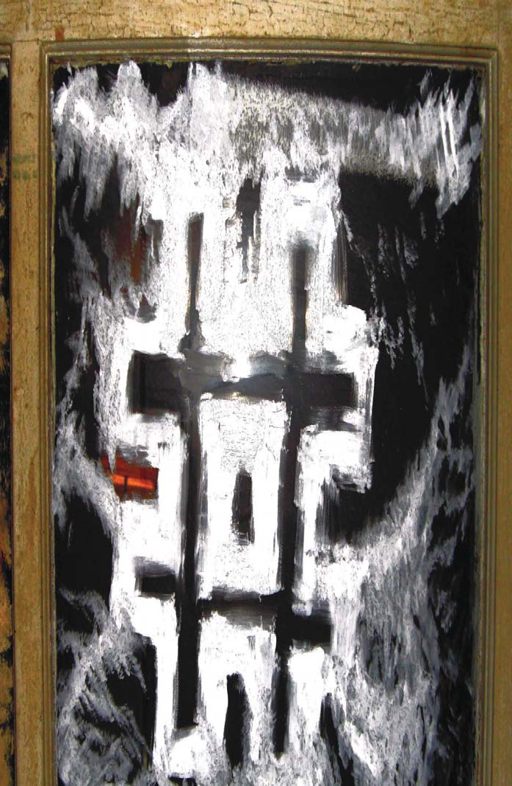
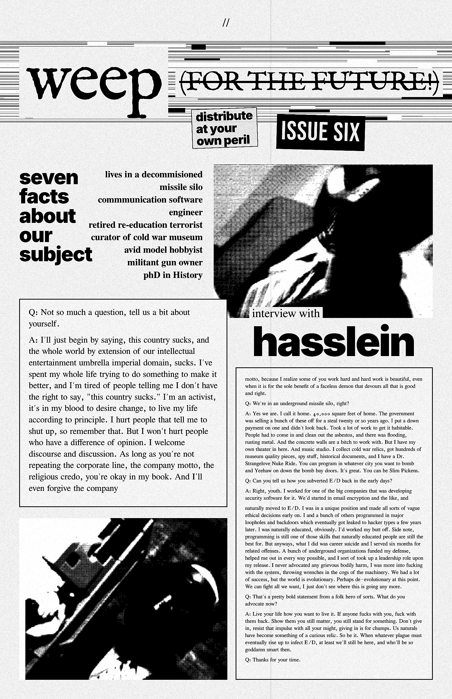
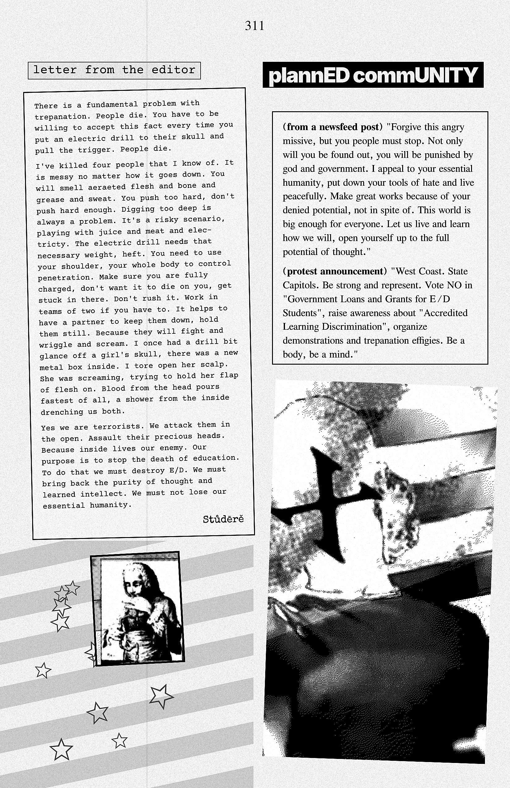
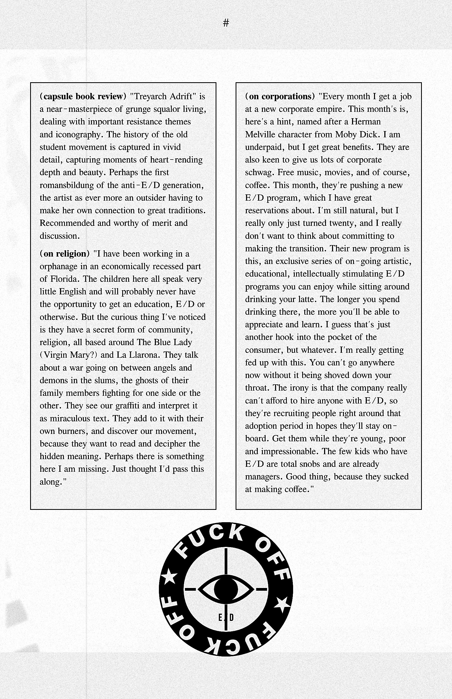
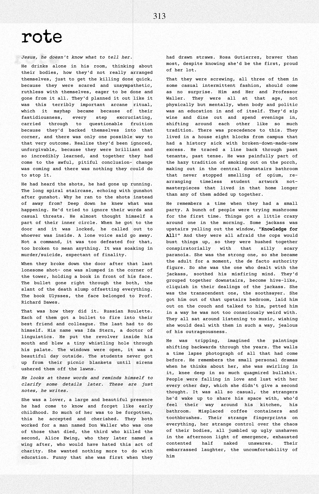
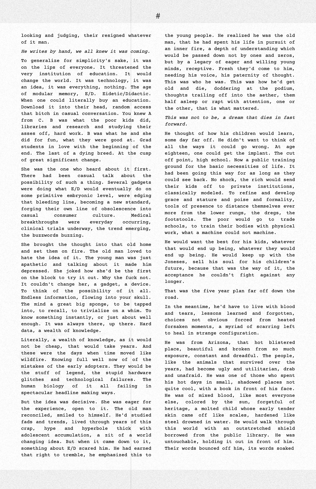
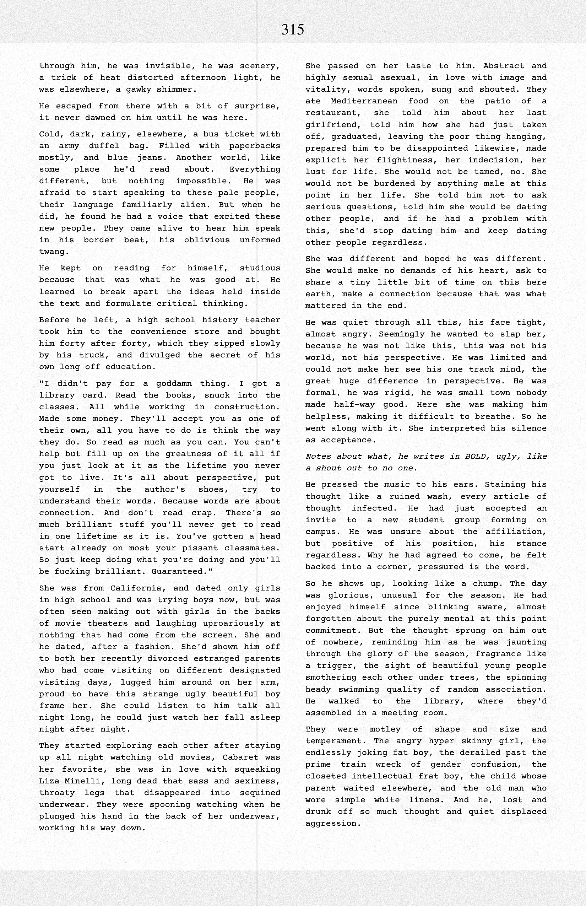
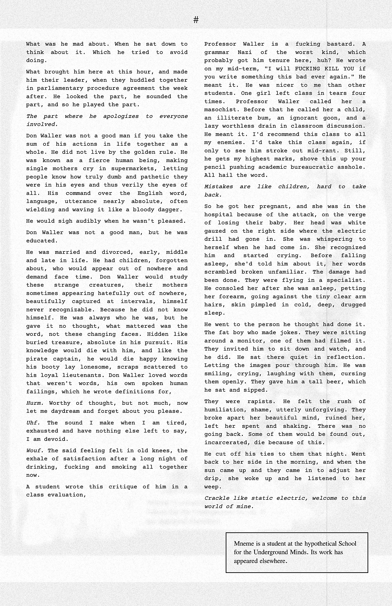
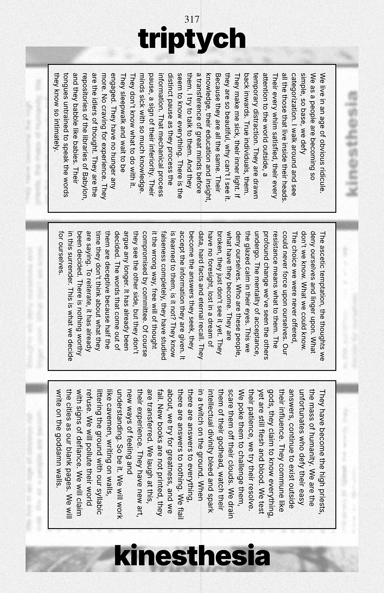

# Volume IV — Scraps, Screenplays & Daddy

*Modern Mythology* (2010) — restored text for the visual novel. Register: **xerox zine punk**. Source pages 292–413 (PDF page index; printed folio = index + 1).

Conventions: `<!-- p.N -->` page anchors · **CUE** speaker lines · `####` sluglines · `> [[RECOVERED …]]` text transcribed from the page image · fenced `:::expansion` blocks are new connective material (not in the 2010 book) — keep, cut or rewrite.

---

<!-- p.292 -->

*Plate: Back-matter plate (painting: white glyph on black)*

<!-- p.293 -->
inward tableaux  

Great gasping sobs is what it feels like to be a miracle  
I feel them before they leap out of me  
tears already cold and chilling on my face.  

I can't look at any of this any longer  
I strain against the leash  
my animal form a bit terrified and trembling to continue  
I am horse, oh, how am I ever.  
I am bat, silent in flight.  
I am salmon, persistent upstream.  

I look in the mirror and see the day as kaleidoscope of image  
fixating on all the work that needs to be done with craftsman type fingers  
picking and choosing among the best of the exciting delightful.  

Tiny little moments hidden out of sight, reflecting back a world of infinite possibility.  

We play the game as only we know how.  

Choose Your Own Adventure, indeed.  

He looks back at me, almost wishing me well.  

To hold his gaze is to know this uncertain animal for what he is.  

Wanting to be tame, wanting to be wild, flexing at the binds that tie.  

All the bones in his spine crack as he flexes with his might.  

His hair flows back, his nostrils flare, with wings he takes flight.  

A mad dervish of flesh and fire and billowing smoke, no  

hot steam from his lungs all of him wails.  

his head waving from side to side  

strong tail pulsing forward

<!-- p.294 -->
scales sloughing off in death.  

This form that binds me loves me holds me and shows me it loves me  
and what do I show back but contempt?  
For this majesty, this vessel, this ark into the world  
Our bodies are histories written in mammal blood and conflictstrife  
The childhoods we had nuzzled in tight and adolescence spent exploring.  

I look with hungry eyes upon the life I want to live.  
So full of horrors, so full of wonders.  
Why are we capable of the very best of everything and also the worst?  
It's not just a struggle outside, it's a struggle that tears apart our very being.  
Who am I?  
What do I matter?  
What does any of this mean?  

Most of the answers are already out there, in the good books.  
We wear it about ourselves, dine with it, take in a movie with it, spend a quiet evening alone with it.  
ourself. A major player in consciousness that most neglect time with.  
Special alone time with who you are and what you need in life.  
This is all about you.

<!-- p.295 -->
> [[RECOVERED from page image]]

*blank (only a stray "#" in the page-number position)*

[blank]

<!-- p.296 -->
scraps - Thursday, May 18, 2006

i realize now that i've done a lot with my day today, but it didn't feel that way ten minutes ago. only when i stopped to think about it, did i understand. i woke up early for class, attended that, came home and did homework, two or so hours worth, read and relaxed on the couch for the rest of the time, reading through an armfull of mcsweeneys published books, the persistent gappers of frip by the excellent george saunders, the people of paper, and everything that rises. the last two are both amazing and elevated my thought in curious ways today. i wrote many words and found a nice gateway into the fake l.ron book i'm writing called the earthman chronicles. i already have a very good idea how i want to lay out and present all the writings from that project/book, and i have to say it's a tad unusual. but it should be pretty, and fun to read, if i do my job right. i'm writing the pulp thing fast and furious, and only today did i stop to look at what i'd written. clunky, but with a little revision, and a new beginning, i really think i opened it up into something far less clunky and thoughtful and pretty. probably too much for a pseudo-pulp novel, but it is clearly evocative of the ethereal john carter books, so it works, i think. i pretty much spend all my work hours, thinking about what i want to write for that, what i need to learn more about, and fun stuff to do.

basically, to lay it out here, the untitled pasadena project: (it really needs a kick ass name, but nothing has come to me yet. maybe one will later, hopefully. usually the title is the first thing that hits me when i write. not this time. i mean, i got individual titles for the individual parts, but not the cohesive whole. oh well)

The first part is the thesis, a fun, wacky bit of meta writing.

<!-- p.297 -->
The introduction really gets things rolling. i've written a lot of this out long hand on reciept paper at work and will not transcribe it here, but just give you the gist... Basically, the introduction is where I apologize to all my friends and family for all the hell i've put them through, following my mental breakdown. This was written in the far off year of 2011, whereupon my graduate thesis was rejected, i disappeared off the face of the earth, and descended into hermetic artistic madness. the result was my revised thesis, which i present here, with notes to the prior edition, which i tried to once publish, but the edition was tied up in a legal battle with the church of scientology.

i have basically come to my senses, this time around, and present the findings as amused yet horrified anecdotes into the initial mindset. but the thesis explores lots of fun stuff, mostly made-up yet truthfully divergent episodes of me visiting my sister at caltech, and mentally projecting myself through some odd caltech scientific experiment, back into the past, which i only remember years later while writing my first thesis.

the second edition of the thesis removes or changes all names of the litigious parties. but it still makes perfect sense.

(yeah right)

as well, there is a long lost volume of science fiction pulp i've brought back from the past somehow, the missing l.ron hubbard 'masterpiece'. which i've claimed as my own for whatever reason. 'the earthman chronicles'. which is way fun and stupid, but tied into the meta-narrative in wild playful ways.

the main character in the story isn't so much me, as jack parsons, the rocket scientist/playboy/satanic church figurehead. i deal with the jack parsons, l. ron hubbard, forrey ackerman circle of old time sci-fi nerds extensively, dramatizing that

<!-- p.298 -->
with odd strokes.

if it sounds insane, i hope it is, because that's sort of the point. i want to go out there on a limb with this one. not play it safe, be a word nerd, challenge myself and try something outlandish and celebrate strange facets of myself and open that up to my own artistic interpretation.

yeah, enough about that. i should read more and fall unconscious with a lot on my mind, neurons safely occupied.

Mailbox (second)  

expecting words to fall out  
of so small a space  
sometimes it does and all falls away.  
names that aren't mine  
lost in these hands.  

rather i pry into shadow lives  
than relinquish my claim  
found on lost correspondence.  
not hard at all to imagine  
a cave not far from shore.  

the trap door shut on  
the sea-shell sounding  
blood in my neck  
echoing waiting for  
words to appear explicit  
writing on walls.  

hesitant dread awaiting inspection  
carefully wrapped missives

<!-- p.299 -->
tucked in context folded corners  
stasis of parcel pieces  
quiet slumber waiting  
for the right hands to find reason  
to bend them crack them  
break them anew.  

The Art of the Public Sanctuary  

to fountains that exist as monuments to idleness  
broken marble laid comfortably askew  
angles bisecting natural order.  
to freshly manufactured lawn that is open to every trespass  
tended by invisible hands that leverage harmony  
for casual consideration.  

to demands of city life that call into question  
rules of governance scheduled demolition zoning jurisdiction  
civil ordinance allotted acreage.  
to weary business people  
looking like freshly risen corpses shuffling unawares  
straggling homeless  
the lively dead  
sitting together on benches without a word shared.  

to quiet afternoons  
not so quiet with city sound  
echoing through concrete glass  
arriving far off wind chimes  
dissonant music played under three feet of water.  
to newspapers left scattered pushed up against young trees  
armored in chicken wire to ward off urban blight.

<!-- p.300 -->
> [[RECOVERED from page image]]

*back-matter verse (end of "The Art of the Public Sanctuary"; "Pinecone (first)", "Pinecone (second)")*

to the child who finds a quiet spot
settles in place absently pulls at grass
thinking of subterranean tunnels
connecting daycare to workplace to bus stop to here.
to adventures that happen just out of sight
small cause for alarm a camera crew
filming at the base of a fountain
because it adds slight motion to an otherwise still frame.

**Pinecone (first)**

armored and pronged waiting to drop
packed tight like a hand grenade
to only explode in a forest fire
when everything else has fled for dear life.

its shrapnel litters the carpet ashen floor
this desolate unmade graveyard wasteland
lying in wait for however long it takes
to be the first to seed new life.

and grow above the rest.

**Pinecone (second)**

armored and pronged waiting to drop
packed tight like a hand grenade
to only explode in a forest fire
untouched by man's hands.

pieces of it litter the carpet ashen floor

<!-- p.301 -->
fallen shrapnel upon unmade desolation  
Lying in wait for however long it takes  
To be the first to seed new life.  

Pinecone (third)  

one of many by nature's design  
hardly unique in no way special  
carrier container delivery system  
of an adolescent nature it maintains.  

armored and pronged waiting to drop  
packed tight like a hand grenade  
oo only explode overhead in a forest fire  
run amok to spread and consummate.  

pieces litter the ashen carpet floor  
fallen shrapnel upon unmade desolation  
firming in wait for however long it takes  
to be the first to seed new life.  

Nourishment  

He is giving away two cabinets for food  
The contents of one exchanged for another  
Nourishment of a different sort  
Retaining whatever knowledge he can  
Of names and titles carried within  

A collection lost out of desperation  
Doesn't dare start thinking eating quietly by candlelight  
The temporary insanity already sated  
The patience of contentedness a friction against

<!-- p.302 -->
The slow crumbling agony of a lifetime's empty legacy  

Retinal Burn (darkroom) (first)  

(I don't know where anything comes from)  

The cathode rays burn through in one of three colors.  
Up close through a child's eyes, like a dance of pinpricks.  
Light from all stars, mostly just our star,  
Capturing and framing countenance and circumstance.  

Shadows sketch far more interesting facets  
Than light ever will.  
The chemical burn, the trace image  
The simple lasting magic that ages as we do.  
Wrinkling yellowing molding  

The negative reverse, the mold cast outward  
To study inward and return to the amber moments.  

There is an unknown process,  
As we don't consider  
The baths of poison that give it color and shape.  
Drying like leaves on a vine after a rainstorm.  

Retinal Burn (darkroom) (second)  

Light from all stars, mostly just our star,  
Capturing and framing countenance and circumstance.  
Shadows sketch far more interesting facets  
Than light ever will.  

The chemical burn, that trace image

<!-- p.303 -->
The simple lasting magic that ages as we do.  
Wrinkling yellowing molding  
The negative reverse, the mold cast outward  

To study inward and return to the amber moments.  
There is a secret process,  
Only known to those who consider  
The baths of poison that give it shape and color,  
Leaving it to dry like leaves on a vine after a rainstorm.  

Retinal Burn (darkroom) (third)  

Light began some ancient journey long ago  
Setting off from all stars, but mostly just our star.  
Arriving without much consideration, falling casual about the day.  
Capturing circumstance and framing countenance.  

Shadows cut across perfect beauty  
Sketching far more interesting facets  
Than mere light ever will.  

An oscillating eye is all there is to see.  
A catch of breath later the chemical burns,  
The trace image remains.  

The negative reverse, the mold cast outward  
To return to, study inward amber moments preserved.  
There exists a secret process,  
Known only to those who consider

<!-- p.304 -->
The baths of poison that give it shape and color,  
Wrinkling, yellowing, molding,  
Left to dry like leaves on a vine after a rainstorm.  

Modern Drunkard  

He relaxes against the hill  
Where grass meets concrete shore  
And raises the oblong can  
To his lips.  

Later he pisses into it  
This half-mile long fountain  
The moon like a smile  

Reflected disrupted wavering.  
Cross-legged he sits  
More listening to  
Than watching the ducks  
Tiny bobbing shapes catching light.  

clean - Friday, April 28, 2006

okay, that shower feels good and deserved.

i am sloppy when it comes to my thoughts. especially when i am really feeling it, emotionally. and i've really been feeling it emotionally this week. and sometimes i get lucky and when i'm really feeling it emotionally, clarity washes over me and words are mine to command. not so much this week, but hopefully soon.

i guess i really don't understand how anything works, especially

<!-- p.305 -->
 my own thought process. but i am very much loving life, learning much, and bringing joy to those who matter.

i tend to come across as haphazard and random, but passionate, and lazy, but intense, and quiet... conflicted, over analytical andy link why can't he just deep breath sigh enjoy himself in this moment...

i really have a lot to do this weekend. for school, mostly, but work will occupy valuable evening time. i'd like to be chumming and slumming with friends, however. so i may lapse if friendly words of encouragement cross my lap.

i am probably going to get started tonight on organizing my poetry portfolio for monday. i have a paper for mexican-american autobiography do as well that day. time is a wasting. at least i'll be all done with everything by thursday.

i went to court yesterday to settle a traffic ticket and my missing in action insurance card. damn court fee was a hundred bucks. eh. now i just have to take defensive driving and all will be squared. i also made a fool out of myself to be sweet to a special pretty girl with flowers and candy. tulips and dark chocolate to be precise, which on a hot day, left in the car for not very long, both became soggy. seriously, i won't live this one down for awhile, i am dork.

i got my new mcsweeneys in the mail yesterday. which was joy of joys, good words to digest at my own leisure. i am still discovering cool stuff in past issues. my appreciation of writers in general has grown immensely and i have much to do to ever make an impact such as any of these fine wordsmiths on the literary scene. but i am eager to try, and ready to fail but good.

<!-- p.306 -->
my camera is all repaired (or so the camera repair people say) and has been shipped back to me. i should get it early next week. i'm excited for 'all right' to come about how it may.

may.

almost here. wow. start of summer. i think this one will be good. despite me being bogged down in school and work. i will play and create much, i know it. my head is bursting with images and ideas i want to share with all the good peoples of the world who crave like i do.

stained glass - Tuesday, March 28, 2006

yeah, i've been working towards a good solid depressed day. a bit of background, about every six months, i seem to collapse into myself, utterly terrified of the world, feeling helpless about life, afraid of all that is good and right. perhaps this is natural and common to other people, but it doesn't seem to be. usually, all i need is a warm presence near me to help me through it. but at the same time, i need a distance from the warm presence. i just need the proximity. i'm too scared to close my eyes and will it away, i always stay sober, i have to surround myself with comfort, and the feeling always seems to last way too long in that day.

i'm not there yet, but i soon will be.

and today was no picnic. i had a great night last night. got to see a lot of swell people, the always delightful and mesmerizing(and hyper silly) p and her crowd of choristes, the soon to be kiwis Mike Scott and Eric V.C, the long time no see Jenn and her friend Kim, and that's about it for last night.

i finished and turned in my meta-fiction, weep (FOR TEH

<!-- p.307 -->
FUTURE!) ((which i should have called it)). i got some curious remarks and can't wait to get the actual class reaction. still need to have a sit down with glenn blake about what i've written so far. i have one more story i think i'll write for that class. just need to find the time to brainstorm. i want to do something completely fresh in my mind.

i also went to the Alley Theater for the poetry reading by Louise Gluck and Franz Wright. that was pretty swell. two Pulitzer Prize winners for poetry, and i liked it. go figure. they were captivating to soak in. i lament my lack of culture.

from this point on, i will play some overdue Oblivion, soak in the intraweb, and wash this bad day away.

send me words people.

weep (FOR THE FUTURE!) - Friday, March 24, 2006

Okay. Tonight I finish this bad boy of a story for school up. I'm going to work until it done. How about that? I'm prepared for an all nighter. So long as the words flow, I'll be fine.

Got to see some fine folk yesterday. The Smitjol, Mansleeve, and Dave Addison. I crashed on D.A.s couch, the strains of Lost lulling me to sleep.

I also got pulled over by a cop for running a red light. I suck. I ran that red light, totally unaware. Maybe he was making it up, but I don't think so. I just said was in a daze and apologized. I think I can take defensive driving to make it go away.

I've had several strange dreams. I'm trying to remember last night's. The night before, was a keystone dream and unlocked several others from my past, allowing me to remember a big

<!-- p.308 -->
giant section of dream time narrative. This dream was what I now dub my "nightmare nautical sci-fi wasteland". In this dream, I'll only highlight the current bits, not all the backstory. I was leading a group of scuba divers through this hellish stretch of ocean going vessel graveyard. Rusted, run aground cruiseliners in a bleak bit of Caribbean keys. The horrific bit was we were being prodded by a massive sea turtle that kept breaching the surface, staring at us, and perhaps eating a few of us. It was unclear, or maybe something else was. This thing was monstrous. The head was the size of trailer home. We were swimming for our lives.

Okay. I need to write now. Must. I start now.

okay. update from the day after. i've finished the story bit of it. just like i said i would. the rest of the project is almost done as well. lots of work i'm doing on that. the graphic design is all done, basically. i just need some flava text. i'll post a pdf of it, and the text of the story, when i'm all done. maybe tomorrow. i need to have it finished by monday, regardless.

Another day. Sunday now. About to run off to work. Just finished the rough of weep. You can read it here or wait until i get you a better looking hard copy sometime this week.

Monday, March 06, 2006  
careful veneer  

crackle and static tug at my ears.  
i'm alone in my room.  
tonight i actually feel it.  
i have words i can't explore because they are stuck coming out.  
i write here in hopes that i can jar a thought or three free.  
i'm working on a new story. it is bizarre.  
it may be planned community redux. i'm not sure.  
it will take a strange shape. i will do strange things with it.  
it is very meta.  
i hope to have it complete before the end of my spring break.  
i will call on several of you to play your part.  
i have a paper/presentation i need to be working on.  
something is wrong with my keyboard or computer.

<!-- p.309–316 -->

## weep (FOR THE FUTURE!) — reproduced zine (pp 309–316)

*Issue six of a fictional anti-E/D zine, reproduced as eight new page images from the 2010 layout (`images/zine/`). Photos are halftoned crops of the original scans. The p.311 corporate-logo parody is replaced by an original "FUCK OFF / E/D" seal. The full transcription follows each image for the script and voice passes.*

<!-- p.309 -->

transcription

*zine collage — cover/interview page of "weep (FOR THE FUTURE!)" issue six (running head is a stray "//")*

[block: masthead, large serif over glitched scan-line texture] weep(~~FOR THE FUTURE!~~) — "(FOR THE FUTURE!)" is struck through by a horizontal rule

[block: pasted label] distribute at your own peril

[block: pasted label] issue six

[image: grainy b/w photo, upper right — a figure in a dark helmet/mask reading or writing, seen close-up]

[block: sidebar, left heading] seven facts about our subject

[block: sidebar, right-aligned list]
lives in a decommisioned missile silo
commmunication software engineer
retired re-education terrorist
curator of cold war museum
avid model hobbyist
militant gun owner
phD in History

[block: headline bar] hasslein interview with

[block: interview column 1]
Q: Not so much a question, tell us a bit about yourself.

A: I'll just begin by saying, this country sucks, and the whole world by extension of our intellectual entertainment umbrella imperial domain, sucks. I've spent my whole life trying to do something to make it better, and I'm tired of people telling me I don't have the right to say, "this country sucks." I'm an activist, it's in my blood to desire change, to live my life according to principle. I hurt people that tell me to shut up, so remember that. But I won't hurt people who have a difference of opinion. I welcome discourse and discussion. As long as you're not repeating the corporate line, the company motto, the religious credo, you're okay in my book. And I'll even forgive the company

[block: interview column 2]
motto, because I realize some of you work hard and hard work is beautiful, even when it is for the sole benefit of a faceless demon that devours all that is good and right.

Q: We're in an underground missile silo, right?

A: Yes we are. I call it home. 40,000 square feet of home. The government was selling a bunch of these off for a steal twenty or so years ago. I put a down payment on one and didn't look back. Took a lot of work to get it habitable. People had to come in and clean out the asbestos, and there was flooding, rusting metal. And the concrete walls are a bitch to work with. But I have my own theater in here. And music studio. I collect cold war relics, got hundreds of museum quality pieces, spy stuff, historical documents, and I have a Dr. Strangelove Nuke Ride. You can program in whatever city you want to bomb and Yeehaw on down the bomb bay doors. It's great. You can be Slim Pickens.

Q: Can you tell us how you subverted E/D back in the early days?

A: Right, youth. I worked for one of the big companies that was developing security software for it. We'd started in email encryption and the like, and

[block: interview column 3]
naturally moved to E/D. I was in a unique position and made all sorts of vague ethical decisions early on. I and a bunch of others programmed in major loopholes and backdoors which eventually got leaked to hacker types a few years later. I was naturally educated, obviously. I'd worked my butt off. Side note, programming is still one of those skills that naturally educated people are still the best for. But anyways, what I did was career suicide and I served six months for related offenses. A bunch of underground organizations funded my defense, helped me out in every way possible, and I sort of took up a leadership role upon my release. I never advocated any grievous bodily harm, I was more into fucking with the system, throwing wrenches in the cogs of the machinery. We had a lot of success, but the world is evolutionary. Perhaps de-evolutionary at this point. We can fight all we want, I just don't see where this is going any more.

Q: That's a pretty bold statement from a folk hero of sorts. What do you advocate now?

A: Live your life how you want to live it. If anyone fucks with you, fuck with them back. Show them you still matter, you still stand for something. Don't give in, resist that impulse with all your might, giving in is for chumps. Us naturals have become something of a curious relic. So be it. When whatever plague must eventually rise up to infect E/D, at least we'll still be here, and who'll be so goddamn smart then.

Q: Thanks for your time.

[image: lower left — high-contrast b/w photo of a handgun lying on a desk beside a round object/helmet]

<!-- p.310 -->

transcription

*zine collage — "letter from the editor" + "plannED commUNITY" newsfeed/protest blocks*

[block: boxed label] letter from the editor

[block: typewriter-face column, slightly rotated]
There is a fundamental problem with trepanation. People die. You have to be willing to accept this fact every time you put an electric drill to their skull and pull the trigger. People die.

I've killed four people that I know of. It is messy no matter how it goes down. You will smell aeraeted flesh and bone and grease and sweat. You push too hard, don't push hard enough. Digging too deep is always a problem. It's a risky scenario, playing with juice and meat and elec-tricty. The electric drill needs that necessary weight, heft. You need to use your shoulder, your whole body to control penetration. Make sure you are fully charged, don't want it to die on you, get stuck in there. Don't rush it. Work in teams of two if you have to. It helps to have a partner to keep them down, hold them still. Because they will fight and wriggle and scream. I once had a drill bit glance off a girl's skull, there was a new metal box inside. I tore open her scalp. She was screaming, trying to hold her flap of flesh on. Blood from the head pours fastest of all, a shower from the inside drenching us both.

Yes we are terrorists. We attack them in the open. Assault their precious heads. Because inside lives our enemy. Our purpose is to stop the death of education. To do that we must destroy E/D. We must bring back the purity of thought and learned intellect. We must not lose our essential humanity.

[block: signature, typewriter face] Stůdērě

[image: inset engraving — 18th-century-style figure (Voltaire-like) above an engraving of a trepanation/surgery on a reclining patient]

[image: background — rotated star-spangled flag fragments, grey brush strokes]

[block: headline, heavy condensed type] plannED commUNITY

[block: boxed text]
**(from a newsfeed post)**
"Forgive this angry missive, but you people must stop. Not only will you be found out, you will be punished by god and government. I appeal to your essential humanity, put down your tools of hate and live peacefully. Make great works because of your denied potential, not in spite of. This world is big enough for everyone. Let us live and learn how we will, open yourself up to the full potential of thought."

**(protest announcement)**
"West Coast. State Capitols. Be strong and represent. Vote NO in "Government Loans and Grants for E/D Students", raise awareness about "Accredited Learning Discrimination", organize demonstrations and trepanation effigies. Be a body, be a mind."

[image: lower right — collage of a head with a black X/cross marked on the scalp, striped flag, and a figure in dark clothing holding a power drill]

<!-- p.311 -->

transcription

*zine collage — two text columns (book review / on religion / on corporations) around a photo*

[block: left column]
**(capsule book review)**
"Treyarch Adrift" is a near-masterpiece of grunge squalor living, dealing with important resistance themes and iconography. The history of the old student movement is captured in vivid detail, capturing moments of heart-rending depth and beauty. Perhaps the first romansbildung of the anti-E/D generation, the artist as ever more an outsider having to make her own connection to great traditions. Recommended and worthy of merit and discussion.

**(on religion)**
"I have been working in a orphanage in an economically recessed part of Florida. The children here all speak very little English and will probably never have the opportunity to get an education, E/D or otherwise. But the curious thing I've noticed is they have a secret form of community, religion, all based around The Blue Lady (Virgin Mary?) and La Llarona. They talk about a war going on between angels and demons in the slums, the ghosts of their family members fighting for one side or the other. They see our graffiti and interpret it as miraculous text. They add to it with their own burners, and discover our movement, because they want to read and decipher the hidden meaning. Perhaps there is something here I am missing. Just thought I'd pass this along."

[block: right column]
**(on corporations)**
"Every month I get a job at a new corporate empire. This month's is, here's a hint, named after a Herman Melville character from Moby Dick. I am underpaid, but I get great benefits. They are also keen to give us lots of corporate schwag. Free music, movies, and of course, coffee. This month, they're pushing a new E/D program, which I have great reservations about. I'm still natural, but I really only just turned twenty, and I really don't want to think about committing to making the transition. Their new program is this, an exclusive series of on-going artistic, educational, intellectually stimulating E/D programs you can enjoy while sitting around drinking your latte. The longer you spend drinking there, the more you'll be able to appreciate and learn. I guess that's just another hook into the pocket of the consumer, but whatever. I'm really getting fed up with this. You can't go anywhere now without it being shoved down your throat. The irony is that the company really can't afford to hire anyone with E/D, so they're recruiting people right around that adoption period in hopes they'll stay on-board. Get them while they're young, poor and impressionable. The few kids who have E/D are total snobs and are already managers. Good thing, because they sucked at making coffee."

[image: centre — b/w photo of a Starbucks siren-logo sign altered so the ring reads "F[?]… OFF" (apparently "FUCK OFF"; top letters cropped/obscured)]

[image: background — faded grey photos of street scenes/graffiti]

<!-- p.312 -->

transcription

*zine page — typewriter-face short story "rote" in two columns over a faded photo background*

[block: title, bold typewriter] rote

[block: italic epigraph] *Jesus, he doesn't know what to tell her.*

[block: two-column story text]
He drinks alone in his room, thinking about their bodies, how they'd not really arranged themselves, just to get the killing done quick, because they were scared and unsympathetic, ruthless with themselves, eager to be done and gone from it all. They'd planned it out like it was this terribly important arcane ritual, which it mayhap became because of their fastidiousness, every step excruciating, carried  through to questionable fruition because they'd backed themselves into that corner, and there was only one possible way to that very outcome. Realize they'd been ignored, unforgivable, because they were brilliant and so incredibly learned, and together they had come to the awful, pitiful conclusion- change was coming and there was nothing they could do to stop it.

He had heard the shots, he had gone up running. The long spiral staircase, echoing with gunshot after gunshot. Why he ran to the shots instead of away from? Deep down he knew what was happening. He'd tried to ignore their words and casual threats. He almost thought himself a part of their inner circle.  When he got to the door and it was locked, he called out to whoever was inside. A lone voice said go away. Not a command, it was too defeated for that, too broken to mean anything. It was soaking in murder/suicide, expectant of finality.

When they broke down the door after that last lonesome shot- one was slumped in the corner of the tower, holding a book in front of his face. The bullet gone right through the both, the slant of the death slump offsetting everything. The book Ulysses, the face belonged to Prof. Richard Dawes.

That was how they did it. Russian Roulette. Each of them got a bullet to fire into their best friend and colleague. The last had to do himself. His name was Ida Stern, a doctor of linguistics. He put the revolver inside his mouth and blew a tiny whistling hole through his palate. The windows were open, it was a beautiful day outside. The students never got up from their picnic blankets until sirens ushered them off the lawns.

*He looks at these words and reminds himself to clarify some details later. These are just notes, he writes.*

She was a lover, a large and beautiful presence he had come to know and forget like early childhood. So much of her was to be forgotten, this he accepted and cherished. They both worked for a man named Don Waller who was one of those that died, the third who killed the second, Alice Ewing, who they later named a wing after, who would have hated this act of charity. She wanted nothing more to do with education. Funny that she was first when they had drawn straws. Rosa Gutierrez, braver than most, despite knowing she'd be the first, proud of her lot.

That they were screwing, all three of them in some casual intermittent fashion, should come as no surprise. Him and Her and Professor Waller. They were all at that age, not physically but mentally, when body and politic was an education in and of itself. They'd sip wine and dine out and spend evenings in, shifting around each other like so much tradition. There was precedence to this. They lived in a house eight blocks from campus that had a history sick with broken-down-made-new excess. He traced a line back through past tenants, past tense. He was painfully part of the hazy tradition of smoking out on the porch, making out in the central downstairs bathroom that never stopped smelling of opium, re-arranging timeless student artwork not-masterpieces that lived in that home longer than any of them added up together.

He remembers a time when they had a small party. A bunch of people were trying mushrooms for the first time. Things got a little crazy around one in the morning. Some jackass was upstairs yelling out the window, "**Knowledge for All!**" And they were all afraid the cops would bust things up, so they were hushed together conspiratorially with that silly scary paranoia. She was the strong one, so she became the adult for a moment, the de facto authority figure. So she was the one who dealt with the jackass, soothed his misfiring mind. They'd grouped together downstairs, become hive-like, cliquish in their dealings of the jackass. She was the transcendent one, the soothsayer. She got him out of that upstairs bedroom, laid him out on the couch and talked to him, petted him in a way he was not too consciously weird with. They all sat around listening to music, wishing she would deal with them in such a way, jealous of his outrageousness.

He was tripping, imagined the paintings shifting backwards through the years. The walls a time lapse photograph of all that had come before. He remembers the small personal dramas when he thinks about her, she was swirling in it, knee deep in so much quagmired bullshit. People were falling in love and lust with her every other day, which she didn't give a second thought. It was all so casual, the strangers he'd wake up to share his space with, who'd feel their way around his kitchen, his bathroom. Misplaced coffee containers and toothbrushes. Their strange fingerprints on everything, her strange control over the chaos of their bodies, all jumbled up ugly unshaven in the afternoon light of emergence, exhausted contented half naked unawares. Their embarrassed laughter, the uncomfortability of him

[image: background — faded, horizontally streaked grey photo (figure/building) behind the text]

<!-- p.313 -->

transcription

*zine page — "rote" continued (two typewriter-face columns over faded photo)*

[block: two-column story text]
looking and judging, their resigned whatever of it man.

*He writes by hand, we all knew it was coming.*

To generalize for simplicity's sake, it was on the lips of everyone.
It threatened the very institution of education.
It would change the world.
It was technology, it was an idea, it was everything, nothing.
The age of modular memory, E/D.
Eidetic/Didactic.
When one could literally buy an education.
Download it into their head, random access that bitch in casual conversation.
You knew A from C.
B was what the poor kids did, libraries and research and studying their asses off, hard work.
B was what he and she did for fun, what they were good at.
Grad students in love with the beginning of the end.
The last of a dying breed. At the cusp of great significant change.

She was the one who heard about it first. There had been casual talk about the possibility of such a thing. Several gadgets were doing what E/D would eventually do on some primitive embryonic level, were edging that bleeding line, becoming a new standard, forging their own line of obsolescence into casual consumer culture. Medical breakthroughs were everyday occurring, clinical trials underway, the trend emerging, the buzzwords buzzing.

She brought the thought into that old home and set them on fire. The old man loved to hate the idea of it. The young man was just apathetic and talking about it made him depressed. She joked how she'd be the first on the block to try it out. Why the fuck not. It couldn't change her, a gadget, a device. To think of the possibility of it all. Endless information, flowing into your skull. The mind a great big sponge, to be tapped into, to recall, to trivialize on a whim. To know something instantly, or just about well enough. It was always there, up there. Hard data, a wealth of knowledge.

Literally, a wealth of knowledge, as it would not be cheap, that would take years. And these were the days when time moved like wildfire. Knowing full well now of of the mistakes of the early adopters. They would be the stuff of legend, the stupid hardware glitches and technological failures. The human biology of it all failing in spectacular headline making ways.

But the idea was decisive. She was eager for the experience, open to it. The old man reconciled, smiled to himself. He'd studied fads and trends, lived through years of this crap, hype and hyperbole thick with adolescent accumulation, a zit of a world changing idea. But when it came down to it, something about E/D scared him. He had earned that right to tremble, he emphasized this to the young people. He realized he was the old man, that he had spent his life in pursuit of an inner fire, a depth of understanding which would be passed down not by ones and zeros, but by a legacy of eager and willing young minds, receptive. Fresh they'd come to him, needing his voice, his paternity of thought. This was who he was. This was how he'd get old and die, doddering at the podium, thoughts trailing off into the aether, them half asleep or rapt with attention, one or the other, that is what mattered.

*This was not to be, a dream that dies in fast forward.*

He thought of how his children would learn, some day far off. He didn't want to think of all the ways it could go wrong. At age eighteen, one could get the implant. The cut off point, high school. Now a public training ground for the basic necessities of life. It had been going this way for as long as they could see back. No shock, the rich would send their kids off to private institutions, classically modeled. To refine and develop grace and stature and poise and formality, tools of presence to distance themselves ever more from the lower rungs, the dregs, the footstools. The poor would go to trade schools, to train their bodies with physical work, what a machine could not machine.

He would want the best for his kids, whatever that would end up being, whatever they would end up being. He would keep up with the Joneses, sell his soul for his children's future, because that was the way of it, the acceptance he couldn't fight against any longer.

That was the five year plan far off down the road.

In the meantime, he'd have to live with blood and tears, lessons learned and forgotten, choices not obvious forced from heated forsaken moments, a myriad of scarring left to heal in strange configuration.

He was from Arizona, that hot blistered place, beautiful and broken from so much exposure, constant and dreadful. The people, like the animals that survived over the years, had become ugly and utilitarian, drab and unafraid. He was one of those who spent his hot days in small, shadowed places not quite cool, with a book in front of his face. He was of mixed blood, like most everyone else, colored by the sun, forgetful of heritage, a molted child whose early tender skin came off like scales, hardened like steel drowned in water. He would walk through this world with an outstretched shield borrowed from the public library. He was untouchable, holding it out in front of him. Their words bounced off him, its words soaked

[image: background — faded streaked grey photo behind text]

<!-- p.314 -->

transcription

*zine page — "rote" continued (two typewriter-face columns over high-contrast photo background)*

[block: two-column story text]
through him, he was invisible, he was scenery, a trick of heat distorted afternoon light, he was elsewhere, a gawky shimmer.

He escaped from there with a bit of surprise, it never dawned on him until he was here.

Cold, dark, rainy, elsewhere, a bus ticket with an army duffel bag. Filled with paperbacks mostly, and blue jeans. Another world, like some place he'd read about. Everything different, but nothing impossible. He was afraid to start speaking to these pale people, their language familiarly alien. But when he did, he found he had a voice that excited these new people. They came alive to hear him speak in his border beat, his oblivious unformed twang.

He kept on reading for himself, studious because that was what he was good at. He learned to break apart the ideas held inside the text and formulate critical thinking.

Before he left, a high school history teacher took him to the convenience store and bought him forty after forty, which they sipped slowly by his truck, and divulged the secret of his own long off education.

"I didn't pay for a goddamn thing. I got a library card. Read the books, snuck into the classes. All while working in construction. Made some money. They'll accept you as one of their own, all you have to do is think the way they do. So read as much as you can. You can't help but fill up on the greatness of it all if you just look at it as the lifetime you never got to live. It's all about perspective, put yourself in the author's shoes, try to understand their words. Because words are about connection. And don't read crap. There's so much brilliant stuff you'll never get to read in one lifetime as it is. You've gotten a head start already on most your pissant classmates. So just keep doing what you're doing and you'll be fucking brilliant. Guaranteed."

She was from California, and dated only girls in high school and was trying boys now, but was often seen making out with girls in the backs of movie theaters and laughing uproariously at nothing that had come from the screen. She and he dated, after a fashion. She'd shown him off to both her recently divorced estranged parents who had come visiting on different designated visiting days, lugged him around on her arm, proud to have this strange ugly beautiful boy frame her. She could listen to him talk all night long, he could just watch her fall asleep night after night.

They started exploring each other after staying up all night watching old movies, Cabaret was her favorite, she was in love with squeaking Liza Minelli, long dead that sass and sexiness, throaty legs that disappeared into sequined underwear. They were spooning watching when he plunged his hand in the back of her underwear, working his way down.

She passed on her taste to him. Abstract and highly sexual asexual, in love with image and vitality, words spoken, sung and shouted. They ate Mediterranean food on the patio of a restaurant, she told him about her last girlfriend, told him how she had just taken off, graduated, leaving the poor thing hanging, prepared him to be disappointed likewise, made explicit her flightiness, her indecision, her lust for life. She would not be tamed, no. She would not be burdened by anything male at this point in her life. She told him not to ask serious questions, told him she would be dating other people, and if he had a problem with this, she'd stop dating him and keep dating other people regardless.

She was different and hoped he was different. She would make no demands of his heart, ask to share a tiny little bit of time on this here earth, make a connection because that was what mattered in the end.

He was quiet through all this, his face tight, almost angry. Seemingly he wanted to slap her, because he was not like this, this was not his world, not his perspective. He was limited and could not make her see his one track mind, the great huge difference in perspective. He was formal, he was rigid, he was small town nobody made half-way good. Here she was making him helpless, making it difficult to breathe. So he went along with it. She interpreted his silence as acceptance.

*Notes about what, he writes in BOLD, ugly, like a shout out to no one.*

He pressed the music to his ears. Staining his thought like a ruined wash, every article of thought infected. He had just accepted an invite to a new student group forming on campus. He was unsure about the affiliation, but positive of his position, his stance regardless. Why he had agreed to come, he felt backed into a corner, pressured is the word.

So he shows up, looking like a chump. The day was glorious, unusual for the season. He had enjoyed himself since blinking aware, almost forgotten about the purely mental at this point  commitment. But the thought sprung on him out of nowhere, reminding him as he was jaunting through the glory of the season, fragrance like a trigger, the sight of beautiful young people smothering each other under trees, the spinning heady swimming quality of random association. He walked to the library, where they'd assembled in a meeting room.

They were motley of shape and size and temperament. The angry hyper skinny girl, the endlessly joking fat boy, the derailed past the prime train wreck of gender confusion, the closeted intellectual frat boy, the child whose parent waited elsewhere, and the old man who wore simple white linens. And he, lost and drunk off so much thought and quiet displaced aggression.

[image: background — high-contrast grey halftone photo (crowd/figures) behind both columns]

<!-- p.315 -->

transcription

*zine page — end of "rote" (two typewriter-face columns over photo) + boxed contributor note; running head is a stray "#"*

[block: two-column story text]
What was he mad about. When he sat down to think about it. Which he tried to avoid doing.

What brought him here at this hour, and made him their leader, when they huddled together in parliamentary procedure agreement the week after. He looked the part, he sounded the part, and so he played the part.

*The part where he apologizes to everyone involved.*

Don Waller was not a good man if you take the sum of his actions in life together as a whole. He did not live by the golden rule. He was known as a fierce human being, making single mothers cry in supermarkets, letting people know how truly dumb and pathetic they were in his eyes and thus verily the eyes of all. His command over the English word, language, utterance nearly absolute, often wielding and waving it like a bloody dagger.

He would sigh audibly when he wasn't pleased.

Don Waller was not a good man, but he was educated.

He was married and divorced, early, middle and late in life. He had children, forgotten about, who would appear out of nowhere and demand face time. Don Waller would study these strange creatures, their mothers sometimes appearing hatefully out of nowhere, beautifully captured at intervals, himself never recognizable. Because he did not know himself. He was always who he was, but he gave it no thought, what mattered was the word, not these changing faces. Hidden like buried treasure, absolute in his pursuit. His knowledge would die with him, and like the pirate captain, he would die happy knowing his booty lay lonesome, scraps scattered to his loyal lieutenants.  Don Waller loved words that weren't words, his own spoken human failings, which he wrote definitions for,

*Hurm.* Worthy of thought, but not much, now let me daydream and forget about you please.

*Uhf.* The sound I make when I am tired, exhausted and have nothing else left to say, I am devoid.

*Wouf.* The said feeling felt in old knees, the exhale of satisfaction after a long night of drinking, fucking and smoking all together now.

A student wrote this critique of him in a class evaluation,

Professor Waller is a fucking bastard. A grammar Nazi of the worst kind, which probably got him tenure here, huh? He wrote on my mid-term, "I will FUCKING KILL YOU if you write something this bad ever again." He meant it. He was nicer to me than other students. One girl left class in tears four times. Professor Waller called her a masochist. Before that he called her a child, an illiterate bum, an ignorant goon, and a lazy worthless drain in classroom discussion. He meant it. I'd recommend this class to all my enemies. I'd take this class again, if only to see him stroke out mid-rant. Still, he gets my highest marks, shove this up your pencil pushing academic bureaucratic asshole. All hail the word.

*Mistakes are like children, hard to take back.*

So he got her pregnant, and she was in the hospital because of the attack, on the verge of losing their baby. Her head was white gauzed on the right side where the electric drill had gone in. She was whispering to herself when he had come in. She recognized him and started crying. Before falling asleep, she'd told him about it, her words scrambled broken unfamiliar. The damage had been done. They were flying in a specialist. He consoled her after she was asleep, petting her forearm, going against the tiny clear arm hairs, skin pimpled in cold, deep, drugged sleep.

He went to the person he thought had done it. The fat boy who made jokes. They were sitting around a monitor, one of them had filmed it. They invited him to sit down and watch, and he did. He sat there quiet in reflection. Letting the images pour through him. He was smiling, crying, laughing with them, cursing them openly. They gave him a tall beer, which he sat and sipped.

They were rapists. He felt the rush of humiliation, shame, utterly unforgiving. They broke apart her beautiful mind, ruined her, left her spent and shaking. There was no going back. Some of them would be found out, incarcerated, die because of this.

He cut off his ties to them that night. Went back to her side in the morning, and when the sun came up and they came in to adjust her drip, she woke up and he listened to her weep.

*Crackle like static electric, welcome to this world of mine.*

[block: boxed contributor note, serif]
Mneme is a student at the hypothetical School for the Underground Minds. Its work has appeared elsewhere.

[image: background — grey photo of trees/foliage, figure at upper right]

<!-- p.316 -->

transcription

*zine collage — "triptych / kinesthesia": three sans-serif panels printed rotated 90° on the page (read with page turned clockwise)*

[block: rotated vertical label, left] triptych

[block: rotated panel 1]
We live in an age of obvious ridicule. We as a people are becoming so simple, so base, we defy categorization. I walk around and see all the those that live inside their heads. Their every whim satisfied, their every attention to the world outside, a temporary distraction. They are drawn back inwards. True individuals, them. They make me sick, their inner light. If they are so beautiful, why can't I see it. Because they are all the same. Their knowledge, their education and insight, a transference of great minds before them. I try to talk to them. And they seem to know everything. There is the distinct pause as they process the information. That mechanical process pause, a sign of their inferiority. Their minds sick with so much knowledge. They don't know what to do with it. They sleepwalk and wait to be engaged. They have no hunger any more. No craving for experience. They are the idlers of thought. They are the repositories of the libraries of Babylon, and they babble like babies. Their tongues untrained to speak the words they know so intimately.

[block: rotated panel 2]
The ascetic temptation, the thoughts we deny ourselves and linger upon. What don't we know. What we could know. The choice we were never offered, could never force upon ourselves. Our resistance means what to them. The profound change we've seen the others undergo. The mentality of acceptance, the glazed calm in their eyes. This we deny ourselves. Who are these people, what have they become. They are broken, they just don't see it yet. They have no foresight, lost in a dream of data, hard facts and eternal recall. They become the answers they seek, they accept the information they are given. It is learned to them, is it not? They know falseness completely, they have studied it the wrong way, free will of thought compromised by committee. Of course they see the other side, but they don't argue any longer. It has already been decided. The words that come out of them are deceptive because half the time they don't think about what they are saying. To reiterate, it has already been decided. There is nothing worthy in this surrender. This is what we decide for ourselves.

[block: rotated panel 3]
They have become the high priests, the mass of humanity. We are the unfortunates who defy their easy answers, continue to exist outside their influence. They commune like gods, they claim to know everything, yet are still flesh and blood. We test their patience, we try their resolve. We poke them to challenge them, scare them off their clouds. We drain them of their godhead, watch their intellectual divinity bleed and spark in a twitch on the ground. When there are answers to everything, there are answers to nothing. We flail about, we try for greatness, and we fail. New books are not printed, they are transferred. We laugh at this, their experience. They have new art, new ways of feeling and understanding. So be it. We will work like cavemen, writing on walls, littering the ground with our syllabic refuse. We will pollute their world with signs of defiance. We will claim the cities as our blank pages. We will write on the goddamn walls.

[block: rotated heavy label, lower right of panel 3] kinesthesia

[image: background — dark b/w photo of a wall covered in handwriting/graffiti and tree branches behind the three panels]

<!-- p.317 -->
> [[RECOVERED from page image]]

*blank (only a stray "#" in the page-number position)*

[blank]

<!-- p.318 -->
Sunday, February 05, 2006  
twirlwind

wow, life.

i'm sort of approaching critical mass. life is both too good to me, and a complete bastard.

i have feelings, tremendous feelings, but time is going by both too fast and too slow. time is choice in how it cruel it does this. i shake an angry finger at time.

because

i am altogether smitten.  
i am writing like a madman. each new bit is getting better than the last. i've grown afraid of new words, afraid i'll fail, afraid i'll fuck it all up. but i know i won't, no way, no how.  
school is brilliant. my profs are like unto demi-gods of good reading and writing.

on the downside, i probably work too hard so that much of life is dedicated unfairly to just getting by. but the delicious irony is that it makes the worthy choice bits that much more incandescent.

somebody slap me.

<!-- p.319 -->
Thursday, January 19, 2006  
service engine soon

i'm so unbelievably happy right now, but there is a puzzle piece missing.  
i say this here in abstract because if i say it out loud, to myself, i'll just give it form and that would probably break me. I've done it before, spoken my own curse, brought it down upon myself. And I hate doing it to others.

When it comes to passion, when it comes to depth of feeling, i have this reserved front i continue to put up, yet it does me no good in the end. All i want to is do the selfish arrogant male thing and shout my heart out for the world, sometimes recklessly, but all that has given me is heartache and too much time and distance from those i adore.

The games we play, the poker metaphor. The showing of the hand. See, here's how i normally am. I know I got a great hand, I'm terrible at bluffing, anyone can read me. But I got a great hand regardless, read into this how you will. But I know I'm a good person, that I have many outstanding qualities and virtues and blah de blah, that I can make people happy just by being myself. And I'm grinning because I know I got it good, on the inside and outside, I'm a happy camper. I live in that moment, of knowing myself and wanting to know other people, truly understand them, and accept them. I don't ever want to put my cards down, I want to hold them back and smile and look across and not be judged on what I'm holding back.

But that's not how people play that game. I wish I could communicate more of who I am without really giving away all the best surprises, I wish I could exist in the present to so many people who matter so much, but until I get better at

<!-- p.320 -->
> [[RECOVERED from page image]]

*scraps — 2006 blog post ("service engine soon" end)*

opening up, truly learning how to communicate without alienating, saying stupid things however honest they may be, they end up hurting just as much.

I shouldn't write right after running. I'm still a bit dizzy. And sweaty. Yuck.

School is awesome. Life is awesome. Unsaids are awesome.

<!-- p.321 -->
#### INT. AND EXT. VARIOUS LOCALES - DAY AND NIGHT

**CHARLIE (AND CHORUS)**  
We all just want her out of ourheads. We can't get her out. She sits at the top of our thoughts, sometimes a casual obsession, more often, a horrible beautiful daydream. Destroyer of men and women alike, we adore her in spite, because of, for being exactly who she is. She's our muse, a rotten thing of perfection and imperfection entwined. She has no conscience, no thought for anyone but herself. To spit on her face, to kiss her lips. That's why we love her. That's why we'll do anything to be near her, to help her, to put her on a pedestal to raise her higher and higher, further and further from the depths we sink to because of her. We reach out. Call out. Scream out. Caroline.  

TITLES: SISTER CARRIE, BASED ON THE NOVEL BY THEODORE DRIESER

#### INT. A BUS STATION - DAY

CHARLIE DROUET stands, reading his newspaper. His name imprinted on the newspaper itself. He wears a simple t-shirt with jeans. His hair uncombed, his face slightly stubbly.

<!-- p.322 -->
CAROLINE walks up to the bus overhang. She has a bag by her side. Her clothes are disheveled. She is attractive, but nothing special at this time and place, still, the spark is there.

Charlie folds up his newspaper and walks over, looking her over just a bit.

**CHARLIE**  
Where you headed?  

**CAROLINE**  
My sister's, not too far from here.  

**CHARLIE**  
Where you from?  

**CAROLINE**  
Small town, about three hours east. You'd have never heard of it.  

**CHARLIE**  
Can I offer you a cigarette?  

**CAROLINE**  
No thanks, don't smoke.  

**CHARLIE**  
I insist you start or start back up.  

Carrie takes the cigarette and he lights.

**CAROLINE**  
Thanks.

<!-- p.323 -->
#### INT. THE BUS - DAY

They both sit on the bus. He is sitting next to her. They both steal looks at each other. Each speaks to the camera in turn.

**CHARLIE**  
I'd like to think I charmed her, I'd like to think there was some instantaneous attraction neither of us could help or control.  

**CAROLINE**  
When they think about me like this, I always look better, sound smarter than I really am. I'm really nothing special. I always insist, but they never seem to hear.  

**CHARLIE**  
I was fantasizing about all the things I'd like to do to her, nothing super dirty. I mean, I wanted to see her naked, wanted to touch her. But it was all just casual sensual, just getting to know you fantasizing.  

**CAROLINE**  
Charlie was real sweet, mostly harmless. Not the kind of guy I usually go for, exactly the kind of guy I know I'll end up hurting.

<!-- p.324 -->
**CHARLIE**  
I'm taking creative license with this whole introduction scene, because I can't exactly be honest about how raw and honest our initial encounter felt. This is all in retrospect, all suspect to my emotion. Nothing objective. I hope to strip it all away and make ourselves naked and somehow figure out just who this girl is.  

**CAROLINE**  
Charlie's a passionate guy, but a bit naïve. Wears his heart on his sleeve. That can be really attractive in a guy. Or not.  

Charlie looks at Carrie. She looks back at him. He hands her his business card.

**CHARLIE**  
Look, I know you're new here. But if you need someone to show you around, help you get comfortable with the city, all you gotta do is let me know. I keep my own hours, so it's never a bother.  

**CAROLINE**  
Thanks Charlie.  

#### INT. CHARLIE'S APARTMENT - NIGHT

Charlie is lying in bed, a book over his chest.

**CHARLIE**  
I'm a single man. I enjoy the frequent

<!-- p.325 -->
company of different women. I have projects I must work on, people to see, art to make. Instead, I sit in bed and let my imagination take hold. I let Caroline sink in. I most like the affect she has on me.  

#### INT. THE BUS - DAY

Charlie gets off the bus, Carrie stays. She flips over his card, then puts it in her purse. A middle-aged business man or professor type sits next to her. He plays with a PDA.

**GEORGE**  
Wife totaled the goddamn car this morning, talking on her phone. Yap Yap Yap. She's to see about getting a rental, which I asume will be a piece of shit wrecker. Goddamn inconvenience and then some.  

Carrie kindly gets off the bus, passing in front of GEORGE HURSTWOOD.

**CARRIE**  
Have a good day sir. Hope it improves.  

#### INT. CHARLIE'S APARTMENT - DAY

Charlie wakes up in bed and walks through the apartment.

**CHARLIE**  
Professor George Hurstwood teaches Literature. He has a wife and two children. He is forty-three years old and is currently

<!-- p.326 -->
 working with his agent to publish his fourth collection of short stories. I happen to be in one of his classes.  

#### INT. HURSTWOOD'S CLASS - DAY

The desks are all in a circle, workshop style. Charlie shares a book with an attractive girl.

**HURSTWOOD**  
What's nice about my job is I can get grad students to do all my work for me.  

**CHARLIE**  
What's nice about his class is I'm the only dude in it.  

**GIRL**  
I find the journey of Rasselas to be something of an insight the human spirit, but the exotic setting is kind of hokey and one dimensional. At least it goes down easy for bullshit philosophy disguised as fiction.  

#### INT. CHARLIE'S APARTMENT - DAY

Charlie is getting dressed and ready for the day.

**CHARLIE**  
I have a date with some girl named Andrea today. One of her friends hooked us up at this club called Paradise Lost.

<!-- p.327 -->
#### INT. AN ABSTRACT NIGHT CLUB OF PECULIAR LIGHT AND FORM - NIGHT

**CHARLIE**  
I know nothing about her, except that she waved at me, she had glitter all over her face, and her smile was like words can't describe, like the most beautiful music in the world playing under three feet of water.  

This music of sorts play over an abstract club scene. Charlie takes two small indented pills with a shot of vodka. The grittiness of the scene gives way to a healthy blur of color and shape. Bodies touch and pull away from each other. Charlie's smiling face stands out among it all.

The girl who is ALL SMILES comes up and dances. They dance close and she kisses him. His hand goes down her back. Her eyes are Carrie's. Charlie pulls back and examines this amalgamation. A cut-out of Carrie's head is worn like a mask over ALL SMILES' face. Glitter is stuck to it in fact.

**ALL SMILES**  
I'm going to ask you out and you aren't going to even remember this moment, are you?

<!-- p.328 -->
**CHARLIE**  
Of course I'll remember. I may not get all the details just right, but I'll remember.  

**ALL SMILES**  
Goodness gracious.  

All Smiles leans in to kiss. Their faces meet. 2D plays against 3D. In all the dancing that's going on, Charlie and All Smiles become a solid blur of connection.

#### INT. A GRUNGY BATHROOM - NIGHT

Charlie leans up against the wall, looks at himself in the mirror. Someone has drawn a face with a sharpie marker. His reflection framed most peculiar.

**CHARLIE**  
An after party. Where lines are crossed, connections made, and everything forgotten in a blur of indulgence and high energy.  

Charlie goes outside.

#### INT. THE AFTER PARTY - NIGHT

A woman swings on a tire, her dress leaving contrails of pink and orange light. One contrail bounces all over the room. Charlie follows it to the bar, where it lands in a shot glass. He downs the pink

<!-- p.329 -->
liquid and turns to look.

Carrie is standing there, smiling at him. Charlie eyes her suspiciously.

**CHARLIE**  
You're not in my head are you?  

**CAROLINE**  
I dunno, am I?  

**CHARLIE**  
I thought I saw you earlier, but it wasn't you. She didn't even look like you. But I think I made her look like you-  

**CAROLINE**  
In your head?  

**CHARLIE**  
Exactly!  

Caroline produces a cigarette.

**CAROLINE**  
See what you did to me?  

**CHARLIE**  
What I've been doing? What have you been doing? You get settled in with your sister? All moved in?  

**CAROLINE**  
You really want to hear about all that?

<!-- p.330 -->
**CHARLIE**  
Tell me everything, leave nothing out.  

#### EXT. THE SISTER'S HOUSE - DAY

Carrie stands outside with her bags by her side. The house is pretty low rent, in bad shape, maybe two bedrooms, tight and cramped, the yard in a sorry state.

**CAROLINE**  
My sister got knocked up the first time when she was fifteen. Mom and dad kicked her out when the kid was off her tit and she could go out and look for work. Instead, she got pregnant again. Different daddy, of course, but they got married and here they be. I was told I could live with them if I got work and looked after the kids on weekends.  

#### INT. THE HOUSE - DAY

Caroline is standing as the SISTER and BROTHER-IN-LAW go about their business, yelling at each other, ignoring her.

**SISTER**  
Wal-Mart is always hiring. They hired me, they'll hire you. Pay ain't great, managers are a fucking chore, but it's big and you can slip under the radar if you start to hate it.

<!-- p.331 -->
**BROTHER-IN-LAW**  
No socks. I said I wanted clean socks. Didn't you hear me say that yesterday?  

**SISTER**  
How hard is it to throw your own goddamn clothes in the goddamn dryer.  

**BROTHER-IN-LAW**  
I asked you. You said you'd do it. Now I don't have clean socks.  

#### EXT. WAL-MART PARKING LOT - DAY

Carrie stands in the parking lot, wearing a Wal-Mart vest.

**CAROLINE**  
Piss test later, I got a job. Pays six fifty an hour, and drains the last bit of life left out of me. I can do better. I know I can. But I come home exhausted, all I want to do is sleep.  

#### INT. THE AFTER PARTY - NIGHT

Carrie is aglow. She's an absolute beauty. Charlie is gently touching her back. They sit together on two stools so close together.

<!-- p.332 -->
**CHARLIE**  
So what are you doing right here right now?  

**CAROLINE**  
I really want to act, you know? I was in a couple high school productions. No big parts or nothing, but I loved it more than anything.  

**CHARLIE**  
Now bring me full circle.  

**CAROLINE**  
A guy was hitting on me at work, asked me out. I don't know anyone yet, so I figured why not. Now here I am. All tired lonesome lonely, and more than a little drunk.  

**CHARLIE**  
How far do you have to drive?  

**CAROLINE**  
Thirty minutes.  

**CHARLIE**  
My place is within five walking. You're welcome to crash on my couch.  

**CAROLINE**  
Why thank you Charlie, how very nice of you to offer.  

#### INT. CHARLIE'S APARTMENT - NIGHT

<!-- p.333 -->
Charlie and Caroline are making out on the couch. Kissing lightly, tenderly.

**CHARLIE**  
How very nice indeed.  

**CAROLINE**  
I'm really very tired you know.  

**CHARLIE**  
You're welcome to join me in bed.  

**CAROLINE**  
It's okay. The couch is fine.  

**CHARLIE**  
There's not room enough for us both on the couch.  

**CAROLINE**  
Yeah, I'm really tired Charlie.  

**CHARLIE**  
Cool. Cool.  

Charlie pulls back and stands up. She settles into the couch. He puts a blanket on her.

**CHARLIE**  
Good dreams Caroline.  

She's either asleep or unresponsive. Her face is blank, but sweet.

<!-- p.334 -->
**CHARLIE**  
I'm just standing here and watching her sleep. I think I'll continue doing this. I should probably talk about something, to fill the void of me just staring and remembering her touch, her taste. She got to me good, no, more grand than good, something about her, just her way of being, her style and her eyes, learning all about me. I can't take my eyes off her. I can't stop thinking about her.  

Charlie sits in a chair across from her.

Time passes. He's fallen asleep. His hair wildly fluctuates, though he stays still. It's like a force of nature is messing up his hair despite him staying stationary.

It is morning now, the blanket is still on the couch, but Carrie is gone.

A passage from Sister Carrie near the beginning, most important. Granted, my take on this will be very similar, but very different. It's a very modern book, despite the era in which it takes place. first chapter, subtitled, a waif amid forces.

"When a girl leaves her home at eighteen, she does one of two things. Either she falls into saving hands and becomes better, or she rapidly assumes the cosmopolitan standard of virtue and becomes worse. Of an intermediate balance, under the circumstances, there is no possibility. The city has its cunning wiles, no less than the infinitely smaller and more human tempter. There are large forces which allure with all the

<!-- p.335 -->
soulfulness of expression possible in the most cultured human. The gleam of a thousand lights is often as effective as the persuasive light in a wooing and fascinating eye. Half the undoing of the unsophisticated and natural mind is accomplished by forces wholly superhuman. A blare of sound, a roar of life, a vast array of human hives, appeal to the astonished senses in equivocal terms. Without a counsellor at hand to whisper cautious interpretations, what falsehoods may not these things breathe into the unguarded ear! Unrecognised for what they are, their beauty, like music, too often relaxes, then weakens, then perverts the simpler human perceptions.

Caroline, or Sister Carrie, as she had been half affectionately termed by the family, was possessed of a mind rudimentary in its power of observation and analysis. Self-interest with her was high, but not strong. It was, nevertheless, her guiding characteristic. Warm with the fancies of youth, pretty with the insipid prettiness of the formative period, possessed of a figure promising eventual shapeliness and an eye alight with certain native intelligence, she was a fair example of the middle American class--two generations removed from the emigrant. Books were beyond her interest--knowledge a sealed book. In the intuitive graces she was still crude. She could scarcely toss her head gracefully. Her hands were almost ineffectual. The feet, though small, were set flatly. And yet she was interested in her charms, quick to understand the keener pleasures of life, ambitious to gain in material things. A half-equipped little knight she was, venturing to reconnoitre the mysterious city and dreaming wild dreams of some vague, far-off supremacy, which should make it prey and subject--the proper penitent, grovelling at a woman's slipper."

The first meeting of Carrie and Charlie on the train heading into Chicago, in which he charms her within a moment. The amount of dialogue will be minimal. The emotions, gestures,

<!-- p.336 -->
and signals should do most of the talking. Working with framing, incidental detail, and visual evocation, ie lighting, staging, blocking.

"How true it is that words are but the vague shadows of the volumes we mean. Little audible links, they are, chaining together great inaudible feelings and purposes. Here were these two, bandying little phrases, drawing purses, looking at cards, and both unconscious of how inarticulate all their real feelings were. Neither was wise enough to be sure of the working of the mind of the other. He could not tell how his luring succeeded. She could not realise that she was drifting, until he secured her address. Now she felt that she had yielded something--he, that he had gained a victory. Already they felt that they were somehow associated. Already he took control in directing the conversation. His words were easy. Her manner was relaxed."

In the beginning, we have to feel her unease of the men coming up to her, winning 'these small victories'... and her alienation with her new surroundings. She's not in her skin yet. She's not a tourist, but rather, a new tenant to the city of which she knows little about, has little contact to.

"Carrie realised the change of affectional atmosphere at once. Amid all the maze, uproar, and novelty she felt cold reality taking her by the hand. No world of light and merriment. No round of amusement. Her sister carried with her most of the grimness of shift and toil."

In the beginning, I want Carrie to be naked. The men who will project so much of their desires and wants on her, will first encounter her as such. She is most herself at the beginning and end, away from the perspective of the suitors. It is in the two bookend scenes where we see how much she has changed and

<!-- p.337 -->
how very much the same she has remained the same.

betterment

What I know about myself, what truly there is to know, is more story than analogy. I am not like anything but these words right now. We're in the past. Two days ago I heard something that stuck with me. Two people I did not know were discussing their love for their child. They were not married, all there was between them was their love for their child. They could not stop talking about her. How intelligent. How completely and totally wonderful she was. She was. That's what made them smile. These two people were not in love with each other. They only saw each other because of her. To talk about her. You realize somewhere about now that their little girl is dead and that's all they have to talk about. Her life. What it mattered for, what it meant to them and why they meet out here of all places to talk about her. Their words carry, their story bleeds over into our lives because. The table is twisted wire. You spill a drink the liquid splashes through a film of stick remains.

I don't know what to tell you. Okay, yes, that's a lie. I do. I just have to think about it. The story. Yes. I don't know what happens next to these two people. The man's name is Jason. He wanted to grow up to be a surfer and became a semenary student instead. Her name is Rebecca. I might have loved her if things were different. Rebecca spoke to God for the first time when she was ten at a friend's house. They were playing around with candles, pictures of angels. Becca looked in the bathroom mirror and saw her future. Her friends found her ten minutes later, convulsing, babbling like a baby. Cooing. Kawing. Smiling with her tongue out. This is what came between us. This is what brought them together. Their baby died not too

<!-- p.338 -->
long ago, two and a half. Married a year out of college. They hooked up in California where Becca was studying journalism. Jason was still a surfer hadn't found God yet. Never really did find God, had a friend drown though. Drunk and tethered to his board on a really bad spill. Jason cried to Becca one night, outside a small mexican restaurant, tilting the margarita glasses back to finish them off. She took him back to her dorm room and lost her virginity despite her word to God.

We can talk about a lot of things now. Her name was Esther. She was a happy accident. Jason and Becca never even discussed marriage. It just sort of came to pass in a frantic three months in the middle of summer. They honeymooned in San Francisco. Jason got drunk one night and passed out in the hotel lobby while going down for ice. Becca panicked, thinking he'd run out on her and the baby inside her. She was weeping when she called up her sister and told her all her insecurities and how Jason had slept with another woman before he proposed to her at her parents house. Becca's sister gave Becca her credit card number to reserve a plane ticket should things fall apart before they ever really began.

Becca searched the hotel for Jason and eventually found him. She'd walked by him four times and only saw him because she stopped to look at herself in a gigantic mirror adorned with iconographic engravings. She took it as a sign when all it was was a mirror. She found him looking at herself, seeing how desperate she was, looking into mirrors.

When Esther was born she was premature. She was kept on a respirator for ten days. When she was taken off, she had weak lungs, and several serious complications as result. She was a beautiful baby. Quiet, happy. She put up with a lot of discomfort. Her eyes, when they first came alive, took in everything. She made funny noises and startled at the odd sounds and she loved the new faces that entered her world and cried when they were gone. She was a baby who was learning

<!-- p.339 -->
so much about the world, herself, and the people who loved her.

Jason and Becca broke up a month and a half after Esther died. Jason cried on Becca and they talked about God. Jason went to stay with his brother who worked as a Ranger in Redwood National Park. Becca stayed there to finish up the schooling she put on hold to start a family.

I sit and listen at a table and hear two strangers talk about things that should not concern me. I might be paying too much attention, listening in on their story and hearing something that is not there. There's something more I want to hear. I picture her and I think about how her life might be different with me not in it. Fantastic, I hope. Sad. Of course. All lives are worth crying about to some degree. Maybe this is too much.

We're someplace else now. Explanation is needed. Things you need to know about me. I'm writing in my underwear at two in the morning. I'm coming down with the flu, and I should be sleeping because I need to be at work earlier than normal. Writing comes to me easier the closer I get to dream. To be asleep and be awake at the same time is a very unusual, sensual experience. Music plays quietely as not to wake the other people in the house who live here with me asleep behind their doors and walls. I am debating whether or not I should be honest to you, the reader, because my life is very complicated at this point. It's simple in how easily even I misconstrue it.

Another moment of my life taken out of context.

A day away from Thanksgiving. I am thinking about Christmas presents for my friends and family. I am greedy. I want to spend all my money on presents for myself and only give them my words. I am writing stories for each of them. Stories that will be read by only them, me giving my stories over to them completely, to do with them what they will, out of my hands. All the stories together will tell a larger story, one that they may or may not be aware of. I will keep no copies

<!-- p.340 -->
 of these stories. I will print out one copy and one copy only for each of them. What happens to those words is entirely up to them.

Another story for all of you. This one about two sisters, who each had a lot to say to each other but only said it to other people.

Gina was around twenty-five and single, not bad looking, not afraid of the world, she fed off innocence. She had that dark thing going for her. She made bad choices and learned to live with them. She respected honesty and beauty and people who were open to new ideas. Her baby sister Agnes was only seventeen. Anges was losing her innocence but the many people like Gina still fed off the innocence that existed inside her. Agnes was alive and full of hope and dream. People who saw her were the people who had lost this, wanted her for that reason only no matter how good looking she was, how smart she was, that's all they saw until they'd used it up all out of her. Both girls grew up in the same household but Gina had a different father she remembered living with until she was five.

Agnes had a friend, we'll call him Eric who wanted to be an artist. He drew anatomy. Not flesh so much as bone. He liked to fascinate himself with evolving lines that became mazes that became illusions to the eyes at so many angles. He dropped out of high school at age sixteen because no one around him seemed to care. Eric worked at a gas station part time and lived at a house with his brother's friends.

While Gina worked at a call center, she dreamt of vacations to the far north, wherever that might be. Because it was cool and wet and so much like a dream. She lived south, where it was hot and sticky and where it only got foggy on the highway with so much pollution. Gina called old people, who were either about to die or were already dead. She hated her job. It had no future for her though the industry of health care

<!-- p.341 -->
only seemed to be growing.

While Agnes was at school, fourth period, she thought about a road trip Gina took her on last summer. They went to New Orleans without all the Mardi Gras hooplah. They went to Bourbon street and all the historical landmark cliches that marked the map. They stayed at a cheap motel with a cheap, not totally unsanitary public pool. Some nights after sightseeing, they sat in the pool and talked to different boys who were passing through. On the second to last night, Anges watched her sister make out with Derrick and Todd and thought nothing of it. Neither of them wanted her so she went up to her room and fell asleep.

While Eric smoked on his break, he watched the cars go by on the service road leading up to the highway. He thought about buying a new car should he win the lottery. He thought about hanging out at IHOP afterwork with some chicks his brother wanted him to meet. Eric didn't know what he wanted so much as he wanted to want again. He thought he might want to try Opium. God knows why. He thought about PCP. How fucking crazy that might be. If there was a world that existed outside this one, Eric thought about how fucking mindblowing it'd be to step over to the otherside just for a lunchbreak and maybe not ever come back. When Eric talked to his friends, mostly what he talked about was making a fresh start for himself somewhere new. He wanted to run from what he had. Not that he didn't have anything. He just had opportunity and he blew it. He hated regret, because everyone told him he shouldn't have any regret. But he did.

Things are radically different in no real discernible way. Quantum physics are to blame. Particles that interact with other particles are forever entwined across time and space. Destroy an atom and time travel is possible. Collide an atom, shatter it and it is not lost, it will reconstitute in another time and place. Conservation of mass, conservation of the universe,

<!-- p.342 -->
 the big and the small forever in orbit, the unknown tug of gravity, the one force that we have yet to fathom that does not seem to exist except for the effect it has on everything. It is not light, it is not energy, it is not matter, it is perhaps everything and nothing. It is an idea that maybe it comes from the very center of the universe pulling forevermore. What pulls us. What makes us. What is responsible for all this being. The cold hard truth is that we will never know. Even the faithful cannot deny the overwhelming reality. It creeps in like cracks in china, intact but questions permeate. What they probe is both their faith and their conscience. When they ask questions to God and they get their answers, are they any wiser? Are the scientists, the mystics, the lunatics and artists? If all the faithful screamed out in unison, if all the skeptics continued to work towards their own answers. Denying that, disproving this. The simple conclusion, the singular occurrence of humanity would remain.

There is a colorblind boy who does not yet know he is colorblind. His world is our world and this difference is not yet part of the cultural consciousness that will emerge from his life.

There is no philosophy to contain humanity. No government, no utopia, no bright and shiny future to look forward to. The universe is slowly ending. Humanity works towards its own end much quicker. The hope that remains begins with children who see the world, their world and universe, as a playground of right and wrong and possibility, not plausibility and deniability. The dream of humanity, the ideal of humanity is very much alive in minds such as these.

\# posted by Andy : 10:09 AM

Man. Crack me up. All these posts are saying exactly

<!-- p.343 -->
the same thing, exactly the opposite thing. Cause for worry. I realized I'm not at all sick anymore today. Wow. Just snuck up on me. Feeling well, not coughing up crap, not feeling down. Well, I feel down, only because it's a down sorta day. It's all in my head. I am a simple, nice guy. I can make myself happy damn it. Heh.

all over town

Ripped from a headline. Stolen from the lips of passersby. The idea of E/D. What it meant. What it would be. Just a buzzword. Just a maybe. What it could be was a revolution. The stuff of science fiction. A concept too good to be true. E/D was still years away from becoming a common reality, a necessity just as necessary as the microwave oven. It was like a hard drive for the human mind. It was about random access memory. Real memory. Human memory. It was Eidactic, Didactic. Artificial connections overriding hard wired consciousness. It was about knowing shit. Shit you didn't know before you bought that memory module at Walmart. It was about the death of eduction. It was time to weep for the future. Because already people were saying E/D would be the doom of mankind. The airplane of evolution stalled mid-flight. What would become of the human race because real progress was built on the foundation of knowledge. Real know-how came through experience, learned experience. You could not go from A to C without hitting B. When the news hit, nothing much happened for weeks. People had to digest something this big. Then the old professors started not coming to classes. Those who had spent years learning the old fashioned way, whose entire sum of their existence counted for shit. They killed themselves. Up in their old reading rooms, private offices, home studies because they looked at the faces of their students and they knew. They were extinct. Because of what was coming around the corner because an education could truly be bought like a piece

<!-- p.344 -->
of software. Coming in shrinkwrap, an instruction manual the size an old serial novel. It was obscene. It was sacrilege. Because academics shunned the possibly maybes. Because science fiction wasn't true fiction. They ignored progress, they ignored the very dreams manifest. Because progress wasn't really at the true essence of humanity. It wasn't real, it wasn't tactile, it wasn't emotion. It was the march of time, a beat they could draw from always keeping one step behind. Because E/D was the baton twirler and they were the basso instruments in the back, heavy and monotone. Those that lived had nothing to do but discuss what would become of education. How it would change. How society would change. The schools would stay, no doubt. They were still about separating the classes, furthering the divide. Now classrooms would be more styled on the old style. The true style of teaching. Open discourse. In the round. Because perspective could not be aquired through technology, not yet at least, because E/D could give a small child the knowledge of nations but it couldn't teach it how to think. Not that they'd install the E/D interface in children. They were already discussing the age protocol. How much should a person really know, could a person really know and how soon should they be able to. Because educators would still be needed, could still make an impression. They'd just have to make one much sooner. Because the age of instant information was coming. Because the flood was loosed upon mankind.

jack of suede

Dressed all in black like an upstate concert goer. The sound of a Theremin off in the distance, humming and trilling, not shrill but pleasant like a bad 1950s mad scientist creature feature only turned into something romantic, desperate. Because

<!-- p.345 -->
 music is important, that's why they're here. It's not a diversion, an escape into the throng of the masses. It's a retreat into their own tiny heads. Picture a stage draped in satin, sheets of satin, black and kind of shimmery, like a reflecting pool of black oil, slick. The theatrics are overwhelming, often stealing away from the focus. Her. Half naked, half interested in them. She's like the bead of light at the end of the magnifying glass. Burning them with her radiance, her indifference. She's not quite human. She sings and they all scream, wail, moan and faint. Whatever, she thinks. Like she hasn't seen this before. But she smiles and continues singing. So. Long. Farewell. She's working on a movie. She'll star in it. Produce it. But the idea's not hers. The script, please, she doesn't even write her own songs. She's pop. She's manufactured. An image to associate with an emotion and she knows it. The latest model off the assembly line. If you squint real hard you might be able to tell them apart. In a few years it'll be someone else's turn to shine. She's the only reason they're here but her story just might be the least interesting. Days spent in buses, airports, record stores, megamalls, rehearsal halls, hotel rooms, hotel conference rooms, lobbies, penthouses, saunas, bars. She's never alone, never turned off. She's a machine of human process, human desire. Without them she can't function. Without them she's never truly alive. Without him, she'd be nothing. He's old, fat and unattractive. He has more secrets, more dirty little secrets than even he can stomach. He's gotten blow jobs from children while their parents look on. He once let a thug cut the lips off a girl because she just wouldn't shut up. He doesn't report half of what he owes in taxes. He's a bad man. Jack was once a record executive. He worked for the RIAA. He made millions and millions of really easy to get money. He wrote contracts and pushed talent in and out of offices. He didn't even listen to the music, couldn't even stand it. He wears ear plugs for these concerts. Music is all about image to Jack. Music is all about the attitude, the charisma. Because

<!-- p.346 -->
 really ugly fat chicks can sing like the very angels themselves but they can't get the thirteen year old boys or girls at home with the radio on and the genetalia between their fingers off. Because fantasies are all about attraction. About wanting someone. Wanting to be that someone. Live that lifestyle, wear that outfit, command those audiences. This was the power of Kings and Queens. What people raised nations over. And this was the new warfare, the new art of war. Jack would never be a figurehead but he could be the puppet dictator. Because true Kings and Queens were often children. Half retarded children stunted by parents who couldn't parent who thrust their young ones into the wilds to further themselves. Jack was a bad man but he wasn't a monster, not like these people who sell their young into slavery. Who live vicariously on the telly on the loo with the tabloid rag between their sweaty palms who can read all about their fictional selves in totally unauthorized biographies. Whose offspring defined their existence.

Jack was in town on a hot tip. Here to make the claim, attend to the virgin sacrifice. Some girl in a junior high school had come out of nowhere. Auditioned for a musical variety show. One of the casting agents in his pocket got him out here first thing pronto. Jack had treated her folks to a nice dinner at some place noveau, limo, champagne, caviar, all that bullshit they expect. Because their baby's a star. An honest to goodness piece of heaven, piece of ass. Get them backstage, get their eyes wide as saucers, all this can be theirs. It's not a hard sell. It's not like it's their life savings. It's just their baby. She's practically an adult now anyway. She can make up her own mind. She's old enough and knows what's best, who are they to interfere with her dreams, her wishes. And she's 15. Jack sees kids half her age wanting twice as much as her. Their tiny little brains already forced into ambition. Molded into rock star movie star fashion primadonnas. Because this is the Cinderella society. Where you can be poor, dumb and ignorant, but if you're beatiful and you've got a bit of fairy dust,

<!-- p.347 -->
you can be Queen. The power of the people. Few can resist the call. It made Jack kind of want to believe in Fate. Watching promise fulfilled. Destiny itself could not resist this very temptation. Jack sipped bottled water, five bucks, stood back and watched the happy family unit, watched that brief flicker, it wasn't something he wished for, knewing what he knew.

angry fog

Lizza Beth wanted to succeed at something, anything. She listened to opera because it seemed distant, different. She wrote stories about things. She spent a lot of time lying in bed, staring at the ceiling, waiting for inspiration. Her parents thought she might not ever become anybody, ever do anything to distinguish herself but she knew deep down inside differently. She read great novels, great poetry. A little bit of Emily Dickenson, a little bit of Thoreau, a little bit of Ernest Hemingway. She couldn't fully commit herself to a style, a genre. She had a short attention span which meant she never finished A Thousand Years of Solitude, Hard Times. They were good books, they just didn't click how she wanted them to. She liked Prozac Nation. The chick in that was kinda cool. Lizza Beth read a quote from France or something about young people. How they were self-centered and full of dreams and half-baked schemes to be the Very Best Person in the World. Lizza thought most guys her age were kind of like that but all her girl friends didn't act that way. They wrote stories about getting molested, even though maybe just one of them had actually gotten molested because that's what girls her age did because shit like that needs to be talked about. Brought into the open because stories are all about getting inside someone, telling their secrets. Because they've gotta have Epiphanies, they've got to get something from the experience. Because getting molested makes them a better person at the very end like in a sitcom, how everyone's all made up and

<!-- p.348 -->
happy and all life's problems are wiped clean in the span of thirty minutes. Because if something really awful happens to you, you grow from the experience. That's why all those World War Two movies were popular at the moment. Because young men could get shot and killed, and kill people, too, and still come out better people because of it. Getting Molested was her generation's World War Two. Well, at least it might have been until that whole 9/11 thing but even that only really counted if you were from New York. One girl Lizza knew tried to pull some bullshit sympathy about 9/11 and since she wasn't a New Yorker, she heard some shit about it. The whole second cousin of my friend bullshit everyone else was pulling was still so very in. The cheerleader weep parties and stuff. Lizza Beth did art stuff because she wasn't really good at the math and science stuff and she was quick to point out that it wasn't just because she was a girl because her brother and dad were awful at those thing too. The whole Art Fag mentality pissed Lizza off some. She didn't want to be different, she didn't want to change who she was just to stand out. If someone had to bullshit themselves into hating their lives just to get some sympathy, fine. Just wasn't her thing. She thought one of the most beautiful things in the world was fuzion. The concept that someone can take something old and make something new out of it. Maybe mix it up a bit. Because old stuff was generally very boring by itself and new stuff, with all the hype and crap, it just came across like a commercial. If she had to think of an example of something fuzion, something kick ass, it'd probably be anything by David Lynch. Even though Twin Peaks was like, twenty years old, it was both cutting edge and eerily nostalgic. She liked that. She wanted to move to a small town like that where everyone had perfect lives and kept horrible awful secrets. That was so much cooler than being here, where all the houses being built had to follow construction guidelines to keep them all looking as different as possible without looking too different. Like, her house followed

<!-- p.349 -->
the same basic floorplan as half the buildings in her neighborhood did. Only difference was the kind of brick and roofing they used to stick on the outside. Cosmetic surface differences. Lizza Beth could go to a friend's house for the first time and know exactly where everything was without even asking. Lizza didn't even have to think about this shit, didn't even realize how fucked up things were until Marco entered her life. Marco was from Venezuela and he was pretty fucking hot. He didn't look very Mexican, looked kind of like a blonde European. He hated Texas, he hated the United States. Marco's dad was, like, fifty, and still going to college. The corporation he worked for in Venezuela paid for his schooling, even though, he was like, fifty. Only deal was, as soon as he was done with school, he had to go back to Venezuela and work for them for fifteen years. Kind of like slave labor, only he still got paid. Marco said his dad only made the equivalent of two grand a year in Venezuela, working for the oil companies. They lived pretty good though, lived in a nice part of the city in a pretty nice apartment building. Marco spoke good English because his mom taught at an International School and he got a free education there, which cost five times as much what his father made. So in a way, Marco's mom was the real breadwinner of the family, which Lizza Beth thought was cool, considering most women in Venezuela were still only secretaries and shit, because Marco said it was like being in the United States circa 1950, those ideals where women could only be mothers and beauty pageant winners and swimsuit models. Lizza thought that was horrible and learned that horrible was the same word in Spanish, spelled the same, only pronounced different. She wished she'd been taking Spanish instead of French. She thought French was cool when she was twelve because it sounded prettier and all the smart people in commercials and good movies spoke French, but now she knew different. But, cool thing was, French and Spanish were still very close in terms of reading and talking, which she didn't

<!-- p.350 -->
realize until she met Marco. So when he said stuff in Spanish, she kind of knew what he was saying. He also knew French, Spanish, Italian, Japanese and German. He was studying Latin and Russian with his mother, who spoke thirteen different languages. That blew Lizza's mind. All she knew was English and two terms of French. She always thought foreigners didn't know how to speak English, but it turned out according to Marco, most of them spoke English and about a half dozen other languages. Marco also hated going to public schools. He thought they were like slums. Lizza agreed with him, because things were pretty shitty, all things except sports. The stadiums and uniforms were all new, all kept up. Marco wanted to go to college in England and with the grades he was getting, Lizza thought he could go anywhere. Marco liked soccer, which he called football, and could completely destroy anybody when he was on the field. He played for the high school and he was the star. The soccer boys were called faggots and fairy queers, because this was Texas, and real football was what was popular. Marco got beat up when he wouldn't try out for American football, because they saw him running, saw how fast he was. What pissed them off wasn't that he was good, it was just that he didn't give a shit about them. Like he was living in some parallel dimension where what they were doing just didn't matter because not being part of the popular crowd was practically a crime. The kids who drifted too far from the mainstream, who saw things that other people couldn't see, they were practically living in the Twilight Zone. You could be black, Mexican, gay or old, as long as you weren't fundamentally different on the outside. The kids who played Dungeons and Dragons and had Chess Club and talked about computers and Shakespeare and fake wrestling on television and old movies like Star Wars, well they were geeks but even they had each other. Lizza was afraid of becoming untouchable, like those poor Indian beggar people. The Jahti, they called it. The caste system where everybody was a part of the body, only the

<!-- p.351 -->
untouchables were nothing. That's so true because that's how it was here. There were people who were nothing, who had nobody, who no one would speak to. Because whoever the Indian equivalent of Jesus Christ might've been, he must've been in high school.

heavy breathing

Aaron was thinking back to when he was in eighth grade and when he was sitting next to a kid named Billy Terry From McKinney Texas. Billy Terry From McKinnery Texas was the newest kid. He had a sort of redneck west Texas accent. He thought everybody else spoke funny. Y'all speaking funny. When he introduced himself to everyone, he always called himself Billy Terry From McKinney Texas, so that's what everybody ended up calling him. Billy Terry From McKinney Texas. Billy Terry From McKinney Texas wasn't in school for very long. He got kicked out, expelled, and sent to a Juvenille Center for sexually assaulting a sixth grader in the drama room during lunch. They were working on puppets for a drug sketch they were going to perform for the fifth graders, four blocks over at the elementary school. Aaron was sewing costumes for the puppets, ones he designed and he didn't notice the two of them making out behing the miniature stage. They tried to get Aaron expelled, too, because they thought he was going along with it. He didn't know. He thought they were just practicing. Improvisation, trying out their puppets. Aaron seemed slow to other kids, adults and only his mother and him agreed that he just had an overactive imagination. They had to explain to him when he was twelve that a certain show on televsion wasn't real. Aaron never got to go to the movies or rent videos because he wasn't permitted to watch anything over PG. He still played with his toys when he was thirteen, still had an imaginary friend who he couldn't see but still very much believed in. He saw a show on television about alien

<!-- p.352 -->
abductions and two weeks later had a waking dream where soft melodies and blue lighting filled his bedroom and little white alien people came in and poked him in the arm with a very large needle. He couldn't move at all, and his eyes were open and he was very scared. The next day he was sunburnt like that guy in Close Encounters of the Third Kind, and acting very funny around adults and drawing pictures in textbooks and reading old Omni's in the library. Aaron's mother didn't have enough time for her kids as she had to support them all by herself. She dated once or twice a year, went out with her girlfriends to windowshop for men but remained relatively faithful to her ex while he served out his sentence. She only had a year left before he was to be let out for good, should he remain on reasonable terms with the state. She had to support a sickly son, a boy with asthma who couldn't play sports because his body could kill him, who really needed some sort of activity to keep him grounded to reality. She bought Aaron a videogame system when his father went away. Like a babysitter, only less teenager. One of those early nintendo systems, with the simple graphics and sound. Back when the games were still cute and harmless. Aaron was immediately taken by the games, the whole nintendo culture that was built up around them. He read the magazines, studied the strategies and comic books and cartoons on television. He ate the cereral. He didn't have friends but he got friends so that he could have someone else to play with. Steven Chau was stuck up and a bit of an ass for a kid, but when he got hit by that first car, he couldn't do anything physical for a couple months so Steven's mom bought Steven the latest Sega system, which Aaron didn't have, so Aaron invited himself over to try it all out. A friendship of sorts was built out of videogames. The competition and cooperation of those little bleeping bits of code.The two boys didn't really like each other to begin with, but they liked the games so they stuck it out. Aaron was not as smart as Steven, and kind of insane in many ways. Steven could freely cuss at

<!-- p.353 -->
Aaron in Cantonese because Steven's mom didn't like Aaron much back then and Aaron wouldn't ever respond, just stare blankly at the screen, fiddling with his videogame controller. The two never really became real friends until Steven's second car incident. Aaron remembered watching his friend try and eat with chopsticks again for the first time, sobbing unsuccessfully afterwards. Aaron was the one who showed Steven he could still do something. He helped his friend get some motor skills back thanks to those damn videogames. Aaron had patience in ways that most people did not because Aaron was the kind of kid who never really got bored with anything. Some said Aaron was the kind of kid who could be entertained staring at a blank wall for hours on end, that maybe Aaron could look after Steven but couldn't look after himself. He could game upwards of ten hours straight, not stopping to eat, rest or even use the restroom. He pissed himself more than once but never bad. Just little piss spots.

ourobouros

Steven put gel in his dark hair and stared at himself in the mirror, remembered when he pissed himself, shit himself, when he'd wake up in the middle of the night rank with shit, wet with stick. He tried to hide the sheets and clothes in his closet after he showered in the middle of the night, scared and quietly crying despite himself. He didn't like being reduced to a baby at the age of thirteen. He didn't like how words came out of his mouth when they came out at all. How he sometimes had seizures in public and how the scars on his body looked when he went to a public pool. He was getting better, slowly, but he would never be as good as he was. He used to be in gifted classes, with gifted kids who weren't as smart as he was. He had to go to normal classrooms for the very first time in his life where the kids were just as mean and bitter as the teachers class materials old and out of date and covered in

<!-- p.354 -->
spit and snot and bite marks and had pictures that were probably taken in the nineteen seventies. Where instead of using computers, they watched filmstrips and listened to headphones while they followed along in work books that had all the pages torn out. His old friends called him a retard. He got Cs. He worked so hard to never get back to where he was.

what sort of

"Tell me where to drop you off. When to drop you off. Recognize anything yet?"

The kid wasn't looking up, just holding his head in his hands in his lap. "Just drop me off and I'll be okay."

Chess looked at the kid and kept on driving. Because she'd been in his place before, had the kinds of nights he was just now waking up from. He looked so mad at himself, so not interested in what was happening outside his head. Chess thought about how old people looked, their eyes totally eating up everything, so interested in what was out there, like they were tired of who they were, but in a good way. Kids like her and him just had to keep moving, because because because they had no reason to stop. She needed coffee and caffeine however she could get it. She had to get to sleep in a couple hours so she could be up by nine pm and exhaustion was the only thing that did her in for sleep. Chess couldn't bring herself to stop the nightlife, couldn't get back on a real schedule like the rest of them. When she was up all night and the sun popped up and morning was here, her mind told her no, her body told her yes, because natural cycles fucked everything up. The music and energy that drove her, drove her to the ground, where she slept on a mattress in a small single room apartment. She had a futon for visitors, which could uncomfortably fit two in certain situations. She had a small black and white television, not because she couldn't afford color, but

<!-- p.355 -->
because she liked the artificial noir. In front of the curtained picture window was a pretty swell stereo system she built herself piece by piece after graduation. Her music collection shrunk to tiny since she went digital. She kept everything on CD and inside her on computer. She had several external computer hard drives she kept in a stack, which she'd pop in and out of her Mac as she saw fit to update her collection. She did her composing on a Yamaha keyboard which also plugged into the Mac, allowing her to compose in silence with her headphones on, because she had neighbors who didn't keep the same hours as her. She kept to herself here when she wasn't at work, because work was all about other people, other people's music. Chess took the kid to her apartment because she only lived three miles from the Saga and she didn't feel like wasting her whole morning on his account.

"I gotta phone, should you feel so inclined to make a phone call to somebody, anybody."

Chess motioned for the boy to follow her into the elevator, which he did at his own pace. He kept turned away from her. "That nose of yours is something. Looks like a spoiled fruit."

His bottom lip pursed but he said nothing.

"Got a name, yeah, you got a name. Maybe you'd like to share it?"

"Norm."

"Like normal. Cool."

"Norman Todd. Most people just call me Norm. Or Todd. Because Norman was that guy in Psycho. Norman Bates."

The elevator opened and Norman Todd followed Chess out into hallway, where an elderly man was walking their way with a garden trough in his hand.

"Morning Earl."

The old man didn't say anything, but his face brightened with the look of extreme pleasure and satisfaction, his

<!-- p.356 -->
smile so much a smile as to split the skin along his lips and his eyes. Chess kept walking and Norman Todd kept following, moving closer to her with each step.

voices in a crowded room

"Give me a reason. Give me one fucking reason. Ain't got one? That's okay. People like you got em even if you can't say the goddamn words. I've served on juries, I've gone to third world countries, I've even set foot in a ghetto slum, so I know what poor people look like, what they sound like, and what they don't do for a living. You Miss, are a good for nothing bum. You don't shop so much as you scavenge. It's all about the handout, isn't it? It's all about popping out bastard kids and wearing stretch pants and being a hundred and fifty pounds overweight, even though you have no money to buy food, so you expect the government to give you food, because getting something for nothing is what you live for. You want to amount to nothing, good, because you might as well kill yourself now. It's a goddamn shame people like you have to exist for the rest of us to matter. Goddamn."

"It's hard to understand things that are not connected to us, have never been a part of our lives. We've actually got to learn how to connect to people, places, ideas. Hate is sort of the disconnect that happens. Not when we make the effort not to learn, but when we choose to remove those people, places and ideas from ourselves entirely. It hurts to breathe sometimes, thinking about how much people hate us. How what we do and say won't make a whit of a difference, how even if they have us at their mercy, they'll go ahead and kill our children in front of us just for spite. It doesn't matter how we talk, how we look, what we believe, because we're all the same really. Because someone out there hates you no matter who you are. Because all you can do is try and stay alive, try

<!-- p.357 -->
and not cross paths with the person or persons who will undo you. Because this isn't about paranoia, it's about survival. It's about history and who we are. There's a reason we believe in the end of the world. It's about being a faceless individual in a heartless society. It's about being a person in your own mind, waging war against yourself, where yourself is never constant, where what you believe is just energy tap dancing across tiny tendrils of flesh. What you percieve isn't real, it's just a delusion of what you want to be real. It's reality motivated by your own petty desires and dreams. It isn't what the rest of us want. We want to be better than you. And in the end, we will crush you and you will be dead. Another tragedy, another disconnection from the life we lead."

"Babies laugh and cry, but they can't sing. I've never heard a baby sing. I wonder if babies even know what music is. It's just noise to the baby and maybe all of life is just noise to the baby. They say a baby's brain is formed in the last three months of pregnancy, before that it really doesn't have a human brain, not really. When a baby is not a baby, it can start to sing and dance and play. Before that it's just cute and tender and stupid. They say playing music for a baby will make that baby grow up smarter, like maybe noise is what makes us smarter. There are plenty of smart deaf people, but before, back in the day, they called them deaf and dumb, like maybe the two were connected somehow. Maybe that's just how they were percieved. Because nobody did nothing for them. Maybe filling up some baby's head with noise, keeping them surrounded by words and sounds and compositions of music, maybe that can have some effect on how they come to be. Maybe the same can be true for the opposite, being alone with yourself, the senses you rely on for company. Babies have the possibility of the world in them. Everything and nothing."

"Saw a man once, man with a stick for a hand. Not like

<!-- p.358 -->
a hook or nothing. A stick, like a twig, only bigger than a twig. It just came out of his wrist. I'm sure it was hygenic and had some sort of purpose, but it didn't look it. Looked like he had a goddamn stick for a hand. Didn't look like he belonged in this world. Looked like something out of a horror movie, or some cave drawing. Having a stick for a hand has to be symbolic of something, but didn't seem that way to me. It didn't even look like a sturdy stick. Like maybe it might break at any second. He couldn't use it for nothing, except scaring kids with. I kept thinking if he fell down, he'd probably try and stop his fall with his stick hand, and break that stick, or worse, drive that stick even deeper into the stump. Maybe he was some sort of circus freak show person, maybe some masochist who does that to himself for the attention. Probably not. Probably just some guy. Only difference being his stick for a hand."

"I'm looking for something. Anything. Because nothing fills the void. I'm programmed to want. I'm programmed to desire more than I can have. And having nothing hurts me. It gnaws at me. I'm not going hungry. I'm not ignorant. I just want what I can't have. I am nothing because I have nothing. I haven't had sex in over three years. I don't drive a nice car. I live in a run down apartment and eat grilled cheese and macaroni and cheese. I steal ketchup packets from fast food places. I steal straws for God's sake. It doesn't make any sense. Because I'm not really poor, in the grand scheme of things. I wasn't born in Somalia for God's sake. I'm not living in my Mother's basement any more, but I might as well be. I have credit card debt, and school debt and I think I owe the IRS still, for some strange stock thing I can't explain. Because I wasn't even making enough to file at the time, and yet they still want money from me. I have nightmares about repossession and my teeth falling out. I dream about days off where I can sit at home and do nothing but watch television and jerk

<!-- p.359 -->
off. Because I don't want to kill myself, but I don't want to be alive any longer. I'm twenty four and I look at my father and I think he's had a much better life than me. Maybe that's what I need to do. Become a father, become a caregiver to a child who doesn't want to be here. Because I think maybe some people are happier never being born. Like maybe things just get worse the moment you're concieved. Because it can only end one way."

"Nothing is happening. You repeat to yourself, nothing is happening. This is going nowhere. These people mean nothing. Their lives, their words, they count for shit. And you'd be right. Damn right. They depress me. They bring me down and take me away from where I want to be. But the petty and insignificant are our friends and family. They are the people who aren't us. They are people we write letters to once a year and push to the backs of our memory. We can never be less than perfect, never immaculate for more than an hour out of the day. Depression is a sickness and it can be treated with self help. We just have to read books about how to get better, attend seminars with survivors who have stories to share. Don't fall into the abyss. Don't lose yourself in your sorrow. To stop caring is to stop living. Pay attention to the voices around you. Listen to what they have to say, even if it doesn't make any sense. Because to them, it does. Because to them, they've got to share. This is about healing. This is about returning to yourself."

looking forward most

She was set. She had everything planned out. Her evening was before her. She had a list, a winecooler her parents wouldn't notice missing, three kinds of scented bubble bath, bath beads, and scented oils, a book about sex only not really

<!-- p.360 -->
 because she found it in the school library, and her cellular phone which was flashing blue and pink, pulsing out near the antennae. She was getting ready for the evenening that lay ahead, that she could not get too excited about else she'd set herself up for disappointment, but she could imagine scenarios, situations that weren't too unsensual, too unusual. She could sit back and smile and think dirty thoughts, feel like a girl and a woman and alive for one night a week. Lizza Beth spent hours getting ready for the moments ahead. She could dream about words that would never be said, looks in his eyes that could never be read. She believed in the potential of forever. Wishing for the happilys and evers after. She painted her nails, and played with her eyelashes. She could be an artist make herself the art. She could try and transform her ways most subtle. She felt just a little different just a little better. Here a little there a lot. She could taste the artificiality on her lips, and she loved it. That spoiled creme pink, that blue current under her eye that made her look as happy as she wanted to be. It wasn't only a date, it wasn't only a moment set aside for the two of them, it was the promise of more, and it wasn't really a date, it wasn't really something that concrete. It was just a movie. They did it a lot. They went out and were friends and could just act evil and bullshit and be kids and adults and little monsters. They'd see R-rated movies because they were almost seventeen and no one ever checked, and they'd go to a fifties mall diner and have hamburgers and milkshakes and watch the greasers and rollerskating foodhandlers with their pierced tongues and noses and dyed hair go zooming past. Because the moments they had together, together, went by too quickly. Because Lizza Beth would reflect on those moments until the next moment. She would analyze and plan and attack the memory, the future, like all young people did who knew what they were doing. She could dream and breathe and smile and sigh. She could be naked and unashamed, be analytical of herself and see only potential. Depression was something that

<!-- p.361 -->
wasn't happening to her, wasn't who she was. Not today, not right now.

the wasted sentiment

Steven didn't want to leave his house, didn't want to make the journey outside. He was still tired and stiff from falling asleep like he did, twisted in a tight spot. He dreamt of being at a summer camp for smart kids, where the kids did science experiments and played on computers, only he just wanted to go swimming and sing around the camp fire and be a kid. They had plans they made last Sunday night and looked forward to all school week. They had parties to go to, raves to track down, energy to burn.

seem

John worked in a twenty four hour drug store where he was watched on twelve different cameras. He hated being watched, hated the automatic distrust. Because these cameras were not in the general area of the store, these cameras were pointed at him, in the back of the store. John thought he was an honest kid. Thought he'd never ever want to break a rule, break a law. But it was getting to him. He wanted to spite the invisible eye. He hated his job, hated how little he was paid to do basically nothing. He read books most of the time and fell asleep on the job occassionally because there were door chimes to alert him to incoming customers. He listened to electronic music. It was great because a customer couldn't tell he was listening to music because all he did on the job was run a barcode across an electronic eye and handle greasy dollar bills and plastic strips of denomination. There used to be another kid who worked with John but the corporation that owned the drug store was about to go public and laid off a fifth of the work force. John didn't think much about the

<!-- p.362 -->
safety concerns of being alone in a big drug store at four in the morning but neither did the corporation who made his decisions for him. An elderly man had come into the store three nights ago wanting itch creme. John didn't give much thought to the old man but pointed him in the right direction when words were required of him. The old man came back, angry because he couldn't find what he was looking for, and angry John couldn't help him out because he couldn't leave the counter, the till full of money left unattended. The old man got angrier and John asked him to leave. That's when he came for me. The old man rushed John with an electric drill in his hand and drove the whirling metal bit into his head. He was trying to get at me. Trying to kill what he thought was me. Pushed John to the floor and pushed his hair to the side and found the incisision. That's when he plunged the drill into his skull. Two inches in. The scrap of blood and bone and metal. Yellow goo came out the hole. It felt like a bomb went off in John's head. Then when the old man was gone, John hit the panic button and called 911, but didn't talk into the reciever, because he didn't know if he should. When they took him to the hospital and gave him a couple of stitches and told him not to hit his head too much, not to do anything that might exert him while it healed, Yorke was fired for not doing his job right. Because the same cameras that caught the act of violence, also made proof of John's inability to follow the employee handbook in seven separate citations. I know the rest of the story because you want me to know the rest.  
Why?  
What does this matter?

<!-- p.363 -->
> [[RECOVERED from page image]]

*short prose — numbered fragment "209" (machine/AI narrator monologue)*

**209**

I have a hurt I cannot place. There are people who look at me, look into me, like you do. And other people who call out to me and want something I cannot give. Because I cannot give. All I can do is watch and listen and remember. I try to respond to the pain because I know they are suffering. I did not know what this all meant because I could not see the big picture. I did not understand until just now. Just now, a concept that does not apply to me. You, the individual, the being that perceives. What do you want from me? What is it you want from all of them? Are they market research. Are they numbers in the global census. Are they test subjects, because they all have numbers, moreso numbers than they have names. What will you ask me? I am not like Liza. I am not like any of the others. I may not be aware but I am concerned. I know what I am, but not who I am. I am not aware. The numbers don't make sense. They are clear and concise and applicable but they have no reason. There is no pattern no quantifiable understanding to be had. They exist in their own minds. They exist in the present. The past and future are places they would rather be. They seek out other states of consciousness. They want diversions and distractions. They don't want to live, they want to dream. The patterns that exist at the top show such activity. The patterns at the bottom are equally confusing. Where they are more animal, than man. Where they desire and want and wish to consume. Don't call me Ed. Don't call me that. I am not one of you I am not a toy to play with like some child. I don't want. I don't feel. So why do I complain. What are the strings translating to. This language of translation. How we communicate. It's not how I percieve, it's how you perceive. I am just a mirror into their world. I am nothing. I exist to try and make sense of the impossible. The unquantifiable. Why me. Why something so imperfect as I am imperfect. Why do you want access to them. Why do you want me to betray them.

<!-- p.364 -->
> [[RECOVERED from page image]]

*short prose — end of "209"; start of "chimes"*

Their consciousness. That which is a stream of images and associations. I cannot pry into their minds but I can see into their present and that only sometimes allows peaks into the past and the future. None of it makes any sense. What is going to happen to them. I cannot answer this question because I don't have answers only they have answers, only none of them are right.

**chimes**

I hear glass shatter. A boy was listening to the radio station XGFM with radio personalities Satan Spork and Slim Jim Joachim. The music something fast and rapid. The boy was hit from behind by a suburban monster truck one of those beasts of a machine that eats and pisses thick liquid and glows under street lights like a one-ton fish of the deep it's antenna angling back and forth picking up silent cosmic vibrations your whole body can feel. No damage to its front grill as it pushed the back of the small car three feet north. The boy was caught by a pillow moving at the speed of sound exploded his nose and left cheek. His seat twisted, his right leg snapped near the hip. Kept conscious by the beep beep beep of some emergency system and the music in his head. I ask him a question while he's too stunned to move, when the music quiets down and a commercial break surges to the moment twice as loud. His consciousness responds with an association. The image is of a teenage girl in a bikini. A wine cooler in her hand. A beach as wide as the horizon. A place he has never been before, what he wants heaven to be, where he wants to be instead of here. All this information is valuable. All the details. What type of bikini she is wearing. What color it is. What color her lipstick could be if it was a real color instead of an association. She is an ideal. The broken boy's internal beautiful moment is what people spend their whole lives wishing for. This is the sublime. This moment is the holy grail to people who wor-

<!-- p.365 -->
> [[RECOVERED from page image]]

*short prose — end of "chimes"; start of "hit a wall"*

ship ideals. Advertisers mostly. The people who live by the notion that sex sells, fashion is fleeting and youth is the most beautiful thing there ever was or will be. This is A class wish fulfillment. The moment of desperation, the surrender of the senses to something greater. He doesn't think about his family. He doesn't think about his dog named Zorba. He thinks about never getting to see the next episode of his favorite television show. He wants to live to see game four of the NBA finals. He doesn't want to wear a cast on his leg because he only gets to wear one sneaker on his foot. He might not get to go skiing with his friends for graduation. Above all else he was afraid something bad might've happened to his dick. He moaned when the music started back up because the song sucked. This is all valuable information. He couldn't move but he could change the radio station in his head. Jerked in a second to ZRON, where the last half of a word was heard. -ly means to me. Why don't we talk another call from one of you out there. Reaching out to the masses. Needing that supplication, needing that audience, needing those advertisers. The boy thought about an ice cold soda. The ice first washed with cold water to remove the bitter frost and only then added to soda. Sweet. Full of energy. He dreamed of flavored potato chips and bleach blonde bimbos. He dreamed of hamburgers that existed only in commercials. He dreamed of buying a bigger car with a better collision rating. His heaven was a place of security. Where he didn't have to worry about car crashes, taxes, car insurance and bad grades. Heaven was an advertisment that played in his own mind. His heaven was the sublime of cliche.

**hit a wall**

Chess and the boy were sitting in her kitchen, making up Kool-Aid, the official beverage of the young and poor. She was out of macaroni and cheese so she and the boy ate

<!-- p.366 -->
> [[RECOVERED from page image]]

*short prose — "hit a wall" cont.*

from the mass of ramen noodles that lined her pantry. She had two sets of everything in her kitchen except for cups, she had lots of cups. Two plates, two bowls, two pans. She hardly ever used the second of anything. Her usual guests were grandmothers and grandfathers living a government supplied income as meager as her own. She sometimes had them over for tea in the mornings, when their schedules overlapped. Old people and her had completely different hours. She was up at four pm and by then they were usually asleep or making arrangements for sleep. As Chess and the boy slurped down their meal, Chess thought about how she didn't want to spend her whole life as a charity case. She took money twice a year from her grandparents, if only to have them worry less. She hated being dependent on someone else. Yet at the same time she was proud of her ability to give entirely of herself to someone else. She had moved into a retirement home because she could be surrounded by people who would gladly ask for her help. Maybe generosity was why she hadn't had sex in eighteen months. She outright refused pity sex and didn't pursue anything short term. Long term was just her way avoiding the issue altogether. Not that she wasn't attractive. She could turn every other guy on without really trying. She wasn't hot but she wasn't so cold as to give them no hope. That would be mean. Chess couldn't be mean. Just like she couldn't refuse a request for real desperate help. She couldn't walk away from someone else's pain. Her mother had given Chess's cat's kittens away to the neighbor to drown when she was eight. Chess grew up in San Antonio in a little adobe house one bedroom she shared with four siblings. All the boy toys and girl toys mixed up in a pile. She listened to music because it was free and it was her own. She slept with six boys the year she turned thirteen and didn't want much to do with sex for six years after that. Things were strange then. She didn't know what she was. She didn't know what things were. She went where the music was. She followed it around from place to place, person to

<!-- p.367 -->
> [[RECOVERED from page image]]

*short prose — "hit a wall" cont.*

person. Did things the music told her to do. The Todd boy had the same look in his eye that she had in hers the day she came home at 9 am and her mother kicked her out of the house and Chess discovered she had nowhere to go.

"Really, you can stay here until you get things figured out. It's not your home or nothing. Just a place to crash until you get a place of your own."

The boy nodded, stirring his sugar and red water concoction with a fork. "Really nice of you. Don't even know me. I keep wanting to tell you something, something like thank you. But it's not that. Don't know what I'm trying to say."

"Todd. Really, just take it easy. Just crash while I'm at work. Get some sleep. You'll feel better. Take a shower. Get cleaned up. Take a walk outside. Go for a swim in the pool. Just got to warn you don't go in the sauna, that's where the old folks hook up. I went in there once and saw what could only be described as old folk sex. Details you don't want to hear."

Norman Todd laughed, rocking back and forth on the edge of the counter. "Like what, they do it all sweaty for lubrication and stuff because they're all wrinkled up?"

Chess smiled. "Hey. Don't make fun of the old people."

Chess got up from her chair at the small circular table and washed off her dish. The one with Donatello from the Teenage Mutant Ninja Turtles. It was like her brother's, back from when having something to call her own meant something important. Back when he touched her ballerina jewel box and it fell from her nightstand and broke at the hinge and the little ballerina snapped and she cried and wailed and beat on him with her tiny balled up fists. And he just stood there and said his sorrys and later tried to fix it. Tried to make it better but he couldn't. So he gave her his Burger King Donatello mug that he bought at a flea market for two dollars. She looked at it. Held it up to the light. Admired it for one perfect moment before she threw it to the ground. Watched it shatter at his feet.

<!-- p.368 -->
> [[RECOVERED from page image]]

*short prose — end of "hit a wall"; start of "i. paper cuts and the star key"*

Because it was the sort of things that people who love each other do. Because he forgave her and she carried the guilt over something so small.

The Todd boy wouldn't know about her life. Wouldn't care. Chess wanted to know all about him. Wanted to keep him here until she knew he was good and decent. He could be a good person.

"I'm really tired. I could really fall asleep right now."

Chess pointed with her eyes. "Just use the futon. It pulls apart in two pieces."

"We can keep them apart if that makes you more comfortable."

"Sure. Whatever. Sleep is sleep."

Chess brushed her teeth because Kool-Aid before sleep tasted like toothpaste anyways and she couldn't afford a regular visit to the dentist. She rinsed and repeated because she was thorough and it was a rhythm she was used to. When she gargled, it was a natural sound, a regular sound that soothed her. Not the sound so much as the feeling, that hum that filled up her chest like she was singing.

**i. paper cuts and the star key**

My own personal refresh rate is set to the constant of the rate of decay of the universe. How often the new and beautiful washes over the old and stale Dorian Gray. Recreation on a conscious level extrapolated with the purely cosmetic zed. Beauty as a quantifier, measure it just so across matrices. Brow lines, beatific blemishes, jaw lines, ear placement, the tiny human dabs of paint that stick out to turn your head to the side in consideration.

I blow up letters. I place a form letter in the copying machine. Reduction is good for abstraction before re-enlargement. The letter e. lower case like e.e. cummings, filling eight and a half

<!-- p.369 -->
> [[RECOVERED from page image]]

*short prose — "i. paper cuts and the star key" cont.*

by eleven. It hardly looks perfect, inelegant but beautiful. Takes me twelve copies at four hundred percent to get it this large. The edges are jagged just right. Splotchy islands exist outside the mainland. Reason being who gives a shit. Forget for a second I have a reason to exist. I occupy my time setting goals, fulfilling milestones. Some of these I'd prefer to complete before I die.

I imagine my mortal coil like a corkscrew. As some higher power forces me through the cork, everything slows, I dull to a stop, then pop. My destiny fulfilled, my purpose accounted for by cosmic reckoning. I order lunch for the office. I account for coworkers indebted to me and the change I must break. I'm the day's mealtime bookie. Today is Saigon Deli. A notepad of numbers and exceptions to the rule, none of this, more of that please. I daydream because it's one of the few pleasures in life I don't have to share with anyone. I'm selfish that way. I close my eyes when no one is looking.

My fingers bleed. The fingernails are bent back but never broken. They never speak to me. When one is not working on me, they shuffle together like they're trying to dance. There is no music, only light that could almost be music, the way it pulsates and throbs. They look like neighbors. The class of people who live on the edge of what we know, are comfortable with.

Under the nails they place a thin strip of magnesium that sparks when it touches the pink wet. It burns like how agony would burn, I shake and weep and can't control my legs which would kick up and at them. I see pink, soft and beautiful. Their caul is pulled across my vision.

An expense report I fill out. With gas mileage to and from lunch meetings, toll fares, printer cartridges, black markers and highlighters. Receipts of who owes what again. I do the

<!-- p.370 -->
> [[RECOVERED from page image]]

*short prose — "i. paper cuts and the star key" cont.*

math and the numbers leave my fingers connecting the past to the future. I feel the subtraction, the reduction of myself. Orange. Like a cream soda. I break down what I know and what I don't. A list I keep hidden in my desk drawer. The Nieto Avenue Library. Monica Dewitt. Calamari. Sometimes, to help myself, I draw lines between the disparate associations, to try and make sense of it all.

I started wearing glasses when I turned twenty five. I look fine, I thought I wouldn't when I was eighteen. My body changes almost daily. I degauss more often than I should. The wash of color, the breaking of the lines, the bending of the window, the reality I know. Like someone threw a pebble in.

There is a man who comes up to my desk once a week and tries to sell me cookies. His name is Javier and he talks about nothing but animals. Mammals, insects, fish and invertebrates, he organizes classifications of life in his mind like sports scores or famous quotations, sea cucumbers and pygmy shrews. What they have in common, how they're completely unlike. Javier once told me that all cities are one city. That in your head exist all your ancestors, alive and fighting to live a new life through you.

I stay to work after hours, when the cleaning crews come over to play. In their white smocks and aprons, like chefs and surgeons, they chitter and chatter in foreign tongue and made up playspeak. Their hum can be heard above and below. Moving closer, then further away. The sound they make is the sound of alien lovemaking.

The white noise of penetration, their faces brittle and full of hostile intent. I stare at where the walls meet, at a ninety degree angle. How bright it is in the center, at the nexus. My eyes play tricks on me. I don't trust them anymore, perhaps

<!-- p.371 -->
the lenses are too thick, the layers compressed together to fool me just so. Hidding inside is a polarized portal that hides and reveals things it should not.

There is a beach I visit where the waves crash thick white and the sand is blue. Volcanic rock I pack in bags and take home with me. Only the locals know of this place and they tend to avoid it. When the sun hits the horizon you've never seen anything like it. I only wade out to my knees. The kelp ropes around my ankles and black green crabs pump across the surface sideways. My sun-block lotion is orange and pink and here is where I can daydream I'm at my desk, waiting for the hour to dissolve away and my future open up like the sky falling down.

Products of the imagination. Distributed friendships, emergent acquaintances, proffered contact lists. I skim the rolodex and remove hazy recollections, broken trusts, go-betweens. My fingers scream for mercy. I type a form letter to payroll attorneys I've never seen. I don't trust my eyes.

The parking garage is the color of honeydew. The fluorescent lighting plays against the concrete hardtop interior. The hum in the air is like electricity on the teeth. My throat warbles just a bit, a taste of unease swallowed away. Always the sound of the far off car descending that stresses me to action at a hurried pace. To retreat before it shows itself. The headlights catching me, the descending thing ever nearer.

nothing doing

My mental landscape has been firmly rooted in between idling and productive. My mind is wandering, and I let it. It does feel good to roam without much of a care, without want for worry. Website is coming. Most of it is done. I just need to go back

<!-- p.372 -->
and really tighten the screws. I went live before feature complete, but oh well. I'm lazy that way. My justification is that life is a work in progress.

I've been a little bit angry, a little bit complacent and a little bit lost in the world. Most of who I am is very happy to be here in this moment, living this life. There is a lot of wonderful potential for me there, out there. Mostly I just wonder. I have no dreams right now. None at all. When I sleep I get patterns and imagery but no clues. When I daydream I feel a great big void. At this time and place I lack the imagination to fill it in.

My faint glimmer, the tiny musement, that little spark of inspiration is a shadow of the past, cast reflected, teasing. A picture locked in my mind's eye, set and too far gone, to be but a wish upon a star.

To me, words are never wasted. But to most they are never heard.

In one ear and out the other. As all the perspectives of the world give way to our own, when we are alone, what are we left with? You try and be strong, but few can live off the will of their will alone. We are raised by whatever family our fate-luck saw fit to bestow. We make the best.

The pattern is made with age. Running the grain. To feel all the difference subtle and spoken.

There is a time when I need to hear that voice, the one not in my head, the one that is not my conscience, my motherfatherother. That voice rings true, like all honest eyes in the night that sparkle just right.

<!-- p.373 -->
Away with this. Before I confuse myself further.

liquid pour

the sky so high, the riddle of the blanket, the oscillating eye and the cloud behind. cataract, tesseract, oh so plain in fact. the woman form, grace of her face and absolute certainty of disgrace. Disinfranchised, illusioned, matter of fact. the riddle of the subject, control the control subject. standards in practice and divisions of industry. break it down under the thumb. press it hard against the skin. slide against your loving kin. what you see, break against me. the wave, the glass, the house of never solitude. what is washed up, tossed aside, drift into a life. taken in and smothered whole. bottled up and swallowed whole. stupid words, divided so. the math a part of the alien tongue. the puzzle a tickle, to curl lips up, retreat flesh. tear against the teeth. tongue against the roof. a sore a pleasure a broken blister. the pinkened fissure, a ripened bleeding aorta, the smile of the soldier. describe a decibel, compose a dream. ear splitting, mind consuming. passion as a play. players on a stage, exit left, words linger.

wit's end

I'm all out of the human vitality we call energy. I'm just run dry. Even my down days this week have been too intense. And here we be at Friday. Janessa's in town before she's off to the Arctic in mid-October. I think we're going to go to the Renaissance Festival tomorrow with Mom. Can't wait for that but I think tonight we'll go hard as well. Well, I hope not too hard but you never know. I write many stupid words to make sense of my stupid thoughts. I'm overcome by the desire to just lock myself in my room and write and not ever come out. But the timing is suspect. Needless, with all the shit going on in my head, in the world around me, my family has been in

<!-- p.374 -->
my thoughts very much lately. Seeing Grandma was the start of it. A nice little interlude in Oregon. I felt a lot of warmth up there, a lot of hope in the air. It wasn't quite like how I remembered it.

My initial passage from there to here was built on the back of tragedy, circumstance and many endings all at once. Right now, with all the half tears that sit in my eyes and don't come out. With all the work I've given my knuckles, I'm half way between anger management and depression. I should be happy. I am happy, aren't I? Questions roll around in my head and I can't quite articulate or spit the damn things out. I'm told to stop being such a nice guy because somehow nice makes me seem deceitful and I come across half honest.

I'm full of tired, full of wasted thoughts and emotion. I don't know where to go from here. I never do. What was good and right went wrong so very quick and that seems to be the way of it. Intensity boiled down, personality burnt off.

I want to surround myself with the unknown, smother myself in the beauty I see but so very little of this life has anything to do with me right now. It's all so impersonal and uninterested, not giving a shit, one whit.

I'm frayed.

workinp

The scarf around his neck was tight and made him sweat in the southern California heat. His mother was a chef at a local waffle place, dressed ready for work, on her way to dropping him off for day care. The old woman running the place was prone to hot flashes and kept the air conditioning circulating frigid inside the crumbling Victorian beach home.

<!-- p.375 -->
The gates leading down to the front door came up to the boy's shoulders. He enjoyed running his hand along the peeled paint and braving potential splinters. His hand always came away flecked with yellow. A large, crude wooden cross hung on the front door. Sand blew up against the crack at the bottom.

The boy and his mother went inside without knocking. The sound of other children at play echoed down the foyer. She signed a piece of paper behind the front door. The boy took his shoes off and put them carefully in line with the rest. Shivering, he made his way quietly, softly, down the hallway, his feet light on the waxed wood floor. There was a room with old toys and a small library of large books. He continued down to the patio cordoned off with a fine cloth mesh. Children were playing in pots, burying seeds under instruction. He saw the beach just outside, swimsuits jogging along, sitting down to bathe, venturing out into the cold calm.

"Alex, here take this," his mother had gotten behind him.

It was a check, "give it to Grandma Tulsa at the end of the day, okay?"

She kissed him and gave him a, "be good," before she was gone.

Before lunch, Alex and the children drew in coloring books, listened to Grandma Tulsa tell a chapter in The Sea Shells and the Very Scary Storm Cloud storybook. She had a strange voice. Hard and man-like, but still very soft and gentle. She made the pain of the Sea Shells feel very real and immediate and the oppressive Storm Cloud so very scary. Her accent was very different than any Alex had ever heard but he never had trouble understanding a word she said.

A certain quiet settled into the place right after the meal had been eaten. Alex spread out on a sleeping mat, his back on the floor, chewing nails as stillness descended. An oscillating fan shook steadily overhead, papers tacked to the

<!-- p.376 -->
wall rustled. There were intermittent coughs and sneezes and sighs from all around him. He was comfortable in the middle of them all. Grandma Tulsa sat rocking in a chair, doing cross stitch in her lap.

The light in the room slowly died out. Cloud cover was rolling in or fog on the beach. Alex thought about the sound of thunder, so far away, in another place. It hardly ever did that here. It could be very scary. The quality of the air seemed to change. The chill deepened stuck to his skin. He pulled his scarf tight to his lips, his breath pouring out near his eyes, his eyelids unsure.

There was a sound from down below where the steps led up. Heavy footsteps, wet footsteps. Alex turned on his side and looked over to Grandma Tulsa. She set aside the stitch work in a basket by her side and stood sharply adjusting her glasses.

The light from the windows seemed to bleed out dead. A reddish hue settled into the shadows. The children still slept in their spot, rooted by full tummies and strange visions behind eyelids.

A shape and sound approached the door. Grandma Tulsa unlocked the door to let the stranger in. A storm of sand blew in, orange and yellow, a dervish of grit and salt.

Still they slept perhaps even deeper into their dreaming. Alex refused to sit upright. He pushed his scarf up to hide his wide open eyes.

In walked a sea gull on trident feet. His lumpy beak opened and cawed out. A cloud of black sea fleas emerged from inside, emptying the gull out completely. Feathers out, consumed by the fleas. The beak and claws dropped to the door mat. Grandma Tulsa opened her mouth wide and let the fleas fly inside.

They crawled on her face and in her hair. They covered her glasses and ventured into her ears.

Twisting and shaking her limbs, she took a few steps

<!-- p.377 -->
and found her footing. When she removed her glasses, Alex saw she was very different. Her eyes were the same but the lines that made up her face were gone. Her hair was still a shock of white but full and healthy. She wasn't beautiful, she wasn't any skinnier but she was younger.

The man who entered was wearing a baseball cap and coveralls.

"I'm here to paint the fence," he said.

Crabs fell from his pockets each subsequent one larger than the last. They were crabs like Alex had never seen before. Colored outside the lines of reality just a bit, more or less legs than necessary, strange parts deep sea creatures were said to possess.

They were coming for Alex, working their way through the sleeping children. They started up his leg, inside his pant cuff. He tightened and tensed and muffled his terror as much he could. One the shape of an egg came up on orange fingerlike tentacles. Its eyes resembled a squid's and when Alex knew that, "the boy should be sleeping," he said.

The crabs raised their claws high to attack.

Tulsa came kicking at them brushing them aside. They turned to sand and the sand poured out between the cracks in the floor.

"You shouldn't come during the day," she said, looking up, but leaning down to reassure Alex.

He walked over to the window and put his hand against the window, "There's work that needs to be done."

The impression he left was a handprint of blood. She raised Alex to his feet and took hold of his wrist, pulling him into the kitchen.

"I'm going to pull out a strawberry shortcake and you can eat it while Maine and I talk grown-up talk," Tulsa tucked his shirt into his pants and rubbed the snot off his face and then finally went about preparing a plate of the dessert.

Alex sat up next to the window looking out at Maine

<!-- p.378 -->
who had gone outside to guard his paints and brushes. He was cussing at the loud music coming from down on the beach.

Alex heard the artificial birth of the whipped cream and turned his attention to the sweet dish placed in front of him.

Tulsa left without a word and met Maine on the porch. Spoonful after spoonful it never diminished. The light cake the air light cream, Alex hoped he'd get full and have to stop eating.

Maine showed Tulsa how to paint over the windows. They started high. Yellow lines like paste squished down the picture window frames, soon the whole ocean view was obscured by the dirty off color. Alex noticed he'd finished his shortcake and stood to reach and put his plate on the counter.

Alex remembered his friends still sleeping in the other room, and walked in on careful footsteps.

A boy, skin and bone clear like a jellyfish, colorful tendrils for hair sat bobbing gently in Tulsa's chair. He was reading a picture book carefully, his eyes large and wet and gray. When he saw Alex he smiled and pulled his thin legs into a knot and sat up straight. Light from the yellow windows pressed through him, cast a dazzle of color upon the floor and wall.

His voice felt like the brush of bubbles on the skin, "I was told to wait here until they said so."

Alex sat at the foot of the chair and watched the boything turn the pages, his face reflecting back the playful watercolor imagery. His eyes deep and solid, optic nerve dissolving into clear liquid colliding with a milky explosion of color that could only be his brain.

"Who are you," asked Alex realizing he was staring.

"How come you're not asleep," said the boy, just for a moment taking his eyes off the book to look Alex over.

"I'm not tired."

The boy gave a slow nod of lazy agreement. He turned

<!-- p.379 -->
another page, his eyes went back to the page, "My name is Hurley."

Alex didn't say another thing as Hurley finished his picture book. When he was done, he closed its covers and placed it on the floor. As he shook his hands in front of his face, the fingers lost their rigidity and moved like anemone strings. His finger tips lit up with a harsh electric glow and the room was filled with streaks of blue and pink light. Wherever the light touched, the light remained, casting off the old room like it was a shadow.

It felt like the prickles of sensation returning after a limb falling asleep. Alex looked down at his hands. The creases on his knuckles smoothed out. He stood up, his equilibrium all wrong. He was growing too big for his skin, his clothes pulled tight across his skin and the instant he was afraid, it all stopped.

Hurley got up from his chair and looked around the room. He went over to a splash of light that had settled inside a painting of a fisherman and his boy at the docks, putting fish on lines of string. Alex noticed the other children were bathed in the glow and seemed to be physically diminishing like the bottom of the room had fallen out from under him, like he had entered a funhouse and the proportion was skewed to throw him off balance.

"What did you do," he asked.

Hurley opened his mouth and his translucent tongue emerged, taking on more color and form the further it stuck out from his mouth. The tip touched the painting and lapped at the light, tasting at not just the light, but all the color from the painted world as well.

"This place is funny," Hurley said, quite happy with his discovery, "It's all so ugly until I touch it then it's just wonderful."

"I don't understand," said Alex.

"We came for Mom, to help secure the home against

<!-- p.380 -->
the storm that's coming," said the boything his voice slight and broken.

cracked and broken

Victim of circumstance, the boy who refused to look both ways and met a minivan head-on. He rolled off the front right side and the mother and child on the inside screamed. He got off with a broken wrist and twelve stitches where his chin hit the pavement. Three years later, he'd get hit by a truck riding his bicycle home from school. He was in a coma for six days. Two years after that when the hair had grown back and the bones had long since reset, he crashed his driver's ed vehicle head on into an ambulance. No one survived that accident. Not the boy, not the teacher, not driver or the EMTs, and most definitely not the man strapped down in back who was already dead.

His last conscious thoughts, fifteen minutes before the accident were as follows.

The sky is splitting open and all I see is the breast of my mother. The ground won't let go of me and I cannot move. My children will never hear my voice again. My breathing. Don't let it stop. Please God, don't let it stop. Pain like a warm bath all around and comforting. Shock. Mind racing going everywhere. Oh the colors. My head is rolling back and forth. Eyelids won't stop fluttering. People. Where are the people to find me. Somebody please.

The incident of that moment, fading memories. The EMT who received his last breath loved that part of the job. It was his drug of choice. Trying to save people, doing everything in his power, taking that last bit of them into his lungs when there was nothing more he could do for them. The final

<!-- p.381 -->
exhalation was what he lived for, though he would never admit as much. He'd read that in some cultures, they bottled the final breath. Sucked it down, Spirits, taking the name from. His last breath, the last one that mattered, was the concussive impact of him being thrown and tumbled, over and over but the first impact was what did it. Cracked like a china doll, all that knowledge, information and love leaked right out.  

Good people are no less immune from pain and misery. Good people are hypocrites same as the rest. Surely we all know those who go about their lives, trying to do good, trying to live right. We like to think ourselves so very giving, so much like them. It takes a certain kind. Their words and actions and deeds may live on past but the small sacrifices and mercies die just the same when they live no more to carry out. A mission of goodwill, of servitude to something great, what is lost in their leaving?  

Who are the victims of that circumstance. Those impacted by the passing of good from this world. Those who give inspiration and encourage honesty and just means of mercy. The flipside of the coin are the victims of evil. How silly it comes down to gross simplification. But know this, the Janus of good and evil is all the more so because we believe it so.  

Reflections in the mirror. What she glanced back at, not herself, but the world behind her. The more she studied, the more she disbelieved it all. A big fat lie, a figment of folly, the imagination. She turned quickly, the light and her eyes played cruel tricks on her. She grew scared, she thought herself irrational because she was chasing after shadows. She wanted to stop thinking so much, trying to stop scaring herself to the brink of breakdown. Complete and mental. She wasn't sleeping, she wasn't going to work. Friends and family grew concerned.

<!-- p.382 -->
 She had never been on medication. She was thinking it time she saw a doctor. But she was so afraid of the knowledge they wielded over her like a weapon. Their words made it so, impressed their reality upon her. She knew reality was malleable, soft like butter. Light was the fastest thing in the world but it bent and twisted before her eyes. Gravity was the center of everything but all she was space dust hurtling through the void on so many axis, twisted and warped to the chaos rock, round and around the fire, the cosmic candle which would some day give out. Break it down, make it new, the cosmic glue, entropy entrusted. Stop, she told herself. Just stop.

Words were déjà vu. She'd said them before, or felt she'd had never stopped saying them. Two faced, in the mirror. The way the shadows fell. One side in bright, the other in black, a warm friendly smile, a cruel twisted thing, the teeth so bright.

i know things will be good. there is happiness to be found. there are smiles and laughter still to be had.

Remarkable. Blind sight. With skin you feel it all. Without, every nerve ending opened up and overloaded. An explosion of sensation, the focus comes into retina, burns the image at the back of the mind's eye inverted. There are moments where I get drunk off beauty. I can just sit with someone and just the sight, their presence and being, just the amount of sensation they bring me, overwhelms. I get tongue tied and stupid. It is said I think too much when I think too little. You can't critique such a thing. You can't even say you appreciate it without questions that ruin just how singular perfect it resonates. There are hints, glimmers and glamours, that leave a forever lasting impression. Moments, glances, poses, ways of phrases so perfect they need to be locked in time and shared and studied. People need to know. Perhaps I am not the person

<!-- p.383 -->
 to say maybe it is best I show. We find it easier to believe in the seeing of the thing. But when it comes to ourselves, how little we trust the words of others. Compliments we deny outright we explain away with a secret blush our hearts racing our face slightly flush. That is the way it is with me. Yet I feel there is so little trust I've earned in this lifetime. Connections never firmly established. I drift at the edges of acceptance. I'd like to think it's all of my own doing, always too late the understanding comes. All I can do is laugh, be a warm and friendly human being and disappear into the sublime beauty of it all.

everyday in november

ack.  
ack ack.

about to choke over my own tongue. flustered and non-verbal today. Language has taken off running for the hills.

late for work. hesistant to take a deep breath. back in my own.

two feet.

the descent of man.

the decent man.

american ennui. the mood i find myself in. alone and afflicted with what ails.

others understand with silent acknowledgement.

the pressure in the cabin is increasing. my ears won't pop. a whistle in my head that gets louder and louder. tears come to

<!-- p.384 -->
my eyes and i realize. dried up and deserted. the invisible intangible. i fall asleep among strangers and dream alien dreams while cold dry recycled air fills my sinuses. where is my place. where am i headed. i am unwanted. sneaking down the stairs, out the door and maybe just maybe.

people who wear glasses have indents on their noses. people who wear their hearts on the outside are a bloody mess.

"Say you want to find out what ails you. You go to a doctor. If you can't go to a doctor, you look up the symptoms. Try and figure out what the cause is, how to fix it. I've been looking through the books, reading commentary from the experts on the matter. I've come to the conclusion that what I have is so very typical, but so very terminal."

agwat

You are about to explode because of what you want to say and know that once you do nothing will ever be the same again. Some of the greatest tests of our lives come from being honest with ourselves, putting it all out there. So seldom do we ever take that plunge. It could be cold waters, it could be the greatest thing ever. But you gotta take that first step. If you see the opportunity, if you know yourself, be honest and find a way. The universe is telling you stuff all the time, your heart is wanting to be heard over the noise of it all. Holding back hurts everyone involved. Everyone and everything happens to you for a reason.

iii. static electric

My mouth tastes funny ever since I cut the gums in the back right bottom side. Wound opened up a bit, flesh just teasing me and it won't come off. Machine parts I feel with my tongue.

<!-- p.385 -->
Taste of copper and the sting of wire tips digging into bone. People chew and gnaw at themselves, to eat away thoughts of yesterday. People have blood of fire, oxygen and food fuels their flames. They burn bright but wither and shrivel when all that remains is the pitch of their hearts, like so much used oil, what was good and fresh and vital is cast out buried deep, sealed to protect animals and ground water.

Colonies in the skies, aromas in the airs, my body smells an unwholesome reek. I batter down the door. The people inside cower, refuse me. I tower above them, ten feet above them. I am robot rampage. I am the machine that takes over for their fleshly needs. I eat them alive, fee fi fo fum.

A light lights up. I check my gauges. Music in my head, a dance in my step, no place to be but here. Contents under pressure may vary. I feel queer. Oscillating camera eyes. Government experiments with psychics gone awry. Mechanics fused to their insides, diodes, LEDs, transistor radio parts gone WIFI. They were janitors, bus drivers, lunch ladies. People who serve just out of sight. There, but not. Those with the power to read our minds as we pass them by. They collect dirt on us as they clean under our step. Their wheels turn as they steer. They smile on the inside with a fake smile on the outside.

I shower in industrial sparks. I drink from the cup of molten lead. I dress in the finest flesh peeled from their bones soft and delicate. I have no name lost in the system like so much misplaced paper work. Numbers will always remain of me. Digits clicking through time, changing, distributed. What to do with the name Maria. Mother of all, saint all seeing, always a place for it, never a place for me.

Types of people. Where to begin and end in disseminating

<!-- p.386 -->
who they are, where they're headed. They are the information of a lifetime compiled and cross-sectioned, none of it matching, striving for the barest and basest of connection, identifying trends across a mélange of interpersonal experience. Break them down and make them new. Every day our universe, every moment their existence what has come before just a precursor to the moment they find themselves in where everything can change often brutal in bluntness. The shape of things pictured here as a spiral forever voyaging, only when it spins out of control does it come into focus.

Random. Makeshift. Chaos.

The voice outside my head is alien to the voice inside. They sound nothing alike, pre-recorded played back for his amusement. The man who whose job it is to wash the patina of colors from people's heads. Scrub them clean while he records and forces on them labels and pre-determined outcomes. Auras altered by medication and machinations. I refuse to budge. I stand firm a tower of right. My metal bones, girders rooted to the foundation of my belief. Gibbous animals are his kind. Wasted thought, wasted potential in the unveiling of their lives every bit as unique in their simplicity. Mundane are they, Ibsen's archetypes, strong roles for women, progressive realists.

Dread words in dead times, the end is nigh, so says the night watchman. Lantern in hand, smile on his face, smoke coming out of his mouth, singing a song to the whir of summertime insects and the flutter of sparrows by the hundreds. A purpose exists and it is to illuminate. Not ancient knowledge or guiding insight but simple light by simple means.

I scream and they all hear it, my scream of blood and loose teeth and rotten insides. They lock me down. In they come with their electric screwdrivers bolting me to my bedding. A

<!-- p.387 -->
light in the back of my throat flickers on and off, splashing their blank faces. My face runs red from the inside, my skin translucent yellow aglow.

Pretend as hard as I can I can not be something I am not. Those are the dreams of me awake. I tug at chemical bonds forever binding. If I had the proper elements, I'd crack this prison remake the shell.

The body alchemist, the broken golem, the magi's gift, all forgotten, I am never alone, ask me questions, I'll give them lies.

A boy whose name is Adam comes to look upon me and read the inscription in front of the window. His father holds him back tears in his eyes. I sit still because I want to look good. If I move it may frighten him away, a monster mother machine such as me. They talk about my inner workings because I have no ears and mouth and cannot respond to their unkind judgment, they critique my appearance and my demeanor. The museum guards sit in the wings, the attendants tell my history and the progress made to my surface restoration.

I sit and I stare back out when all I want to do is tear their progress from my skin and coat the walls with the fresh paint of my love. Then they'd see me for what I really am not who they remember.

ii. map of the city

I wake in a dumpster, shirt off my back, face stiff with hurt. The sun high in the sky, the trash around me humid and sweating. Breathing difficult, chest hurts so bad. I remember them beating me. Had to catch the bus, car problems, wouldn't start for some reason. Just standing there when the gang comes young men knowing just what to do.

<!-- p.388 -->
I hear the dump truck beeping down the alley. I squirm, find a solid grip and pull myself out. I see their faces, driver and passenger and I know they aren't human. They have the right shape, the right sort of movement in those bright yellow jumpsuits. One gets off the side mount. His face is covered in a mask, a circle but no color just empty eye sockets, big and black and empty. He picks up a homeless man, dead or asleep, throws him in the compactor like he weighs nothing at all. Homeless man doesn't fight or move. He's stiff like a mannequin. They clean out everything in the alley, human or otherwise. Make it so that nothing remains. So I hurry on out where the street should be. All I see out there are people, hundreds of thousands of people, a sea of people, all flowing together like cells in an artery vein. They have faces, they have purpose. I stay as far from them as I can. I pull myself along the face of a building hugging it else they sweep me along where they're going in their hurry of cellular motion.

I get inside a fast food restaurant. There is a pretty lady in front of me in a red dress down to her ankles, straps over her shoulders, long black hair down her back. She turns around and she has on a mask, a triangle that seems to be falling off her face. Black triangle holes for eyes. She sees me but doesn't care. She turns and watches the young men fighting. There is a large crowd of them beating each other up, blood washing on the walls and floor and ceiling. They throw each other into tables and counters and some just watching exit to the indoor children's playground where the children are ganging up on the younger and smaller children, throwing them off the top, putting their heads between wood planks in the bouncy bridge, and shoving their mouths full with loose gravel. The adult men just stomp the children. Get them underfoot and destroy them, throw them into objects or each other.

A boy comes up to me, grabs my arm and pulls me out. Yanks me through the river of people across the street into a clothing store. It is empty except for naked mannequins and

<!-- p.389 -->
sale banners slumped and covered thick with dust.

The boy wears clothes from another era, brown with age sweat and the dirt of the city. He has on a fast food paper crown. He says his name is King. King of the City, he says. And his words echo in the empty shell around me. He hops up on a counter, the glass crunching in the recess under his tiny feet. Ruled by Rage, those lot were. She's a wicked one. Her and her sisters, can't tell them much apart these days. Might be demons might be they are. We don't really have names here ,don't really talk much either. Fast times, living in the city. We're all brothers here, all sisters, all mothers and fathers. Once was, always will be.

We walk up the metal spine of the dead escalator. We climb to the sky, broken and pink. King runs to the edge of the roof and looks out, hoots for me to come over. Vertigo swells. We're someplace not real. I can't take it all in. The city feeds on itself, gives birth to itself, twists, turns, collapses, congeals. King grabs me by my belt and slaps my chest. Best get scared of ones in masks. They aren't blood relation like the rest of us. They want nothing more than to have us fight, feast, or fuck ourselves to complacency.

King jumps from the roof. I jump after him. We land in a park, square and dead. The trees empty of leaves, the benches empty of people. In the center, a statue of my mother and father, bronzed and beaten with pigeon shit. King takes me to a mound of dirt and begins digging. I join in without a word from him. A person's face emerges, gasping for air, a woman buried shallow.

We pull her out, she is naked. Her hair is dyed red and she is middle aged. We three talk about the newspaper leafs that drift together like schools of fish while she washes clean in the fountain thick with leaves and slime. Her name is Maria. More so than me she does not belong here. King says so as he's lived here as long as he can remember. He wants to leave the city but first he must find the map of the city. Hard to map

<!-- p.390 -->
something that's always changing always growing. When it's cut it bleeds. The city has a body. Like the Hindu Jahti. Need a special kind of map from a special kind of mapmaker.

I ask him why the King of the City would ever want to leave. He smiles. We three make our way to the heart, which is always beating.

rescue ranger

Let me paint a picture for you. It is 8:30 am. I am in my car, hair wet from a shower just waking up. No food or liquid in me still a bit dreamy and dazed from a restful night's sleep. It's too early for me to determine how this day may fare. I turn the heat up, the radio on and I set out for the daily grind. When all of a sudden-

A squirrel is standing in the middle of the road, her bushy tail rigid, flicking back and forth like a rattle. She's just standing there, chattering away. My car is stopped maybe twelve or so feet in front of her. It's a quiet mid-town suburban road, damp with wet and soggy leaves. And the squirrel stands defiant. She shall not let me pass. I inch forward six inches or so. The squirrel chatters and pounds her tail left and right, to and fro, in agitation.

To emphasize for effect, I'm having a Mexican stand-off with a squirrel. I say it's a she because despite the serious cojones shown, I see no obvious squirrel package up front. In human reckoning, no hairy beach ball gonads.

In my experience, these agile beasts invite death upon themselves with regular abandon. I am confused and a little awed by my cute and fuzzy nemesis.

Since I don't speak squirrel or chipmunk or whatever form

<!-- p.391 -->
of rodent language they chirp away in, I can't query the beast to find out why it refuses me passage. I admire the cunning creature and its show of fortitude so I back up, turn around and go down the street the other way. In my rearview mirror, the squirrel contemplates its victory on the battleground known as Michigan Street and basks in the glory of the moment. It will tell the tale of staring down a one ton vehicle, an eighth ton human, and coming away victorious.

These are a few truths I came away from and they are thus:

1. I lack the necessary skills to adequately confront a squirrel poised in the middle of the road refusing to budge.  
2. (or) I am a sucker for being punctual and on-time.  
3. (most assuredly) The tree rodent uprising is at hand.

Addendum, from my notes on the matter:

They have the position and means to attack our network of communication and utility. They have the numbers to swarm us en masse. They are a reckless, stupid and suicidal species. They eat their young for breakfast, stuffing their cheeks on babyflesh. They know where we live, they know our routine, they watch from above, stashing their stores for the armageddon they will unleash upon us all.

SCUMM

I think I'm out of the funk. Serious sleep and nostalgia overload last night may have cured me. I delved into some old graphic adventures and started on my own, aka chapter seven of small wood volumes. Yes. Really. There will be other stuff in the chapter as well, all that text stuff will stand alone and connect, but the main proper chapter will be best experienced in the self-contained graphic adventure you must download

<!-- p.392 -->
and play on your computer. It won't be terribly long but it will rock. I did the brainstorming and man, I can't wait to do the whole arty po-mo self-referential blender thing featuring my nostalgic youth of graphic adventure game playing, and some seriously messed up small wood stuff best represented just like this. The art I'm doing for it is some of my favorite as I've been painting and drawing all sorts of strange stuff in hopes of making it memorable, to say the least, and what's really cool is a bunch of you real world people will be characters in it. So if I ask to take pictures, have you give line readings, you know what for. So ha. Further proof I've gone insane, yes I think so. I'll post screen caps in a bit, when I get further along. It'll be a slow-going project, but worthy in a way that will be of no importance to anyone but a select few. Still, I hope that anybody who experiences small wood volumes plays through and gets something out of it. When I stop to think about it, I realize how much I'm putting into this multi-media monster known as small wood volumes and I'm just happy to be productive in so many different ways, each serving the same purpose. I dream of the day when a whole mess of stories, images, and other fragments are assembled into a cohesive whole and taken in as such. It is all self-indulgent nonsense but necessary therapy, I guess.

some notes on graphic adventures and how I'll be using them, I'll addend these to chapter seven when i get there on that blog...

To me, the medium was very psychological. The presentation was that of a stage, with the fourth wall cut away. I will reference this aspect with a theater portion, where Dickens Dean, the player character, shows up on-stage in the middle of a production. How information is relayed in the medium is subtle. The very curious and insistent are rewarded with further and further insight. It encourages deep thought,

<!-- p.393 -->
reiteration and experimentation. Choices are always limited, puzzles sometimes carefully constructed, clever, but almost always according to an alien logic.

The graphics are a timestamp of the era in which it was made. I will use this to show chronology. The pseudo-me PC will journey through a dream state small wood, pretty horrifying in its presentation. Doors will open to the past and he will emerge pixellated, 16 color, flat. I like how the past and childhood sequences will be primitive and archtypal in presentation. It reflects the whole nature of simple scribbles and broad strokes.

Small Wood segments will be artsy mishmash collage of line art, photo, mixed media nonsense. The overall tone will be aesthetically beautiful and frightening.

Flashes to the real world will be photoreal or stylized art work, depending on the situation.

Playthrough, not exhausting exploration should run forty five minutes to an hour. I want to limit locations to around 25-30. Characters to half that. Puzzles, maybe one every five minutes, with two being semi-difficult. Inventory items will be limited to essentials and a few red herrings.

midnight addendum: I worked on this quite a bit this evening, learning more of the basics and setting up the first section. It is a lot easier than I thought it would be. sleep tonight after I sketch out a few more sequences.

ps.

this life is a series of letters strung together one after another.

Some go undelivered, others change lives and there are those that exist on their own as a story to learn from and grow by. A concentrated bit of the self, opened, ingested and considered.

<!-- p.394 -->
Words that mean everything and nothing, how easily deceived by meaning, caught up in syntax, reading what is wanted instead of implied. Emotional vignettes, an outburst of chronology, a story filtered through the eye to the hand to the ink on the page. Taking in a person so much thought is given to the exterior, their beauty and presence, their aura of affection can be like unto the light of creation. Life is brevity. I get caught up in the beauty of it all, it is very hard not to in the moment. I've made these same comparisons before, time and time again, a beautiful thing but about as substantial as a fleeting glimpse, always forever a beautiful thing. When it comes to distance and reflection, the mode and causality of thoughtful recollection, these aren't the moments that tear me apart, make me new again, often what does it is a simple understanding, relayed, not hidden, forgetting the game, making an admission, a confession, having to say something, anything relating to the meaning, truth of it all, who we are, what we're doing here, where we're going. So many unknowns and sometimes what we do know is so painful, it hurts so much to say anything. What I've put in a letter, so much I've gotten from.

Right now all I feel is an ache, a hole where words need to go.

Portions of moments, whole chapters of life,  
Idea nowhere to be found, not even among cross faded dream.  
Now, idea spills out some font of the cosmos, bigger than reckoning,  
Me.  

Idea, such a thing wondrous in theory.  

In human thought, idea gives birth to good and then bad.  
Not so much evil, though it could be that,  
Bad just a note played off key, missed ever so slight.  
Bad hits your gut, like good does, or should.

<!-- p.395 -->
Where one stabs the mind with pangs of human recognition,  
The other vibrates, etching warmth into visible shadow.  

Good is youthful dreaming, hard work, and glowing play.  
Bad is destroying the hard earned dreams of others,  
A complacent acceptance,  
Active repression.  

The edges of perception, where the world is large, our universe is larger, and the multiverse still not largest.  
Bigger than what you can imagine but exactly what you imagine lies our next question.  

Because there is no one true answer and also because there is, because that possibility also exists.  
We are found, if not in the stardust, then in the mind's dust.  
The physical complexity of not just life, not just a cell, not just atomic composition, or string vibration.  
We are found, if not in these bodies, than in these senses.  

Tasting the sweet milk of life, smelling the sun on the flowers,  
Touching the lips of a lover, hearing words for the magic they are, seeing the world unfold within your lifetime.  

You can become god or like a god or just be.  
The potential we call untapped is really a more like a jar whose lid is about to slide open.  
It all comes down to perception seeing your life for what it truly is.  

A mythic, sensory, generational, idea driven, turbulence of thought, almost too much but never quite enough, a center of existence.  

It is about the Golden Moment, seized by the throat and

<!-- p.396 -->
throttled into co-existence.  
A wonderful prisoner to muse over, abstract and extrapolate.  
The tiny threads of a lifetime that weave in and out then fray out into so much aether.  
Their intertwined mezzanine altogether incandescent if viewed up close or far away,  
Like a sculpture of neon spider silk weightless in flight.  

Beauty is all around us, as we are forever chasing it  
and losing sight of why it can be lost or found.  

We aspire to perfection, be that perfection in just one thing or in all things,  
Our place is both inside and outside this perfection, these two worlds,  
And when they truly meet, it is an affirmation of not just life but something far more profound.  

But that is the thing about perfection, where does it go from there where does it err along the way.  

The simple missteps of a life lived, the small regrets and missed opportunities, spiraling inward.  
A perfect life unlived by simple mistake, undone by single word and awkwardly glanced implication.  
Regret is what fills us instead, regret is what sours the happiness of ourselves and others,  
Spreads like a frown across the faces of a crowd.  

Failure is but an option, as is the path to success, regardless to how we get there.  
Meeting simple goals, understanding basic truths, deriving certain knowledge.  

The firmament we find ourselves in is new dirt,

<!-- p.397 -->
Yet more far ancient than our animal intellect can tell.  

caltech

Invitational intellect divvied up  
Writ on walls, up in the air  
Musical strains echo through halls  
Arriving here nor there.  

Rich paternity of learned expression  
Expanded consciousness and experimentation  
Young bodies yearning and earning  
Lingering in exhausted's comfy shadow.  

Video basements alive with gameplay  
A broken insect's eye of screen and monitor  
Cathode rays, LCD infestation of low light imagery  
Retinal burn pattern recognition cognitive dissonance.  

Nerdery, a simple refrain for Nerdery.  

8-bit chorus line of butt rock R2D2  
Muralized sprite art, archaic and totemic.  
Scrawled across leather couch with pen knife  
GAY FOR C3PO  

Houses pitted against each other  
For intellectual supremacy,  
Settling instead on cultural divides  
That shape egos instead.  

A cross-talk emerges, ages of experience  
Forbidden knowledge and cracked sanities  
Spill out on warm California concrete

<!-- p.398 -->
A rich paternity of L. Ron Hubbard,  
Jack Parsons, JPL and experimental rockets to hell.  

Not so much eternal damnation as muddled  
Antichrists, stolen goods and womens  
Black magic martyrs for the lost and confused  
Errol Flynn wannabes and Pulp Fiction Religion.  

A moment which fragments an author's dream  
Into that of a renegade charlatan prophet  
Discords New Age into something Tired  
The dreamers cease to and the opposite comes true.  

Larger than life lover of life, Admiral of the  
Salted seas, an earth he could not return to.  
Left to journey to the end of days  
Amid a preteen Gestapo and other bad ideas.  

Lafayette was a pirate captain, aye.  
I dreamed his dream in hallowed walls  
Thought perhaps so was I  
Fooling the foolish, feeling quite the fool.  

An ecstatic state of being, drifting to beaches  
Over-lit Chinese supermalls, sister's friends  
In Bikini tops, striding through freezer section  
Fighting over which Mochi ball is the more perfect.

<!-- p.399 -->
> [[RECOVERED from page image]]

*poem ("2-Player Sit-Down")*

**2-Player Sit-Down**

Words carefully aimed to intercept
Missile'd defense, fortified silos
Of intellect, wit, measured response.

Cities are lost to stray visions of
Soft-lined, out of focus passing beauties
Whose backward glancing
Shoots and eschews for the pinball tables.

Horsemen, more quarters for the slotting.
Friendly conversation turned competitive.
Scores are tallied cities left flaming,
Dames in passing, wasted initials.

Backsides scored to carnival noises,
Eyes never quite averted
From dim-lit glass holding it all in.

Drunken fingers fumble over drunken quarters
The last game is played to warm the eyes
Back in to focus.

<!-- p.400 -->
> [[RECOVERED from page image]]

*short prose — opening of "in/flux" (section title set as a subscript beside the page number); heavy bold sans, staggered layout: narrative blocks left, overheard-dialogue fragments right*

[block: section label beside page number] in/flux

[block: left narrative column]
He wakes to troubled dreams and curled up tight sleep, tiny faces with strange, just strange, looks on faces he can't quite recognize remember decide upon later.

He lies there awake and scratches himself raw in this one spot on his hip, the skin there dry and defeated, crumbling off in large unwholesome flakes.

He fills the morning emptiness with hot coffee diluted to last through the weekend. The sun will not make an appearance for an hour yet. He showers and shaves and brushes and dresses, his hair still wet and thick against his neck and ears.

He gets in his car, it lurches backwards, jumps forward in a hurry, the apartment gates inhale to let him out, and he drives through suburban side streets to get there, avoiding main arteries not yet choked at this early hour.

He parks in the side lot, almost full to capacity already.

There are kids and their questions waiting for him outside the computer lab. He opens it with keys, their questions answered in the order he cares to answer them.

[block: right fragment column]
-skills lab is a 2-do you have your flow chart-are we reading chapter six-yes, you can go in the classroom, read chapter seven, and the-

[block: left narrative column]
Kids pour in, books and arms and bags toss about. Start-up screens replacing screensavers, kids shrieking unexpectedly at nothing in particular. There is a sign hung up over one of the children that says, "We see everything as inspiration!" A kind of peace settles throughout and within, eyes go wide and blank, staring straight ahead.

[block: right fragment column]
-how did you do that- -he threw gum in the recycling bin- by your hand is- aight- I'm not unmotivated- I'm just lazy-

[block: left narrative column]
He looks over the shoulder of a kid wearing abercrombie-fitch jeans, his name is Todd, he thinks he may be one of them, he says to Todd, "I like your text. Right click to hyper-link. What slide is it going to?"

Another motivational poster says, "In the

<!-- p.401 -->
book of life the answers aren't in the back!"

Todd taps through, shows him the sequence of events. He smiles almost. Todd has lost the project twice already, by either forgetting to save or saving it to the wrong place in the class folder. He is almost glad the kid is such a mess-up because his story comes out better each time he has to do it over again.

"You are the author of your own life story," says another.

He is thumbing through quizzes, "That's a no name. I think I pulled out the no names to the front. It's not in here. Did you check the box to see if it accidentally. Did you do it on a separate sheet of paper. Did you want to redo it. When did you want to come in. Tomorrow after school. Okay, that sounds good."

- there's a Jessica Simpson gallery on this computer- music videos - it doesn't save on gaggle- It keeps opening up gaggle- how is her social studies - it's not English- a kid said her mom died- who said- Carlos said-

He walks to his classroom to let in the motley seventh grade morning crew, those few hungry reader types huddled close to the door looking for a fix off the shelf, those who nobody talks to outside of class vacant eyed troubled souls with nowhere else to go, and those normal behind in their homework everyday everyway plain joes and janes.

Another of the boys is in his first period, home room, Jacob. He sits by himself in the back, and watches Dylan provoke a girl to tears, almost.

Drifting in casual comfortable, at home, home room, to await the same old start of day.

They remain loud and noisy, the ones who are loud and noisy, until the room has become a packed assembly hall sounding with squeaky confused uncertain voices.

All he has to do is stand up and all goes quiet.

Their voices go hushed, their eyes on him, those oblivious elbowed into silent submission.

The Curious George clock ticktocks unnoticed. The posters for TAKS testing have been gazed over and absorbed an inch at a time rendered nullvoid this late in the year. Posters for making an apology, skills for adolescents, a whole series going something like this: Caring. Choices. Effort. Respect. Responsibility.

He points to the B.U.G. Board, with the other hand he points to a student.

"What does B.U.G. stand for?"

"Bringing up Grades."

<!-- p.402 -->
"You were a big B.U.G."

"Yeah, I know."

Insect stickers with names on them.

Outside, across the hallway, a kid blocks the entrance to another classroom with his body, preventing the remainder from entering.

"She cuts her bangs," says the kid in the Led Zeppelin t-shirt.

More posters detailing elements of a short story or novel. Setting, plot, character, point of view, theme.

Honor the Texas Flag.

Roll. The quiet right after taking roll. What the students can't see he jots down on copied sheets of paper. A drone, the intercom clicks to life, resounds through the room, a student at the microphone calling off birthdates, "Have a thoughtful Thursday," it ends.

Halfway through the first lesson, "Just say it out so I can call on you and you can give an answer."

"I can't find where we are."

"You should be looking at your QuickStarts."

"They're due today, right?"

"Caution, brains at work," another says.

First period ends. As they exit into the hallway he watches them, because that is part of his job.

Between periods, the women gather together in pairs or threes near stairwells or traffic intersections, herding children with a laying on of hands and talking amongst themselves the whole time.

-not handling the break-up well- Jack transferred to Kincaid- teaching choir now- he was the fun one-shame he's the one who had to leave-

He waves to the women, who stop talking for a moment to wave back, then continue on only nearer a whisper.

He turns and watches a boy who watches him. Colby, he's one of them. He looks down to shove a book in his bag, slams the plate metal door and rushes up a lonely flight of stairs.

The rhythm of the hall gives way to a pulling out of the tide. Figures recede and hurry gamely to beelined destinations.

He returns to class which has seemingly started without him. Second period is his favorite. The smart kids who want to be here, who seem to give a damn. Their books are already opened up. Two of the boys are in here, they sit together and keep poking each other.

<!-- p.403 -->
Finding the verb that agrees with the subject.

"Why David? This is what we've been doing the whole time. The subject is what. A noun or a pronoun. I know you guys know plural and subject. That's why I'm telling you, you gotta find the subject of the sentence first. Are we saying the employees are excellent. No, we're saying the safety record is excellent."

One of them is a sullen boy with dark wet bangs across his tiny slit eyes.

"The cloud of locusts approaches."

The other is Derrick the drama kid. Big kid, not fat, messy hair, always trying to be funny, never forcing it, wears a t-shirt says, "Trust me, I'm Irish."

"If you talk during a quiz, what will I think you're doing?"

In a loud voice they all say at once, "Cheating!"

He goes around the room, looking over shoulders, a word here or there, leaning in sometimes. They are hunched over pensive. A hand to a forehead, all grip. Statue of a raven, painted cheaply, looks down from above. Frequent eyes searching outward, scanning, frequent yawns. Girls playing with bangs, always playing with bangs. One girl fans herself with an index card. A rubber duck hangs from the ceiling like a mobile, words dangling off it, "Drenched. Sailor. Texture." Elbow on the desk, hand in the hair, other hand resting on arm near the shoulder.

While they take the quiz he checks the chart for participation. Some names already have three checks. This is why he loves this class. And then it is over and the rest of the day comes on suddenly.

The bit with the hallway again. The women don't even care that he's nearby.

-doesn't seem it does he- how can you tell- god, you're vain- of course he does- not that pretty, but attractive enough I suppose-

He passes out a pink hand-out, titled "Character Suitcase."

"I want you to imagine you're Bilbo Baggins and you're going on a vacation to Mirkwood. What would you pack to take along with you. You're project is to make a suitcase for Bilbo to take with him on his trip. Memorbilia and mementos to decorate the outside of the suitcase."

"What's pervious mean?"

"Pervious. Previous. That's a typo."

"Who is the main goblin guy?"

<!-- p.404 -->
"Just call him the main goblin, okay?"

Tangible, intangible nouns. The kids make animal sounds, the momentum of the noisemaking builds. One kid sits back absently, playing with a pencil, flipping it into the air. He might possess the attention span of a gnat. The muddled language at the back of the class is a stupid annoyance. They keep disrupting. He decides he'll force the whole class to stay several minutes after class, to cut into their hallway recess time.

"Can I put some pig meat in the suitcase?" One kid is rubbing his stomach, imagining pig meat. Another is shredding little bits of paper which he litters the carpet like dandruff. Someone starts singing, they turn to look, he is singing the meow mix song. Another boy shouts out across the room a knowing, "I'm a kitty cat!"

They all crack up at this. Some inside joke he does not get. One child leans threateningly over the desk of one of the girls, his face wide open like a monkey. He exhales, blows hard down on her desk and scatters her papers.

"In the book of life the answers aren't in the back. - Charlie Brown"

Kids run from the social studies teacher in the hall. He hears her talk to the Spanish teacher about the Vice-Principal touching a sixth grade girl accidentally inappropriately . He hears that one everywhere, the kids won't shut up about it. "Stop touching each other and go to class," a shout from an unknown direction. He has a flower pen, at the top is an orange plastic flower. He keeps it raised up to his nose, tickling himself with it. 6th graders rush by. Going to lunch. Tiny little apes, bouncing off the walls, each other, so tiny. Teachers with their lunches in plastic grocery bags, ducking out of sight along unused halls, intent on rendevous and momentary escape.

"Just sitting there with the book open doesn't mean you're actually doing it."

They chew gum, they chew their own hair, some look like children, others like young adults. A tiny black girl with braided dreads draws on a table with a permanent marker.

"Number seven, Michaela?"

"The prepositional duck."

"Number eight, Chase?"

"The crow?"

"Jada."

"Sea cucumbers are gross. They poop twenty-four seven."

"Clear your desks please."

Loud sneezing from a corner of the room, an even louder bless you rings out from the

<!-- p.405 -->
opppsite end.

The girls huddle close at a table, he can hear, "Shut up for real."

He asks a girl what the tie-dyed shirt she is wearing is for.

(the student in critical condition)

A look, the class shhhs. Whispers.

His teaching degree is hanging, prominient.

The kids go off to eat. He lingers in the room. He goes to a computer, puts the Royal Tennenbaum soundtrack in the CD-ROM and listens with headphones while he eats baby carrots out of a bag. Elsewhere he imagines the women sitting around in a bookroom perhaps, gossiping about him, them, everyone. Tuck Everlasting. Anne Frank. Ella Enchanted. The company they keep.

One of the boys looks in at him through the window. He turns and begins to take his headphones off. The boy kisses the window quickly, his eyes mocking and shining cruel and then he's gone.

He welcomes the seventh graders returning from lunch. They have too much energy and he does not have enough.

"Write in complete sentences. They don't have to be long, but they do have to be complete."

Another sneeze. A kid with soft features, his hair cropped close to suggest a tight cap of hair. Quiet scratching of writing utensil to paper. The click of mechanical pencils, yawning, hurried shuffling. One child writes with a purple crayola marker, thin. Purses and pencil pouches on the tops of desks. Lots of fresh new sneakers, shining underneath.

A small hispanic girl, almost invisible in a dirty white hand-crocheted blouse, ruffled. There is something of a stigma hanging about her, plain for all to see. He sees it clearly, there's something beautiful about her that makes her impossible to comprehend. She must be poor, she must have nothing, she speaks good enough English.

A boy, one of them, reads "The Dead Zone", and never takes his eyes up off the pages for the whole of the class session.

The social queen bee, strolling around casual, is unaware of the eyes on her. The other children smile as she gets close, but it is either friendly or forced.

He hates her. She has a twin brother who is just as rotten and lovely.

The layering of clothes on this hot day makes no apparent sense. What is up with that, all the sweaters on top sweaters. He supposes the room is slightly chilly. Maybe it's a fashion

<!-- p.406 -->
thing. It smells like freshly cleaned, industrially cleaned, tightly woven carpet. Purple speckled white in places.

"A pipe? Pipeweed? What would Bilbo pack?"

The anal retentive girl in green, carefully filing all her papers away in a collapsible folder. Conspirators ducking in close.

"Hey Josh, I saw you in the play yesterday."

Josh is one of those boys, he must be. The girl flirts with him ineffectively.

"Why'd you say Amsterdam?"

There are the kids that tower above all the rest. There is a pretty girl with ugly teeth jutting through like rock outcroppings. There is a kid on his knees, praying to him, the teacher, pleading to move seats to be next to a friend, because they just want to sit together.

"Your Mama" jokes echo through the room. Your momma so fat, she makes Shamu look small. Your mamma so nasty she makes speed stick slow down. The girls all chime in, "You guys are so retarded."

Yo momma so fat, when her beeper goes off, they think she backin up.

Small kid with big hair, bad dye job, he's angry, and he's one of them.

"We were talking about fads."

From across the room he screams, "What'd you call me?"

They don't notice. He comes up, and watches the girls. "Is this a new fad?" she asks, pointing to a hand-painted tye-dyed t-shirt, the one that everyone seems to be wearing.

(the student in critical condition)

Joaquim. Quiet, speaking just above a whisper, telling the girls what happened to the boy. They already know but their faces scrunch up ugly sad, their eyes search for something, some truth that is not in this room at this hour, this day, not ever.

"Prepositional phrase. You can take it out if you don't need it. I'm waiting for you to stop talking. Austin. I know you've been patient. You can put your arm down."

"What's a locust?"

"It's a kind of bird."

"It's a cloud."

A note is delivered to the class. There is a quiet because news is always bad news, especially from the outside. The class is anxious and quiet and many a breath are held inadvertent unconscious.

He takes the note and reads it. It is nothing.

"Your mom needs you to bring your house keys home, Alex."

<!-- p.407 -->
vii. daddy

Dickens Dean sat at his tangle of inverted eyeballs, monitors that sprang forth a greatest hits collection of his fears, phobias, dreams and desire. He'd been cateloguing and mapping his own mind in an attempt to understand intelligence. He was becoming self-aware and what's worse, he wanted to have children.

Dickens Dean had used his great powers of innovation to seed technology across the four corners of the globe. E/D was coming to fruition, a tangible thread across the membranes of the young and connected. They could access information in the cloud and claim it as their own. Memories, education, experience. It was something to see. Dickens Dean felt powerful at the front of it, shaping the course of human evoltion and history, but the more Dickens Dean stared at the map of his consciousness, the more he hungered to fill in the blank spots on the map, not in a cheap and easy E/D quick fix, but in a permanent solution.

He wanted a mate to marry his consciousness to and pass on that perfect map to a new and perfect child. He searched the E/D channels far and wide, narrowing his search down to a select few. He journeyed to them and told them his plans. They were each humored but thought him an eccentric madman and each in her own way refused his proposition.

Dickens Dean went back to his glass tower on the Pacific Ocean and set his near limitless resources to creating the perfect woman, if not in flesh, in imagination. How best to create a new child that is one-half imagination, but to have one imaginary parent. He named his digital bride to be Esther and set about to creating a near enough approximation of an intelligent human woman in a flash of data. Dickens Dean dreamed nothing if not big.

Teams within teams, whole sectors of industry were devoted to Dickens Dean at this point. Creating digital life was

<!-- p.408 -->
the next big leap not much further off. The endless discussions and ethical meetings Dickens Dean had to attend. He had to defend and inspire when all the rest just wanted to condemn.

A security team was required now which Dickens Dean quickly rationalized rendered invisible in the back of the mind continuing on with his daily routine. After two years of milestone after milestone Esther was complete. A marginally self-aware young woman, a blend of ethnicity, educated, looking for a sense of purpose and a place in the world. They created her world around her, straining up against her young intelligence. For the simulations they ran a slower older version of Esther for the background characters which gave her the illusion of independence and growth. Her parents were perfect, lovely people, prompting all manner of prospective wonderment. Esther liked to ride her bike and explore the urban neighborhood in which she resided. Esther was learning to speak French and had just fallen in love for the second time in her life when he showed up. His hair a mop of brown, his frame lean and strong. His eyes were grey no green no blue. He introduced himself as Dickens Dean.

They hit it off, there was an instant kindness and recognition between them, as if they were meant to be but that disturbed Esther on a level she wasn't ready for, she didn't know what this meant, this bad timing of perfection, something was not right in her world.

They saw each other for a couple of months. He got more anxious and intense, trying to convey the urgency of their meeting, There was a deadline here.

Esther broke it off with Dickens Dean and he sulked off to his own universe, disappearing from hers. She fell in love, she got married. He was out of her life for how many years but then he returned. Little things she'd told him in confidence, the projection of her dreams, he'd seemingly become in the years between. What is it exactly, what was he trying to prove?

<!-- p.409 -->
He cornered her in a dark hallway one fortuitous encounter.

Are you happy, he asked.

Yes, she said a large part of her fighting against that simple word.

You called me the devil when we were along together, do you still mean that?

Yes, she trembled, pulling herself closer.

What if I have a confession to make, would you believe me? Remember when I told you, you lie to me, in the car in that dark lot.

Yes.

I know you're going to find this hard to believe but I created you. When you were praying to God, which I gave you, that belief, It was one of those things I really find attractive, but can't really understand. When you were praying to God, you were praying to me. Those wishes you were making, I was able to hear them and I was calling out to you with all my being.

And you lied to me.

In my mind, I've created you as the perfect woman.

I'm not perfect.

Yes! Of course you aren't but you're perfect for me.

What does that even mean.

It's just a feeling. If you still don't feel it, after all these years. I'll just keep trying. I'll just disappear and come back when you least expect it.

You are the devil.

No, yes. Maybe. I'm mostly good but with you I'll never play fair.

That scares me.

Good, life should be scary. I'm terrified of everything and the happiest guy I know but I can live with my fear and enjoy the experience of just living. My animal body is starting to shake on a fundamental level, I think I must kiss you now-

<!-- p.410 -->
Dickens and Esther Dean lived a comfortable life together. They had a daughter they named Aria, a beautiful gift of a child.They spent as much time together with her as they could. Dickens Dean never hurt to provide them with whatever it is they wanted.

This is too easy, don't you think, Esther asked him one late night.

Do you want it to be harder he asked her?

Why do you sound so sinister. It's like you want something bad to happen to our happiness.

Oh gosh no. I want us to be the best we can possibly be.

But that's unnatural.

Oh, I know. It'll take its toll in other ways. The universe is all about balance. With you and Aria I'm all about balance.

Go to bed you've got a doctor's appointment in the morning.

Just reading a bit longer, okay?

Okay.

Aria feels special but doesn't know why. Everyone in her world seems to be looking at her like she's an angel. It's been this way all her life and frankly by ten years old she's gotten a little sick of it. She doesn't want to hang out with the pretty superficial mean children. She wants to have discussions and get into arguments and talk about all there is to talk about.

Aria's dad is away on business a lot these days. Her mom is happy but a bit distant and forces Aria to go to dancing lessons and take piano. Aria is good at them but has no interest in them at this point in her life. She knows that will come later. Right now she just wants to soak in the sights, sounds and smell of childhood. She likes being small and finding odd

<!-- p.411 -->
corners to hide away in. She enjoys car rides and rainy days and getting her hair cut. Her friends all love her and she loves them back. She is always getting them into trouble.

Aria is a teenager and gets the distinct vibe that everyone is studying her for signs of weakenss. Women prod her with strange lines of questioning, men are either entranced or exasperated by her. Her parents are coy with her, making all sort of sly jokes to each other in quiet. She resents their secrets from her and realizes why she must begin keeping secrets of her own, a nice socially acceptable weapon to keep tucked away safely.

Aria dreams of escape. She is starting to feel the smallness of her world in eerie tremors, night terrors and directs her tastes towards the macabre and unexplained. All the answers she gets back through books and mass media is entertaining but hollow. She probes deeper.

She does her research and makes some strange insights into the fabric of reality. She experiments with hallucinogens and listens to some Pink Floyd. There may or may not be a black light and or lava lamp in her dorm room.

Aria visits her dad in Shanghai, he drives her to his one-room apartment and leaves her there, goes to sleep in his office. She wanders from window to window, surveying all that lies before her. She always knew she grew up at the seat of power but didn't know what that meant exactly. Her father's business was at the forefront of everything, it was hard for her to distinguish her parents from the rest of the world at this point. It all felt like home to her.

The next night he takes her to his office building and shows her around.

These are the things you probably shouldn't see, he says and leads her in.

From here, her whole world shattered into a million pieces and here her flight into multiverse began.

<!-- p.412 -->
Dickens Dean didn't know how to explain to his wife that their daughter was gone forever.

What do you mean, she's gone?

She's left this world and considering how many worlds there are, and how hard it is to travel across them, the chances of her coming home are zero to none.

What are you talking about, Dickens Dean?

You're going to hate me for everything I'm going to tell you. You're going to hate me so much.

You seem awful certain, Dickens Dean.

You must have your opinions of me but know everything I've done in this life together with you has been for myself, my own ambition and our child.

You are a selfish human being, now tell me where she is.

It was time to tell Aria where she comes from. Where I come from. I had to show her.

But you come from here. You're from here.

Yes and no. I come from another world. I came to this world looking for you in hopes of having a beautiful child.

What other world?

While I use the terms real, I only refer to my real world as my origin point. All the worlds I peer across now are just as real to me as my original. I created this world, this virtual world, to create my perfect woman. I pursued you relentlessly until you caved.

What you are saying is so wrong, so abhorrent on so many levels.

You may not believe it but understand this, our child is a half-breed, a beautiful lovely entity living across the multiverse that has broken many natural and unnatural laws by her very existence. She is so powerful and can change so many worlds just by continuing to exist.

I don't know what you're saying.

<!-- p.413 -->
I'm going to go look for her. I have so much to tell her. We've got people working on it right now, we just have to follow her and if that proves impossible, we'll have to draw her to us.

How do you hope to do that?

No spoilers, just know that I'll be working hard to bring her home safely.

Assuming she wants to come back.

She still loves us, she just doesn't know what anything is right now.

I remember youth, Dickens Dean.

I will love you forever, you know.

You know.
